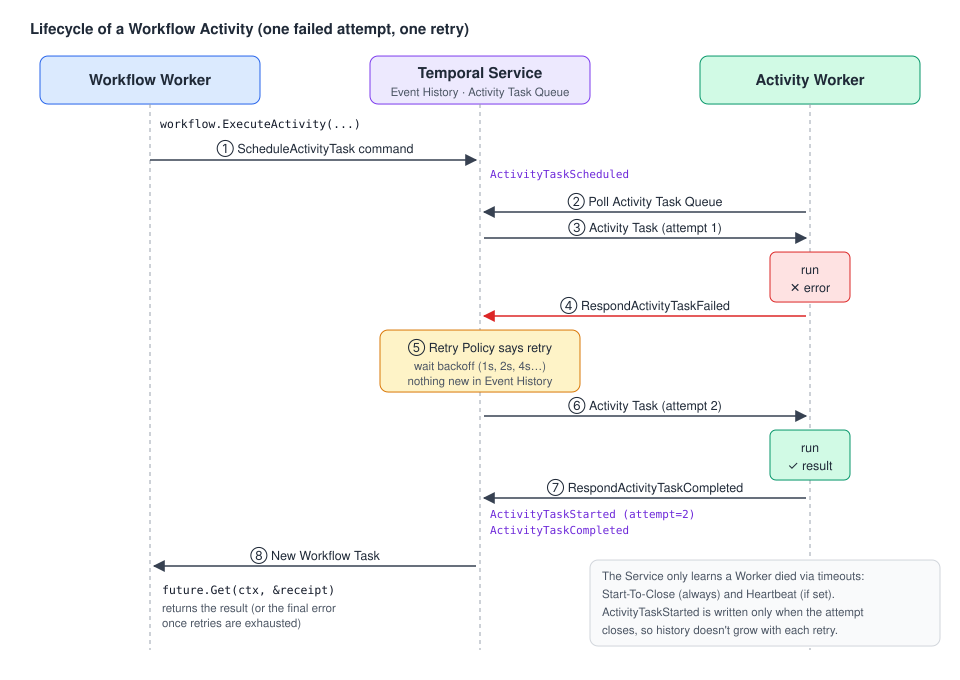

# 03 · Calling Activities from a Workflow (Workflow Activities)

> **Level:** core concept · **Read time:** ~20 min
> **Sources:** [Encyclopedia — Workflow Activity](https://docs.temporal.io/workflow-activity) · [Activity Execution](https://docs.temporal.io/activity-execution) · [Go SDK — Activity Execution](https://docs.temporal.io/develop/go/activities/execution)

A **Workflow Activity** is an Activity Execution started **as a step in a Workflow**. Its lifetime
is scoped to the Workflow Run, and every step is recorded in that Workflow's Event History. Use it
whenever you **orchestrate several steps**: run them in order, branch on a result, compensate a
failure, or wait for a Signal or a Timer between steps.

To run **just one** Activity with no orchestration, a [Standalone Activity](06-standalone-activities.md) is simpler and cheaper.

---

## 1. What happens when you call `workflow.ExecuteActivity`



1. Your Workflow code calls `workflow.ExecuteActivity(...)`. At the end of the Workflow Task, the
   Worker sends a **`ScheduleActivityTask`** command.
2. The Service writes **`ActivityTaskScheduled`** to the Event History and puts an **Activity Task**
   on the Activity's Task Queue.
3. An Activity Worker polling that queue picks up the task and runs your function. This is one
   *attempt*, also called an Activity Task Execution.
4. If the attempt fails, the **Retry Policy** decides whether to try again after a backoff.
5. When an attempt succeeds, or the Activity finally fails, the Service writes
   **`ActivityTaskStarted`** and then **`ActivityTaskCompleted`** (or `Failed`, `TimedOut`, `Canceled`).
6. A new Workflow Task delivers the result to your Workflow, and `future.Get` returns.

> 📝 Temporal doesn't detect a lost task or a crashed Worker directly. It relies on the
> **Start-To-Close Timeout**: when it expires, the attempt is considered failed and retried. If the
> Retry Policy allows only 1 attempt and a timeout happens, the Activity is not retried.

---

## 2. The basic call

`workflow.ExecuteActivity(ctx, activity, args...)` needs:

- a `workflow.Context` that carries **`ActivityOptions`** (set with `workflow.WithActivityOptions`)
- the Activity, either as a **function reference** (the SDK validates the argument types) or as a **string** Activity Type
- the arguments

It returns a **`workflow.Future`** right away. The Activity runs asynchronously.

| `Future` method | Behavior |
| --- | --- |
| `Get(ctx, &result)` | Blocks the Workflow until the Activity Execution closes, then fills `result` or returns the error |
| `IsReady()` | `true` once the result is available, so a later `Get` won't block |

The type you pass to `Get` must match the Activity's return type.

---

## 3. `ActivityOptions` reference

Set with `workflow.WithActivityOptions(ctx, workflow.ActivityOptions{...})` and passed to `ExecuteActivity` through `ctx`.

| Field | Required | Default | What it does |
| --- | --- | --- | --- |
| `StartToCloseTimeout` | **Yes**, or `ScheduleToCloseTimeout` | = `ScheduleToCloseTimeout` | Max duration of **one attempt** |
| `ScheduleToCloseTimeout` | **Yes**, or `StartToCloseTimeout` | ∞ | Max duration of the **whole Execution**, retries included |
| `ScheduleToStartTimeout` | No | ∞ | Max time an Activity Task waits in the queue (not retryable) |
| `HeartbeatTimeout` | No | none | Max gap between two heartbeats |
| `RetryPolicy` | No | 1s initial, ×2 backoff, max 100s, unlimited attempts | How failed attempts are retried |
| `TaskQueue` | No | the Workflow's Task Queue | Routes the Activity Task to a specific pool of Workers |
| `ActivityID` | No | generated | Identifier, unique among the **open** Activities of this Workflow Run |
| `WaitForCancellation` | No | `false` | On cancel, wait for the Activity to acknowledge before returning |

Timeouts and retries are covered in [chapter 04](04-timeouts-retries-heartbeats.md) and cancellation in [chapter 05](05-failures-and-cancellation.md).

> 💡 `workflow.WithActivityOptions` returns a **new** context. Derive one context per kind of call
> when the options differ, for example a short timeout for a DB write and a long one plus a
> heartbeat for a PDF render.

---

## 4. A realistic example: order fulfillment with routing, parallelism and compensation

The `OrderFulfillmentWorkflow`:

1. scores fraud and reserves inventory **in parallel**
2. charges the card
3. creates the shipment on a **dedicated Task Queue** (`warehouse-eu`) served by Workers inside the warehouse network
4. if shipping fails, **compensates**: refunds the charge and releases the stock
5. sends the confirmation and renders the invoice PDF **in parallel**

### Shared types and Activities

```go
// file: fulfillment/types.go
package fulfillment

type OrderLine struct {
	SKU      string
	Quantity int
}

type FulfillOrderInput struct {
	OrderID       string
	CustomerID    string
	CustomerEmail string
	Lines         []OrderLine
	AmountCents   int64
	PaymentToken  string
	ShipTo        string
}

type FulfillOrderResult struct {
	ChargeID       string
	TrackingNumber string
	InvoiceURL     string
}

type ReservationResult struct{ ReservationID string }
type ChargeReceipt struct{ ChargeID string }
type Shipment struct{ TrackingNumber string }
type InvoiceDocument struct{ URL string }
```

```go
// file: fulfillment/activities.go
package fulfillment

import (
	"context"
	"fmt"

	"go.temporal.io/sdk/activity"
)

// InventoryActivities runs on the default "orders" Task Queue.
type InventoryActivities struct{}

func (a *InventoryActivities) ReserveInventory(ctx context.Context, orderID string, lines []OrderLine) (ReservationResult, error) {
	return ReservationResult{ReservationID: "RSV-" + orderID}, nil
}

func (a *InventoryActivities) ReleaseInventory(ctx context.Context, reservationID string) error {
	activity.GetLogger(ctx).Info("Releasing stock", "reservationID", reservationID)
	return nil
}

func (a *InventoryActivities) ScoreFraud(ctx context.Context, customerID string, amountCents int64) (float64, error) {
	return 0.12, nil
}

// PaymentActivities wraps the payment provider.
type PaymentActivities struct{}

func (a *PaymentActivities) ChargeCard(ctx context.Context, orderID, token string, amountCents int64) (ChargeReceipt, error) {
	return ChargeReceipt{ChargeID: "ch_" + orderID}, nil
}

func (a *PaymentActivities) RefundCharge(ctx context.Context, chargeID string) error {
	return nil
}

// ShippingActivities is registered ONLY by the warehouse Workers (Task Queue "warehouse-eu").
type ShippingActivities struct{}

func (a *ShippingActivities) CreateShipment(ctx context.Context, orderID, shipTo string) (Shipment, error) {
	return Shipment{TrackingNumber: fmt.Sprintf("1Z-%s", orderID)}, nil
}

// DocumentActivities renders documents and sends emails.
type DocumentActivities struct{}

func (a *DocumentActivities) GenerateInvoicePDF(ctx context.Context, orderID string, amountCents int64) (InvoiceDocument, error) {
	return InvoiceDocument{URL: "s3://invoices/" + orderID + ".pdf"}, nil
}

func (a *DocumentActivities) SendOrderConfirmation(ctx context.Context, email, orderID, tracking string) error {
	return nil
}
```

### The Workflow

```go
// file: fulfillment/workflow.go
package fulfillment

import (
	"errors"
	"time"

	"go.temporal.io/sdk/temporal"
	"go.temporal.io/sdk/workflow"
)

const WarehouseTaskQueue = "warehouse-eu"

var ErrFraudSuspected = errors.New("order rejected: fraud score too high")

func OrderFulfillmentWorkflow(ctx workflow.Context, in FulfillOrderInput) (FulfillOrderResult, error) {
	logger := workflow.GetLogger(ctx)

	// Default options for quick, idempotent calls.
	ctx = workflow.WithActivityOptions(ctx, workflow.ActivityOptions{
		StartToCloseTimeout: 10 * time.Second,
		RetryPolicy: &temporal.RetryPolicy{
			InitialInterval:    time.Second,
			BackoffCoefficient: 2.0,
			MaximumInterval:    time.Minute,
		},
	})

	var inv *InventoryActivities
	var pay *PaymentActivities
	var ship *ShippingActivities
	var docs *DocumentActivities

	// 1) Fan-out: the two calls run in parallel because we only call Get afterwards.
	fraudF := workflow.ExecuteActivity(ctx, inv.ScoreFraud, in.CustomerID, in.AmountCents)
	reserveF := workflow.ExecuteActivity(ctx, inv.ReserveInventory, in.OrderID, in.Lines)

	var fraudScore float64
	if err := fraudF.Get(ctx, &fraudScore); err != nil {
		return FulfillOrderResult{}, err
	}
	var reservation ReservationResult
	if err := reserveF.Get(ctx, &reservation); err != nil {
		return FulfillOrderResult{}, err
	}
	if fraudScore > 0.8 {
		_ = workflow.ExecuteActivity(ctx, inv.ReleaseInventory, reservation.ReservationID).Get(ctx, nil)
		return FulfillOrderResult{}, ErrFraudSuspected
	}

	// 2) Charge, with an explicit Activity ID that is easy to find in the UI and CLI.
	chargeCtx := workflow.WithActivityOptions(ctx, workflow.ActivityOptions{
		ActivityID:          "charge-" + in.OrderID,
		StartToCloseTimeout: 30 * time.Second,
	})
	var receipt ChargeReceipt
	if err := workflow.ExecuteActivity(chargeCtx, pay.ChargeCard, in.OrderID, in.PaymentToken, in.AmountCents).Get(ctx, &receipt); err != nil {
		_ = workflow.ExecuteActivity(ctx, inv.ReleaseInventory, reservation.ReservationID).Get(ctx, nil)
		return FulfillOrderResult{}, err
	}

	// 3) Route the shipment to the warehouse Workers on another Task Queue.
	shipCtx := workflow.WithActivityOptions(ctx, workflow.ActivityOptions{
		TaskQueue:              WarehouseTaskQueue,
		StartToCloseTimeout:    2 * time.Minute,
		ScheduleToCloseTimeout: 30 * time.Minute, // stop retrying after 30 min in total
	})
	var shipment Shipment
	if err := workflow.ExecuteActivity(shipCtx, ship.CreateShipment, in.OrderID, in.ShipTo).Get(ctx, &shipment); err != nil {
		// 4) Compensation (saga): undo the earlier steps in reverse order.
		logger.Error("Shipment failed, compensating", "error", err)
		_ = workflow.ExecuteActivity(ctx, pay.RefundCharge, receipt.ChargeID).Get(ctx, nil)
		_ = workflow.ExecuteActivity(ctx, inv.ReleaseInventory, reservation.ReservationID).Get(ctx, nil)
		return FulfillOrderResult{}, err
	}

	// 5) Fan-out again: confirmation email and invoice PDF.
	pdfCtx := workflow.WithActivityOptions(ctx, workflow.ActivityOptions{
		StartToCloseTimeout: 5 * time.Minute,
		HeartbeatTimeout:    20 * time.Second,
	})
	invoiceF := workflow.ExecuteActivity(pdfCtx, docs.GenerateInvoicePDF, in.OrderID, in.AmountCents)
	emailF := workflow.ExecuteActivity(ctx, docs.SendOrderConfirmation, in.CustomerEmail, in.OrderID, shipment.TrackingNumber)

	var invoice InvoiceDocument
	if err := invoiceF.Get(ctx, &invoice); err != nil {
		return FulfillOrderResult{}, err
	}
	if err := emailF.Get(ctx, nil); err != nil {
		logger.Warn("Confirmation email failed", "error", err) // not fatal for the order
	}

	return FulfillOrderResult{
		ChargeID:       receipt.ChargeID,
		TrackingNumber: shipment.TrackingNumber,
		InvoiceURL:     invoice.URL,
	}, nil
}
```

### Two Worker pools

The `orders` Workers run the Workflow and most of the Activities. The `warehouse-eu` Workers run only
`ShippingActivities`. The Workflow doesn't care where they run; it only names the Task Queue.

```go
// file: cmd/orders-worker/main.go
package main

import (
	"log"

	"github.com/acme/shop/fulfillment"
	"go.temporal.io/sdk/client"
	"go.temporal.io/sdk/worker"
)

func main() {
	c, err := client.Dial(client.Options{})
	if err != nil {
		log.Fatalln(err)
	}
	defer c.Close()

	w := worker.New(c, "orders", worker.Options{})
	w.RegisterWorkflow(fulfillment.OrderFulfillmentWorkflow)
	w.RegisterActivity(&fulfillment.InventoryActivities{})
	w.RegisterActivity(&fulfillment.PaymentActivities{})
	w.RegisterActivity(&fulfillment.DocumentActivities{})
	log.Fatalln(w.Run(worker.InterruptCh()))
}
```

```go
// file: cmd/warehouse-worker/main.go
package main

import (
	"log"

	"github.com/acme/shop/fulfillment"
	"go.temporal.io/sdk/client"
	"go.temporal.io/sdk/worker"
)

func main() {
	c, err := client.Dial(client.Options{})
	if err != nil {
		log.Fatalln(err)
	}
	defer c.Close()

	w := worker.New(c, fulfillment.WarehouseTaskQueue, worker.Options{})
	w.RegisterActivity(&fulfillment.ShippingActivities{})
	log.Fatalln(w.Run(worker.InterruptCh()))
}
```

---

## 5. Non-blocking result checks with `IsReady`

`Get` blocks. When you want to poll a result without blocking, for example to do other work first, check `IsReady()`:

```go
// file: fulfillment/isready_example.go
package fulfillment

import (
	"time"

	"go.temporal.io/sdk/workflow"
)

func WarmupExampleWorkflow(ctx workflow.Context, orderID string) (string, error) {
	ctx = workflow.WithActivityOptions(ctx, workflow.ActivityOptions{StartToCloseTimeout: time.Minute})
	var docs *DocumentActivities

	invoiceF := workflow.ExecuteActivity(ctx, docs.GenerateInvoicePDF, orderID, int64(0))

	// ... do other deterministic work, start other Activities, wait on timers ...
	if err := workflow.Sleep(ctx, 5*time.Second); err != nil {
		return "", err
	}

	if invoiceF.IsReady() {
		var invoice InvoiceDocument
		if err := invoiceF.Get(ctx, &invoice); err != nil { // does not block: result is ready
			return "", err
		}
		return invoice.URL, nil
	}
	return "pending", nil
}
```

Running many Activity Executions from one Workflow is normal. You can block on each result in turn,
or keep going and collect the results later.

---

## 6. Event History: consequences you must design for

A Workflow Activity writes `ActivityTaskScheduled`, `ActivityTaskStarted` and
`ActivityTaskCompleted` (or `Failed`, `TimedOut`, `Canceled`) to the Workflow's history. This has two consequences:

1. **Replay reuses the recorded result.** When a Workflow replays (after a Worker restart, for
   example), completed Activities are **not executed again**. That is why an LLM call or a
   payment inside an Activity runs exactly once from the Workflow's point of view.
2. **Arguments and return values are persisted.** They count toward the
   [Event History limits](https://docs.temporal.io/workflow-execution/event#event-history-limits).
   Keep payloads small, and watch how many Activities a single Workflow Execution schedules. For
   very long loops, see Continue-As-New.

> 📝 Completed Activities don't re-run on replay. **Before** an Activity reports completion,
> though, nothing is recorded. If the Worker dies before reporting, the attempt is retried. That's
> the idempotency case from [chapter 02](02-defining-activities.md#6-design-for-retries-idempotency-and-granularity).

---

## 7. Activity ID

- If you don't set `ActivityID`, the SDK generates one.
- It must be unique among the **open** Activity Executions of the Workflow Run. A Run may reuse an
  ID once the earlier Activity with that ID has closed.
- Set it explicitly when **something outside the Workflow needs to address the Activity**:
  [async completion by ID](08-async-completion.md), or an operator running
  `temporal activity pause --workflow-id ... --activity-id charge-ORD-1042` ([chapter 10](10-activity-operations.md)).

---

## 8. Cancellation and operator commands (preview)

- A Workflow Activity **can't be cancelled directly**. It gets a cancellation request when its
  Workflow is cancelled, or when the Workflow code cancels the context it was scheduled with. It
  must **heartbeat** to receive it. → [chapter 05](05-failures-and-cancellation.md)
- Operators can **Pause, Unpause, Reset and Update Options** of a running Workflow Activity
  (Public Preview). → [chapter 10](10-activity-operations.md)

---

## Key takeaways

- `workflow.ExecuteActivity` returns a `Future`. Call `Get` now to run steps one after another, or later to run them in parallel.
- Every call needs `StartToCloseTimeout` or `ScheduleToCloseTimeout`.
- `TaskQueue` in `ActivityOptions` routes work to specialized Workers.
- Compensation (saga) is plain Workflow code that calls "undo" Activities.
- Inputs and outputs are stored in the Event History, so keep them small.

⬅️ Previous: [02 · Defining Activities](02-defining-activities.md) · ➡️ Next: [04 · Timeouts, retries & heartbeats](04-timeouts-retries-heartbeats.md)
