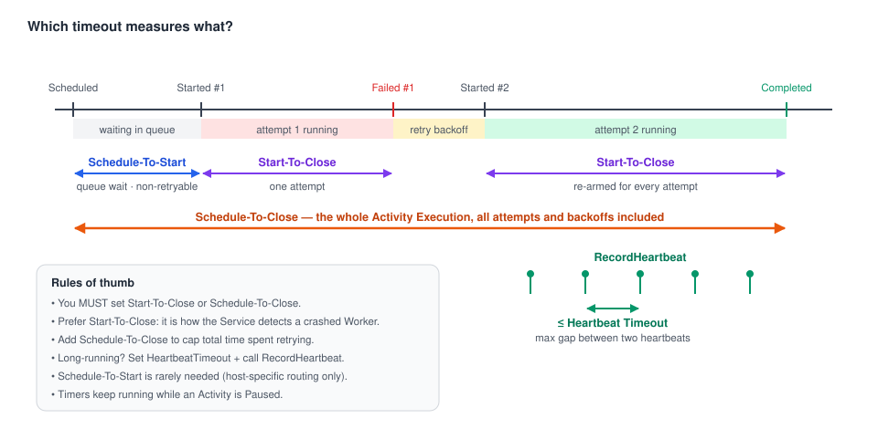
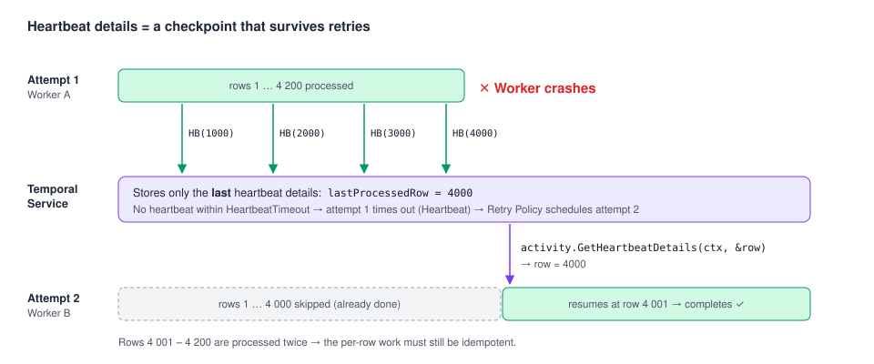

# 04 · Timeouts, Retry Policies & Heartbeats

> **Level:** core concept · **Read time:** ~20 min
> **Sources:** [Go SDK — Activity Timeouts](https://docs.temporal.io/develop/go/activities/timeouts) · [Go SDK — Activity Execution](https://docs.temporal.io/develop/go/activities/execution) · [Encyclopedia — Activity Definition (retry policy)](https://docs.temporal.io/activity-definition#activity-retry-policy)

Timeouts, Retry Policies and Heartbeats are how Temporal makes an Activity durable:

- **Timeouts** tell the Service when to stop waiting. They are its **only** way to notice that a Worker died.
- The **Retry Policy** says what to do after a failure: retry when, how often, and up to when.
- **Heartbeats** let long Activities prove they are alive, save a checkpoint, and receive cancellation.

---

## 1. The four Activity timeouts



| Timeout | Measures | Retryable? | When to set it |
| --- | --- | --- | --- |
| **Start-To-Close** | One attempt, from the moment a Worker picks it up to the result | ✅ a timed-out attempt is retried | **Almost always.** It's how a crashed Worker is detected. Set it a bit above the longest normal attempt. |
| **Schedule-To-Close** | The whole Activity Execution: all attempts and backoffs | ❌ ends the Execution | To cap the **total** time spent retrying (an SLA) |
| **Schedule-To-Start** | Time an Activity Task waits in the queue before a Worker picks it up | ❌ **non-retryable by design**: retrying would put the task back in the same queue | Rarely; mainly for host-specific routing |
| **Heartbeat** | Max gap between two heartbeats of a running attempt | ✅ treated as a failed attempt | For long-running Activities (see §4) |

> ⚠️ **You must set Start-To-Close or Schedule-To-Close.** If you set only Schedule-To-Close,
> Start-To-Close defaults to the same value. Then a single hung attempt can use the whole budget.
> Prefer setting Start-To-Close explicitly.

```go
// file: catalog/timeouts_example.go
package catalog

import (
	"time"

	"go.temporal.io/sdk/workflow"
)

func timeoutsExample(ctx workflow.Context) workflow.Context {
	return workflow.WithActivityOptions(ctx, workflow.ActivityOptions{
		StartToCloseTimeout:    30 * time.Second, // each attempt: 30s max
		ScheduleToCloseTimeout: 10 * time.Minute, // give up after 10 min of retries in total
		// ScheduleToStartTimeout: 1 * time.Minute, // only with host-specific Task Queues
	})
}
```

---

## 2. What Temporal guarantees about attempts

- Temporal guarantees that an Activity Task **either runs or times out**. A task can be lost on its
  way to a Worker, or after the function started and the Worker crashed. Temporal doesn't detect
  this directly: the **Start-To-Close** timeout expires and the Retry Policy applies.
- Each attempt **starts from the beginning of your function**, unless you use Heartbeat details as a checkpoint (§5).

---

## 3. Retry Policy

Activities **retry automatically by default**: exponential backoff and **unlimited attempts**,
bounded only by Schedule-To-Close. The default policy is:

```go
// file: catalog/retry_default.go
package catalog

import (
	"time"

	"go.temporal.io/sdk/temporal"
)

// What you get if you set no RetryPolicy at all:
var DefaultActivityRetryPolicy = &temporal.RetryPolicy{
	InitialInterval:        time.Second,
	BackoffCoefficient:     2.0,
	MaximumInterval:        100 * time.Second, // 100 × InitialInterval
	MaximumAttempts:        0,                 // 0 = unlimited
	NonRetryableErrorTypes: []string{},        // none
}
```

| Field | Meaning |
| --- | --- |
| `InitialInterval` | Delay before the first retry |
| `BackoffCoefficient` | Multiplier applied to the delay after each retry |
| `MaximumInterval` | Upper bound for the delay |
| `MaximumAttempts` | `0` = unlimited, `1` = **no retries** (at-most-once) |
| `NonRetryableErrorTypes` | `ApplicationError` *types* that stop retries immediately |

A custom policy **replaces the individual fields** you set. You still need a timeout.

### Example: a supplier API

```go
// file: catalog/activities.go
package catalog

import (
	"context"
	"errors"
	"fmt"
	"time"

	"go.temporal.io/sdk/activity"
	"go.temporal.io/sdk/temporal"
)

type SupplierPriceRequest struct {
	SupplierID string
	SKU        string
}

type SupplierPrice struct {
	SKU        string
	PriceCents int64
}

// Errors returned by the (fake) supplier HTTP client.
var (
	ErrUnknownSKU  = errors.New("supplier: unknown SKU")
	ErrRateLimited = errors.New("supplier: 429 too many requests")
)

type SupplierClient interface {
	GetPrice(ctx context.Context, supplierID, sku string) (int64, error)
}

type CatalogActivities struct {
	Supplier SupplierClient
	Rows     RowSource
}

func (a *CatalogActivities) FetchSupplierPrice(ctx context.Context, in SupplierPriceRequest) (SupplierPrice, error) {
	price, err := a.Supplier.GetPrice(ctx, in.SupplierID, in.SKU)
	switch {
	case errors.Is(err, ErrUnknownSKU):
		// Retrying won't help: fail the Activity Execution now.
		return SupplierPrice{}, temporal.NewNonRetryableApplicationError(
			fmt.Sprintf("SKU %s not sold by %s", in.SKU, in.SupplierID), "UnknownSKU", err)

	case errors.Is(err, ErrRateLimited):
		// Retry, but wait longer on each attempt instead of using the policy's interval.
		attempt := activity.GetInfo(ctx).Attempt
		return SupplierPrice{}, temporal.NewApplicationErrorWithOptions(
			"supplier rate limited", "RateLimited", temporal.ApplicationErrorOptions{
				NextRetryDelay: 3 * time.Second * time.Duration(attempt),
				Cause:          err,
			})

	case err != nil:
		return SupplierPrice{}, err // plain error: retryable, default backoff
	}
	return SupplierPrice{SKU: in.SKU, PriceCents: price}, nil
}
```

Three ways to stop or shape retries:

1. **From the Activity:** return `temporal.NewNonRetryableApplicationError(msg, type, cause)`.
2. **From the caller:** list error *types* in `RetryPolicy.NonRetryableErrorTypes`. Only that caller treats them as fatal.
3. **Override the next delay:** return an `ApplicationError` with `NextRetryDelay`. It **replaces** the interval the Retry Policy would have computed for that retry.

```go
// file: catalog/workflow_prices.go
package catalog

import (
	"time"

	"go.temporal.io/sdk/temporal"
	"go.temporal.io/sdk/workflow"
)

func RefreshSupplierPricesWorkflow(ctx workflow.Context, supplierID string, skus []string) (map[string]int64, error) {
	ctx = workflow.WithActivityOptions(ctx, workflow.ActivityOptions{
		StartToCloseTimeout:    15 * time.Second,
		ScheduleToCloseTimeout: 5 * time.Minute,
		RetryPolicy: &temporal.RetryPolicy{
			InitialInterval:        2 * time.Second,
			BackoffCoefficient:     2.0,
			MaximumInterval:        30 * time.Second,
			MaximumAttempts:        8,
			NonRetryableErrorTypes: []string{"UnknownSKU", "InvalidSupplier"},
		},
	})

	var a *CatalogActivities
	prices := make(map[string]int64, len(skus))
	for _, sku := range skus {
		var p SupplierPrice
		err := workflow.ExecuteActivity(ctx, a.FetchSupplierPrice, SupplierPriceRequest{SupplierID: supplierID, SKU: sku}).Get(ctx, &p)
		if err != nil {
			workflow.GetLogger(ctx).Warn("price refresh failed", "sku", sku, "error", err)
			continue
		}
		prices[sku] = p.PriceCents
	}
	return prices, nil
}
```

> 💡 **At-most-once:** for something that must never run twice and can't be made idempotent, set
> `MaximumAttempts: 1`. You then handle the failure yourself in the Workflow.

> ⚠️ Don't hand-roll retry loops inside the Activity. Return the error and let the policy work. You
> keep metrics and UI visibility, and your timeouts stay short.

---

## 4. Heartbeats

An **Activity Heartbeat** is a ping from the Worker running the Activity to the Service. It says
"I'm alive and making progress". Heartbeats give you three things:

| Benefit | How |
| --- | --- |
| **Fast failure detection** for long attempts | If no heartbeat arrives within `HeartbeatTimeout`, the attempt fails (timeout type `Heartbeat`) and is retried. You don't wait for a long Start-To-Close. |
| **Checkpointing** | Heartbeat `details` are stored. The **next attempt** can read the last ones and resume. |
| **Cancellation delivery** | Cancel, Pause and Reset requests are delivered **only through the heartbeat response**. An Activity that never heartbeats can't be cancelled while it runs. |

Rules of thumb:

- An Activity should **either finish within a few minutes or heartbeat**.
- Set `HeartbeatTimeout` **and** call `activity.RecordHeartbeat` well within that interval.
- The Worker **throttles** heartbeats, so not every call reaches the Service, and cancellation can arrive a bit later than expected.

```go
// file: catalog/heartbeat_simple.go
package catalog

import (
	"context"
	"fmt"

	"go.temporal.io/sdk/activity"
)

type ResizeImagesInput struct {
	ProductID string
	ImageKeys []string
}

type ResizeImagesResult struct {
	ProcessedCount int
}

func (a *CatalogActivities) ResizeProductImages(ctx context.Context, in ResizeImagesInput) (ResizeImagesResult, error) {
	for i, key := range in.ImageKeys {
		// ... download, resize, upload `key` ...
		_ = key
		activity.RecordHeartbeat(ctx, fmt.Sprintf("processed image %d/%d", i+1, len(in.ImageKeys)))
	}
	return ResizeImagesResult{ProcessedCount: len(in.ImageKeys)}, nil
}
```

---

## 5. Heartbeat details as a resumable checkpoint



A retry **restarts your function from the top**. It does not resume in the middle. What carries over
is the **last recorded heartbeat details**. Read them at the start and skip the work that is
already done.

```go
// file: catalog/import.go
package catalog

import (
	"context"
	"time"

	"go.temporal.io/sdk/activity"
)

// RowSource streams rows of a large supplier CSV stored in object storage.
type RowSource interface {
	Count(ctx context.Context, fileKey string) (int, error)
	UpsertRow(ctx context.Context, fileKey string, row int) error // idempotent upsert by SKU
}

type ImportCatalogInput struct {
	FileKey string // e.g. "s3://supplier-feeds/acme-2026-10-23.csv"
}

type ImportCatalogResult struct {
	RowsImported int
}

func (a *CatalogActivities) ImportProductCatalog(ctx context.Context, in ImportCatalogInput) (ImportCatalogResult, error) {
	logger := activity.GetLogger(ctx)

	// 1) Resume from the last checkpoint if a previous attempt recorded one.
	startRow := 0
	if activity.HasHeartbeatDetails(ctx) {
		var lastDone int
		if err := activity.GetHeartbeatDetails(ctx, &lastDone); err == nil {
			startRow = lastDone + 1
			logger.Info("Resuming import", "fromRow", startRow, "attempt", activity.GetInfo(ctx).Attempt)
		}
	}

	total, err := a.Rows.Count(ctx, in.FileKey)
	if err != nil {
		return ImportCatalogResult{}, err
	}

	// 2) Process and heartbeat the index of the last finished row.
	for row := startRow; row < total; row++ {
		select {
		case <-ctx.Done(): // cancelled / timed out / paused: stop cleanly (chapter 05)
			return ImportCatalogResult{}, ctx.Err()
		default:
		}
		if err := a.Rows.UpsertRow(ctx, in.FileKey, row); err != nil {
			return ImportCatalogResult{}, err // retried; next attempt resumes after the last heartbeat
		}
		activity.RecordHeartbeat(ctx, row)
	}
	return ImportCatalogResult{RowsImported: total}, nil
}

// ImportTimeouts: a long Start-To-Close, but a short Heartbeat Timeout so a dead
// Worker is detected in ~30s instead of 2h.
const (
	ImportStartToClose = 2 * time.Hour
	ImportHeartbeat    = 30 * time.Second
)
```

> ⚠️ The rows processed between the last heartbeat that **reached the Service** and the crash run
> again. Keep the per-row work idempotent (an upsert, not an insert).

### Setting the Heartbeat Timeout and reading heartbeat details on failure

When an attempt times out because of a missed heartbeat, and no retry is left, the Workflow gets a
`*temporal.TimeoutError` with `TimeoutType() == TIMEOUT_TYPE_HEARTBEAT`. The **last heartbeat
details** are attached to it.

```go
// file: catalog/workflow_import.go
package catalog

import (
	"errors"

	enumspb "go.temporal.io/api/enums/v1"
	"go.temporal.io/sdk/temporal"
	"go.temporal.io/sdk/workflow"
)

func ImportCatalogWorkflow(ctx workflow.Context, fileKey string) (int, error) {
	ctx = workflow.WithActivityOptions(ctx, workflow.ActivityOptions{
		StartToCloseTimeout: ImportStartToClose,
		HeartbeatTimeout:    ImportHeartbeat,
		RetryPolicy:         &temporal.RetryPolicy{MaximumAttempts: 5},
	})

	var a *CatalogActivities
	var res ImportCatalogResult
	err := workflow.ExecuteActivity(ctx, a.ImportProductCatalog, ImportCatalogInput{FileKey: fileKey}).Get(ctx, &res)

	var timeoutErr *temporal.TimeoutError
	if errors.As(err, &timeoutErr) && timeoutErr.TimeoutType() == enumspb.TIMEOUT_TYPE_HEARTBEAT {
		var lastRow int
		if timeoutErr.HasLastHeartbeatDetails() {
			_ = timeoutErr.LastHeartbeatDetails(&lastRow)
		}
		workflow.GetLogger(ctx).Error("import kept losing its Worker", "lastCheckpointRow", lastRow)
		return lastRow, err
	}
	if err != nil {
		return 0, err
	}
	return res.RowsImported, nil
}
```

### Heartbeating from outside the Worker

If the work is done by another system, as in [async completion](08-async-completion.md), that system
can heartbeat with the **Task Token** through a Temporal Client:

```go
// file: catalog/external_heartbeat.go
package catalog

import (
	"context"

	"go.temporal.io/sdk/client"
)

// ReportTranscodeProgress runs in the external transcoding service, not in a Worker.
func ReportTranscodeProgress(ctx context.Context, c client.Client, taskToken []byte, percent int) error {
	return c.RecordActivityHeartbeat(ctx, taskToken, percent)
}
```

---

## 6. Picking values: a cheat sheet

| Activity kind | Start-To-Close | Schedule-To-Close | Heartbeat | Retry |
| --- | --- | --- | --- | --- |
| DB write / fast API call | 5–30 s | optional (SLA) | – | default |
| Payment charge (idempotent key) | 30 s | 10–30 min | – | default + `NonRetryableErrorTypes: {"CardDeclined"}` |
| File / media processing (minutes–hours) | ≥ longest run | optional | 10–60 s + checkpoint | default |
| Non-idempotent legacy call | short | – | – | `MaximumAttempts: 1` |
| Waiting for a human via async completion | days | – | optional, from the external system | small `MaximumAttempts` |

---

## Key takeaways

- Set **Start-To-Close** on every call. Add **Schedule-To-Close** to cap the total retry time.
- Default retries are **unlimited** with exponential backoff. Stop them with non-retryable errors or `MaximumAttempts`.
- `NextRetryDelay` lets the Activity choose its next backoff, for example to honor a `Retry-After`.
- Long Activities **heartbeat**: you get faster failure detection, checkpoints, and cancellation delivery.
- Heartbeat details survive retries, but a retry restarts the function, so resume explicitly.

⬅️ Previous: [03 · Workflow Activities](03-workflow-activities.md) · ➡️ Next: [05 · Failures, cancellation & benign errors](05-failures-and-cancellation.md)
