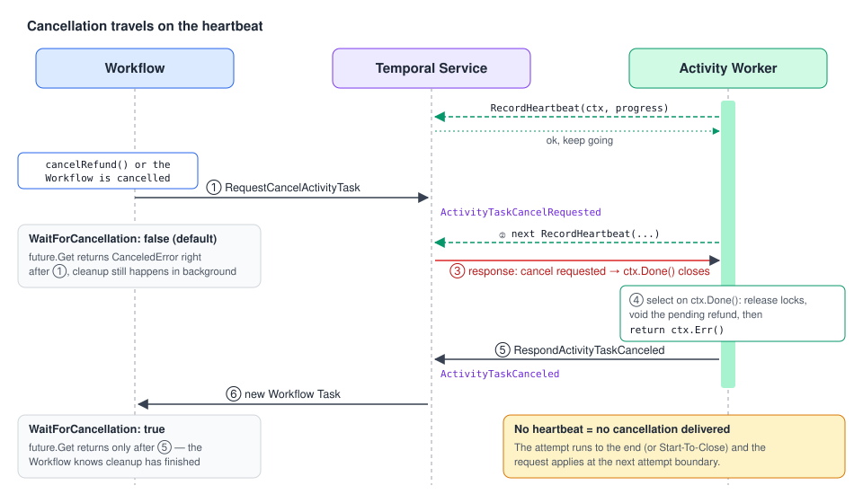

# 05 · Failures, Cancellation & Benign errors

> **Level:** sub-feature · **Read time:** ~20 min
> **Sources:** [Encyclopedia — Activity Execution (Cancellation)](https://docs.temporal.io/activity-execution#cancellation) · [Workflow Activity (Cancellation)](https://docs.temporal.io/workflow-activity#cancellation) · [Go SDK — Benign exceptions](https://docs.temporal.io/develop/go/activities/benign-exceptions) · [Go SDK — Activity Execution](https://docs.temporal.io/develop/go/activities/execution)

Chapter 04 covered how Temporal **retries**. This chapter covers what happens when retrying is
over or no longer wanted:

1. How an Activity **failure** reaches your Workflow, and how to inspect it.
2. How to keep **expected** failures out of your alerts (benign errors).
3. How **cancellation** works, why it needs heartbeats, and how to clean up properly.

---

## 1. Anatomy of an Activity failure in Go

An Activity Execution **fails** when it runs out of retries, returns a **non-retryable** error, hits
Schedule-To-Close, or is **cancelled**. The Workflow then gets an error from `future.Get`:

```
*temporal.ActivityError            ← always the outer wrapper (ActivityType, ActivityID, RetryState…)
   └─ cause, one of:
        *temporal.ApplicationError  ← your Activity returned an error (Type(), Details(), NonRetryable())
        *temporal.TimeoutError      ← a timeout fired (TimeoutType(), LastHeartbeatDetails())
        *temporal.CanceledError     ← the Activity was cancelled
        *temporal.PanicError        ← your Activity panicked
```

Use `errors.As` to branch on the cause:

```go
// file: billing/types.go
package billing

type ChargeSubscriptionInput struct {
	SubscriptionID string
	CustomerID     string
	AmountCents    int64
}

type ChargeResult struct {
	ChargeID string
}

// DeclineDetails travels inside an ApplicationError as structured details.
type DeclineDetails struct {
	DeclineCode string // e.g. "insufficient_funds"
	CanRetryAt  string
}
```

```go
// file: billing/activities.go
package billing

import (
	"context"

	"go.temporal.io/sdk/temporal"
)

type BillingActivities struct{}

func (a *BillingActivities) ChargeSubscription(ctx context.Context, in ChargeSubscriptionInput) (ChargeResult, error) {
	declined := in.AmountCents > 100_000_00 // pretend the bank said no
	if declined {
		// Typed, non-retryable, with structured details for the Workflow.
		return ChargeResult{}, temporal.NewNonRetryableApplicationError(
			"card declined", "CardDeclined", nil,
			DeclineDetails{DeclineCode: "insufficient_funds", CanRetryAt: "2026-11-01"},
		)
	}
	return ChargeResult{ChargeID: "ch_" + in.SubscriptionID}, nil
}
```

```go
// file: billing/renewal_workflow.go
package billing

import (
	"errors"
	"time"

	"go.temporal.io/sdk/temporal"
	"go.temporal.io/sdk/workflow"
)

type RenewalOutcome struct {
	Status      string // "renewed" | "dunning" | "retry-later"
	ChargeID    string
	DeclineCode string
}

func SubscriptionRenewalWorkflow(ctx workflow.Context, in ChargeSubscriptionInput) (RenewalOutcome, error) {
	ctx = workflow.WithActivityOptions(ctx, workflow.ActivityOptions{
		StartToCloseTimeout:    30 * time.Second,
		ScheduleToCloseTimeout: 15 * time.Minute,
	})

	var a *BillingActivities
	var res ChargeResult
	err := workflow.ExecuteActivity(ctx, a.ChargeSubscription, in).Get(ctx, &res)
	if err == nil {
		return RenewalOutcome{Status: "renewed", ChargeID: res.ChargeID}, nil
	}

	var appErr *temporal.ApplicationError
	var timeoutErr *temporal.TimeoutError
	var canceledErr *temporal.CanceledError

	switch {
	case errors.As(err, &appErr) && appErr.Type() == "CardDeclined":
		var details DeclineDetails
		_ = appErr.Details(&details)
		return RenewalOutcome{Status: "dunning", DeclineCode: details.DeclineCode}, nil

	case errors.As(err, &timeoutErr):
		// Schedule-To-Close elapsed: the payment provider was down for 15 minutes.
		return RenewalOutcome{Status: "retry-later"}, nil

	case errors.As(err, &canceledErr):
		return RenewalOutcome{}, err

	default:
		var actErr *temporal.ActivityError
		if errors.As(err, &actErr) {
			workflow.GetLogger(ctx).Error("charge failed",
				"activityType", actErr.ActivityType().GetName(),
				"retryState", actErr.RetryState().String())
		}
		return RenewalOutcome{}, err
	}
}
```

> 💡 The **type string** of an `ApplicationError` (`"CardDeclined"`) is what
> `RetryPolicy.NonRetryableErrorTypes` matches. Pick stable, explicit names.

---

## 2. Benign errors: expected failures without the noise

Some failures are **part of normal operation**: polling a warehouse system that is "not ready yet",
or a transient failure you fully expect to be retried. Reported as normal errors, they flood logs,
metrics and traces and hide real incidents.

Mark them **benign** with `ApplicationErrorCategoryBenign`. A benign Activity error:

- is logged at **DEBUG** instead of ERROR/WARN
- **doesn't emit** Activity failure metrics
- doesn't set the OpenTelemetry span status to **ERROR**

It **still fails the attempt** and is **retried** like any other error, and your Workflow still sees it if it's final.

```go
// file: billing/benign.go
package billing

import (
	"context"
	"errors"

	"go.temporal.io/sdk/temporal"
)

var errExportNotReady = errors.New("bank export not generated yet")

type BankStatementRequest struct {
	AccountID string
	Date      string // "2026-10-22"
}

// FetchBankStatement polls the bank's SFTP until the daily file appears.
// "Not there yet" is expected for a few hours every morning: keep it out of alerts.
func (a *BillingActivities) FetchBankStatement(ctx context.Context, req BankStatementRequest) (string, error) {
	path, err := lookForStatementFile(req)
	if errors.Is(err, errExportNotReady) {
		return "", temporal.NewApplicationErrorWithOptions(
			err.Error(),
			"StatementNotReady",
			temporal.ApplicationErrorOptions{
				Category: temporal.ApplicationErrorCategoryBenign,
			},
		)
	}
	if err != nil {
		return "", err // a real problem: normal ERROR log + failure metric
	}
	return path, nil
}

func lookForStatementFile(req BankStatementRequest) (string, error) {
	return "", errExportNotReady
}
```

---

## 3. Cancellation

### 3.1 Why cancellation exists

Cancellation does two things:

- it **tells the Activity it can stop working**, and
- it **gives the Activity time to clean up** what it created (locks, temporary files, a half-created resource).

### 3.2 When an Activity receives a cancellation

- **Cancellation was requested.** This usually comes from a Workflow cancellation, or from the
  Workflow cancelling the context it used to schedule the Activity. A **Workflow Activity can't be
  cancelled directly** from outside; it goes through its Workflow. Standalone Activities can be
  cancelled directly ([chapter 06](06-standalone-activities.md)).
- **The Service considers the attempt failed** because a timeout fired, for example a missed
  heartbeat. The failure message is `TIMED_OUT`.
- **The Workflow Run is closed.** The failure message is `NOT_FOUND`.
- **An operator Paused or Reset it** ([chapter 10](10-activity-operations.md)).
- Depending on the SDK: the Worker is shutting down, heartbeat details can't be serialized, or a Worker-side timeout fired.

### 3.3 The golden rule: **no heartbeat, no cancellation**



The Service delivers a cancellation request in the **response to a heartbeat**. An Activity that
never calls `RecordHeartbeat` keeps running until it returns, or until Start-To-Close expires. Also:

- Heartbeats are **throttled**, so the cancellation may arrive a bit later than you expect.
- Cancellation is requested **only once**. Asking again doesn't deliver a second request.
- Your Activity can **accept** it (let the cancellation error propagate) or **ignore** it (keep going and return a normal result).

In Go, an accepted cancellation shows up as **`ctx.Done()` closing**, and you return `ctx.Err()`.
`context.Cause(ctx)` tells you **why** the context was cancelled. That's how you tell an operator
**Pause** or **Reset** apart from a real cancellation (Go SDK v1.34+).

### 3.4 Activity side: a cancellable, cleaning-up Activity

Usually the work is one long blocking call, like rendering a print job. Heartbeat from a **background goroutine** so cancellation can reach you:

```go
// file: shipping/activities.go
package shipping

import (
	"context"
	"errors"
	"time"

	"go.temporal.io/sdk/activity"
)

type PrintLabelInput struct {
	ShipmentID string
	PrinterID  string
}

type LabelPrinter interface {
	StartJob(ctx context.Context, shipmentID, printerID string) (jobID string, err error)
	WaitJob(ctx context.Context, jobID string) error // blocks; honors ctx
	CancelJob(ctx context.Context, jobID string) error
}

type ShippingActivities struct {
	Printer LabelPrinter
}

func (a *ShippingActivities) PrintShippingLabel(ctx context.Context, in PrintLabelInput) error {
	logger := activity.GetLogger(ctx)

	jobID, err := a.Printer.StartJob(ctx, in.ShipmentID, in.PrinterID)
	if err != nil {
		return err
	}

	// Heartbeat in the background so cancellation can be delivered while WaitJob blocks.
	stopHeartbeat := make(chan struct{})
	defer close(stopHeartbeat)
	go func() {
		ticker := time.NewTicker(5 * time.Second) // well under HeartbeatTimeout
		defer ticker.Stop()
		for {
			select {
			case <-ticker.C:
				activity.RecordHeartbeat(ctx, jobID)
			case <-stopHeartbeat:
				return
			case <-ctx.Done():
				return
			}
		}
	}()

	err = a.Printer.WaitJob(ctx, jobID)
	if ctx.Err() == nil {
		return err // finished (successfully or not) without being interrupted
	}

	// Interrupted: find out why before cleaning up.
	cause := context.Cause(ctx)
	switch {
	case errors.Is(cause, activity.ErrActivityPaused):
		// Paused by an operator: the Activity will resume later. Keep the print job.
		logger.Info("Paused, keeping print job", "jobID", jobID)
	case errors.Is(cause, activity.ErrActivityReset):
		logger.Info("Reset, the next attempt starts over", "jobID", jobID)
		a.cancelJob(jobID)
	default:
		// Real cancellation (or the Workflow closed): release the printer.
		logger.Info("Cancelled, releasing printer", "jobID", jobID, "cause", cause)
		a.cancelJob(jobID)
	}
	return ctx.Err() // accept the interruption: report the attempt as cancelled
}

// cancelJob uses a fresh context: the Activity context is already cancelled.
func (a *ShippingActivities) cancelJob(jobID string) {
	cleanupCtx, cancel := context.WithTimeout(context.Background(), 10*time.Second)
	defer cancel()
	_ = a.Printer.CancelJob(cleanupCtx, jobID)
}
```

> 💡 **Graceful Worker shutdown:** `activity.GetWorkerStopChannel(ctx)` closes when the Worker
> begins stopping. The Worker then waits `WorkerStopTimeout` before it cancels the Activity context.
> Select on it to checkpoint (heartbeat) and exit early.

### 3.5 Workflow side: requesting cancellation and `WaitForCancellation`

A Workflow cancels an Activity by **cancelling the context** it scheduled it with
(`workflow.WithCancel`). It also decides whether to **wait** for the Activity to acknowledge:

| `WaitForCancellation` | `future.Get` returns… | Use when |
| --- | --- | --- |
| `false` *(default)* | right away, with a `CanceledError` | You don't care when cleanup finishes |
| `true` | only after the Activity has acknowledged the cancellation (cancelled, completed or failed) | The next steps depend on the cleanup having finished |

```go
// file: shipping/workflow.go
package shipping

import (
	"errors"
	"time"

	"go.temporal.io/sdk/temporal"
	"go.temporal.io/sdk/workflow"
)

const CancelShipmentSignal = "cancel-shipment"

// PrepareShipmentWorkflow prints a label, unless the customer cancels the order first.
func PrepareShipmentWorkflow(ctx workflow.Context, in PrintLabelInput) (string, error) {
	printCtx, cancelPrint := workflow.WithCancel(ctx)
	printCtx = workflow.WithActivityOptions(printCtx, workflow.ActivityOptions{
		StartToCloseTimeout: 10 * time.Minute,
		HeartbeatTimeout:    15 * time.Second, // required to receive the cancellation
		WaitForCancellation: true,             // wait until the printer is released
	})

	var a *ShippingActivities
	printF := workflow.ExecuteActivity(printCtx, a.PrintShippingLabel, in)

	cancelCh := workflow.GetSignalChannel(ctx, CancelShipmentSignal)
	sel := workflow.NewSelector(ctx)
	sel.AddFuture(printF, func(workflow.Future) {})
	sel.AddReceive(cancelCh, func(c workflow.ReceiveChannel, more bool) {
		c.Receive(ctx, nil)
		cancelPrint() // ① request Activity cancellation
	})
	sel.Select(ctx)

	err := printF.Get(ctx, nil) // with WaitForCancellation=true, returns after cleanup
	var canceled *temporal.CanceledError
	switch {
	case errors.As(err, &canceled):
		return "cancelled", nil
	case err != nil:
		return "", err
	}
	return "label-printed", nil
}
```

### 3.6 Cleaning up after the *Workflow* itself is cancelled

When the whole Workflow is cancelled, its root `ctx` is cancelled too, so any new Activity scheduled
with it fails immediately. To run compensation Activities after that, use a **disconnected context**:

```go
// file: shipping/cleanup.go
package shipping

import (
	"context"
	"errors"
	"time"

	"go.temporal.io/sdk/workflow"
)

type CarrierActivities struct{}

func (c *CarrierActivities) BookCarrierSlot(ctx context.Context, shipmentID string) error {
	return nil
}

func (c *CarrierActivities) ReleaseCarrierSlot(ctx context.Context, shipmentID string) error {
	return nil
}

func BookCarrierWorkflow(ctx workflow.Context, shipmentID string) (err error) {
	ao := workflow.ActivityOptions{StartToCloseTimeout: time.Minute}
	ctx = workflow.WithActivityOptions(ctx, ao)
	var c *CarrierActivities

	defer func() {
		if !errors.Is(ctx.Err(), workflow.ErrCanceled) {
			return
		}
		// The Workflow was cancelled: run cleanup on a context that is NOT cancelled.
		cleanupCtx, _ := workflow.NewDisconnectedContext(ctx)
		cleanupCtx = workflow.WithActivityOptions(cleanupCtx, ao)
		_ = workflow.ExecuteActivity(cleanupCtx, c.ReleaseCarrierSlot, shipmentID).Get(cleanupCtx, nil)
	}()

	if err := workflow.ExecuteActivity(ctx, c.BookCarrierSlot, shipmentID).Get(ctx, nil); err != nil {
		return err
	}
	// ... wait for the pickup: timers, signals ...
	return workflow.Sleep(ctx, 24*time.Hour)
}
```

---

## Key takeaways

- `future.Get` returns `*ActivityError` wrapping the real cause. Use `errors.As` to get `ApplicationError`, `TimeoutError` or `CanceledError`.
- Give `ApplicationError`s stable **types** and structured **details**. That is what policies and Workflows branch on.
- Mark expected noise as **benign**: it is still retried, but no ERROR logs, failure metrics or ERROR spans.
- **No heartbeat, no cancellation.** Heartbeat from a goroutine during long blocking calls.
- In Go, cancellation = `ctx.Done()`. Use `context.Cause(ctx)` to tell **Pause** and **Reset** apart from cancel. Clean up with a fresh context.
- `WaitForCancellation: true` makes the Workflow wait for cleanup. `NewDisconnectedContext` runs compensation after the Workflow itself was cancelled.

⬅️ Previous: [04 · Timeouts, retries & heartbeats](04-timeouts-retries-heartbeats.md) · ➡️ Next: [06 · Standalone Activities](06-standalone-activities.md)
