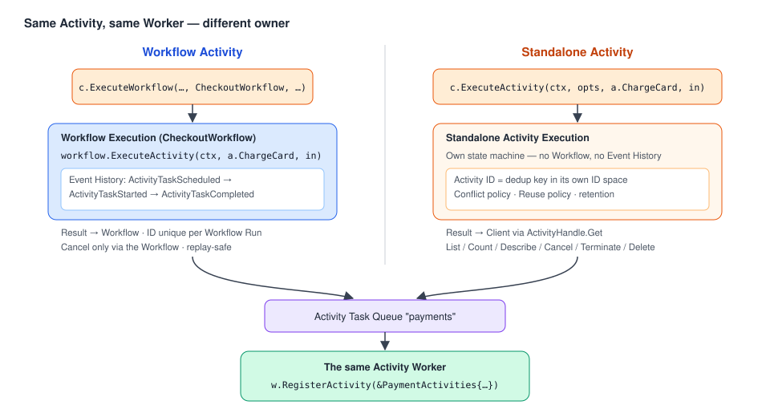
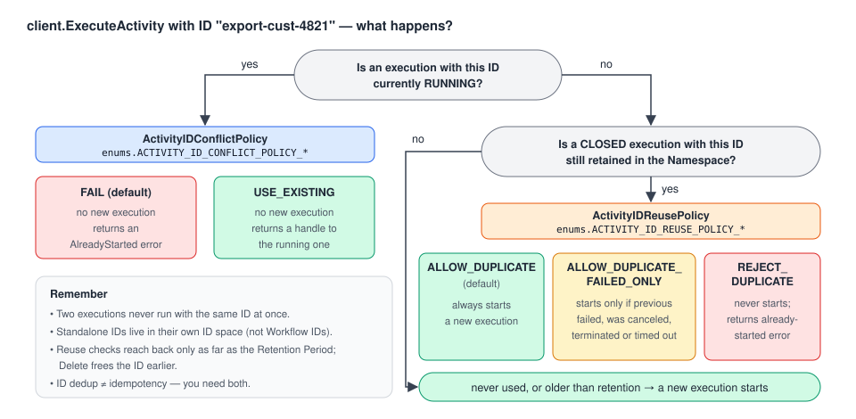

# 06 · Standalone Activities: durable jobs without a Workflow

> **Level:** execution mode · **Read time:** ~25 min
> **Sources:** [Encyclopedia — Standalone Activity](https://docs.temporal.io/standalone-activity) · [Go SDK — Standalone Activities quickstart](https://docs.temporal.io/develop/go/activities/standalone-activities-quickstart) · [Go SDK — Standalone Activities feature guide](https://docs.temporal.io/develop/go/activities/standalone-activities)

---

## 1. The problem: "I just need one reliable background job"

You often need to run **one** thing reliably: send an email, process a webhook, sync a record, export
a customer's data, transcode a file. Before Standalone Activities, Temporal gave you two options,
neither of them great:

- wrap the single call in a one-step Workflow, which adds code, latency and cost, or
- use a separate job queue (Celery, Sidekiq, SQS + workers), which has its own retry semantics, visibility and operations.

A **Standalone Activity** is a top-level Activity Execution **started directly by a Client, with no
Workflow**. It is **Temporal's job queue**: the job is persisted, dispatched to one of your Workers,
retried on failure, and **addressable by its ID** the whole time.

| In a job queue | In Temporal |
| --- | --- |
| The function a job runs | An **Activity Definition**, a normal function registered by name |
| One enqueued job | A **Standalone Activity Execution**, one durable run addressable by its Activity ID |
| The queue | A **Task Queue** that your Workers poll |
| A worker process | An **Activity Worker**, your process running your code |

> **Use it** for a single Activity run reliably. **Use a Workflow** when steps depend on each other.
> The two coexist in the same application, and you can add Workflow orchestration later **without
> rewriting the Activity**.



| | Standalone Activity | Workflow Activity |
| --- | --- | --- |
| Started by | a Client (`client.ExecuteActivity`) | Workflow code (`workflow.ExecuteActivity`) |
| Lifetime | Independent top-level execution | Scoped to the Workflow Run |
| Result delivered to | The Client, through an `ActivityHandle` | The Workflow |
| Event History | **None** (own state machine, no replay) | Yes |
| Activity ID space | **Separate** ID space with dedup policies | Scoped to the Workflow Run |
| Cancel / Terminate / Delete directly | ✅ | ❌ (only through the Workflow) |
| Cost and latency for a single call | Fewer Billable Actions, fewer round trips | Higher |
| Best for | Durable job processing | Multi-step orchestration |

The execution semantics are the **same**: queued, retried until success or Schedule-To-Close, and
your code must be **idempotent**.

---

## 2. Prerequisites

| Component | Minimum version |
| --- | --- |
| Go | 1.24+ |
| Temporal Go SDK | **v1.49.0+** |
| Temporal CLI | **v1.9.1+** (`brew install temporal`, check with `temporal --version`) |
| Temporal Server | **v1.32.0+** (the CLI dev server bundles one) |
| Temporal Cloud | GA in all regions |

```bash
temporal server start-dev   # dev server on localhost:7233, Web UI on http://localhost:8233
```

---

## 3. Define and register the Activity (nothing new)

The Activity Definition and Worker registration are **identical** to regular Activities. The Worker
doesn't know, and doesn't care, whether a Workflow or a Client starts the Activity.

Our example is a GDPR-style **customer data export** job, plus an **abandoned-cart reminder** email:

```go
// file: jobs/activities.go
package jobs

import (
	"context"
	"fmt"
	"time"

	"go.temporal.io/sdk/activity"
)

const TaskQueue = "customer-jobs"

type ExportCustomerDataInput struct {
	CustomerID  string
	Format      string // "json" | "csv"
	RequestedBy string
}

type ExportCustomerDataResult struct {
	ArchiveURL string
	Records    int
}

type CartReminderInput struct {
	CustomerID string
	CartID     string
	Email      string
}

type DataExportActivities struct {
	// e.g. a DB pool, an S3 client, an email provider...
}

// ExportCustomerData gathers every table that mentions the customer and uploads a ZIP.
// It heartbeats per table so it can resume and be cancelled.
func (a *DataExportActivities) ExportCustomerData(ctx context.Context, in ExportCustomerDataInput) (ExportCustomerDataResult, error) {
	tables := []string{"profile", "orders", "addresses", "payments", "support_tickets"}

	start := 0
	if activity.HasHeartbeatDetails(ctx) {
		_ = activity.GetHeartbeatDetails(ctx, &start) // resume after the last finished table
	}

	records := 0
	for i := start; i < len(tables); i++ {
		select {
		case <-ctx.Done():
			return ExportCustomerDataResult{}, ctx.Err()
		case <-time.After(200 * time.Millisecond): // pretend to dump one table
		}
		records += 100
		activity.RecordHeartbeat(ctx, i+1)
	}
	return ExportCustomerDataResult{
		ArchiveURL: fmt.Sprintf("s3://gdpr-exports/%s.%s.zip", in.CustomerID, in.Format),
		Records:    records,
	}, nil
}

func (a *DataExportActivities) SendCartReminderEmail(ctx context.Context, in CartReminderInput) error {
	activity.GetLogger(ctx).Info("Sending cart reminder", "cartID", in.CartID, "to", in.Email)
	return nil
}
```

```go
// file: cmd/jobs-worker/main.go
package main

import (
	"log"

	"github.com/acme/shop/jobs"
	"go.temporal.io/sdk/client"
	"go.temporal.io/sdk/contrib/envconfig"
	"go.temporal.io/sdk/worker"
)

func main() {
	// envconfig reads TEMPORAL_ADDRESS / TEMPORAL_NAMESPACE / TEMPORAL_API_KEY / TLS vars or a TOML
	// profile, so the same binary works on the dev server and on Temporal Cloud.
	c, err := client.Dial(envconfig.MustLoadDefaultClientOptions())
	if err != nil {
		log.Fatalln("Unable to create client", err)
	}
	defer c.Close()

	w := worker.New(c, jobs.TaskQueue, worker.Options{})
	w.RegisterActivity(&jobs.DataExportActivities{})

	if err := w.Run(worker.InterruptCh()); err != nil {
		log.Fatalln("Unable to start worker", err)
	}
}
```

---

## 4. Start a job: `client.ExecuteActivity`

`client.ExecuteActivity(ctx, client.StartActivityOptions, activity, args...)` persists the job and
returns an **`ActivityHandle`** right after the start RPC. It **doesn't wait** for the result.

`StartActivityOptions` **requires**: `ID`, `TaskQueue`, and `ScheduleToCloseTimeout` or `StartToCloseTimeout`.

| Option | What it controls |
| --- | --- |
| `ID` | The **deduplication key**. Use a business identifier you already have. |
| `TaskQueue` | Which Workers get the job |
| `StartToCloseTimeout` / `ScheduleToCloseTimeout` / `ScheduleToStartTimeout` / `HeartbeatTimeout` | Same meaning as for Workflow Activities ([chapter 04](04-timeouts-retries-heartbeats.md)) |
| `RetryPolicy` | Default is at-least-once with exponential backoff. `MaximumAttempts: 1` gives **at-most-once**. |
| `ActivityIDConflictPolicy` | What to do if a job with this ID is **running** (§6) |
| `ActivityIDReusePolicy` | Whether a **closed** job's ID can be reused (§6) |
| `StartDelay` | Dispatch the first attempt after a delay (§7) |
| `Priority` | Priority and fairness when jobs compete for the same Workers |
| `TypedSearchAttributes` | Your own indexed fields, usable in List and Count queries |
| `Summary` / `StaticDetails` | Human-readable text shown in the UI and CLI |

```go
// file: cmd/request-export/main.go
package main

import (
	"context"
	"errors"
	"log"
	"time"

	"github.com/acme/shop/jobs"
	enumspb "go.temporal.io/api/enums/v1"
	"go.temporal.io/api/serviceerror"
	"go.temporal.io/sdk/client"
	"go.temporal.io/sdk/contrib/envconfig"
	"go.temporal.io/sdk/temporal"
)

func main() {
	c, err := client.Dial(envconfig.MustLoadDefaultClientOptions())
	if err != nil {
		log.Fatalln("Unable to create client", err)
	}
	defer c.Close()

	customerID := "CUST-4821"
	opts := client.StartActivityOptions{
		ID:                     "export-" + customerID, // one export per customer at a time
		TaskQueue:              jobs.TaskQueue,
		StartToCloseTimeout:    10 * time.Minute,
		ScheduleToCloseTimeout: 2 * time.Hour,
		HeartbeatTimeout:       30 * time.Second,
		RetryPolicy: &temporal.RetryPolicy{
			InitialInterval: 5 * time.Second,
			MaximumAttempts: 10,
		},
		// Customer clicks "Export my data" twice? Attach to the running job instead of failing.
		ActivityIDConflictPolicy: enumspb.ACTIVITY_ID_CONFLICT_POLICY_USE_EXISTING,
		// A new export is allowed only if the previous one did not succeed.
		ActivityIDReusePolicy: enumspb.ACTIVITY_ID_REUSE_POLICY_ALLOW_DUPLICATE_FAILED_ONLY,
		Summary:               "GDPR export for " + customerID,
	}

	var acts *jobs.DataExportActivities
	handle, err := c.ExecuteActivity(context.Background(), opts, acts.ExportCustomerData,
		jobs.ExportCustomerDataInput{CustomerID: customerID, Format: "json", RequestedBy: "self-service"})

	var already *serviceerror.ActivityExecutionAlreadyStarted
	if errors.As(err, &already) {
		log.Println("An export already succeeded for this customer within the retention period")
		return
	}
	if err != nil {
		log.Fatalln("Unable to start export", err)
	}

	// Store these IDs (DB, API response...) to check on the job later.
	log.Println("Export job accepted", "ActivityID", handle.GetID(), "RunID", handle.GetRunID())
}
```

You can also pass the Activity as a **string Activity Type**, which is handy when the starter doesn't import the Worker's package:

```go
// file: jobs/start_by_name.go
package jobs

import (
	"context"
	"time"

	"go.temporal.io/sdk/client"
)

func StartCartReminderByName(ctx context.Context, c client.Client, in CartReminderInput) (client.ActivityHandle, error) {
	return c.ExecuteActivity(ctx, client.StartActivityOptions{
		ID:                  "cart-reminder-" + in.CartID,
		TaskQueue:           TaskQueue,
		StartToCloseTimeout: 30 * time.Second,
	}, "SendCartReminderEmail", in)
}
```

Or from the CLI:

```bash
temporal activity execute \
  --type ExportCustomerData \
  --activity-id export-CUST-4821 \
  --task-queue customer-jobs \
  --start-to-close-timeout 10m \
  --input '{"CustomerID":"CUST-4821","Format":"json","RequestedBy":"ops"}'
```

> 💡 **Long jobs:** start the job and **keep the handle (or the ID)** instead of blocking on the
> result. That way a caller's slot and connection aren't held for the whole job.

---

## 5. Work with the job: handle, result, describe, cancel, terminate

`ActivityHandle` is to a Standalone Activity what `WorkflowRun` is to a Workflow.

| Method | Purpose |
| --- | --- |
| `GetID()` / `GetRunID()` | Identity (RunID is empty for a handle obtained by ID only; `Describe` returns it) |
| `Get(ctx, &result)` | Block until the job closes. Fills `result` or returns the failure as an error |
| `Describe(ctx, client.DescribeActivityOptions{...})` | Status, run state, attempt count, last heartbeat, retry info... |
| `Cancel(ctx, client.CancelActivityOptions{Reason})` | **Request Cancel**: graceful, delivered on heartbeat |
| `Terminate(ctx, client.TerminateActivityOptions{Reason})` | Forceful close, **no cleanup** |

Use `client.GetActivityHandle` to get a handle again later, for example from another process. `RunID`
is optional: leave it empty to target the **latest** execution with that ID.

```go
// file: cmd/export-status/main.go
package main

import (
	"context"
	"log"
	"os"
	"time"

	"github.com/acme/shop/jobs"
	"go.temporal.io/sdk/client"
	"go.temporal.io/sdk/contrib/envconfig"
)

func main() {
	c, err := client.Dial(envconfig.MustLoadDefaultClientOptions())
	if err != nil {
		log.Fatalln(err)
	}
	defer c.Close()

	handle := c.GetActivityHandle(client.GetActivityHandleOptions{
		ActivityID: "export-CUST-4821",
		RunID:      "", // latest execution with this Activity ID
	})

	// 1) Describe: cheap status check, e.g. for a "your export is being prepared" page.
	desc, err := handle.Describe(context.Background(), client.DescribeActivityOptions{IncludeLastFailure: true})
	if err != nil {
		log.Fatalln("describe failed", err)
	}
	log.Printf("status=%v runState=%v attempt=%d lastHeartbeat=%s",
		desc.Status, desc.RunState, desc.Attempt, desc.LastHeartbeatTime.Format(time.RFC3339))

	// 2) Operator actions.
	if len(os.Args) > 1 {
		switch os.Args[1] {
		case "cancel":
			// Graceful: the job sees ctx.Done() on its next heartbeat and can clean up.
			err = handle.Cancel(context.Background(), client.CancelActivityOptions{Reason: "customer withdrew request"})
		case "terminate":
			// Forceful: no cleanup runs. Use when Cancel was not honored.
			err = handle.Terminate(context.Background(), client.TerminateActivityOptions{Reason: "stuck export"})
		}
		if err != nil {
			log.Fatalln("operation failed", err)
		}
		return
	}

	// 3) Wait for the result, but no longer than 1 minute on the client side.
	//    (This context limits only the client wait, not the job.)
	waitCtx, cancel := context.WithTimeout(context.Background(), time.Minute)
	defer cancel()
	var res jobs.ExportCustomerDataResult
	if err := handle.Get(waitCtx, &res); err != nil {
		log.Fatalln("export failed or still running", err)
	}
	log.Println("export ready:", res.ArchiveURL, "records:", res.Records)
}
```

CLI equivalents:

```bash
temporal activity result   --activity-id export-CUST-4821   # wait for the result
temporal activity describe -a export-CUST-4821               # status, attempt, last error
temporal activity cancel   --activity-id export-CUST-4821 --reason "No longer needed"
temporal activity terminate --activity-id export-CUST-4821 --reason "Bad input"
temporal activity delete   --activity-id export-CUST-4821    # terminate if running, then delete
```

### Lifecycle control in one paragraph

A Standalone Activity has no Workflow that owns it, so you act on it **directly by Activity ID**:
**Request Cancel** asks it to close gracefully, **Terminate** closes it now with no cleanup, and
**Delete** terminates it if it's running and then deletes the record asynchronously. Interrupting a
*running attempt* is **cooperative**: the Activity must heartbeat. If the Worker doesn't respond,
the cancel takes effect at the next attempt boundary, for example when Start-To-Close elapses.
**Only Terminate and Delete** always discard progress, whether or not the code cooperates.
Details are in [chapter 10](10-activity-operations.md).

---

## 6. Deduplication: Activity ID, Conflict Policy and Reuse Policy



Use a business identifier as the Activity ID (`export-CUST-4821`, `webhook-evt_9f2c`,
`transcode-video-8812`). Temporal then enforces uniqueness for you, in an **ID space separate from
Workflow IDs**:

**Conflict Policy**: a job with this ID is **running**.

| Value | Behavior |
| --- | --- |
| `ACTIVITY_ID_CONFLICT_POLICY_FAIL` **(default)** | Don't start. Return `ActivityExecutionAlreadyStarted`. |
| `ACTIVITY_ID_CONFLICT_POLICY_USE_EXISTING` | Don't start. Return a **handle to the running job**. |

**Reuse Policy**: a job with this ID is **closed** but still retained.

| Value | Behavior |
| --- | --- |
| `ACTIVITY_ID_REUSE_POLICY_ALLOW_DUPLICATE` **(default)** | Always allowed to start again |
| `ACTIVITY_ID_REUSE_POLICY_ALLOW_DUPLICATE_FAILED_ONLY` | Start only if the previous one failed, was canceled, was terminated or timed out |
| `ACTIVITY_ID_REUSE_POLICY_REJECT_DUPLICATE` | Never start again. Return `ActivityExecutionAlreadyStarted`. |

> ⚠️ **Deduplication ≠ idempotency, and you need both.** The Activity ID stops you **submitting the
> same job twice**. Idempotent code stops **one job's side effects from happening twice** when it is retried.

### Result retention

A closed Standalone Activity and its result are kept for the Namespace **Retention Period**, like
any closed Execution. During that window it stays visible to `describe` and `list`, and **the Reuse
Policy checks against it**. After retention, the record is deleted and the ID can be reused. Run
`temporal activity delete` to remove it sooner.

---

## 7. Schedule a job for later: Start Delay

`StartDelay` dispatches the **first** attempt after a delay. Use it for a reminder email or a deferred
cleanup. Retries follow the Retry Policy, not the delay. This is a **one-time** delayed job, not a
recurring schedule.

```go
// file: jobs/reminder.go
package jobs

import (
	"context"
	"time"

	"go.temporal.io/sdk/client"
)

// ScheduleCartReminder emails the customer 1 hour after they abandoned their cart.
// If they come back and pay, call CancelCartReminder.
func ScheduleCartReminder(ctx context.Context, c client.Client, in CartReminderInput) error {
	var acts *DataExportActivities
	_, err := c.ExecuteActivity(ctx, client.StartActivityOptions{
		ID:                  "cart-reminder-" + in.CartID,
		TaskQueue:           TaskQueue,
		StartToCloseTimeout: 30 * time.Second,
		StartDelay:          time.Hour,
	}, acts.SendCartReminderEmail, in)
	return err
}

func CancelCartReminder(ctx context.Context, c client.Client, cartID string) error {
	h := c.GetActivityHandle(client.GetActivityHandleOptions{ActivityID: "cart-reminder-" + cartID})
	return h.Cancel(ctx, client.CancelActivityOptions{Reason: "cart checked out"})
}
```

```bash
temporal activity start --activity-id cart-reminder-C-991 --type SendCartReminderEmail \
  --task-queue customer-jobs --start-to-close-timeout 5m --start-delay 1h
```

Starting a Standalone Activity from a recurring **Schedule** is **not supported**. For recurring
work, schedule a Workflow that calls the Activity. It then runs as a Workflow Activity.

---

## 8. Visibility: list and count jobs

`ListActivities` and `CountActivities` take a [List Filter](https://docs.temporal.io/list-filter)
query, using the same syntax as Workflow visibility. They return **only Standalone Activities**, not
Activities running inside Workflows.

```go
// file: jobs/visibility.go
package jobs

import (
	"context"
	"log"

	"go.temporal.io/sdk/client"
)

func ReportRunningExports(ctx context.Context, c client.Client) error {
	resp, err := c.ListActivities(ctx, client.ListActivitiesOptions{
		Query: "ActivityType = 'ExportCustomerData' AND ExecutionStatus = 'Running'",
	})
	if err != nil {
		return err
	}
	for info, err := range resp.Results { // Go 1.23+ range-over-func iterator
		if err != nil {
			return err
		}
		log.Printf("ActivityID=%s Type=%s Status=%v Scheduled=%s",
			info.ActivityID, info.ActivityType, info.Status, info.ScheduleTime)
	}

	count, err := c.CountActivities(ctx, client.CountActivitiesOptions{
		Query: "TaskQueue = '" + TaskQueue + "' GROUP BY ExecutionStatus",
	})
	if err != nil {
		return err
	}
	log.Println("total executions:", count.Count) // executions (Running, Completed, Failed...), NOT queued tasks
	for _, g := range count.Groups {
		log.Println("  ", g.GroupValues, g.Count)
	}
	return nil
}
```

```bash
temporal activity list  --query "ExecutionStatus='Running'"
temporal activity count --query "GROUP BY ExecutionStatus"
```

All the usual Activity metrics (scheduled, started, completed, failed, timed out, canceled) also apply to Standalone Activities.

---

## 9. Production notes

- **Worker throughput.** An Activity Worker's default poller count is lower than many job-queue
  frameworks use, and some of those prefetch several tasks per poll. When you compare throughput
  after a migration, **match the poller settings first**.
- **Serverless Workers** (Public Preview: AWS Lambda, GCP Cloud Run). Job load is bursty, so Temporal
  can **start a Worker on demand** when a job arrives and no Worker is free. The Worker must belong to
  a Worker Deployment Version with a compute provider configured.
- **Priority and fairness.** Priority is strict: higher priority is dispatched first. Fairness gives
  each fairness key its own virtual queue, so one tenant's backlog can't starve others. On Temporal
  Cloud, Fairness has a per-Action surcharge.
- **Temporal Cloud.** No code change thanks to `envconfig`. Set the environment variables:

  ```bash
  # mTLS
  export TEMPORAL_ADDRESS=<namespace>.<account>.tmprl.cloud:7233
  export TEMPORAL_NAMESPACE=<namespace>.<account>
  export TEMPORAL_TLS_CLIENT_CERT_PATH=path/to/client.pem
  export TEMPORAL_TLS_CLIENT_KEY_PATH=path/to/client.key
  # or API key
  export TEMPORAL_API_KEY=<api-key>
  ```

### Release stages and limitations (at the time of writing)

- **GA:** Standalone Activities, Start Delay, Request Cancel, Terminate, Delete.
- **Public Preview:** Pause, Unpause, Reset, Update Options; batch Request Cancel, Terminate and Delete by query.
- **Not supported yet:** the `TerminateExisting` conflict policy; starting from a recurring Schedule
  or from Nexus; batch Reset, Pause, Unpause, Update Options, Complete and Fail; Export.

---

## Key takeaways

- `client.ExecuteActivity` = **enqueue a durable job**. Same Activity code and same Worker as for Workflows.
- Required: `ID`, `TaskQueue`, and a Start-To-Close or Schedule-To-Close timeout.
- The **Activity ID is your dedup key**, with Conflict and Reuse policies, in an ID space separate from Workflows.
- `ActivityHandle`: `Get`, `Describe`, `Cancel`, `Terminate`. Get a handle again with `GetActivityHandle`.
- `StartDelay` is for one-off deferred jobs. `ListActivities` and `CountActivities` give you visibility.
- When steps start depending on each other, wrap the same Activity in a Workflow.

⬅️ Previous: [05 · Failures & cancellation](05-failures-and-cancellation.md) · ➡️ Next: [07 · Local Activities](07-local-activities.md)
