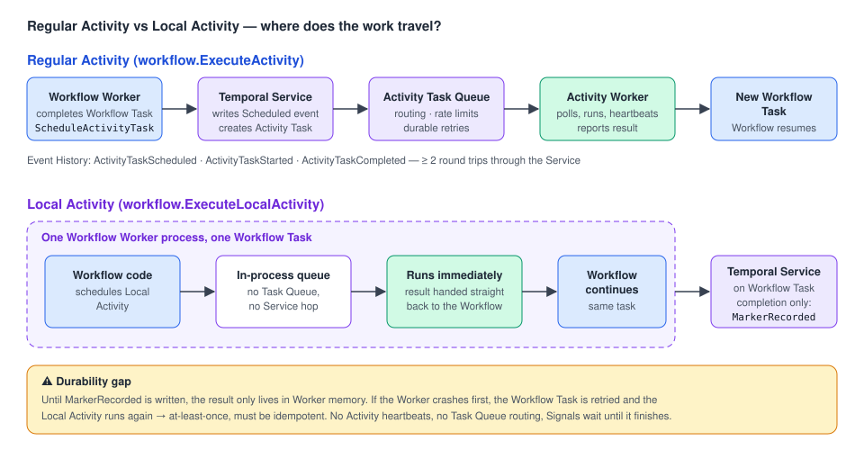

# 07 · Local Activities: trading durability for latency

> **Level:** execution mode (optimization) · **Read time:** ~15 min
> **Sources:** [Encyclopedia — Local Activity](https://docs.temporal.io/local-activity) · [Activity Execution](https://docs.temporal.io/activity-execution#local-activity-executions)

---

## 1. The problem

Every regular Activity makes **at least two round trips** through the Temporal Service: it is
scheduled, dispatched to an Activity Worker, its result is recorded, and the Workflow resumes in a new
Workflow Task. It also writes **three events** to the history. That is fine for a payment call. It is
a lot of overhead for *"compute the VAT from an in-memory table"* when a Workflow does it hundreds of
times per second.

A **Local Activity** runs **in the same Worker process as the Workflow** that schedules it, through an
in-process queue. It never enters an Activity Task Queue. You get **much lower latency** and **fewer
history events**, and you give up some durability.

> 📌 Local Activities are a **performance optimization, not a replacement** for regular Activities.
> For most business logic, regular Activities are the right default.

---

## 2. How they execute



| Regular Activity | Local Activity |
| --- | --- |
| 1. Workflow schedules the Activity | 1. Workflow schedules a Local Activity |
| 2. Workflow Task completes with a `ScheduleActivityTask` command | 2. It is put in an **in-process queue** in the Workflow Worker |
| 3. The Service creates an Activity Task | 3. The Workflow Worker **runs it immediately** |
| 4. An Activity Worker polls the queue and runs it | 4. The result goes **straight back** to the Workflow |
| 5. The result is recorded in the Event History | 5. When the Workflow Task completes, a **`MarkerRecorded`** event stores the result |
| 6. The Workflow resumes in a new Workflow Task | Only the marker is persisted |

### Failure and durability

- A Local Activity result becomes **durable only when the enclosing Workflow Task completes** and
  writes `MarkerRecorded`. Until then it exists **only in Worker memory**.
- If the Worker crashes before that, the Workflow Task is retried, and **every Local Activity run during that task runs again**.
- So Local Activities are **at-least-once** and must be **idempotent**.
- Once the marker exists, replay uses the recorded result and doesn't run the Local Activity again.

### Workflow Task heartbeating (not Activity heartbeating)

Local Activities **can't call `RecordHeartbeat`**. Instead, when a Local Activity approaches about
**80% of the Workflow Task Timeout** (10s by default), the Worker completes the current Workflow Task
and asks for a new one. That lets it run longer than one task timeout, but:

- each of these heartbeats **adds events** to the history,
- **Signals and other external events aren't processed** until the Local Activities finish,
- commands from the Workflow aren't sent until the Local Activity completes or the next Workflow Task heartbeat.

> If an operation regularly gets close to the Workflow Task Timeout, make it a **regular Activity**.

---

## 3. When to use which

| Use a **Local Activity** when… | Use a **regular Activity** when… |
| --- | --- |
| it finishes in **a few seconds**, retries included | it talks to **external systems** (network, DB, APIs) |
| retries are expected to be short | it may take **longer than a few seconds** |
| it is **idempotent** | retries may last minutes or hours |
| low latency matters more than full durability | it needs **Activity heartbeating** |
| no routing, rate limiting or separate Worker pool is needed | you need **Task Queue routing** or **global rate limiting** |
| *e.g. light data transforms, small computations, reading an in-memory cache, fast local file ops* | *e.g. network calls, DB operations, external APIs, long work* |

| Feature | Activity | Local Activity |
| --- | --- | --- |
| Runs on | Activity Worker | Workflow Worker |
| Task Queue | Yes | No |
| Service round trip | Required | Not required |
| Latency | Higher | Lower |
| Event History | Fully recorded | `MarkerRecorded` on completion |
| Heartbeating | Activity heartbeats | Workflow Task heartbeating |
| Retry durability | Durable | At-least-once until the marker is recorded |
| Signal responsiveness | Unaffected | Delayed while the Workflow Task runs |
| Activity Operations (Pause, Reset…) | Yes | **No** |

---

## 4. Go implementation

### The Activities

The same rules as regular Activities apply: `context.Context` first, serializable input and output.

```go
// file: pricing/activities.go
package pricing

import (
	"context"
	"errors"
	"strings"
)

type CartLine struct {
	SKU            string
	Quantity       int
	UnitPriceCents int64
}

type PriceCartInput struct {
	CountryCode string
	Lines       []CartLine
}

type PricedCart struct {
	SubtotalCents int64
	VATCents      int64
	TotalCents    int64
}

// PricingActivities keeps an in-memory VAT table loaded at Worker start-up.
// It does no network I/O, which makes it a good fit for a Local Activity.
type PricingActivities struct {
	VATRateByCountry map[string]float64
}

func (p *PricingActivities) PriceCart(ctx context.Context, in PriceCartInput) (PricedCart, error) {
	rate, ok := p.VATRateByCountry[in.CountryCode]
	if !ok {
		return PricedCart{}, errors.New("no VAT rate for " + in.CountryCode)
	}
	var subtotal int64
	for _, l := range in.Lines {
		subtotal += int64(l.Quantity) * l.UnitPriceCents
	}
	vat := int64(float64(subtotal) * rate)
	return PricedCart{SubtotalCents: subtotal, VATCents: vat, TotalCents: subtotal + vat}, nil
}

// NormalizePostalCode is a pure function: also a good Local Activity.
func NormalizePostalCode(ctx context.Context, raw string) (string, error) {
	return strings.ToUpper(strings.ReplaceAll(strings.TrimSpace(raw), " ", "")), nil
}

// CheckoutActivities does real I/O: keep these as regular Activities.
type CheckoutActivities struct{}

func (c *CheckoutActivities) ChargeCard(ctx context.Context, orderID string, amountCents int64) (string, error) {
	return "ch_" + orderID, nil
}
```

### The Workflow: mixing Local and regular Activities

Local Activities use their own options type, `workflow.LocalActivityOptions`, applied with
`workflow.WithLocalActivityOptions`. It has `ScheduleToCloseTimeout`, `StartToCloseTimeout` (at
least one is required), `RetryPolicy` and `Summary`. There is **no Task Queue and no Heartbeat Timeout**.

```go
// file: pricing/workflow.go
package pricing

import (
	"time"

	"go.temporal.io/sdk/temporal"
	"go.temporal.io/sdk/workflow"
)

type CheckoutInput struct {
	OrderID     string
	CountryCode string
	PostalCode  string
	Lines       []CartLine
}

type CheckoutResult struct {
	PostalCode string
	Priced     PricedCart
	ChargeID   string
}

func QuickCheckoutWorkflow(ctx workflow.Context, in CheckoutInput) (CheckoutResult, error) {
	// Local Activity options: keep timeouts well under the Workflow Task Timeout (10s default).
	lctx := workflow.WithLocalActivityOptions(ctx, workflow.LocalActivityOptions{
		StartToCloseTimeout:    2 * time.Second,
		ScheduleToCloseTimeout: 5 * time.Second, // short retries only
		RetryPolicy: &temporal.RetryPolicy{
			InitialInterval: 100 * time.Millisecond,
			MaximumAttempts: 3,
		},
	})

	// A) Local Activity with a plain function: runs it directly, no registration needed.
	var postal string
	if err := workflow.ExecuteLocalActivity(lctx, NormalizePostalCode, in.PostalCode).Get(lctx, &postal); err != nil {
		return CheckoutResult{}, err
	}

	// B) Local Activity with a struct method: the struct must be REGISTERED on the Worker,
	//    because the nil receiver below is only used to find the registered instance.
	var pricing *PricingActivities
	var priced PricedCart
	err := workflow.ExecuteLocalActivity(lctx, pricing.PriceCart, PriceCartInput{
		CountryCode: in.CountryCode, Lines: in.Lines,
	}).Get(lctx, &priced)
	if err != nil {
		return CheckoutResult{}, err
	}

	// C) Regular Activity for the network call.
	actx := workflow.WithActivityOptions(ctx, workflow.ActivityOptions{StartToCloseTimeout: 30 * time.Second})
	var checkout *CheckoutActivities
	var chargeID string
	if err := workflow.ExecuteActivity(actx, checkout.ChargeCard, in.OrderID, priced.TotalCents).Get(actx, &chargeID); err != nil {
		return CheckoutResult{}, err
	}

	return CheckoutResult{PostalCode: postal, Priced: priced, ChargeID: chargeID}, nil
}
```

When the Workflow Task that schedules `ChargeCard` completes, the Worker sends something like:

```text
MarkerRecorded        (NormalizePostalCode result)
MarkerRecorded        (PriceCart result)
ScheduleActivityTask  (ChargeCard)
```

If `ChargeCard` later fails and retries, the Workflow **replays from the markers**, so the two Local
Activities don't run again. Only `ChargeCard` is retried, according to its Retry Policy.

### The Worker

Local Activities run on the **Workflow Worker**, so register them there:

```go
// file: cmd/checkout-worker/main.go
package main

import (
	"log"

	"github.com/acme/shop/pricing"
	"go.temporal.io/sdk/client"
	"go.temporal.io/sdk/worker"
)

func main() {
	c, err := client.Dial(client.Options{})
	if err != nil {
		log.Fatalln(err)
	}
	defer c.Close()

	w := worker.New(c, "checkout", worker.Options{})
	w.RegisterWorkflow(pricing.QuickCheckoutWorkflow)

	// Used as a Local Activity (struct method -> must be registered here).
	w.RegisterActivity(&pricing.PricingActivities{
		VATRateByCountry: map[string]float64{"FR": 0.20, "DE": 0.19, "ES": 0.21},
	})
	// Used as a regular Activity.
	w.RegisterActivity(&pricing.CheckoutActivities{})

	log.Fatalln(w.Run(worker.InterruptCh()))
}
```

---

## 5. Gotchas

- **Long retry intervals are wasteful.** A Local Activity retry that waits longer than the Workflow
  Task allows ends up being implemented with Workflow Timers and extra history events. Keep retries short.
- **Signals wait.** While Local Activities run inside a Workflow Task, incoming Signals aren't handled.
- **No operator controls.** Pause, Reset, Update Options and the other Activity Operations don't apply to Local Activities.
- **Monitor them** with the `local_activity_total` SDK metric, or look for `MarkerRecorded` entries in the Event History.
- **Worker shutdown.** If the Worker stops before the Workflow Task completes, the Local Activities of that task run again on another Worker. They have no marker yet.

---

## Key takeaways

- Local Activity = runs **inside the Workflow Worker**, no Task Queue, result stored as a **`MarkerRecorded`** event.
- Use it only for **short, idempotent, local** work in **high-throughput** Workflows.
- It is at-least-once until the marker is written. It has no Activity heartbeat, no routing and no operator commands.
- In Go: `workflow.WithLocalActivityOptions` + `workflow.ExecuteLocalActivity`. Register struct-method Local Activities on the Workflow Worker.
- When in doubt, use a **regular Activity**.

⬅️ Previous: [06 · Standalone Activities](06-standalone-activities.md) · ➡️ Next: [08 · Asynchronous Activity Completion](08-async-completion.md)
