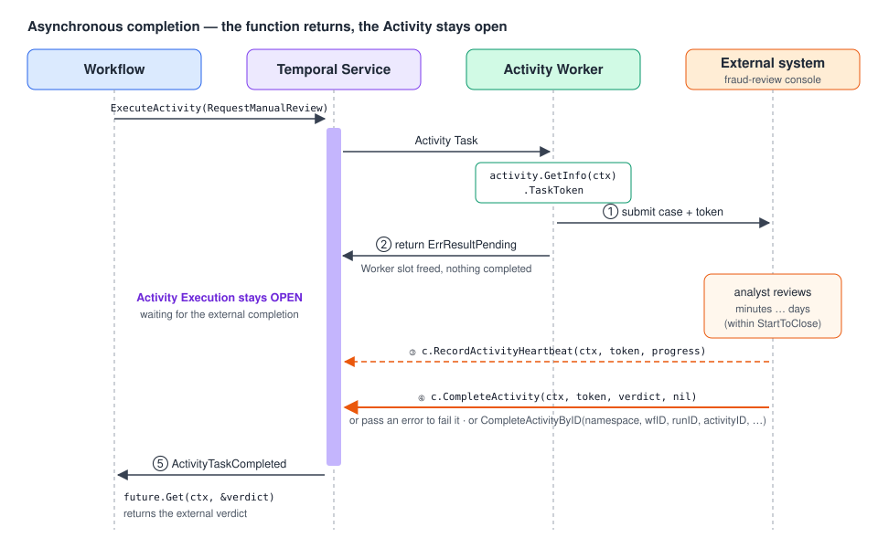

# 08 · Asynchronous Activity Completion

> **Level:** sub-feature · **Read time:** ~15 min
> **Sources:** [Encyclopedia — Asynchronous Activity Completion & Task Token](https://docs.temporal.io/activity-execution#asynchronous-activity-completion) · [Go SDK — Asynchronous Activity Completion](https://docs.temporal.io/develop/go/activities/asynchronous-activity)

---

## 1. The problem

Sometimes **another system holds the final result** of the work your Activity started:

- a human analyst reviews a high-risk order in a back-office console
- a partner warehouse confirms a pickup through its own API hours later
- a legacy batch system processes a file overnight and then calls back

Keeping a Worker goroutine blocked for hours is wasteful and fragile. **Asynchronous Activity
Completion** lets the Activity function **return without completing the Activity Execution**. The
Execution stays **open** in the Service. Later, any process with a Temporal Client can
**heartbeat** it and **complete** it (or fail it) with the real result.



---

## 2. Three steps

1. **The Activity gives the external system what it needs to identify the Execution**: either the
   **Task Token**, or the **Namespace + Workflow ID + Activity ID** (for Standalone Activities: Namespace + Activity ID).
2. **The Activity returns `activity.ErrResultPending`**. This means "not done yet, someone else will finish me".
3. **The external system calls the Temporal Client**: `RecordActivityHeartbeat` while it works, then `CompleteActivity` with a result or an error.

### Step 1 & 2: the Activity

```go
// file: fraudreview/activities.go
package fraudreview

import (
	"context"

	"go.temporal.io/sdk/activity"
)

type ReviewCase struct {
	OrderID     string
	CustomerID  string
	AmountCents int64
	RiskScore   float64
}

type ReviewVerdict struct {
	Approved  bool
	AnalystID string
	Comment   string
}

// ReviewQueue is the back-office system analysts work from (a DB table, a Jira project...).
type ReviewQueue interface {
	Submit(ctx context.Context, taskToken []byte, c ReviewCase) error
}

type ReviewActivities struct {
	Queue ReviewQueue
}

// RequestManualReview opens a case for a human and returns WITHOUT a result.
func (a *ReviewActivities) RequestManualReview(ctx context.Context, c ReviewCase) (ReviewVerdict, error) {
	// 1) Get the information needed to complete this Activity later.
	taskToken := activity.GetInfo(ctx).TaskToken

	// 2) Hand it to the external system.
	if err := a.Queue.Submit(ctx, taskToken, c); err != nil {
		return ReviewVerdict{}, err // normal failure: retried by the Retry Policy
	}

	// 3) Tell the SDK the result will arrive asynchronously.
	return ReviewVerdict{}, activity.ErrResultPending
}
```

### The Workflow: nothing special, except the timeouts

From the Workflow's point of view it is a normal Activity call that just takes a long time. Size
**Start-To-Close** for how long the human may take. Set an explicit **ActivityID** if the external
side completes by ID.

```go
// file: fraudreview/workflow.go
package fraudreview

import (
	"time"

	"go.temporal.io/sdk/temporal"
	"go.temporal.io/sdk/workflow"
)

func ManualReviewActivityID(orderID string) string { return "manual-review-" + orderID }

func HighRiskOrderWorkflow(ctx workflow.Context, c ReviewCase) (ReviewVerdict, error) {
	ctx = workflow.WithActivityOptions(ctx, workflow.ActivityOptions{
		ActivityID:          ManualReviewActivityID(c.OrderID),
		StartToCloseTimeout: 48 * time.Hour, // the analyst SLA
		HeartbeatTimeout:    2 * time.Hour,  // the console must ping at least every 2h
		RetryPolicy:         &temporal.RetryPolicy{MaximumAttempts: 3},
	})

	var a *ReviewActivities
	var verdict ReviewVerdict
	if err := workflow.ExecuteActivity(ctx, a.RequestManualReview, c).Get(ctx, &verdict); err != nil {
		return ReviewVerdict{}, err
	}
	return verdict, nil
}
```

### Step 3: the external system completes the Activity

```go
// file: cmd/review-console/main.go
package main

import (
	"context"
	"log"

	"github.com/acme/shop/fraudreview"
	"go.temporal.io/sdk/client"
	"go.temporal.io/sdk/temporal"
)

// ReviewConsole is the back-office service. It is NOT a Temporal Worker; it only holds a Client.
// The client is heavyweight: create it once per process.
type ReviewConsole struct {
	Temporal client.Client
}

// OnAnalystStillWorking is called periodically (e.g. when the analyst opens the case).
func (r *ReviewConsole) OnAnalystStillWorking(ctx context.Context, taskToken []byte, note string) error {
	return r.Temporal.RecordActivityHeartbeat(ctx, taskToken, note)
}

// OnAnalystDecision completes the Activity with the verdict.
func (r *ReviewConsole) OnAnalystDecision(ctx context.Context, taskToken []byte, v fraudreview.ReviewVerdict) error {
	// The result type must match the Activity's declared return type (ReviewVerdict).
	return r.Temporal.CompleteActivity(ctx, taskToken, v, nil)
}

// OnCaseInvalid fails the Activity. A non-retryable error stops the Retry Policy from
// starting another attempt (which would otherwise give the console a NEW task token).
func (r *ReviewConsole) OnCaseInvalid(ctx context.Context, taskToken []byte, reason string) error {
	failure := temporal.NewNonRetryableApplicationError(reason, "ReviewRejected", nil)
	return r.Temporal.CompleteActivity(ctx, taskToken, nil, failure)
}

func main() {
	c, err := client.Dial(client.Options{})
	if err != nil {
		log.Fatalln(err)
	}
	defer c.Close()
	console := &ReviewConsole{Temporal: c}
	_ = console // wire to your HTTP handlers / UI
}
```

`CompleteActivity(ctx, taskToken, result, err)`:

- `taskToken`: the binary `TaskToken` from `activity.GetInfo(ctx)`
- `result`: the value to record. Its type must match the Activity's return type.
- `err`: if not `nil`, the Activity **fails** and `result` is ignored. A **retryable** error starts a
  new attempt under the Retry Policy, and that attempt has a **new Task Token**. A **non-retryable** error fails the Activity for good.

### Completing by ID instead of Task Token

A Task Token belongs to **one attempt**. If the Activity fails *after* handing out its token but
*before* returning `ErrResultPending`, it is retried, and the external system now holds a **stale
token**. To avoid this, give the external system **stable IDs** instead:

```go
// file: fraudreview/complete_by_id.go
package fraudreview

import (
	"context"

	"go.temporal.io/sdk/client"
)

// Workflow Activity: identify it by Namespace + Workflow ID (+ optional Run ID) + Activity ID.
func CompleteReviewByID(ctx context.Context, c client.Client, namespace, workflowID, orderID string, v ReviewVerdict) error {
	runID := "" // empty = latest Run of the Workflow
	return c.CompleteActivityByID(ctx, namespace, workflowID, runID, ManualReviewActivityID(orderID), v, nil)
}

// Standalone Activity: identify it by Namespace + Activity ID (+ optional Activity Run ID).
func CompleteStandaloneReviewByID(ctx context.Context, c client.Client, namespace, activityID string, v ReviewVerdict) error {
	return c.CompleteActivityByActivityID(ctx, namespace, activityID, "", v, nil)
}
```

> 📝 In the Go SDK, `CompleteActivityByID` works **only for Workflow Activities**. Use
> `CompleteActivityByActivityID` for **Standalone Activities** (async completion works for both).

---

## 3. Async completion vs. Signals vs. polling

When an external system has the final result, there are three ways to get it to the Workflow:

| # | Approach | How |
| --- | --- | --- |
| 1 | **Async completion** | The external system completes the Activity with the result |
| 2 | **Signal** | The Activity completes normally (without the result). Later, the external system **Signals the Workflow** with the result |
| 3 | **Polling** | A later Activity polls the external system for the result |

If you **can't change the external system**: poll (#3), or, if it can reliably call a webhook and retry on failure, write a webhook handler that **Signals** the Workflow (#2).

Choose **#1 Async completion** when:

- the external system is **unreliable** and might fail to Signal, or
- you want the external process to **heartbeat** or **receive cancellation**.

Otherwise, if it reliably Signals back and needs neither heartbeats nor cancellation, prefer **Signals**. The reason is **retry timing**:

| Human review that can take up to **a week** | Async completion | Signal |
| --- | --- | --- |
| Start-To-Close on the Activity | **1 week** | **1 minute** |
| Activity notifies the review system and… | returns `ErrResultPending` | completes immediately |
| If the notification silently fails (the Worker dies) | the retry happens only **after one week** 😬 | the retry happens **after one minute** ✅ |
| Result delivered by | `CompleteActivity` | a Signal to the Workflow |

> 💡 Rule of thumb: **async completion fits when the external party really takes part in the
> Activity's lifecycle** (heartbeats, cancellation). For "notify and wait a long time", a short
> Activity plus a Signal recovers from failures faster.

---

## Key takeaways

- Return `activity.ErrResultPending` to keep the Activity Execution open after the function returns.
- Complete it from anywhere with a Client: `CompleteActivity` (Task Token), `CompleteActivityByID` (Workflow Activity), or `CompleteActivityByActivityID` (Standalone).
- Heartbeat from outside with `RecordActivityHeartbeat`, and size Start-To-Close and Heartbeat timeouts for the external SLA.
- Task Tokens change on every attempt. Prefer IDs if a retry could leave the external system with a stale token.
- For long human waits without heartbeat or cancellation needs, a **Signal** is often the better design.

⬅️ Previous: [07 · Local Activities](07-local-activities.md) · ➡️ Next: [09 · Dynamic Activities](09-dynamic-activities.md)
