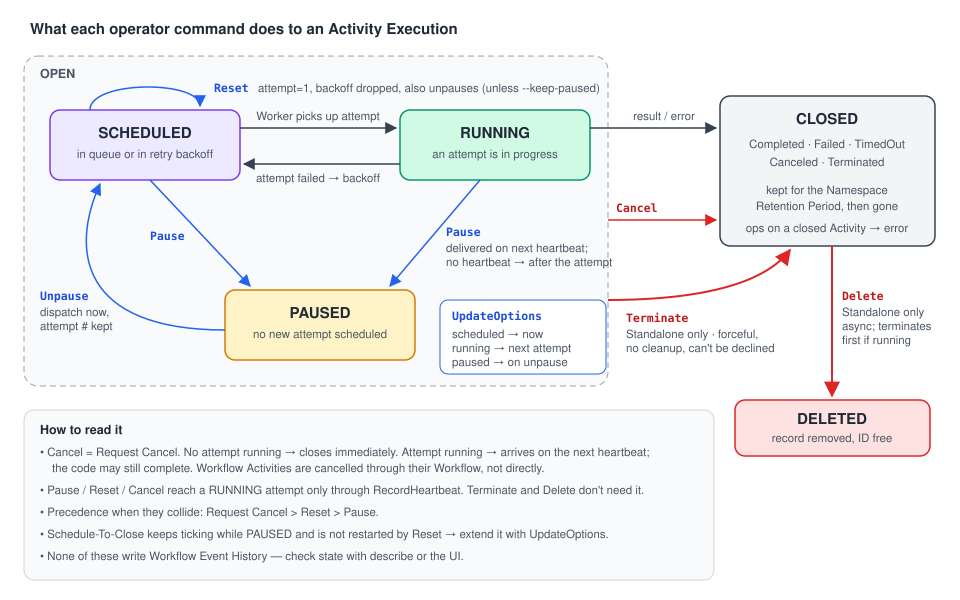

# 10 · Activity Operations: Pause, Unpause, Reset, Update Options, Cancel, Terminate, Delete

> **Level:** operations · **Read time:** ~20 min
> **Sources:** [Activity Operations](https://docs.temporal.io/activity-operations) · [Pause](https://docs.temporal.io/activity-operations/pause) · [Unpause](https://docs.temporal.io/activity-operations/unpause) · [Reset](https://docs.temporal.io/activity-operations/reset) · [Update Options](https://docs.temporal.io/activity-operations/update-options) · [Request Cancel](https://docs.temporal.io/activity-operations/request-cancel) · [Terminate](https://docs.temporal.io/activity-operations/terminate) · [Delete](https://docs.temporal.io/activity-operations/delete)

---

## 1. The problem

Retries and timeouts are **automatic**. Sometimes a human has to step in:

- a downstream API is down and 5,000 Activities are retrying against it, so you want to **stop the retries** until it recovers
- you fixed a bug and deployed. An Activity has used 9 of its 10 attempts, so you want to **give it a fresh set**
- the Schedule-To-Close Timeout is about to expire on a job that can still succeed, so you want to **extend it** without restarting
- a Standalone job was submitted with bad input, so you want to **stop it now**

**Activity Operations** are deliberate actions on a specific Activity Execution, as opposed to the
lifecycle behaviors (retries, timeouts) that happen on their own.

- **Where:** the **CLI** (`temporal activity ...`), the **Web UI**, or the **gRPC API**.
- **Not in Workflow or Activity code.** They are operational controls, not programming APIs.
- **Apply to:** Workflow Activities and Standalone Activities. **Not** Local Activities.

| Release stage | Operations | Versions |
| --- | --- | --- |
| **Public Preview** | Pause, Unpause, Reset, Update Options | Workflow Activities: Server ≥ 1.28.0 (self-hosted UI ≥ 2.47.0). Standalone: Server ≥ 1.32.0, CLI ≥ 1.9.1 |
| **GA** (Standalone) | Request Cancel, Terminate, Delete | Server ≥ 1.32.0, CLI ≥ 1.9.1 |

---

## 2. The operations at a glance



| Operation | What it does | Workflow Activity | Standalone Activity | CLI |
| --- | --- | --- | --- | --- |
| **Pause** | Stops retries. The running attempt continues unless the Activity heartbeats | ✅ | ✅ | `temporal activity pause` |
| **Unpause** | Resumes a Paused Activity. The next attempt starts immediately | ✅ | ✅ | `temporal activity unpause` |
| **Reset** | Clears retry state (attempts, backoff) and schedules a new attempt | ✅ | ✅ | `temporal activity reset` |
| **Update Options** | Changes timeouts, Retry Policy or Task Queue without restarting | ✅ | ✅ | `temporal activity update-options` |
| **Request Cancel** | Asks the Execution to close gracefully so your code can clean up | through the Workflow | ✅ | `temporal activity cancel` |
| **Terminate** | Closes the Execution now, **no cleanup** | ❌ | ✅ | `temporal activity terminate` |
| **Delete** | Terminates if running, then deletes the record asynchronously | ❌ | ✅ | `temporal activity delete` |

> CLI convention: add `--workflow-id <id>` to target a **Workflow Activity**. Omit it to target a **Standalone Activity**.

### What a successful call really means

Every operation does **two things**, and each can succeed without the other:

1. **The server-side state changes immediately.** Terminate closes the Execution. Request Cancel
   closes it right away **if no attempt is running**. This part doesn't depend on heartbeats.
2. **Interrupting a running attempt is best-effort.** Request Cancel, Terminate, Reset and Pause all
   try to reach your code through the **heartbeat response**. An Activity that doesn't heartbeat
   **isn't interrupted mid-attempt**.

So **a successful Request Cancel, Reset or Pause means "accepted", not "stopped"**. A running
attempt may still complete, or fail non-retryably, instead of honoring the request. **Only
Terminate and Delete always discard progress.**

---

## 3. Pause

**When:** a dependency is down and you want retries to stop until it recovers. You also need to
inspect or change config before the next retry, or hold specific Activities during a Worker rollout.

**What happens:**

- **No further retries are scheduled.** The Service enforces this, not the SDK.
- **The parent Workflow is unaffected.** It keeps running, and Signals, Queries and Updates still work.
- **The Workflow can't see it.** No Event History event is written.
- What happens to the **running attempt** depends on heartbeats:
  - **with heartbeats:** it is interrupted on its next heartbeat with a Pause-specific error, so it can clean up and exit
  - **without heartbeats:** it runs to the end. On success the result goes to the Workflow normally. On failure no retry is scheduled.
- Pause is **idempotent**. Pausing a completed Activity returns an error.

```bash
temporal activity pause \
  --workflow-id order-fulfillment-ORD-1042 \
  --activity-id charge-ORD-1042 \
  --reason "Payment provider outage INC-2231, pausing until recovery"
```

⚠️ **A Paused Activity can still time out.** Pause doesn't stop or extend Schedule-To-Close.
There's **no batch Pause** (no `--query`), so you issue one command per Activity ID. And there is
**no Namespace-wide query** for Paused Workflow Activities, so you must know the Workflow ID. Inside
a Workflow, the `TemporalPauseInfo` Search Attribute can be filtered on.

**Workflow Pause vs Activity Pause:** they are independent. Both stop Activity retries, but **only
Activity Pause interrupts a running attempt through its heartbeat**. If both are active, **both must be Unpaused**.

## 4. Unpause

**When:** the dependency recovered, the deploy or config change is done, or the investigation is over.

**What happens:** the Activity is **rescheduled immediately**, and any remaining backoff is dropped.
The **attempt count, heartbeat details and timeouts are kept**. Use Reset to start again from attempt 1.
Unpause is idempotent. Unpausing a completed Activity returns an error.

```bash
temporal activity unpause --workflow-id order-fulfillment-ORD-1042 --activity-id charge-ORD-1042
```

⚠️ Unpausing **many** Activities at once sends all their retries at the same moment. Unpause in
batches, or use `--jitter` with `--query` on Workflow Activities. An Activity **without heartbeats**
that is still running when you Unpause keeps running. No concurrent attempt is started.

## 5. Reset

**When:** you want to give an Activity a **fresh set of retries** after fixing the root cause, start
a Paused Activity clean after a deploy, skip a long backoff and **retry now**, or restart a batch of
failures with jitter.

**What happens:**

| Aspect | After Reset |
| --- | --- |
| Attempt count | Back to **1**, a full set of retries |
| Retry backoff | **Dropped**: if waiting, the new attempt is dispatched immediately |
| Heartbeat details | **Kept** (the next attempt can resume from the checkpoint). Use `--clear-heartbeat-details` to drop them |
| Per-attempt timeouts | Re-armed for the new attempt |
| Schedule-To-Close | **Not restarted**: still measured from the original schedule time |
| Paused? | Reset **also Unpauses**, unless you pass `--keep-paused` |
| Parent Workflow | Unaffected, and it can't see the Reset (no history event) |

**If an attempt is running**, Reset is cooperative: it is delivered through the heartbeat, and the
Worker may stop the attempt or finish it. The Service applies the reset **once the attempt ends**,
including by Start-To-Close. Reset **never runs two attempts at once**.

```bash
temporal activity reset --workflow-id order-fulfillment-ORD-1042 --activity-id charge-ORD-1042
temporal activity reset --workflow-id order-fulfillment-ORD-1042 --activity-id charge-ORD-1042 --keep-paused
temporal activity reset --activity-id export-CUST-4821     # Standalone
```

⚠️ Bulk Reset with `--query` can overwhelm a recovering service, so add `--jitter`.
`--restore-original-options` reverts timeouts, Retry Policy and Task Queue to the values set when the Activity was first scheduled.

## 6. Update Options

**When:** Schedule-To-Close is about to expire on a Paused Activity, the Retry Policy needs tuning
(longer backoff, more attempts), or you want to **move the Activity to another Task Queue** (other
Workers), or restore its original config.

**What you can change:** timeouts (Schedule-To-Close, Start-To-Close, Schedule-To-Start, Heartbeat),
the Retry Policy (initial interval, max interval, backoff coefficient, max attempts) and the Task
Queue. **Only the fields you pass are changed.**

| Activity state | When the new options apply |
| --- | --- |
| Waiting for a retry | **Immediately**: the pending retry timer is recomputed |
| Running | **Next attempt**: the running one isn't interrupted |
| Paused | When it is Unpaused and the next attempt starts |

```bash
temporal activity update-options \
  --workflow-id order-fulfillment-ORD-1042 \
  --activity-id charge-ORD-1042 \
  --schedule-to-close-timeout 24h
```

⚠️ `--restore-original-options` works **only with `--query`** (it is silently ignored for a single
Workflow) and can't be combined with other changes. It needs a stored snapshot, so Activities that
started before your Service supported Activity Operations are rejected.

## 7. Request Cancel (Standalone directly; Workflow Activities through their Workflow)

**When:** a Standalone job is no longer needed, or was submitted by mistake, and you want it to stop
**at a safe point** and release its resources.

**What happens:** the Execution moves to `CancelRequested`.

- **No attempt running:** it closes **immediately**, heartbeat or not.
- **Attempt running:** the cancellation is raised in your code at the **next heartbeat response**. The Activity ends as canceled if your code lets the error propagate.
- **No heartbeat:** it takes effect at the next attempt boundary, for example when Start-To-Close elapses.

```bash
temporal activity cancel --activity-id export-CUST-4821 --reason "No longer needed"
```

Cancellation can be requested **only once**, and it **takes precedence** over Reset and Pause.

## 8. Terminate (Standalone only)

**When:** a Standalone job is stuck or misbehaving and must close **now**, heartbeat or not, or a
Request Cancel was ignored.

**What happens:** the Execution closes immediately and **discards progress**. Your code **can't see
or decline it**: no cleanup runs and no cancellation error is raised. The record stays queryable
until the Retention Period ends.

```bash
temporal activity terminate --activity-id export-CUST-4821 --reason "Bad input"
```

## 9. Delete (Standalone only)

**When:** you must remove an Execution and its result **before retention ends**, or **free its
Activity ID** for reuse now.

**What happens:** if it's running, it is first **terminated** (same semantics as above). The record is
then removed **asynchronously**, so it can stay visible briefly. Delete is **irreversible**: the
inputs and result are gone.

```bash
temporal activity delete --activity-id export-CUST-4821
```

---

## 10. When operations collide, and how timers behave

- **Precedence:** **Request Cancel > Reset > Pause**. A higher-precedence request wins over a pending lower one.
- A request that doesn't fit the current state returns an **error** instead of being queued:
  `FailedPrecondition` (wrong state) or `NotFound`.
- **Timers keep running while Paused**, including Schedule-To-Close.
- **No new attempt is scheduled while Paused.** On Unpause, a retry that is already due **starts immediately**.
- **Before the first attempt**, Unpause respects the original **Start Delay** deadline. If that deadline already passed, the Activity is dispatched immediately.

## 11. Batch operations

Use `--query` (a [List Filter](https://docs.temporal.io/list-filter)) instead of a single ID:

- **Standalone Activities:** batch **Request Cancel, Terminate, Delete**
- **Workflow Activities:** `--query` works with **Reset, Unpause, Update Options**
- `--jitter` spreads the batch out so a recovering downstream isn't hit all at once

```bash
temporal activity terminate \
  --query 'ActivityType="ProcessImage" AND ExecutionStatus="Running"' \
  --reason "Bad input batch"
```

## 12. Observability and audit

- Operations **don't write Event History events**. Nothing that reads history (Workflow code,
  Replay, external tools) can tell an operation happened. Once the Activity completes or the Workflow closes, the evidence is gone.
- To see the current state, use `temporal workflow describe`: it shows each pending Activity's Paused flag, attempt and last failure. The **UI** shows who did what, when, and why (if `--reason` was given).
- **Temporal Cloud billing:** Pause, Reset and Update Options each count as **one Action**. Unpause is free.

---

## 13. Go: making your Activity "operations-friendly"

Operations reach running code only through heartbeats. A well-behaved long-running Activity therefore:

1. **heartbeats** regularly (and saves a checkpoint in the details), and
2. when `ctx.Done()` fires, uses **`context.Cause(ctx)`** to tell **Pause**, **Reset** and **Cancel** apart (Go SDK **v1.34.0+**).

| Cause | Meaning | Typical handling |
| --- | --- | --- |
| `activity.ErrActivityPaused` | Paused, will **resume later** | Release expensive resources and **keep the checkpoint** |
| `activity.ErrActivityReset` | The next attempt restarts at attempt 1 | Save partial progress if you want, then exit |
| anything else | Real cancellation, timeout, or the Workflow closed | Undo partial work and exit |

```go
// file: marketplace/activities.go
package marketplace

import (
	"context"
	"errors"
	"time"

	"go.temporal.io/sdk/activity"
)

type SyncListingsInput struct {
	SellerID string
	SKUs     []string
}

type MarketplaceAPI interface {
	UpsertListing(ctx context.Context, sellerID, sku string) error
	OpenSession(ctx context.Context, sellerID string) (sessionID string, err error)
	CloseSession(ctx context.Context, sessionID string) error
}

type MarketplaceActivities struct {
	API MarketplaceAPI
}

// SyncListingsToMarketplace pushes thousands of listings. Ops may Pause it during a
// marketplace outage, or Reset it after a fix.
func (a *MarketplaceActivities) SyncListingsToMarketplace(ctx context.Context, in SyncListingsInput) (int, error) {
	next := 0
	if activity.HasHeartbeatDetails(ctx) {
		_ = activity.GetHeartbeatDetails(ctx, &next) // kept across Pause/Unpause and Reset
	}

	session, err := a.API.OpenSession(ctx, in.SellerID)
	if err != nil {
		return 0, err
	}
	defer func() {
		closeCtx, cancel := context.WithTimeout(context.Background(), 5*time.Second)
		defer cancel()
		_ = a.API.CloseSession(closeCtx, session) // the Activity ctx may already be cancelled
	}()

	for i := next; i < len(in.SKUs); i++ {
		if ctx.Err() != nil {
			return i, interrupted(ctx, i)
		}
		if err := a.API.UpsertListing(ctx, in.SellerID, in.SKUs[i]); err != nil {
			if ctx.Err() != nil {
				return i, interrupted(ctx, i) // the upsert was cut short: don't checkpoint it
			}
			return i, err
		}
		activity.RecordHeartbeat(ctx, i+1) // checkpoint + delivery channel for operations
	}
	return len(in.SKUs), nil
}

// interrupted logs why the Activity context was cancelled and returns ctx.Err().
func interrupted(ctx context.Context, next int) error {
	logger := activity.GetLogger(ctx)
	switch cause := context.Cause(ctx); {
	case errors.Is(cause, activity.ErrActivityPaused):
		logger.Info("Paused by operator; will resume from checkpoint", "next", next)
	case errors.Is(cause, activity.ErrActivityReset):
		logger.Info("Reset by operator; next attempt restarts at attempt 1", "next", next)
	default:
		logger.Info("Cancelled", "cause", cause)
	}
	return ctx.Err()
}
```

### Bonus: experimental handle methods for Standalone Activities

The Encyclopedia describes operator commands as **CLI, UI and gRPC only**. Recent Go SDK releases
(seen in **v1.50.0**) also expose **experimental** methods on a Standalone `client.ActivityHandle`:
`Pause`, `Unpause` (with `Jitter`), `UpdateOptions` and `RestoreOriginalOptions`. Use them for
internal ops tooling, not in business code, and expect the API to change:

```go
// file: marketplace/ops_tooling.go
package marketplace

import (
	"context"
	"time"

	"go.temporal.io/sdk/client"
)

// ExtendAndResume is an ops-tool helper: give a paused Standalone job 24h more, then resume it.
func ExtendAndResume(ctx context.Context, c client.Client, activityID string) error {
	h := c.GetActivityHandle(client.GetActivityHandleOptions{ActivityID: activityID})

	newDeadline := 24 * time.Hour
	if _, err := h.UpdateOptions(ctx, client.ActivityOptionsUpdate{
		ScheduleToCloseTimeout: &client.ActivityOptionChange[time.Duration]{Value: &newDeadline},
	}); err != nil {
		return err
	}
	return h.Unpause(ctx, client.UnpauseActivityOptions{
		Reason: "marketplace API recovered",
		Jitter: 30 * time.Second,
	})
}
```

---

## 14. Runbook: "the payment provider is down"

1. **Pause** the affected Activities (one per ID): `temporal activity pause --workflow-id … --activity-id … --reason "INC-2231"`.
2. Watch `temporal workflow describe`. Paused Activities **still count down Schedule-To-Close**, so if the outage is long, **update-options** to extend it.
3. When the provider recovers, either **Unpause** (keeps the attempt count) or **Reset** (fresh attempts). Use `--query` + `--jitter` for Workflow Activities.
4. For Standalone jobs that are truly obsolete: **Request Cancel**, then **Terminate** if they ignore it, then **Delete** if you need the IDs back.

---

## Key takeaways

- Operations are **operator tools** (CLI, UI, gRPC). They are not in your Workflow or Activity code, and Workflow code can't see them.
- Server-side state changes immediately. **Interrupting a running attempt needs heartbeats.**
- **Pause** stops retries, **Unpause** resumes now, **Reset** gives fresh attempts, **Update Options** changes config for the next attempt.
- **Request Cancel / Terminate / Delete** act directly on Standalone Activities only. A Workflow Activity is cancelled through its Workflow.
- Precedence: **Cancel > Reset > Pause**. Schedule-To-Close keeps running while Paused and after Reset.
- In Go, detect Pause and Reset with `context.Cause(ctx)` and `activity.ErrActivityPaused` / `activity.ErrActivityReset`.

⬅️ Previous: [09 · Dynamic Activities](09-dynamic-activities.md) · 🏁 Back to the [roadmap](README.md)
