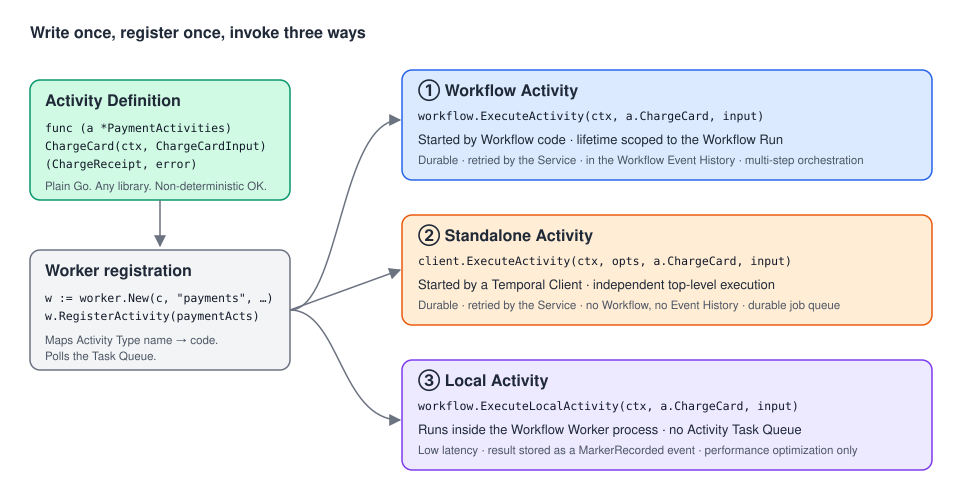

# Temporal Activities with Go: a roadmap

> A progressive onboarding guide to **Temporal Activities** for Go developers. It is based on the
> Temporal Encyclopedia (the concepts) and the Temporal Go SDK docs (how to do it in Go), read side by side.
> Every chapter has **compilable Go examples** with production-like names.
>
> Companion guide: [Temporal Workflows with Go](../../workflows/docs/README.md). Workflows orchestrate, Activities do the side effects.



---

## Why this matters, in 30 seconds

Distributed code fails all the time: timeouts, crashed processes, flaky APIs, rate limits, jobs that
die at 80%. Without Temporal you would build retries, backoff, progress tracking, liveness checks and
job queues yourself, for every side effect.

An **Activity** is a **plain Go function that performs one side effect** (call an API, write to a DB,
send an email, transcode a file). Temporal wraps every call in a durable **Activity Execution** that
**retries** it, **times it out**, **tracks its heartbeats and checkpoints**, **records its result**,
and lets operators **pause, reset or cancel** it. You write the business logic. Temporal provides the reliability.

---

## The roadmap

Read in order. Each stage builds on the previous one.

### Stage 1: Foundations *(core concepts, must-know)*

| # | Chapter | You'll be able to… |
| --- | --- | --- |
| 01 | [What is an Activity, and why does it exist?](01-what-is-an-activity.md) | Explain the problem Activities solve, Workflow vs Activity, the three ways to run one, and the vocabulary. Run a first end-to-end example. |
| 02 | [Defining Activities in Go](02-defining-activities.md) | Write function and struct Activities, choose parameters and results, register and name them, design for **idempotency** and the right **granularity**. |

### Stage 2: Running Activities from Workflows *(core concepts, daily use)*

| # | Chapter | You'll be able to… |
| --- | --- | --- |
| 03 | [Calling Activities from a Workflow](03-workflow-activities.md) | Use `workflow.ExecuteActivity`, futures, parallel fan-out, Task Queue routing, Activity IDs, saga compensation. Understand what goes into the Event History. |
| 04 | [Timeouts, Retry Policies & Heartbeats](04-timeouts-retries-heartbeats.md) | Choose the 4 timeouts, tune or stop retries (`NonRetryable`, `NextRetryDelay`), heartbeat and **resume from checkpoints**. |
| 05 | [Failures, Cancellation & Benign errors](05-failures-and-cancellation.md) | Inspect `ActivityError` causes, mute expected errors, implement **cooperative cancellation** and cleanup. |

### Stage 3: Other ways to run an Activity *(execution modes)*

| # | Chapter | You'll be able to… |
| --- | --- | --- |
| 06 | [Standalone Activities](06-standalone-activities.md) | Use Temporal as a **durable job queue** with `client.ExecuteActivity`: ID dedup policies, Start Delay, handles, list and count. |
| 07 | [Local Activities](07-local-activities.md) | Decide when the latency optimization is worth the reduced durability, and implement it safely. |

### Stage 4: Advanced patterns *(sub-features)*

| # | Chapter | You'll be able to… |
| --- | --- | --- |
| 08 | [Asynchronous Activity Completion](08-async-completion.md) | Let an external system or a human complete an Activity with Task Tokens or IDs, and choose between async completion and Signals. |
| 09 | [Dynamic Activities](09-dynamic-activities.md) | Handle Activity Types that aren't known at compile time (plugins, connectors). |

### Stage 5: Operating Activities in production

| # | Chapter | You'll be able to… |
| --- | --- | --- |
| 10 | [Activity Operations](10-activity-operations.md) | Pause, Unpause, Reset, Update Options, Request Cancel, Terminate and Delete Activities from the CLI. Know what each one really guarantees, and write Activities that cooperate with them. |

---

## Core concepts vs. implementation details

| **Core concepts**: understand these first | **Implementation details, options & sub-features**: learn when needed |
| --- | --- |
| Activity Definition / Activity Type ([02](02-defining-activities.md)) | Custom Activity Type names, registration aliasing ([02](02-defining-activities.md#5-register-the-activity-on-a-worker-and-choose-its-activity-type)) |
| Activity Execution & its lifecycle ([03](03-workflow-activities.md#1-what-happens-when-you-call-workflowexecuteactivity)) | `IsReady`, parallel futures, per-call options ([03](03-workflow-activities.md)) |
| Worker + Task Queue ([01](01-what-is-an-activity.md), [03](03-workflow-activities.md)) | Task Queue routing to specialized Worker pools ([03](03-workflow-activities.md#two-worker-pools)) |
| Idempotency ([02](02-defining-activities.md#6-design-for-retries-idempotency-and-granularity)) | Idempotency key = Run ID + Activity ID ([02](02-defining-activities.md#why-idempotency-is-non-negotiable)) |
| Timeouts & Retry Policy ([04](04-timeouts-retries-heartbeats.md)) | `NonRetryableErrorTypes`, `NextRetryDelay`, `MaximumAttempts: 1` ([04](04-timeouts-retries-heartbeats.md#3-retry-policy)) |
| Heartbeats ([04](04-timeouts-retries-heartbeats.md#4-heartbeats)) | Checkpoint details, external heartbeats ([04](04-timeouts-retries-heartbeats.md#5-heartbeat-details-as-a-resumable-checkpoint)) |
| Failure model ([05](05-failures-and-cancellation.md)) | Benign errors, `WaitForCancellation`, disconnected cleanup contexts ([05](05-failures-and-cancellation.md)) |
| Three invocation modes: Workflow / Standalone / Local ([01](01-what-is-an-activity.md#3-one-definition-three-ways-to-run-it)) | ID Conflict and Reuse policies, Start Delay, retention ([06](06-standalone-activities.md)); Workflow Task heartbeating ([07](07-local-activities.md)) |
| — | Async completion ([08](08-async-completion.md)), Dynamic Activities ([09](09-dynamic-activities.md)), Activity Operations ([10](10-activity-operations.md)) |

---

## Which way should I run this Activity?

```text
Do several steps depend on each other (sequence, branching, compensation, waiting for Signals/Timers)?
├── Yes → Workflow Activity  (workflow.ExecuteActivity)                         → chapter 03
│         └── Is this step tiny (< a few seconds), local, idempotent, and latency-critical
│             in a high-throughput Workflow?
│             ├── Yes → Local Activity (workflow.ExecuteLocalActivity)        → chapter 07
│             └── No  → stay with a regular Workflow Activity
└── No, it's one job → Standalone Activity  (client.ExecuteActivity)           → chapter 06

Does an external system or a human produce the final result?
├── It must heartbeat / receive cancellation, or may fail to call back → Async completion → chapter 08
└── It reliably calls back and the wait is long                         → short Activity + Signal
```

---

## Go API cheat sheet

| I want to… | Go API | Chapter |
| --- | --- | --- |
| Define an Activity | `func (a *X) DoThing(ctx context.Context, in Input) (Output, error)` | 02 |
| Register it | `w.RegisterActivity(&X{deps})`, `w.RegisterActivityWithOptions(fn, activity.RegisterOptions{Name: …})` | 02 |
| Log / inspect inside it | `activity.GetLogger(ctx)`, `activity.GetInfo(ctx)` | 02 |
| Call it from a Workflow | `workflow.ExecuteActivity(workflow.WithActivityOptions(ctx, ao), a.DoThing, in).Get(ctx, &out)` | 03 |
| Set timeouts and retries | `workflow.ActivityOptions{StartToCloseTimeout, ScheduleToCloseTimeout, HeartbeatTimeout, RetryPolicy: &temporal.RetryPolicy{…}}` | 04 |
| Fail without retry | `temporal.NewNonRetryableApplicationError(msg, "Type", cause, details...)` | 04 |
| Choose the next backoff | `temporal.NewApplicationErrorWithOptions(msg, "Type", temporal.ApplicationErrorOptions{NextRetryDelay: d})` | 04 |
| Heartbeat and checkpoint | `activity.RecordHeartbeat(ctx, progress)`, `activity.HasHeartbeatDetails`, `activity.GetHeartbeatDetails(ctx, &p)` | 04 |
| Mark an error as expected | `temporal.ApplicationErrorOptions{Category: temporal.ApplicationErrorCategoryBenign}` | 05 |
| Inspect a failure | `errors.As(err, &*temporal.ApplicationError / TimeoutError / CanceledError / ActivityError)` | 05 |
| Cancel from a Workflow | `ctx, cancel := workflow.WithCancel(ctx)` + `WaitForCancellation` | 05 |
| Handle cancellation in the Activity | `<-ctx.Done()`, `context.Cause(ctx)` (`activity.ErrActivityPaused`, `activity.ErrActivityReset`) | 05, 10 |
| Start a job without a Workflow | `c.ExecuteActivity(ctx, client.StartActivityOptions{ID, TaskQueue, …}, fn, args...)` | 06 |
| Get back to a job | `c.GetActivityHandle(client.GetActivityHandleOptions{ActivityID})` → `Get`, `Describe`, `Cancel`, `Terminate` | 06 |
| List / count jobs | `c.ListActivities`, `c.CountActivities` | 06 |
| Run it locally in the Workflow Worker | `workflow.WithLocalActivityOptions` + `workflow.ExecuteLocalActivity` | 07 |
| Complete it from elsewhere | `return …, activity.ErrResultPending` + `c.CompleteActivity` / `CompleteActivityByID` / `CompleteActivityByActivityID` | 08 |
| Catch unknown Activity Types | `w.RegisterDynamicActivity(fn, activity.DynamicRegisterOptions{})` | 09 |
| Pause / reset / extend from ops | `temporal activity pause / unpause / reset / update-options / cancel / terminate / delete` | 10 |

---

## Diagrams

| Diagram | Used in |
| --- | --- |
| [Activities mental model](../img/activities-mental-model.svg) | README, 01 |
| [Workflow Activity lifecycle](../img/activity-execution-lifecycle.svg) | 03 |
| [Activity timeouts](../img/activity-timeouts.svg) | 04 |
| [Heartbeat checkpointing](../img/activity-heartbeat-checkpoint.svg) | 04 |
| [Cancellation flow](../img/activity-cancellation-flow.svg) | 05 |
| [Standalone vs Workflow Activity](../img/standalone-vs-workflow-activity.svg) | 06 |
| [Standalone ID policies](../img/standalone-id-policies.svg) | 06 |
| [Regular vs Local Activity](../img/local-activity-flow.svg) | 07 |
| [Async completion](../img/async-activity-completion.svg) | 08 |
| [Activity operations state machine](../img/activity-operations-state.svg) | 10 |

---

## About the code samples

- Each chapter is a **self-contained module** named `github.com/acme/shop`. Every Go block starts with
  `// file: <path>` so you can paste it into that path.
- All samples were compiled and `go vet`-checked against **Go SDK v1.50.0** (`go.temporal.io/sdk`)
  and `go.temporal.io/sdk/contrib/envconfig` v1.0.2. Standalone Activities need SDK ≥ v1.49.0, CLI ≥ 1.9.1 and Server ≥ 1.32.0.
- External systems (payment gateways, printers, marketplaces) are **interfaces or fakes**. Swap in your real clients.
- Run everything locally with `temporal server start-dev` (UI at <http://localhost:8233>).

### Notes from checking the docs against the SDK

- The Reset page shows Go detection as `activity.GetCancellationDetails(ctx).Cause()`. That helper
  doesn't exist in SDK v1.50.0. The SDK documents **`context.Cause(ctx)`**, which returns
  `activity.ErrActivityPaused` or `activity.ErrActivityReset`. The chapters use that.
- The Encyclopedia says Activity Operations are CLI, UI and gRPC only. SDK v1.50.0 also has
  **experimental** `Pause`, `Unpause`, `UpdateOptions` and `RestoreOriginalOptions` methods on a
  Standalone `ActivityHandle` (see [chapter 10](10-activity-operations.md#bonus-experimental-handle-methods-for-standalone-activities)).
- `CompleteActivityByID` is for **Workflow Activities**. Standalone Activities use `CompleteActivityByActivityID` ([chapter 08](08-async-completion.md)).

---

## Sources

**Encyclopedia:** [Activities](https://docs.temporal.io/activities) · [Activity Definition](https://docs.temporal.io/activity-definition) · [Activity Execution](https://docs.temporal.io/activity-execution) · [Workflow Activity](https://docs.temporal.io/workflow-activity) · [Standalone Activity](https://docs.temporal.io/standalone-activity) · [Local Activity](https://docs.temporal.io/local-activity) · [Activity Operations](https://docs.temporal.io/activity-operations) ([Pause](https://docs.temporal.io/activity-operations/pause), [Unpause](https://docs.temporal.io/activity-operations/unpause), [Reset](https://docs.temporal.io/activity-operations/reset), [Update Options](https://docs.temporal.io/activity-operations/update-options), [Request Cancel](https://docs.temporal.io/activity-operations/request-cancel), [Terminate](https://docs.temporal.io/activity-operations/terminate), [Delete](https://docs.temporal.io/activity-operations/delete))

**Go SDK:** [Activities](https://docs.temporal.io/develop/go/activities) · [Basics](https://docs.temporal.io/develop/go/activities/basics) · [Execution](https://docs.temporal.io/develop/go/activities/execution) · [Standalone quickstart](https://docs.temporal.io/develop/go/activities/standalone-activities-quickstart) · [Standalone feature guide](https://docs.temporal.io/develop/go/activities/standalone-activities) · [Timeouts](https://docs.temporal.io/develop/go/activities/timeouts) · [Async completion](https://docs.temporal.io/develop/go/activities/asynchronous-activity) · [Dynamic Activity](https://docs.temporal.io/develop/go/activities/dynamic-activity) · [Benign exceptions](https://docs.temporal.io/develop/go/activities/benign-exceptions)
