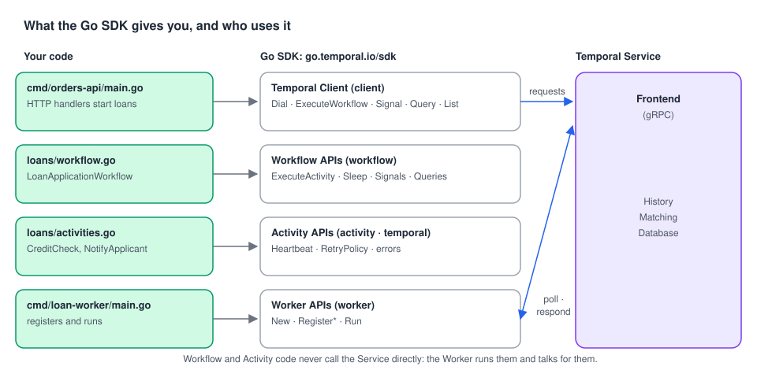

# 02 · Temporal SDKs: what the library gives you

> **Level:** core concept · **Read time:** ~12 min
> **Sources:** [Encyclopedia — About Temporal SDKs](https://docs.temporal.io/encyclopedia/architecture/temporal-sdks) · [Go SDK developer guide](https://docs.temporal.io/develop/go)

---

## 1. The problem

Without Temporal, a reliable multi-step process needs a **home-grown supervisor**: a component that
remembers which step ran, retries failed steps, times them out, and resumes after a crash. Every team
writes a different one, and the business logic gets buried under state machines and retry loops.

A **Temporal SDK** replaces that supervisor with a library. You write the business steps as plain
code, and the SDK, together with the Temporal Service, "steps through that code at runtime to
guarantee execution progression".

---

## 2. What an SDK is, and what a Temporal Application is

A **Temporal SDK** is the open-source library you add to your application to use Temporal, in one
programming language. It gives you APIs to configure a Temporal Client, to write Workflows and
Activities, and to run Workers that you scale out as your load grows.

A **Temporal Application** is the code you write with it:

- **Workflow Definitions**
- **Activity Definitions**
- code that configures **Temporal Clients**
- code that configures and starts **Workers**

A Workflow Definition is written once and **executed many times**: each start creates a new Workflow
Execution. The platform can support millions to billions of concurrent Workflow Executions, and one
execution can live for seconds or for years, through load spikes and failures.

### Official and third-party SDKs

| Official (supported by Temporal) | Third-party (not officially supported) |
| --- | --- |
| Go, Java, Python, TypeScript, .NET, Ruby, PHP, Rust | Swift, Haskell, Clojure, Scala |

All official SDKs talk to the same Temporal Service with the same protocol. A Go Worker and a Python
Worker can serve the same Namespace, and a TypeScript Client can start a Go Workflow, as long as they
agree on Workflow Type names, Task Queues and payloads.

---

## 3. The major components, mapped to Go packages



The Encyclopedia lists three big pieces (Client, Workflow APIs, Worker APIs) plus Activity
customization. In Go they map to packages:

| SDK component | What it does | Go package |
| --- | --- | --- |
| **Temporal Client** | The bridge to the Temporal Service: start, Signal, Query, list Workflows, get results | `go.temporal.io/sdk/client` |
| **Workflow APIs** | Orchestrate Activities, handle Queries/Signals/Updates, talk to other Workflows, timers | `go.temporal.io/sdk/workflow` |
| **Worker APIs** | Configure and run Workers that poll Task Queues and run your code | `go.temporal.io/sdk/worker` |
| **Activity APIs** | Logging, heartbeats, info inside an Activity | `go.temporal.io/sdk/activity` |
| Activity customization | Timeouts, Retry Policy, Heartbeat timeout, async completion | `workflow.ActivityOptions`, `go.temporal.io/sdk/temporal` |
| Testing | Run Workflows in-memory, mock Activities, replay histories | `go.temporal.io/sdk/testsuite`, `worker.NewWorkflowReplayer` |
| Connection config | Load addresses, Namespaces, TLS, API keys from env vars or a TOML file | `go.temporal.io/sdk/contrib/envconfig` |

---

## 4. The development pattern: code that mirrors the business process

The Encyclopedia uses a bank loan as its example, in pseudocode:

```text
func LoanApplicationWorkflow {
    sdk.ExecuteActivity(CreditCheck)
    sdk.ExecuteActivity(AutomatedApproval)
    sdk.ExecuteActivity(NotifyApplicant)
}
```

Here it is as real, compilable Go. Notice that the Workflow reads like the business process, and
that reliability (timeouts, retries, heartbeats) is **configuration**, not code.

```go
// file: loans/types.go
package loans

const TaskQueue = "loan-applications"

type LoanApplication struct {
	ApplicationID  string
	ApplicantID    string
	ApplicantEmail string
	AmountCents    int64
	TermMonths     int
}

type CreditReport struct {
	Score        int
	DebtToIncome float64
}

type Decision struct {
	Approved bool
	Reason   string
	APR      float64
}
```

```go
// file: loans/workflow.go
package loans

import (
	"time"

	"go.temporal.io/sdk/temporal"
	"go.temporal.io/sdk/workflow"
)

// LoanApplicationWorkflow orchestrates the loan process. Each step is an Activity.
func LoanApplicationWorkflow(ctx workflow.Context, app LoanApplication) (Decision, error) {
	logger := workflow.GetLogger(ctx)

	// Activity customization: timeouts and Retry Policy, set once for the steps below.
	ctx = workflow.WithActivityOptions(ctx, workflow.ActivityOptions{
		StartToCloseTimeout: 2 * time.Minute,
		HeartbeatTimeout:    20 * time.Second,
		RetryPolicy: &temporal.RetryPolicy{
			InitialInterval:        time.Second,
			BackoffCoefficient:     2.0,
			MaximumInterval:        time.Minute,
			NonRetryableErrorTypes: []string{"ApplicantNotFound"},
		},
	})

	var a *Activities

	var report CreditReport
	if err := workflow.ExecuteActivity(ctx, a.CreditCheck, app.ApplicantID).Get(ctx, &report); err != nil {
		return Decision{}, err
	}

	var decision Decision
	if err := workflow.ExecuteActivity(ctx, a.AutomatedApproval, app, report).Get(ctx, &decision); err != nil {
		return Decision{}, err
	}

	if err := workflow.ExecuteActivity(ctx, a.NotifyApplicant, app.ApplicantEmail, decision).Get(ctx, nil); err != nil {
		return Decision{}, err
	}

	logger.Info("Loan application decided", "applicationID", app.ApplicationID, "approved", decision.Approved)
	return decision, nil
}
```

```go
// file: loans/activities.go
package loans

import (
	"context"
	"errors"
	"fmt"

	"go.temporal.io/sdk/activity"
	"go.temporal.io/sdk/temporal"
)

var ErrApplicantNotFound = errors.New("applicant not found")

type CreditBureau interface {
	FetchReport(ctx context.Context, applicantID string) (CreditReport, error)
}

type Notifier interface {
	Email(ctx context.Context, to, subject, body string) error
}

type Activities struct {
	Bureau   CreditBureau
	Notifier Notifier
}

// CreditCheck calls an external bureau. It can fail, so it is an Activity:
// the SDK retries it according to the Retry Policy set by the Workflow.
func (a *Activities) CreditCheck(ctx context.Context, applicantID string) (CreditReport, error) {
	activity.RecordHeartbeat(ctx, "calling bureau") // tells the Service we are alive
	report, err := a.Bureau.FetchReport(ctx, applicantID)
	if errors.Is(err, ErrApplicantNotFound) {
		// Retrying will not help: stop now.
		return CreditReport{}, temporal.NewNonRetryableApplicationError("no such applicant", "ApplicantNotFound", err)
	}
	return report, err
}

// AutomatedApproval is pure business rules. It is still an Activity so the rules
// can change without breaking running Workflows.
func (a *Activities) AutomatedApproval(_ context.Context, app LoanApplication, r CreditReport) (Decision, error) {
	switch {
	case r.Score < 620:
		return Decision{Approved: false, Reason: "credit score below 620"}, nil
	case r.DebtToIncome > 0.43:
		return Decision{Approved: false, Reason: "debt-to-income above 43%"}, nil
	case app.AmountCents > 5_000_000:
		return Decision{Approved: false, Reason: "amount needs manual review"}, nil
	default:
		return Decision{Approved: true, Reason: "auto-approved", APR: 6.9}, nil
	}
}

func (a *Activities) NotifyApplicant(ctx context.Context, email string, d Decision) error {
	subject := "Your loan application was declined"
	if d.Approved {
		subject = fmt.Sprintf("Your loan is approved at %.1f%% APR", d.APR)
	}
	return a.Notifier.Email(ctx, email, subject, d.Reason)
}
```

The SDK also makes this Workflow **testable without a server**. The test environment runs the
Workflow in memory and lets you mock each Activity:

```go
// file: loans/workflow_test.go
package loans

import (
	"testing"

	"github.com/stretchr/testify/mock"
	"go.temporal.io/sdk/testsuite"
)

func TestLoanApplicationWorkflow_LowScoreIsDeclined(t *testing.T) {
	var suite testsuite.WorkflowTestSuite
	env := suite.NewTestWorkflowEnvironment()

	a := &Activities{}
	env.RegisterActivity(a)
	env.OnActivity(a.CreditCheck, mock.Anything, "APPL-77").Return(CreditReport{Score: 580, DebtToIncome: 0.2}, nil)
	env.OnActivity(a.NotifyApplicant, mock.Anything, "sam@example.com", mock.Anything).Return(nil)
	// AutomatedApproval is not mocked: the real rules run.

	env.ExecuteWorkflow(LoanApplicationWorkflow, LoanApplication{
		ApplicationID: "LOAN-2024-0091", ApplicantID: "APPL-77",
		ApplicantEmail: "sam@example.com", AmountCents: 1_500_000, TermMonths: 36,
	})

	if !env.IsWorkflowCompleted() {
		t.Fatal("workflow did not complete")
	}
	if err := env.GetWorkflowError(); err != nil {
		t.Fatal(err)
	}
	var d Decision
	if err := env.GetWorkflowResult(&d); err != nil {
		t.Fatal(err)
	}
	if d.Approved {
		t.Fatalf("expected a decline, got %+v", d)
	}
}
```

And the Worker that hosts it:

```go
// file: cmd/loan-worker/main.go
package main

import (
	"context"
	"log"

	"go.temporal.io/sdk/client"
	"go.temporal.io/sdk/worker"

	"github.com/acme/shop/loans"
)

type stubBureau struct{}

func (stubBureau) FetchReport(context.Context, string) (loans.CreditReport, error) {
	return loans.CreditReport{Score: 712, DebtToIncome: 0.31}, nil
}

type logNotifier struct{}

func (logNotifier) Email(_ context.Context, to, subject, _ string) error {
	log.Printf("email to %s: %s", to, subject)
	return nil
}

func main() {
	c, err := client.Dial(client.Options{})
	if err != nil {
		log.Fatalln("unable to create Temporal client", err)
	}
	defer c.Close()

	w := worker.New(c, loans.TaskQueue, worker.Options{})
	w.RegisterWorkflow(loans.LoanApplicationWorkflow)
	w.RegisterActivity(&loans.Activities{Bureau: stubBureau{}, Notifier: logNotifier{}})

	if err := w.Run(worker.InterruptCh()); err != nil {
		log.Fatalln("worker stopped", err)
	}
}
```

---

## 5. How the SDK works with the Service: a choreographer, not a conductor

The Temporal Service does **not** push work to a chosen Worker. It puts **Tasks** on a **Task Queue**
and Workers **poll** for them. If a Worker goes down, its Tasks wait for the next Worker.

When `LoanApplicationWorkflow` calls `workflow.ExecuteActivity(ctx, a.CreditCheck, …)`:

1. The Worker **does not run `CreditCheck`**. The SDK records a `ScheduleActivityTask` **Command**
   and the Workflow code blocks on `.Get`.
2. The Worker sends the Command to the Service, which appends an `ActivityTaskScheduled` **Event** to
   the Event History and puts an **Activity Task** on the Task Queue.
3. A Worker with free capacity (the same one or another) picks up the Activity Task and runs
   `CreditCheck`. If it fails, the Service retries it according to the Retry Policy.
4. The result is stored in the Event History, and a new **Workflow Task** wakes the Workflow up.

Each Task goes through three recorded steps:

| Step | Meaning |
| --- | --- |
| **Scheduled** | The Service added the Task to the Task Queue |
| **Started** | A Worker dequeued the Task |
| **Completed** | The Worker finished the Task and responded to the Service |

[Chapter 06](06-workflow-lifecycle.md) walks through this flow message by message.

---

## 6. Replay: why the SDK can resume after a crash

Because every step is persisted in the Event History, the SDK can **replay** a Workflow: re-run the
Workflow code from the start, feeding it recorded results instead of re-executing Activities, until
it reaches the point where it was interrupted. Then it continues for real.

This only works if the Workflow code makes the same decisions every time it runs, which is why
Workflow code must be **deterministic** and why every side effect lives in an Activity. If replay
produces a Command that doesn't match the recorded history, the SDK raises a
**non-determinism error**. [Chapter 07](07-commands-events-replay.md) shows this in Go.

---

## 7. Key takeaways

- An SDK is a per-language library. Your Temporal Application = Workflows + Activities + Client setup + Worker setup.
- In Go: `client` to talk to the Service, `workflow` and `activity` to write code, `worker` to run it, `temporal` for retries and errors, `testsuite` to test.
- Reliability is configured (`ActivityOptions`, `RetryPolicy`), not hand-coded.
- The Service is a choreographer: it queues Tasks, Workers poll. A Workflow calling an Activity only sends a Command.
- Replay rebuilds Workflow state from the Event History, so Workflow code must be deterministic.
