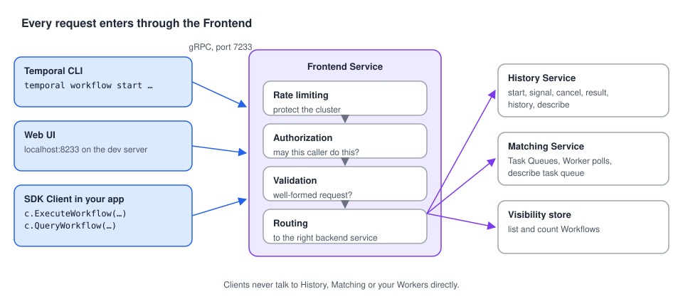

# 03 · The Temporal Client: talking to the Service

> **Level:** core concept · **Read time:** ~15 min
> **Sources:** [Encyclopedia — Client application](https://docs.temporal.io/encyclopedia/architecture/temporal-architecture#client-application) · [How Temporal works — Client](https://docs.temporal.io/encyclopedia/architecture/how-temporal-works#client) · [Go SDK — Temporal Client](https://docs.temporal.io/develop/go/client/temporal-client)

---

## 1. The problem

Your existing services (an HTTP API, a CLI, a back-office UI) need to drive long-running processes:
start an order, change its shipping address, ask where it is, cancel it. They should not need to know
anything about Tasks, Task Queues or Event Histories.

The **Temporal Client** is that simple, consistent entry point. It is a library object from the SDK
that opens a gRPC connection to the Temporal Server's **Frontend Service** and sends **control
requests**. It never runs Workflow or Activity code.

---

## 2. Everything goes through the Frontend



Three kinds of clients talk to the Temporal Server: the **CLI**, the **Web UI** and the **SDK
Client** embedded in your applications. All three call the same gRPC API on the Frontend. The
Frontend handles rate limiting, authorization and validation, then routes each request to the right
backend service. Clients **never** talk to the History or Matching services directly, and never to
your Workers.

This is why the CLI and your Go code are interchangeable for most operations:

| Operation | Go Client | CLI |
| --- | --- | --- |
| Start a Workflow Execution | `c.ExecuteWorkflow(ctx, opts, wf, args...)` | `temporal workflow start` |
| Signal it (asynchronous message that changes its behavior) | `c.SignalWorkflow(ctx, id, runID, name, arg)` | `temporal workflow signal` |
| Query it (read its current state) | `c.QueryWorkflow(ctx, id, runID, name, args...)` | `temporal workflow query` |
| List Workflow Executions | `c.ListWorkflow(ctx, &workflowservice.ListWorkflowExecutionsRequest{Query: …})` | `temporal workflow list --query …` |
| Get its result | `c.GetWorkflow(ctx, id, runID).Get(ctx, &out)` | `temporal workflow result` |
| Cancel it (graceful) | `c.CancelWorkflow(ctx, id, runID)` | `temporal workflow cancel` |
| Terminate it (immediate) | `c.TerminateWorkflow(ctx, id, runID, reason)` | `temporal workflow terminate` |

---

## 3. The order-processing example

The Encyclopedia illustrates the Client with an order processing system. A Client lets you:

- **start** a Workflow Execution when a customer places an order,
- **Signal** it when the customer changes the shipping address,
- **Query** it to show the order status,
- **list** Workflow Executions to see all orders being processed,
- **get the result** when processing is done.

First, a Workflow that supports those operations: it charges the card, then leaves a short packing
window during which the address can change, then ships.

```go
// file: orders/workflow.go
package orders

import (
	"time"

	"go.temporal.io/sdk/workflow"
)

const (
	TaskQueue            = "orders"
	UpdateAddressSignal  = "update-shipping-address"
	OrderStatusQuery     = "order-status"
	packingWindow        = 2 * time.Minute
	activityStartToClose = 30 * time.Second
)

type Address struct {
	Line1      string
	City       string
	PostalCode string
	Country    string
}

type FulfillOrderInput struct {
	OrderID     string
	CustomerID  string
	AmountCents int64
	ShipTo      Address
}

type OrderStatus struct {
	Stage  string // "charging", "packing", "shipping", "shipped"
	ShipTo Address
}

type FulfillOrderResult struct {
	OrderID        string
	TrackingNumber string
}

func FulfillOrderWorkflow(ctx workflow.Context, in FulfillOrderInput) (FulfillOrderResult, error) {
	status := OrderStatus{Stage: "charging", ShipTo: in.ShipTo}

	// Query handler: Clients can read the status at any time.
	if err := workflow.SetQueryHandler(ctx, OrderStatusQuery, func() (OrderStatus, error) {
		return status, nil
	}); err != nil {
		return FulfillOrderResult{}, err
	}

	ctx = workflow.WithActivityOptions(ctx, workflow.ActivityOptions{StartToCloseTimeout: activityStartToClose})
	var a *Activities

	if err := workflow.ExecuteActivity(ctx, a.ChargeCustomer, in.CustomerID, in.AmountCents).Get(ctx, nil); err != nil {
		return FulfillOrderResult{}, err
	}

	// Packing window: accept address changes until the timer fires.
	status.Stage = "packing"
	addressCh := workflow.GetSignalChannel(ctx, UpdateAddressSignal)
	packed := workflow.NewTimer(ctx, packingWindow)
	for done := false; !done; {
		sel := workflow.NewSelector(ctx)
		sel.AddReceive(addressCh, func(ch workflow.ReceiveChannel, _ bool) {
			ch.Receive(ctx, &status.ShipTo)
		})
		sel.AddFuture(packed, func(workflow.Future) { done = true })
		sel.Select(ctx)
	}

	status.Stage = "shipping"
	var tracking string
	if err := workflow.ExecuteActivity(ctx, a.CreateShipment, in.OrderID, status.ShipTo).Get(ctx, &tracking); err != nil {
		return FulfillOrderResult{}, err
	}

	status.Stage = "shipped"
	return FulfillOrderResult{OrderID: in.OrderID, TrackingNumber: tracking}, nil
}
```

```go
// file: orders/activities.go
package orders

import (
	"context"
	"fmt"

	"go.temporal.io/sdk/activity"
)

type Activities struct{}

func (a *Activities) ChargeCustomer(ctx context.Context, customerID string, amountCents int64) error {
	activity.GetLogger(ctx).Info("Charging customer", "customerID", customerID, "amountCents", amountCents)
	return nil // call your payment gateway here
}

func (a *Activities) CreateShipment(ctx context.Context, orderID string, to Address) (string, error) {
	activity.GetLogger(ctx).Info("Creating shipment", "orderID", orderID, "city", to.City)
	return fmt.Sprintf("1Z-%s", orderID), nil // call your carrier API here
}
```

Now the **orders API**: a plain HTTP service that holds **one** Temporal Client for the whole process
and translates HTTP calls into Client calls. It runs no Workflow code at all.

```go
// file: cmd/orders-api/main.go
package main

import (
	"context"
	"encoding/json"
	"errors"
	"fmt"
	"log"
	"net/http"
	"time"

	"go.temporal.io/api/serviceerror"
	"go.temporal.io/api/workflowservice/v1"
	"go.temporal.io/sdk/client"

	"github.com/acme/shop/orders"
)

type api struct {
	temporal client.Client
}

func workflowID(orderID string) string { return "order-" + orderID }

func main() {
	// One Client per process, created at startup and shared by all handlers.
	c, err := client.Dial(client.Options{})
	if err != nil {
		log.Fatalln("unable to create Temporal client", err)
	}
	defer c.Close()

	a := &api{temporal: c}
	mux := http.NewServeMux()
	mux.HandleFunc("POST /orders", a.placeOrder)
	mux.HandleFunc("POST /orders/{id}/address", a.changeAddress)
	mux.HandleFunc("GET /orders/{id}", a.orderStatus)
	mux.HandleFunc("GET /orders/{id}/result", a.orderResult)
	mux.HandleFunc("GET /orders", a.listOrders)
	mux.HandleFunc("DELETE /orders/{id}", a.cancelOrder)

	log.Println("orders API on :8091")
	log.Fatal(http.ListenAndServe(":8091", mux))
}

// Start a Workflow Execution when a customer places an order.
func (a *api) placeOrder(w http.ResponseWriter, r *http.Request) {
	var in orders.FulfillOrderInput
	if err := json.NewDecoder(r.Body).Decode(&in); err != nil {
		http.Error(w, err.Error(), http.StatusBadRequest)
		return
	}
	run, err := a.temporal.ExecuteWorkflow(r.Context(), client.StartWorkflowOptions{
		ID:        workflowID(in.OrderID), // business ID: one running Workflow per order
		TaskQueue: orders.TaskQueue,
	}, orders.FulfillOrderWorkflow, in)
	if err != nil {
		var alreadyStarted *serviceerror.WorkflowExecutionAlreadyStarted
		if errors.As(err, &alreadyStarted) {
			http.Error(w, "order already being processed", http.StatusConflict)
			return
		}
		http.Error(w, err.Error(), http.StatusBadGateway)
		return
	}
	// Returns as soon as the Service has recorded the start. No Worker needed yet.
	writeJSON(w, http.StatusAccepted, map[string]string{"workflowId": run.GetID(), "runId": run.GetRunID()})
}

// Signal the Workflow when the customer changes the shipping address.
func (a *api) changeAddress(w http.ResponseWriter, r *http.Request) {
	var addr orders.Address
	if err := json.NewDecoder(r.Body).Decode(&addr); err != nil {
		http.Error(w, err.Error(), http.StatusBadRequest)
		return
	}
	// Empty runID = the current run of this Workflow ID.
	if err := a.temporal.SignalWorkflow(r.Context(), workflowID(r.PathValue("id")), "", orders.UpdateAddressSignal, addr); err != nil {
		http.Error(w, err.Error(), http.StatusBadGateway)
		return
	}
	w.WriteHeader(http.StatusAccepted)
}

// Query the Workflow to show the current status of the order.
func (a *api) orderStatus(w http.ResponseWriter, r *http.Request) {
	val, err := a.temporal.QueryWorkflow(r.Context(), workflowID(r.PathValue("id")), "", orders.OrderStatusQuery)
	if err != nil {
		http.Error(w, err.Error(), http.StatusBadGateway)
		return
	}
	var status orders.OrderStatus
	if err := val.Get(&status); err != nil {
		http.Error(w, err.Error(), http.StatusInternalServerError)
		return
	}
	writeJSON(w, http.StatusOK, status)
}

// Get the result once processing is finished.
func (a *api) orderResult(w http.ResponseWriter, r *http.Request) {
	ctx, cancel := context.WithTimeout(r.Context(), 5*time.Second)
	defer cancel()

	var result orders.FulfillOrderResult
	err := a.temporal.GetWorkflow(ctx, workflowID(r.PathValue("id")), "").Get(ctx, &result)
	if errors.Is(err, context.DeadlineExceeded) {
		http.Error(w, "order still in progress", http.StatusAccepted)
		return
	}
	if err != nil {
		http.Error(w, err.Error(), http.StatusBadGateway)
		return
	}
	writeJSON(w, http.StatusOK, result)
}

// List Workflow Executions to see all orders being processed.
func (a *api) listOrders(w http.ResponseWriter, r *http.Request) {
	resp, err := a.temporal.ListWorkflow(r.Context(), &workflowservice.ListWorkflowExecutionsRequest{
		Query:    "WorkflowType = 'FulfillOrderWorkflow' AND ExecutionStatus = 'Running'",
		PageSize: 100,
	})
	if err != nil {
		http.Error(w, err.Error(), http.StatusBadGateway)
		return
	}
	ids := make([]string, 0, len(resp.GetExecutions()))
	for _, e := range resp.GetExecutions() {
		ids = append(ids, e.GetExecution().GetWorkflowId())
	}
	writeJSON(w, http.StatusOK, ids)
}

// Cancel the order: the Workflow receives a cancellation request it can react to.
func (a *api) cancelOrder(w http.ResponseWriter, r *http.Request) {
	if err := a.temporal.CancelWorkflow(r.Context(), workflowID(r.PathValue("id")), ""); err != nil {
		http.Error(w, err.Error(), http.StatusBadGateway)
		return
	}
	w.WriteHeader(http.StatusAccepted)
}

func writeJSON(w http.ResponseWriter, code int, v any) {
	w.Header().Set("Content-Type", "application/json")
	w.WriteHeader(code)
	if err := json.NewEncoder(w).Encode(v); err != nil {
		log.Println(fmt.Errorf("write response: %w", err))
	}
}
```

```go
// file: cmd/worker/main.go
package main

import (
	"log"

	"go.temporal.io/sdk/client"
	"go.temporal.io/sdk/worker"

	"github.com/acme/shop/orders"
)

func main() {
	c, err := client.Dial(client.Options{})
	if err != nil {
		log.Fatalln("unable to create Temporal client", err)
	}
	defer c.Close()

	w := worker.New(c, orders.TaskQueue, worker.Options{})
	w.RegisterWorkflow(orders.FulfillOrderWorkflow)
	w.RegisterActivity(&orders.Activities{})
	if err := w.Run(worker.InterruptCh()); err != nil {
		log.Fatalln("worker stopped", err)
	}
}
```

Try it with the dev server and the Worker running:

```sh
curl -X POST localhost:8091/orders -d '{"OrderID":"ORD-1042","CustomerID":"CUS-7","AmountCents":2598,"ShipTo":{"City":"Lyon"}}'
curl localhost:8091/orders/ORD-1042                    # {"Stage":"packing","ShipTo":{"City":"Lyon",...}}
curl -X POST localhost:8091/orders/ORD-1042/address -d '{"City":"Paris"}'
curl localhost:8091/orders/ORD-1042                    # ShipTo.City is now "Paris"
curl localhost:8091/orders                             # ["order-ORD-1042"]
```

> **Signal vs. Query, in one line:** a Signal is **written** to the Event History (it changes the
> Workflow and needs no running Worker to be accepted). A Query is **not** recorded: it is answered
> by a Worker that runs the Query handler on the current state, so it needs a Worker to be up.

---

## 4. Rules for using the Client

| Rule | Why |
| --- | --- |
| Create **one Client per process** and share it. | `client.Dial` opens a gRPC connection. The Client is safe for concurrent use. |
| **Never** create or use a Client **inside a Workflow**. | Workflow code must be deterministic. Calling the network from it breaks replay. Use Child Workflows, `workflow.SignalExternalWorkflow` or an Activity instead. |
| Using a Client **inside an Activity** is fine and common. | Activities may do any I/O. Inject the Client into the Activity struct. |
| Close it on shutdown (`defer c.Close()`). | Releases the connection. |

Here is the "Client inside an Activity" pattern: a returns Workflow notifies the original order
Workflow through an Activity.

```go
// file: returns/activities.go
package returns

import (
	"context"

	"go.temporal.io/sdk/client"
)

const RefundIssuedSignal = "refund-issued"

type RefundIssued struct {
	ReturnID    string
	AmountCents int64
}

// Activities gets the process-wide Client injected by the Worker's main.
type Activities struct {
	Temporal client.Client
}

// NotifyOrderOfRefund signals another Workflow. Allowed here, never in Workflow code.
func (a *Activities) NotifyOrderOfRefund(ctx context.Context, orderWorkflowID string, refund RefundIssued) error {
	return a.Temporal.SignalWorkflow(ctx, orderWorkflowID, "", RefundIssuedSignal, refund)
}
```

---

## 5. Connecting: defaults, environment, config file

`client.Dial` needs an address, a Namespace and, for secured services, TLS and credentials. The
defaults target the local dev server: **`127.0.0.1:7233`** and the **`default`** Namespace, which is
why `client.Options{}` works in the examples above.

For anything else, the Go SDK recommends loading connection options from **environment variables**
or a **TOML configuration file** with the `envconfig` package instead of hard-coding them:

```go
// file: internal/temporalconn/dial.go
package temporalconn

import (
	"go.temporal.io/sdk/client"
	"go.temporal.io/sdk/contrib/envconfig"
)

// Dial reads TEMPORAL_ADDRESS, TEMPORAL_NAMESPACE, TEMPORAL_API_KEY, TLS settings…
// and the "default" profile of ~/.config/temporalio/temporal.toml (or TEMPORAL_CONFIG_FILE).
// Environment variables win over the file.
func Dial() (client.Client, error) {
	return client.Dial(envconfig.MustLoadDefaultClientOptions())
}
```

Profiles, Temporal Cloud (API key or mTLS) and production settings are covered in
[chapter 08](08-running-temporal.md).

---

## 6. Key takeaways

- The Client is an SDK object that sends **control requests** to the **Frontend** over gRPC. It never runs your Workflow or Activity code.
- CLI, Web UI and SDK Clients all use the same Frontend API.
- The core operations: start, Signal, Query, list, get result, cancel, terminate.
- One Client per process. Never inside a Workflow. Fine inside an Activity.
- Load connection settings with `envconfig` rather than hard-coding them.
