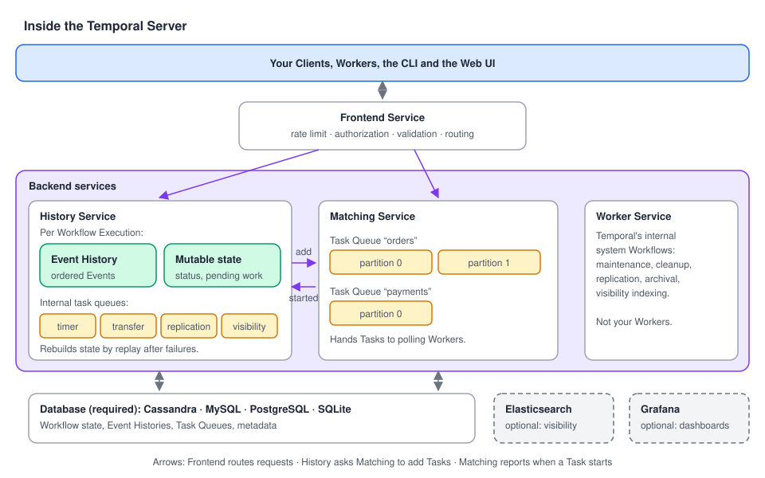

# 04 · Inside the Temporal Server

> **Level:** core concept · **Read time:** ~15 min
> **Sources:** [Encyclopedia — Temporal architecture](https://docs.temporal.io/encyclopedia/architecture/temporal-architecture) · [How Temporal works — Service and Server](https://docs.temporal.io/encyclopedia/architecture/how-temporal-works#relationship-between-the-client-service-and-worker)

---

## 1. The problem

You can use Temporal for weeks treating the Server as a black box. Then a Workflow is "stuck in
Running", a Task Queue has "no pollers", or the ops team asks which database to provision, and the
black box stops being enough.

You don't need to operate the Server to write Workflows. But knowing its **four services** and
**what each one stores** tells you where to look when something doesn't move.

---

## 2. The Server at a glance



The **Temporal Service** runs the **Temporal Server**, its **database**, and optional components. The
Server is one **Frontend** plus several **backend services**:

| Part | One-line job | You see it when… |
| --- | --- | --- |
| **Frontend Service** | The single gRPC entry point: rate limiting, authorization, validation, routing | You call `client.Dial`, the CLI or the UI |
| **History Service** | Owns each Workflow Execution: its Event History, mutable state and internal task queues | You open the Event History in the UI |
| **Matching Service** | Manages Task Queues (and their partitions) and hands Tasks to polling Workers | You look at "pollers" on a Task Queue |
| **Worker Service** | Runs Temporal's **own** internal system Workflows (maintenance, cleanup, replication, archival, visibility indexing) | Almost never: it is not your Worker |
| **Persistence** (required) | Stores Workflow state, Event History, Task Queues and metadata. Cassandra, MySQL, PostgreSQL or SQLite | You size the database |
| Elasticsearch (optional) | Advanced visibility: search Workflow Executions by rich queries | You run `temporal workflow list --query …` at scale |
| Grafana (optional) | Operational dashboards for observability | You watch the cluster's health |

The rest of this chapter takes each part in turn and shows the Go Client call that touches it.
The snippets below form one small diagnostic tool, `shopctl`, that you can point at any Workflow.

```go
// file: cmd/shopctl/main.go
package main

import (
	"context"
	"flag"
	"log"
	"time"

	"go.temporal.io/sdk/client"
)

func main() {
	workflowID := flag.String("workflow-id", "order-ORD-1042", "Workflow ID to inspect")
	taskQueue := flag.String("task-queue", "orders", "Task Queue to inspect")
	flag.Parse()

	c, err := client.Dial(client.Options{})
	if err != nil {
		log.Fatalln("unable to create Temporal client", err)
	}
	defer c.Close()

	ctx, cancel := context.WithTimeout(context.Background(), 10*time.Second)
	defer cancel()

	checkFrontend(ctx, c)
	describeExecution(ctx, c, *workflowID)
	printHistory(ctx, c, *workflowID)
	describeTaskQueue(ctx, c, *taskQueue)
	countRunningOrders(ctx, c)
}
```

---

## 3. Frontend Service: the front door

From your application's point of view, **the Frontend is Temporal**. `client.Dial` connects to it,
Workers poll through it, the CLI and the UI call it. It:

- **rate-limits** requests,
- **authorizes** them (who may start Workflows in this Namespace?),
- **validates** them (is the Task Queue name set? is the payload too big?),
- **routes** them to the right backend service.

Clients never call History or Matching directly, and never your Workers. A quick way to test that the
Frontend is reachable is the gRPC health check:

```go
// file: cmd/shopctl/frontend.go
package main

import (
	"context"
	"log"

	"go.temporal.io/sdk/client"
)

// checkFrontend calls the gRPC health check on the Frontend Service.
func checkFrontend(ctx context.Context, c client.Client) {
	if _, err := c.CheckHealth(ctx, &client.CheckHealthRequest{}); err != nil {
		log.Fatalln("Frontend unreachable:", err)
	}
	log.Println("Frontend: healthy")
}
```

---

## 4. History Service: the memory of every Workflow

The History Service keeps track of **everything that happens in each Workflow**. For each Workflow
Execution it persists:

- the ordered **Event History**: started, Activity scheduled and completed, Signal received, Timer
  fired, completed or failed;
- the **mutable state**: the current summary (status, pending Activities, pending Timers…), so the
  Server doesn't re-read the whole history to answer simple questions;
- **internal task queues**: timers, transfers (e.g. "put a Workflow Task on Task Queue `orders`"),
  replication and visibility indexing.

The Event History is what makes your application crash-proof: after a failure, Temporal rebuilds the
state of a Workflow by **replaying** it against its history. That's why Workflows must be
**deterministic** and Activities **idempotent**.

Two Client calls read from History. `DescribeWorkflowExecution` reads the **mutable state** (a cheap
summary), and `GetWorkflowHistory` reads the **Event History**:

```go
// file: cmd/shopctl/history.go
package main

import (
	"context"
	"log"

	enumspb "go.temporal.io/api/enums/v1"
	"go.temporal.io/sdk/client"
)

// describeExecution reads the mutable state: status and pending Activities.
func describeExecution(ctx context.Context, c client.Client, workflowID string) {
	desc, err := c.DescribeWorkflowExecution(ctx, workflowID, "")
	if err != nil {
		log.Println("describe failed:", err)
		return
	}
	info := desc.GetWorkflowExecutionInfo()
	log.Printf("History: %s is %s (type %s, %d events)",
		workflowID, info.GetStatus(), info.GetType().GetName(), info.GetHistoryLength())

	for _, pa := range desc.GetPendingActivities() {
		log.Printf("  pending Activity %s: state=%s attempt=%d last failure=%q",
			pa.GetActivityType().GetName(), pa.GetState(), pa.GetAttempt(), pa.GetLastFailure().GetMessage())
	}
}

// printHistory reads the Event History, one Event per line.
func printHistory(ctx context.Context, c client.Client, workflowID string) {
	iter := c.GetWorkflowHistory(ctx, workflowID, "", false, enumspb.HISTORY_EVENT_FILTER_TYPE_ALL_EVENT)
	for iter.HasNext() {
		event, err := iter.Next()
		if err != nil {
			log.Println("history read failed:", err)
			return
		}
		log.Printf("  %3d  %-40s %s",
			event.GetEventId(), event.GetEventType(), event.GetEventTime().AsTime().Format("15:04:05.000"))
	}
}
```

Typical output for the order Workflow of [chapter 01](01-the-big-picture.md) (log timestamps removed):

```text
Frontend: healthy
History: order-ORD-1042 is Completed (type ProcessOrderWorkflow, 23 events)
    1  WorkflowExecutionStarted                 10:02:11.204
    2  WorkflowTaskScheduled                    10:02:11.204
    3  WorkflowTaskStarted                      10:02:11.231
    4  WorkflowTaskCompleted                    10:02:11.262
    5  ActivityTaskScheduled                    10:02:11.262
    6  ActivityTaskStarted                      10:02:11.281
    7  ActivityTaskCompleted                    10:02:11.305
    8  WorkflowTaskScheduled                    10:02:11.305
   …
Matching: Workflow poller 41872@orders-worker-7d9f@, last poll 10:02:11
Matching: Activity poller 41872@orders-worker-7d9f@, last poll 10:02:11
Visibility: 0 orders running
```

> **Why a "pending Activity" can show `attempt=4` while the history shows no failures:** while an
> Activity is being retried, History tracks the attempts in **mutable state** only. It writes
> `ActivityTaskStarted` and the final `ActivityTaskCompleted` or `ActivityTaskFailed` Events when the
> last attempt ends. Use `DescribeWorkflowExecution` (or the UI's "Pending Activities") to see a
> retrying Activity. [Chapter 06](06-workflow-lifecycle.md), section 5, explains the timing.

---

## 5. Matching Service: the dispatcher

The Matching Service manages **Task Queues** and their **partitions** (a busy Task Queue is split
into partitions so it can scale). When History says "there is a Workflow Task for `orders`" or "there
is an Activity Task for `payments`", Matching puts it on that queue. When a Worker polls, Matching
finds a waiting Task and hands it over. It also decides how many Tasks to give each polling Worker.

The question you will ask Matching most often is "**is anybody polling this Task Queue?**". A
Workflow that stays at `WorkflowTaskScheduled` almost always means: no Worker polls that Task Queue,
or the Workers poll a queue with a slightly different name.

```go
// file: cmd/shopctl/matching.go
package main

import (
	"context"
	"log"

	enumspb "go.temporal.io/api/enums/v1"
	"go.temporal.io/sdk/client"
)

// describeTaskQueue asks Matching which Workers recently polled the queue.
// Workflow Tasks and Activity Tasks are tracked separately.
func describeTaskQueue(ctx context.Context, c client.Client, taskQueue string) {
	for _, tqType := range []enumspb.TaskQueueType{
		enumspb.TASK_QUEUE_TYPE_WORKFLOW,
		enumspb.TASK_QUEUE_TYPE_ACTIVITY,
	} {
		resp, err := c.DescribeTaskQueue(ctx, taskQueue, tqType)
		if err != nil {
			log.Println("describe task queue failed:", err)
			return
		}
		if len(resp.GetPollers()) == 0 {
			log.Printf("Matching: NO %s pollers on %q. Is a Worker running on this Task Queue?", tqType, taskQueue)
			continue
		}
		for _, p := range resp.GetPollers() {
			log.Printf("Matching: %s poller %s, last poll %s",
				tqType, p.GetIdentity(), p.GetLastAccessTime().AsTime().Format("15:04:05"))
		}
	}
}
```

The same check from the CLI: `temporal task-queue describe --task-queue orders`.

---

## 6. Worker Service: Temporal's own background jobs

The name is confusing, so be precise:

| | **Worker Service** (inside the Server) | **Workers** (your application) |
| --- | --- | --- |
| Who runs it | The Temporal Service | You |
| What code | Temporal's internal system Workflows: maintenance, cleanup, replication, archival, visibility indexing | Your Workflows and Activities |
| Do you interact with it? | No | Constantly |

When this guide says "Worker" without a qualifier, it means **your** Worker
([chapter 05](05-workers.md)).

---

## 7. Persistence and visibility

Everything above writes to the **database**: Workflow state, Event Histories, Task Queues and
Workflow metadata. Supported databases are **Cassandra**, **MySQL**, **PostgreSQL** and **SQLite**
(the dev server started by `temporal server start-dev` uses SQLite). This persistence is what
enables recovery and replay: if anything fails, Temporal reconstructs the exact state of a Workflow
from its Event History.

Listing and counting Workflows goes through **visibility** (the History Service's visibility-indexing
queue feeds it). **Elasticsearch** is the optional component for **advanced visibility** search.

```go
// file: cmd/shopctl/visibility.go
package main

import (
	"context"
	"log"

	"go.temporal.io/api/workflowservice/v1"
	"go.temporal.io/sdk/client"
)

// countRunningOrders uses the visibility store, not the Event Histories.
func countRunningOrders(ctx context.Context, c client.Client) {
	resp, err := c.CountWorkflow(ctx, &workflowservice.CountWorkflowExecutionsRequest{
		Query: "WorkflowType = 'ProcessOrderWorkflow' AND ExecutionStatus = 'Running'",
	})
	if err != nil {
		log.Println("count failed:", err)
		return
	}
	log.Printf("Visibility: %d orders running", resp.GetCount())
}
```

Visibility is updated **asynchronously** from History. A Workflow you just started can take a moment
to appear in `ListWorkflow` or `CountWorkflow`, while `DescribeWorkflowExecution` sees it at once.

---

## 8. Which service answers which call?

| Go Client call | Frontend routes to… |
| --- | --- |
| `ExecuteWorkflow`, `SignalWorkflow`, `CancelWorkflow`, `TerminateWorkflow` | History (creates or changes the execution) |
| `GetWorkflow(...).Get`, `GetWorkflowHistory`, `DescribeWorkflowExecution` | History / persistence |
| `QueryWorkflow` | History and Matching, which deliver the Query to a Worker that runs your Query handler |
| `ListWorkflow`, `CountWorkflow` | Visibility store |
| `DescribeTaskQueue` | Matching |
| Worker polls (`PollWorkflowTaskQueue`, `PollActivityTaskQueue`) | Matching |

---

## 9. Key takeaways

- **Frontend** = the only entry point (rate limit, authz, validation, routing).
- **History** = Event History + mutable state + internal timer/transfer queues for every Workflow. It's the source of truth.
- **Matching** = Task Queues and polling. "No pollers" is the #1 reason a Workflow doesn't progress.
- **Worker Service** = Temporal's internal Workflows, not yours.
- **Persistence** is required (Cassandra, MySQL, PostgreSQL, SQLite). Elasticsearch and Grafana are optional.
- From Go: `CheckHealth` (Frontend), `DescribeWorkflowExecution` / `GetWorkflowHistory` (History), `DescribeTaskQueue` (Matching), `ListWorkflow` / `CountWorkflow` (visibility).
