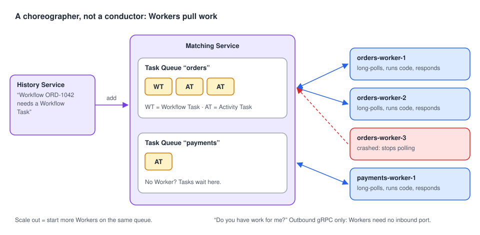

# 05 · Workers: where your code runs

> **Level:** core concept · **Read time:** ~15 min
> **Sources:** [How Temporal works — Worker](https://docs.temporal.io/encyclopedia/architecture/how-temporal-works#worker) · [About Temporal SDKs — Worker APIs](https://docs.temporal.io/encyclopedia/architecture/temporal-sdks#major-components) · [Go SDK — Run a Worker](https://docs.temporal.io/develop/go/workers/run-worker-process)

---

## 1. The problem

The Temporal Server never runs your code, so something else must. That something must be
**yours** (your infrastructure, your secrets, your network access to the payment gateway), must
**scale out** when load grows, and must be **disposable**: a crashed or redeployed process should
lose nothing.

That's a **Worker**: a process you build with the SDK that **polls Task Queues**, runs your Workflow
and Activity code, and reports back. All the important state stays in the Temporal Service, so any
Worker can continue the work of any other.

---

## 2. Polling: the Service is a choreographer



Workers are **pulled**, not pushed. When a Worker starts, it opens a long-lasting connection to the
Frontend and **long-polls** a Task Queue: "do you have work for me?". The Matching Service answers
with a Task when one is available, or holds the poll open until one arrives.

Consequences you can rely on:

- **Workers never need an inbound port.** They only make outbound gRPC calls. A Worker can live in a
  private subnet, a laptop or a Lambda function.
- **No Worker = work waits, it is not lost.** Tasks stay on the Task Queue until a Worker polls.
- **Scaling = starting more Workers** on the same Task Queue. Matching spreads Tasks across all pollers.
- **A Worker that dies mid-Task** simply stops responding. The Service times the Task out and hands
  it to another Worker.

---

## 3. What a Worker does with each kind of Task

| Task | What the Worker does | What it sends back |
| --- | --- | --- |
| **Workflow Task** | Gets the Event History, **replays** it to rebuild the Workflow's state, runs your Workflow code until it completes or must wait (Activity, Timer, Signal…) | **Commands** (`ScheduleActivityTask`, `StartTimer`, `CompleteWorkflowExecution`…) with `RespondWorkflowTaskCompleted` |
| **Activity Task** | Calls your Activity function with the inputs in the Task | The result (`RespondActivityTaskCompleted`) or the error (`RespondActivityTaskFailed`) |

The Server records both as Events in the Event History. Your Workflow and Activity code only ever runs
in Workers, which are under your control.

---

## 4. Create and run a Worker in Go

A Worker is built from three things: a **Client**, a **Task Queue name**, and **`worker.Options`**.
Then you register your Workflow and Activity types and call `Run`.

```go
// file: payments/payments.go
package payments

import (
	"context"
	"time"

	"go.temporal.io/sdk/activity"
	"go.temporal.io/sdk/workflow"
)

const TaskQueue = "payments"

type CaptureInput struct {
	PaymentID   string
	AmountCents int64
}

type Gateway interface {
	Capture(ctx context.Context, paymentID string, amountCents int64) (captureID string, err error)
}

type Activities struct {
	Gateway Gateway
}

func (a *Activities) CapturePayment(ctx context.Context, in CaptureInput) (string, error) {
	activity.GetLogger(ctx).Info("Capturing payment", "paymentID", in.PaymentID)
	return a.Gateway.Capture(ctx, in.PaymentID, in.AmountCents)
}

func CapturePaymentWorkflow(ctx workflow.Context, in CaptureInput) (string, error) {
	ctx = workflow.WithActivityOptions(ctx, workflow.ActivityOptions{StartToCloseTimeout: 30 * time.Second})
	var a *Activities
	var captureID string
	err := workflow.ExecuteActivity(ctx, a.CapturePayment, in).Get(ctx, &captureID)
	return captureID, err
}
```

```go
// file: cmd/payments-worker/main.go
package main

import (
	"context"
	"fmt"
	"log"
	"os"
	"time"

	"go.temporal.io/sdk/client"
	"go.temporal.io/sdk/worker"

	"github.com/acme/shop/payments"
)

type sandboxGateway struct{}

func (sandboxGateway) Capture(_ context.Context, paymentID string, _ int64) (string, error) {
	return "cap_" + paymentID, nil
}

func main() {
	// 1. A Client: the Worker reaches the Service through the Frontend, like any Client.
	c, err := client.Dial(client.Options{})
	if err != nil {
		log.Fatalln("unable to create Temporal client", err)
	}
	defer c.Close()

	host, _ := os.Hostname()

	// 2. A Task Queue name and 3. options. An empty worker.Options{} is fine to start.
	w := worker.New(c, payments.TaskQueue, worker.Options{
		Identity:                               fmt.Sprintf("payments-worker@%s", host), // shown as poller identity
		MaxConcurrentActivityExecutionSize:     50,                                      // Activities running at once
		MaxConcurrentWorkflowTaskExecutionSize: 20,                                      // Workflow Tasks at once
		WorkerStopTimeout:                      30 * time.Second,                        // grace period on shutdown
	})

	// Register every Workflow and Activity type this Task Queue can receive.
	w.RegisterWorkflow(payments.CapturePaymentWorkflow)
	w.RegisterActivity(&payments.Activities{Gateway: sandboxGateway{}})

	// Run blocks, polls, and stops cleanly on SIGINT/SIGTERM:
	// it stops polling and waits for in-flight Tasks up to WorkerStopTimeout.
	if err := w.Run(worker.InterruptCh()); err != nil {
		log.Fatalln("worker stopped", err)
	}
}
```

`Run` is the common choice. For more control (e.g. a Worker inside a larger service with its own
lifecycle), call `w.Start()` and `w.Stop()` yourself.

---

## 5. The registration rule

> **All Workers polling the same Task Queue must register the same Workflow and Activity types.**

A Task Queue does **not** route by type: any Worker polling it can receive any Task on it. A Worker
that receives a Task for a type it didn't register **fails that Task**. If two teams deploy
different code on the same queue name, Tasks fail at random.

The fix is one Task Queue per **set of capabilities**, and you route each Activity to the queue that
can run it:

```go
// file: checkout/workflow.go
package checkout

import (
	"time"

	"go.temporal.io/sdk/workflow"
)

const TaskQueue = "checkout"

type CheckoutInput struct {
	OrderID     string
	PaymentID   string
	AmountCents int64
	PDFTemplate string
}

// CheckoutWorkflow runs on "checkout" Workers, but sends work to two specialized pools.
func CheckoutWorkflow(ctx workflow.Context, in CheckoutInput) error {
	// Payments run on Workers that hold the payment gateway credentials.
	paymentsCtx := workflow.WithActivityOptions(ctx, workflow.ActivityOptions{
		TaskQueue:           "payments",
		StartToCloseTimeout: 30 * time.Second,
	})
	// Invoices are rendered on Workers with lots of CPU and a PDF engine installed.
	invoicesCtx := workflow.WithActivityOptions(ctx, workflow.ActivityOptions{
		TaskQueue:           "invoice-rendering",
		StartToCloseTimeout: 5 * time.Minute,
	})

	// Activities registered on other Workers are called by their type name.
	if err := workflow.ExecuteActivity(paymentsCtx, "CapturePayment", in).Get(ctx, nil); err != nil {
		return err
	}
	return workflow.ExecuteActivity(invoicesCtx, "RenderInvoicePDF", in.OrderID, in.PDFTemplate).Get(ctx, nil)
}
```

Each Worker pool polls only its own queue and registers only its own types:

| Task Queue | Worker deployment | Registers |
| --- | --- | --- |
| `checkout` | `checkout-worker`, 3 replicas | `CheckoutWorkflow` |
| `payments` | `payments-worker`, 2 replicas, in the PCI network zone | `CapturePayment` |
| `invoice-rendering` | `invoice-worker`, autoscaled on CPU | `RenderInvoicePDF` |

---

## 6. Where Workers run

Workers are ordinary processes, so they run wherever your code runs:

- **Long-running processes** on bare metal, VMs or containers. This is the classic setup. Workers are
  horizontally scalable and often run on Kubernetes as a Deployment per Task Queue.
- **Serverless Workers** on serverless platforms such as AWS Lambda, for spiky or low-volume work
  (see the Go SDK's [Serverless Workers](https://docs.temporal.io/develop/go/workers/serverless-workers) guide).

Wherever they run, Workers are **always separate from the Temporal Service**, including with Temporal
Cloud, where Temporal operates the Service and you still run the Workers.

---

## 7. Workers are stateless (on purpose)

Because the Server keeps the Event History, retries and timers, **Workers hold no critical state**:

- Kill a Worker in the middle of a Workflow: another Worker picks up the next Workflow Task, replays
  the history and continues.
- Kill a Worker in the middle of an Activity: the Activity attempt times out (that's why Activities
  need a `StartToCloseTimeout`) and is retried on another Worker. Make Activities **idempotent**.
- Deploy new Worker code: Workflow Tasks of running executions are replayed with the new code, which
  is why changing Workflow code needs care (see the
  [Workflows guide, chapter 11](../../workflows/docs/11-versioning.md)).

> **Performance note:** replaying a long history on every Workflow Task would be slow. The Go SDK
> keeps recently used Workflow Executions **in memory** (a sticky cache, size set with
> `worker.SetStickyWorkflowCacheSize`) and asks the Server to send that Worker's next Workflow Task
> for the same execution back to it, with only the new Events. A full replay happens when the
> execution isn't in the cache: after a restart, an eviction, or on another Worker.

---

## 8. Key takeaways

- A Worker = Client + Task Queue + options + registered types + `Run`.
- Workers **poll**. They need no inbound port. No Worker means work waits, not work lost.
- Scale by adding Workers on the same Task Queue.
- Every Worker on a Task Queue must register the same types. Route work to specialized pools with `ActivityOptions.TaskQueue`.
- Workers are stateless and disposable. The Service holds the state.
