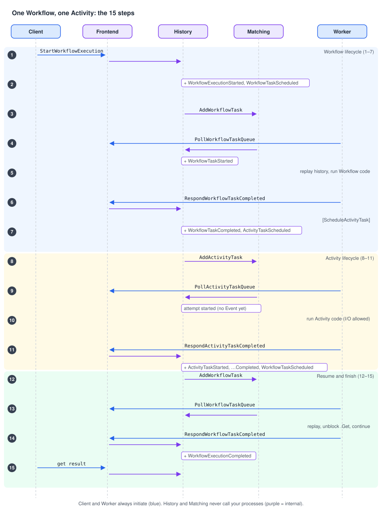

# 06 · Life of a Workflow Execution, step by step

> **Level:** core concept, deep dive · **Read time:** ~20 min
> **Sources:** [How Temporal works — End-to-end lifecycle](https://docs.temporal.io/encyclopedia/architecture/how-temporal-works#end-to-end-lifecycle-of-a-workflow-and-activity) · [About Temporal SDKs — How SDKs work with the Temporal Service](https://docs.temporal.io/encyclopedia/architecture/temporal-sdks#sdk-and-service-relationship)

---

## 1. The problem

"Start a Workflow, it calls an Activity, it returns a result." Behind that sentence, five components
exchange about fifteen messages. When you know them, the Event History in the Web UI stops being a
wall of names: each Event tells you which step happened and which component did it.

This chapter follows **one Workflow Execution with one Activity**, from the Client's start request to
the Client reading the result. It uses the 15 steps of the Encyclopedia's "How Temporal works" page.

---

## 2. The example

A shipping Workflow books a courier for an order. The courier API is flaky: it fails the first two
attempts, so we also see what a **retry** looks like.

```go
// file: shipping/shipping.go
package shipping

import (
	"context"
	"errors"
	"fmt"
	"time"

	"go.temporal.io/sdk/activity"
	"go.temporal.io/sdk/temporal"
	"go.temporal.io/sdk/workflow"
)

const TaskQueue = "shipping"

type BookCourierInput struct {
	OrderID    string
	PostalCode string
	Parcels    int
}

type Booking struct {
	CourierRef string
	PickupAt   time.Time
}

// BookCourierWorkflow runs in a Worker. Each comment refers to the steps below.
func BookCourierWorkflow(ctx workflow.Context, in BookCourierInput) (Booking, error) {
	ctx = workflow.WithActivityOptions(ctx, workflow.ActivityOptions{
		StartToCloseTimeout: 10 * time.Second,
		RetryPolicy:         &temporal.RetryPolicy{InitialInterval: time.Second},
	})

	var booking Booking
	// Steps 5–6: this call does not run BookCourier. It records a ScheduleActivityTask
	// Command, and the Workflow blocks on Get until the result is in the Event History.
	err := workflow.ExecuteActivity(ctx, BookCourier, in).Get(ctx, &booking)
	// Step 13: after replay, execution continues here with the recorded result.
	if err != nil {
		return Booking{}, err
	}
	// Step 14: returning produces a CompleteWorkflowExecution Command.
	return booking, nil
}

// BookCourier runs in a Worker when an Activity Task arrives (steps 9–11).
// It may do I/O: it is not replayed like Workflow code.
func BookCourier(ctx context.Context, in BookCourierInput) (Booking, error) {
	info := activity.GetInfo(ctx)
	if info.Attempt < 3 {
		// Simulate a flaky courier API. The Service retries; no Event is written (step 11).
		return Booking{}, errors.New("courier API: 503 Service Unavailable")
	}
	return Booking{
		CourierRef: fmt.Sprintf("DHL-%s-%d", in.OrderID, in.Parcels),
		PickupAt:   time.Now().Add(24 * time.Hour).Truncate(time.Hour),
	}, nil
}
```

---

## 3. The whole flow on one page



The participants are your **Client** and your **Worker** (your environment), and the **Frontend**,
**History** and **Matching** services (the Temporal Service). Every request from the Client or the
Worker enters through the Frontend. History and Matching never call your processes: the Worker
always asks.

---

## 4. Workflow lifecycle (steps 1–7)

**Step 1. The Client asks Temporal to start a Workflow.** Your code calls `c.ExecuteWorkflow`. The SDK
sends `StartWorkflowExecution` to the Frontend with the **Workflow Type** (`BookCourierWorkflow`),
the **input**, and the **Task Queue** (`shipping`). The Frontend forwards it to the History Service
that owns this Workflow Execution.

**Step 2. History creates the Workflow Execution.** It writes the execution to the database and starts
its Event History with `WorkflowExecutionStarted` and `WorkflowTaskScheduled`. It also creates an
internal **Transfer Task**: "put a Workflow Task on Task Queue `shipping`".

> At this point `ExecuteWorkflow` has returned to your Client. **No Worker was involved.** That's why
> starting a Workflow succeeds even when all Workers are down.

**Step 3. Matching adds a Workflow Task to the Task Queue.** A background queue processor in History
reads the Transfer Task and calls Matching (`AddWorkflowTask`). The `shipping` Task Queue now holds
one Workflow Task.

**Step 4. A Worker polls and gets the Workflow Task.** Your Worker was already long-polling `shipping`
through the Frontend. Matching hands over the Task and tells History it started. History appends
`WorkflowTaskStarted` and returns the Task, **with the Event History**, to the Worker.

**Step 5. The Worker runs your Workflow code.** The SDK replays the Event History to rebuild the
Workflow's state (here there is nothing to rebuild yet), then runs `BookCourierWorkflow` until it
returns or must wait. Here it must wait at `.Get`.

**Step 6. Your Workflow asks for work via Commands.** `workflow.ExecuteActivity` did not run
`BookCourier`: the SDK recorded a `ScheduleActivityTask` **Command**. When the Workflow can't
progress, the Worker sends all its Commands in `RespondWorkflowTaskCompleted`.

**Step 7. History turns Commands into Events and new Tasks.** For `ScheduleActivityTask`, History
appends `WorkflowTaskCompleted` then `ActivityTaskScheduled`, and creates the internal Tasks that will
put an Activity Task on a Task Queue. The Workflow is now **waiting**. It occupies no thread in any
Worker until something happens.

---

## 5. Activity lifecycle (steps 8–11)

**Step 8. Matching puts an Activity Task on the Activity's Task Queue.** For each
`ActivityTaskScheduled` Event, History's queue processor calls Matching (`AddActivityTask`). By
default it is the Workflow's Task Queue. `ActivityOptions.TaskQueue` can send it elsewhere.

**Step 9. A Worker polls and starts the Activity.** A Worker (possibly a different one) polling that
queue receives the Task. History records the **started attempt** and starts the Activity's timeout
timers (e.g. Start-To-Close). It does **not** append `ActivityTaskStarted` yet: that Event is written
when the Activity completes or fails **for the last time**.

**Step 10. The Worker runs your Activity code.** It calls `BookCourier` with the inputs from the Task.
This code can call external services, because it is not replayed like Workflow code.

**Step 11. The Activity reports success or failure.**

| Outcome | Worker sends | History appends |
| --- | --- | --- |
| Failure, retries left (our attempts 1 and 2) | `RespondActivityTaskFailed` | **Nothing.** It schedules the retry, and the Activity Task goes back to the queue after the retry interval |
| Success (our attempt 3) | `RespondActivityTaskCompleted` + result | `ActivityTaskStarted`, `ActivityTaskCompleted` (with the result), `WorkflowTaskScheduled` |
| Retries exhausted or non-retryable error | `RespondActivityTaskFailed` | `ActivityTaskStarted`, `ActivityTaskFailed`, `WorkflowTaskScheduled`. The failure goes to the Workflow |

So **retries are invisible in the Event History**. The only trace is the `attempt` field on the final
`ActivityTaskStarted` Event (and the pending Activity's attempt count while it is retrying). This
keeps histories short even for an Activity that retries for days.

---

## 6. The Workflow resumes and finishes (steps 12–15)

**Step 12. A new Workflow Task is scheduled.** The Activity result (or a Timer firing, a Signal…) made
History append Events and a `WorkflowTaskScheduled`. Its queue processor asks Matching to add the new
Workflow Task to `shipping`.

**Step 13. A Worker picks up the next Workflow Task and continues.** History appends
`WorkflowTaskStarted` and the Worker receives the updated history. The SDK replays it, unblocks the
`.Get` with the recorded `Booking`, and the Workflow continues after it.

**Step 14. The Workflow closes.** The cycle **Workflow Task → Commands → Events → new Tasks** repeats
as many times as needed. When `BookCourierWorkflow` returns, the Worker sends
`RespondWorkflowTaskCompleted` with a `CompleteWorkflowExecution` Command. History appends
`WorkflowTaskCompleted` and `WorkflowExecutionCompleted` and marks the execution **closed**. A
Workflow can also close by failure, cancellation, termination or Continue-As-New. In every case it
goes from open to closed and **never reopens**.

**Step 15. The Client reads the result.** While the Workflow was open, Clients could Query it and send
it Signals. Now that it's closed, `run.Get` asks the Frontend, which reads the result from History and
persistence.

---

## 7. See the 15 steps in your own Event History

This program runs a Worker and a Client in the same process (convenient for a demo, not for
production), executes the Workflow, then prints its Event History with the step that produced each
Event.

```go
// file: cmd/lifecycle-demo/main.go
package main

import (
	"context"
	"log"
	"strconv"

	enumspb "go.temporal.io/api/enums/v1"
	"go.temporal.io/sdk/client"
	"go.temporal.io/sdk/worker"

	"github.com/acme/shop/shipping"
)

// Which lifecycle step writes which Event type.
var stepOf = map[enumspb.EventType]string{
	enumspb.EVENT_TYPE_WORKFLOW_EXECUTION_STARTED:   "step 2  (History creates the execution)",
	enumspb.EVENT_TYPE_WORKFLOW_TASK_SCHEDULED:      "steps 2/11/12 (a Workflow Task is needed)",
	enumspb.EVENT_TYPE_WORKFLOW_TASK_STARTED:        "steps 4/13 (a Worker picked it up)",
	enumspb.EVENT_TYPE_WORKFLOW_TASK_COMPLETED:      "steps 7/14 (Worker sent its Commands)",
	enumspb.EVENT_TYPE_ACTIVITY_TASK_SCHEDULED:      "step 7  (ScheduleActivityTask Command)",
	enumspb.EVENT_TYPE_ACTIVITY_TASK_STARTED:        "step 11 (written late, with the final attempt)",
	enumspb.EVENT_TYPE_ACTIVITY_TASK_COMPLETED:      "step 11 (Activity result recorded)",
	enumspb.EVENT_TYPE_WORKFLOW_EXECUTION_COMPLETED: "step 14 (CompleteWorkflowExecution Command)",
}

func main() {
	c, err := client.Dial(client.Options{})
	if err != nil {
		log.Fatalln("unable to create Temporal client", err)
	}
	defer c.Close()

	// The Worker side: polls "shipping" in the background.
	w := worker.New(c, shipping.TaskQueue, worker.Options{})
	w.RegisterWorkflow(shipping.BookCourierWorkflow)
	w.RegisterActivity(shipping.BookCourier)
	if err := w.Start(); err != nil {
		log.Fatalln("unable to start worker", err)
	}
	defer w.Stop()

	// The Client side: step 1, then step 15.
	ctx := context.Background()
	run, err := c.ExecuteWorkflow(ctx, client.StartWorkflowOptions{
		ID:        "book-courier-ORD-1042",
		TaskQueue: shipping.TaskQueue,
	}, shipping.BookCourierWorkflow, shipping.BookCourierInput{OrderID: "ORD-1042", PostalCode: "69002", Parcels: 2})
	if err != nil {
		log.Fatalln("unable to start workflow", err)
	}
	var booking shipping.Booking
	if err := run.Get(ctx, &booking); err != nil {
		log.Fatalln("workflow failed", err)
	}
	log.Printf("booked %s, pickup %s", booking.CourierRef, booking.PickupAt.Format("Mon 15:04"))

	// Read the Event History back from the History Service.
	iter := c.GetWorkflowHistory(ctx, run.GetID(), run.GetRunID(), false, enumspb.HISTORY_EVENT_FILTER_TYPE_ALL_EVENT)
	for iter.HasNext() {
		ev, err := iter.Next()
		if err != nil {
			log.Fatalln("history read failed", err)
		}
		line := ev.GetEventType().String()
		if attrs := ev.GetActivityTaskStartedEventAttributes(); attrs != nil {
			line += " attempt=" + strconv.Itoa(int(attrs.GetAttempt()))
		}
		log.Printf("%2d  %-52s %s", ev.GetEventId(), line, stepOf[ev.GetEventType()])
	}
}
```

Output against the dev server (log timestamps removed). The two `ERROR` lines are the Worker's SDK logging the failed attempts:

```text
ERROR Activity error. … ActivityType BookCourier Attempt 1 Error courier API: 503 Service Unavailable
ERROR Activity error. … ActivityType BookCourier Attempt 2 Error courier API: 503 Service Unavailable
booked DHL-ORD-1042-2, pickup Tue 10:00
 1  WorkflowExecutionStarted                             step 2  (History creates the execution)
 2  WorkflowTaskScheduled                                steps 2/11/12 (a Workflow Task is needed)
 3  WorkflowTaskStarted                                  steps 4/13 (a Worker picked it up)
 4  WorkflowTaskCompleted                                steps 7/14 (Worker sent its Commands)
 5  ActivityTaskScheduled                                step 7  (ScheduleActivityTask Command)
 6  ActivityTaskStarted attempt=3                        step 11 (written late, with the final attempt)
 7  ActivityTaskCompleted                                step 11 (Activity result recorded)
 8  WorkflowTaskScheduled                                steps 2/11/12 (a Workflow Task is needed)
 9  WorkflowTaskStarted                                  steps 4/13 (a Worker picked it up)
10  WorkflowTaskCompleted                                steps 7/14 (Worker sent its Commands)
11  WorkflowExecutionCompleted                           step 14 (CompleteWorkflowExecution Command)
```

Two failed attempts, three attempts in total, and **11 Events**, not 15: attempts 1 and 2 left no
Events. Only `attempt=3` on Event 6 shows they happened.

---

## 8. Reading a "stuck" Workflow with this model

| Last Event in the history | What it means | Check |
| --- | --- | --- |
| `WorkflowTaskScheduled`, nothing after | No Worker picked the Workflow Task (step 4 never happened) | Is a Worker polling **this exact** Task Queue? Does it register this Workflow Type? |
| `WorkflowTaskStarted`, then `WorkflowTaskFailed` or timed out, repeating | The Worker can't run the Workflow code (panic, non-determinism error, unregistered type) | Worker logs |
| `ActivityTaskScheduled`, nothing after | The Activity is pending: no Worker on its queue, or it is **retrying** | `temporal workflow describe` / UI "Pending Activities": attempt count and last failure |
| A Timer or a Signal wait | The Workflow is waiting by design | Your code |

---

## 9. Key takeaways

- Client → Frontend → History creates the execution and a Workflow Task. Matching queues it. A Worker polls it.
- The Worker replays, runs the Workflow code, and returns **Commands**. History turns Commands into **Events** and new **Tasks**.
- Activities are separate Tasks, possibly on other Workers. Retries are scheduled by the Server and **write no Events** until the last attempt.
- The cycle Workflow Task → Commands → Events → Tasks repeats until the Workflow closes. A closed Workflow never reopens.
- Each Event in the history maps to one step. Use that to debug.
