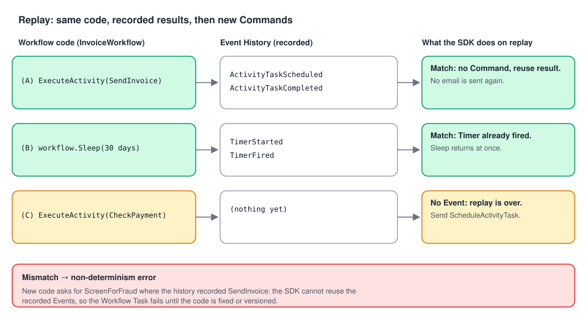

# 07 · Commands, Events and Replay: why it survives crashes

> **Level:** core concept, deep dive · **Read time:** ~20 min
> **Sources:** [How Temporal works — Core vocabulary and durability](https://docs.temporal.io/encyclopedia/architecture/how-temporal-works) · [About Temporal SDKs — Replays](https://docs.temporal.io/encyclopedia/architecture/temporal-sdks#replays) · [Temporal architecture — History Service](https://docs.temporal.io/encyclopedia/architecture/temporal-architecture#history-service)

---

## 1. The problem

A Workflow sends an invoice, waits 30 days for payment, then sends a reminder. On day 12 the Worker
that last ran it is redeployed. On day 30 a **different** Worker gets the next Workflow Task. That
Worker has never seen this Workflow. How does it know that the invoice was already sent, and why
doesn't it send it again?

The answer is the trio **Commands → Events → Replay**. It is the heart of Durable Execution, and it
explains the one rule that surprises every new Temporal developer: Workflow code must be
**deterministic**.

---

## 2. The vocabulary

| Term | What it is | Who produces it |
| --- | --- | --- |
| **Event History** | The ordered, persisted record of everything that happened in one Workflow Execution | History Service |
| **Task** | A unit of work on a Task Queue. A **Workflow Task** wakes the Workflow code up. An **Activity Task** runs Activity code. | History (via Matching) |
| **Command** | An instruction a Worker sends after running Workflow code: "schedule this Activity", "start this Timer", "complete the Workflow" | Your Workflow code, through the SDK |
| **Event** | A fact appended to the Event History, often the result of a Command, or of something external (Activity completed, Signal received, Timer fired) | History Service |
| **Replay** | The SDK re-runs the Workflow code against the recorded Event History to rebuild its state | The SDK, in a Worker |

---

## 3. From Go call to Command to Event

Your Workflow code never *does* anything outside itself. Each Temporal API call becomes a **Command**,
and the History Service records a matching **Event**:

| Go Workflow API | Command sent by the Worker | Event appended by History |
| --- | --- | --- |
| `workflow.ExecuteActivity(...)` | `ScheduleActivityTask` | `ActivityTaskScheduled` |
| `workflow.NewTimer(...)`, `workflow.Sleep(...)` | `StartTimer` | `TimerStarted` (later `TimerFired`) |
| `workflow.ExecuteChildWorkflow(...)` | `StartChildWorkflowExecution` | `StartChildWorkflowExecutionInitiated` |
| `workflow.SignalExternalWorkflow(...)` | `SignalExternalWorkflowExecution` | `SignalExternalWorkflowExecutionInitiated` |
| `workflow.SideEffect(...)`, `workflow.GetVersion(...)` | `RecordMarker` | `MarkerRecorded` |
| `return result, nil` | `CompleteWorkflowExecution` | `WorkflowExecutionCompleted` |
| `return nil, err` | `FailWorkflowExecution` | `WorkflowExecutionFailed` |
| `return nil, workflow.NewContinueAsNewError(...)` | `ContinueAsNewWorkflowExecution` | `WorkflowExecutionContinuedAsNew` |

Some Events have no Command behind them because they come from outside the Workflow:
`WorkflowExecutionSignaled` (a Client sent a Signal), `ActivityTaskCompleted` (a Worker finished an
Activity), `TimerFired` (the Server's timer queue fired).

---

## 4. Replay, step by step



Take this Workflow:

```go
// file: billing/workflow.go
package billing

import (
	"time"

	"go.temporal.io/sdk/workflow"
)

const TaskQueue = "billing"

type InvoiceInput struct {
	InvoiceID     string
	CustomerEmail string
	AmountCents   int64
	DueIn         time.Duration
}

type InvoiceOutcome struct {
	InvoiceID     string
	ReminderSent  bool
	PaidBeforeDue bool
}

func InvoiceWorkflow(ctx workflow.Context, in InvoiceInput) (InvoiceOutcome, error) {
	ctx = workflow.WithActivityOptions(ctx, workflow.ActivityOptions{StartToCloseTimeout: time.Minute})
	var a *Activities
	out := InvoiceOutcome{InvoiceID: in.InvoiceID}

	// (A) Command: ScheduleActivityTask → Events: ActivityTaskScheduled … ActivityTaskCompleted
	if err := workflow.ExecuteActivity(ctx, a.SendInvoice, in).Get(ctx, nil); err != nil {
		return out, err
	}

	// (B) Command: StartTimer → Events: TimerStarted … TimerFired (30 days later)
	if err := workflow.Sleep(ctx, in.DueIn); err != nil {
		return out, err
	}

	// (C) Command: ScheduleActivityTask (CheckPayment)
	var paid bool
	if err := workflow.ExecuteActivity(ctx, a.CheckPayment, in.InvoiceID).Get(ctx, &paid); err != nil {
		return out, err
	}
	out.PaidBeforeDue = paid

	if !paid {
		// (D) Command: ScheduleActivityTask (SendReminder)
		if err := workflow.ExecuteActivity(ctx, a.SendReminder, in).Get(ctx, nil); err != nil {
			return out, err
		}
		out.ReminderSent = true
	}
	// (E) Command: CompleteWorkflowExecution
	return out, nil
}
```

```go
// file: billing/activities.go
package billing

import (
	"context"

	"go.temporal.io/sdk/activity"
)

type Ledger interface {
	IsPaid(ctx context.Context, invoiceID string) (bool, error)
}

type Mailer interface {
	Send(ctx context.Context, to, subject string) error
}

type Activities struct {
	Ledger Ledger
	Mailer Mailer
}

func (a *Activities) SendInvoice(ctx context.Context, in InvoiceInput) error {
	activity.GetLogger(ctx).Info("Sending invoice", "invoiceID", in.InvoiceID)
	return a.Mailer.Send(ctx, in.CustomerEmail, "Invoice "+in.InvoiceID)
}

func (a *Activities) CheckPayment(ctx context.Context, invoiceID string) (bool, error) {
	return a.Ledger.IsPaid(ctx, invoiceID)
}

func (a *Activities) SendReminder(ctx context.Context, in InvoiceInput) error {
	return a.Mailer.Send(ctx, in.CustomerEmail, "Reminder: invoice "+in.InvoiceID+" is due")
}
```

Now the day-30 Workflow Task arrives at a **brand-new Worker**. Its history ends with `TimerFired`.
The SDK replays:

1. It starts `InvoiceWorkflow` from the top with the input stored in `WorkflowExecutionStarted`.
2. At **(A)** the code asks to schedule `SendInvoice`. The SDK checks the history: there is already an
   `ActivityTaskScheduled` for it, followed by `ActivityTaskCompleted`. So it **doesn't send a
   Command**. It resolves `.Get` immediately with the recorded result. **No email is sent.**
3. At **(B)** the code asks for a 30-day Timer. The history has `TimerStarted` and `TimerFired`. The
   SDK resolves the Sleep immediately.
4. At **(C)** the code asks to schedule `CheckPayment`. The history has **no** matching Event: this
   is new. Replay is over, and from here the code runs "for real": the SDK sends a
   `ScheduleActivityTask` Command.

Replay costs no Activity calls, no emails and no 30-day wait. It re-runs only the Workflow's
decisions, which are cheap, so state is rebuilt from the **Event History** alone. That's why the
Encyclopedia says:

- all state lives in the Event History, so **any Worker** can continue a Workflow after another fails;
- Workflow code is **replayed** deterministically, while Activity code runs once per attempt and can have side effects;
- retries and Timers are managed by the **Server**, so Workers hold no critical state.

---

## 5. Determinism: the price of replay

Replay works only if the code makes **the same Commands, in the same order**, every time it runs
against the same history. If replay produces a Command that doesn't match the recorded Events, the SDK
stops with a **non-determinism error** and the Workflow Task fails (and is retried) until you fix the
code.

| Don't do this in Workflow code | Why it breaks replay | Do this instead |
| --- | --- | --- |
| `time.Now()` | Different value on replay | `workflow.Now(ctx)` |
| `time.Sleep(d)` | Not recorded, blocks the Worker | `workflow.Sleep(ctx, d)` |
| `rand.Intn`, `uuid.New()` | Different value on replay | `workflow.SideEffect` (recorded as a marker), or generate it in an Activity |
| HTTP calls, DB queries, reading files | Results can change, side effects run again | An Activity |
| `go func(){…}()`, native channels, `select` | Scheduling order is not deterministic | `workflow.Go`, `workflow.Channel`, `workflow.Selector` |
| Iterating over a `map` to schedule Activities | Go map order is random | Sort the keys first |
| Reordering, adding or removing Activity calls in running Workflows | Recorded Events no longer match | Versioning (`workflow.GetVersion`, Worker Versioning) |

A quick example of the last row. Suppose you "just" add a fraud check before sending the invoice and
deploy it while invoices are waiting on their 30-day Timer:

```go
// file: billing/workflow_v2_broken.go
package billing

import (
	"context"
	"time"

	"go.temporal.io/sdk/workflow"
)

// InvoiceWorkflowV2Broken shows a NON-deterministic change. Do not ship this.
func InvoiceWorkflowV2Broken(ctx workflow.Context, in InvoiceInput) (InvoiceOutcome, error) {
	ctx = workflow.WithActivityOptions(ctx, workflow.ActivityOptions{StartToCloseTimeout: time.Minute})
	var a *Activities

	// NEW first step. On replay, the history's first scheduled Activity is SendInvoice,
	// but this code now asks for ScreenForFraud: the SDK raises a non-determinism error.
	if err := workflow.ExecuteActivity(ctx, a.ScreenForFraud, in).Get(ctx, nil); err != nil {
		return InvoiceOutcome{}, err
	}
	if err := workflow.ExecuteActivity(ctx, a.SendInvoice, in).Get(ctx, nil); err != nil {
		return InvoiceOutcome{}, err
	}
	// … rest unchanged …
	return InvoiceOutcome{InvoiceID: in.InvoiceID}, nil
}

func (a *Activities) ScreenForFraud(context.Context, InvoiceInput) error { return nil }
```

How to make such a change safely is the subject of the
[Workflows guide, chapter 11 (Versioning)](../../workflows/docs/11-versioning.md).

---

## 6. Catch non-determinism before production: replay tests

The SDK ships the same replay machinery that Workers use as a test tool. Export real histories from
production (or staging), keep them in `testdata/`, and replay them against your **new** code in CI:

```sh
temporal workflow show --workflow-id invoice-INV-2024-0042 --output json > billing/testdata/invoice-INV-2024-0042.json
```

```go
// file: billing/replay_test.go
package billing

import (
	"path/filepath"
	"testing"

	"go.temporal.io/sdk/worker"
)

// TestInvoiceWorkflowReplay fails if the current InvoiceWorkflow code would produce
// different Commands than those recorded in real histories.
func TestInvoiceWorkflowReplay(t *testing.T) {
	files, err := filepath.Glob("testdata/invoice-*.json")
	if err != nil {
		t.Fatal(err)
	}
	if len(files) == 0 {
		t.Skip("no recorded histories in testdata/")
	}

	replayer := worker.NewWorkflowReplayer()
	replayer.RegisterWorkflow(InvoiceWorkflow)

	for _, f := range files {
		t.Run(filepath.Base(f), func(t *testing.T) {
			if err := replayer.ReplayWorkflowHistoryFromJSONFile(nil, f); err != nil {
				t.Fatalf("replay of %s failed (non-deterministic change?): %v", f, err)
			}
		})
	}
}
```

If someone registers `InvoiceWorkflowV2Broken` under the name `InvoiceWorkflow`, this test fails with
a non-determinism error on every history that already passed step (A).

---

## 7. Key takeaways

- Workflow code doesn't *do* things. It emits **Commands**. The Server records **Events** and creates **Tasks**.
- **Replay** re-runs the Workflow code against the Event History. Recorded results are reused, so no side effect runs twice.
- Any Worker can continue any Workflow, because all the state is in the Event History.
- Replay requires **determinism**: same history → same Commands. Use `workflow.*` APIs and Activities for anything non-deterministic.
- Guard changes with **replay tests** (`worker.NewWorkflowReplayer`) and **versioning**.
