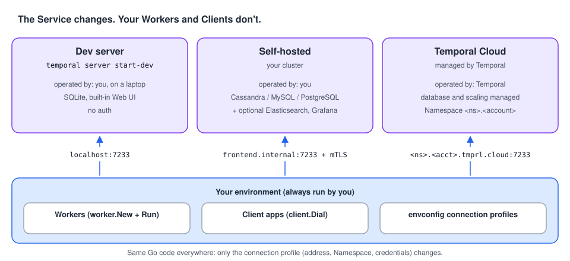

# 08 · Running it for real: dev server, self-hosted, Cloud

> **Level:** production · **Read time:** ~15 min
> **Sources:** [Encyclopedia — Temporal architecture](https://docs.temporal.io/encyclopedia/architecture/temporal-architecture) · [How Temporal works — Server](https://docs.temporal.io/encyclopedia/architecture/how-temporal-works#server) · [Go SDK — Temporal Client](https://docs.temporal.io/develop/go/client/temporal-client) · [Go SDK — Run a Worker](https://docs.temporal.io/develop/go/workers/run-worker-process)

---

## 1. The problem

The same Workers and Clients must run against a laptop dev server, a staging cluster and production.
The only things that should change between them are **where the Temporal Service is** and **how to
authenticate**. Your Workflow and Activity code shouldn't change at all.

---

## 2. Three ways to get a Temporal Service



The Server can run in three places. Your side of the architecture (Clients and Workers) is the same
in all three:

| | **Dev server** | **Self-hosted** | **Temporal Cloud** |
| --- | --- | --- | --- |
| Start it with | `temporal server start-dev` | Your deployment of the Temporal Server services | Sign up, create a Namespace |
| Who operates the Server | You, on your laptop | You (Frontend, History, Matching, Worker services, upgrades, scaling) | Temporal |
| Database | SQLite (in memory, or a file with `--db-filename`) | Cassandra, MySQL or PostgreSQL. You provision it | Managed |
| Optional components | Built-in UI | Elasticsearch (advanced visibility), Grafana (dashboards), the Web UI | Managed |
| Address | `127.0.0.1:7233`, UI `http://localhost:8233` | Your Frontend's address | `<namespace>.<account>.tmprl.cloud:7233` |
| Auth | None | Whatever you configure (e.g. mTLS) | API key or mTLS |
| Who runs your Workers | You | You | **Still you** |

In every case, your Workers run on **your** infrastructure. Temporal Cloud runs "the same kind of
service" as a self-hosted cluster, operated for you. It never runs your code.

---

## 3. One codebase, every environment: connection profiles

The Go SDK recommends keeping connection settings **out of the code**, in environment variables or a
TOML file, and loading them with `go.temporal.io/sdk/contrib/envconfig`.

The TOML file lives at `~/.config/temporalio/temporal.toml` by default, or wherever
`TEMPORAL_CONFIG_FILE` points. Each **profile** is one environment:

```toml
# file: deploy/temporal.toml
[profile.default]                       # laptop: temporal server start-dev
address = "localhost:7233"
namespace = "default"

[profile.staging]                       # self-hosted cluster with mTLS
address = "temporal-frontend.staging.internal:7233"
namespace = "shop-staging"
[profile.staging.tls]
client_cert_path = "/etc/temporal/certs/client.pem"
client_key_path = "/etc/temporal/certs/client.key"

[profile.prod]                          # Temporal Cloud with an API key
address = "shop-prod.a1b2c.tmprl.cloud:7233"
namespace = "shop-prod.a1b2c"
# api_key comes from the TEMPORAL_API_KEY env var, never from a committed file
```

Environment variables (`TEMPORAL_ADDRESS`, `TEMPORAL_NAMESPACE`, `TEMPORAL_API_KEY`,
`TEMPORAL_TLS_CLIENT_CERT_PATH`, …) **override** the file. TLS is turned on automatically when a TLS
section or an API key is present.

Then every binary (Workers, APIs, tools) dials the same way:

```go
// file: internal/temporalconn/dial.go
package temporalconn

import (
	"fmt"

	"go.temporal.io/sdk/client"
	"go.temporal.io/sdk/contrib/envconfig"
)

// Dial connects to the Temporal Service described by the active profile.
//
// The profile is the TEMPORAL_PROFILE env var, or "default". The file is
// TEMPORAL_CONFIG_FILE, or ~/.config/temporalio/temporal.toml. TEMPORAL_* env vars
// override what the file says.
func Dial() (client.Client, error) {
	opts, err := envconfig.LoadClientOptions(envconfig.LoadClientOptionsRequest{})
	if err != nil {
		return nil, fmt.Errorf("load Temporal connection profile: %w", err)
	}
	c, err := client.Dial(opts)
	if err != nil {
		return nil, fmt.Errorf("dial Temporal at %s (namespace %s): %w", opts.HostPort, opts.Namespace, err)
	}
	return c, nil
}
```

```sh
go run ./cmd/orders-worker                                          # laptop, profile "default"
TEMPORAL_PROFILE=staging TEMPORAL_CONFIG_FILE=deploy/temporal.toml go run ./cmd/orders-worker
TEMPORAL_PROFILE=prod TEMPORAL_API_KEY=$(cat /run/secrets/temporal-api-key) ./orders-worker
```

---

## 4. Temporal Cloud from code

If you'd rather configure Cloud in code (or need to override one setting), these are the pieces the
Go SDK docs list: the **endpoint** `<namespace>.<account>.tmprl.cloud:7233`, the **Namespace**
`<namespace_id>.<account_id>`, TLS, and either an **API key** or an **mTLS** client certificate.

```go
// file: internal/temporalconn/cloud.go
package temporalconn

import (
	"context"
	"crypto/tls"
	"sync/atomic"

	"go.temporal.io/sdk/client"
)

// DialCloudWithAPIKey connects with an API key that can be rotated at runtime:
// call key.Store(newKey) and the next request uses it.
func DialCloudWithAPIKey(endpoint, namespace string, key *atomic.Value) (client.Client, error) {
	return client.Dial(client.Options{
		HostPort:          endpoint,  // shop-prod.a1b2c.tmprl.cloud:7233
		Namespace:         namespace, // shop-prod.a1b2c
		ConnectionOptions: client.ConnectionOptions{TLS: &tls.Config{}},
		Credentials: client.NewAPIKeyDynamicCredentials(func(context.Context) (string, error) {
			return key.Load().(string), nil
		}),
	})
}

// DialCloudWithMTLS reads the client certificate on every new connection, so you can
// rotate it by replacing the files, without restarting the Worker.
func DialCloudWithMTLS(endpoint, namespace, certPath, keyPath string) (client.Client, error) {
	return client.Dial(client.Options{
		HostPort:  endpoint,
		Namespace: namespace,
		ConnectionOptions: client.ConnectionOptions{
			TLS: &tls.Config{
				GetClientCertificate: func(*tls.CertificateRequestInfo) (*tls.Certificate, error) {
					cert, err := tls.LoadX509KeyPair(certPath, keyPath)
					if err != nil {
						return nil, err
					}
					return &cert, nil
				},
			},
		},
	})
}
```

---

## 5. A production-shaped Worker

Pulling the previous chapters together: profile-based connection, an identity that shows up in the
poller list, a graceful shutdown that fits Kubernetes' `SIGTERM` handling, and a readiness check
based on the Frontend's health.

```go
// file: orders/orders.go
package orders

import (
	"context"
	"time"

	"go.temporal.io/sdk/workflow"
)

const TaskQueue = "orders"

type Activities struct{}

func (a *Activities) ReserveInventory(ctx context.Context, orderID string) error { return nil }

func ProcessOrderWorkflow(ctx workflow.Context, orderID string) error {
	ctx = workflow.WithActivityOptions(ctx, workflow.ActivityOptions{StartToCloseTimeout: 30 * time.Second})
	var a *Activities
	return workflow.ExecuteActivity(ctx, a.ReserveInventory, orderID).Get(ctx, nil)
}
```

```go
// file: cmd/orders-worker/main.go
package main

import (
	"context"
	"log"
	"net/http"
	"os"
	"time"

	"go.temporal.io/sdk/client"
	"go.temporal.io/sdk/worker"

	"github.com/acme/shop/internal/temporalconn"
	"github.com/acme/shop/orders"
)

func main() {
	c, err := temporalconn.Dial()
	if err != nil {
		log.Fatalln(err)
	}
	defer c.Close()

	pod, _ := os.Hostname() // the Kubernetes pod name
	w := worker.New(c, orders.TaskQueue, worker.Options{
		Identity:          "orders-worker@" + pod,
		WorkerStopTimeout: 25 * time.Second, // below the pod's terminationGracePeriodSeconds (30s)
	})
	w.RegisterWorkflow(orders.ProcessOrderWorkflow)
	w.RegisterActivity(&orders.Activities{})

	// Readiness probe: ready when the Frontend answers. Workers need no other inbound port.
	go func() {
		http.HandleFunc("/readyz", func(rw http.ResponseWriter, r *http.Request) {
			ctx, cancel := context.WithTimeout(r.Context(), 2*time.Second)
			defer cancel()
			if _, err := c.CheckHealth(ctx, &client.CheckHealthRequest{}); err != nil {
				http.Error(rw, err.Error(), http.StatusServiceUnavailable)
				return
			}
			rw.WriteHeader(http.StatusOK)
		})
		log.Println(http.ListenAndServe(":8080", nil))
	}()

	// SIGTERM → stop polling, finish in-flight Tasks (up to WorkerStopTimeout), exit.
	if err := w.Run(worker.InterruptCh()); err != nil {
		log.Fatalln("worker stopped", err)
	}
}
```

---

## 6. Production checklist, from the architecture

| Architecture fact | What to do |
| --- | --- |
| Clients and Workers only talk to the **Frontend** | Open outbound gRPC (port 7233) from your pods to the Frontend or Cloud endpoint. Workers need no inbound port. |
| The Frontend **authorizes** requests | Use mTLS or API keys outside your laptop. Keep secrets in env vars or mounted files, not in TOML in git. |
| **Matching** spreads Tasks across pollers | Scale Workers horizontally per Task Queue. Watch for "no pollers" (`temporal task-queue describe`). |
| All Workers on a Task Queue must register the **same types** | One Deployment per Task Queue. Don't share a queue name between services. |
| **History** keeps state, Workers are disposable | Use rolling deploys freely, but make Workflow changes replay-safe (replay tests + versioning). |
| The **database** is required, Elasticsearch and Grafana are optional (self-hosted) | Size the database first. Add Elasticsearch when you need rich visibility search. Add dashboards for operations. |
| A Client is a gRPC connection | One Client per process. Close it on shutdown. |

---

## 7. Key takeaways

- Dev server, self-hosted cluster or Temporal Cloud: the Service changes, your code doesn't. **You always run the Workers.**
- Keep connection settings in `envconfig` profiles (`TEMPORAL_PROFILE`, `TEMPORAL_CONFIG_FILE`, `TEMPORAL_*` env vars).
- Temporal Cloud = endpoint `<ns>.<acct>.tmprl.cloud:7233` + Namespace `<ns>.<acct>` + API key or mTLS.
- Production Workers: an identity, a graceful stop timeout, a readiness check, one Deployment per Task Queue.
