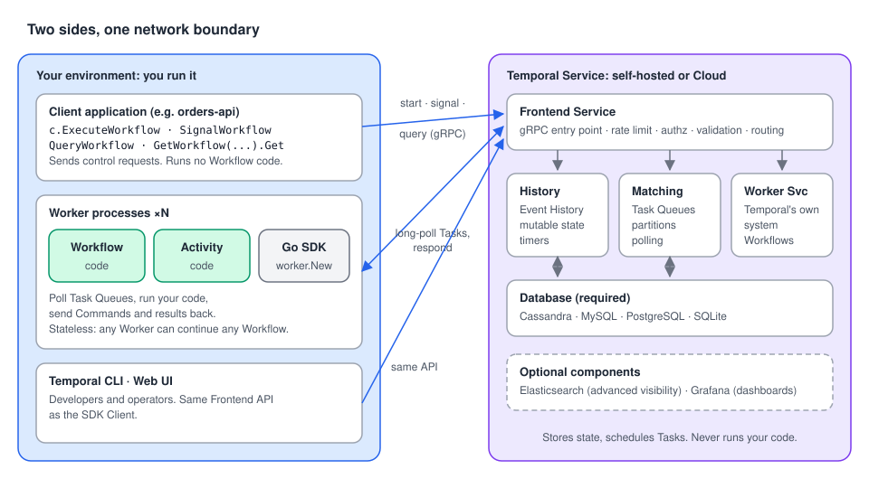

# Temporal Architecture with Go: a roadmap

> A progressive onboarding guide to **how Temporal works under the hood**, for Go developers. It is
> based on the Temporal Encyclopedia's Architecture pages (the concepts), read side by side with the
> Go SDK's Client and Worker pages (how it looks in Go). Every chapter has **compilable Go examples**
> with production-like names.
>
> Companion guides: [Temporal Workflows with Go](../../workflows/docs/README.md) and
> [Temporal Activities with Go](../../activities/docs/README.md). Read this one first to know which
> part runs where. Read those to write the code.



---

## Why this matters, in 30 seconds

Temporal promises that your code **survives crashes, retries failures and resumes after days of
waiting**. That promise comes from a precise split of responsibilities:

- **You** run a Temporal Application: Workflows, Activities, a **Client** that sends requests, and
  **Workers** that run the code. All are built with an SDK.
- **The Temporal Service** (Frontend, History, Matching, a database) records every step as an
  **Event History**, puts work on **Task Queues**, and owns retries and timers. It never runs your code.
- Workers **poll** for Tasks, run your code, and send back **Commands** and results. Because all
  state is in the Event History, any Worker can **replay** a Workflow and continue where another stopped.

When you know this split, you can explain any Event in the Web UI, find why a Workflow is "stuck",
and understand why Workflow code must be deterministic.

---

## The roadmap

Read in order. Each stage builds on the previous one.

### Stage 1: Foundations *(core concepts, must-know)*

| # | Chapter | You'll be able to… |
| --- | --- | --- |
| 01 | [The big picture: who runs what](01-the-big-picture.md) | Tell your environment from the Temporal Service, name the three kinds of clients, and run a complete app (Workflow, Activities, Worker, starter). |
| 02 | [Temporal SDKs: what the library gives you](02-temporal-sdks.md) | Map the SDK's components to Go packages, write a business process as code (loan application), test it in memory, and explain "choreographer, not conductor". |

### Stage 2: The parts *(core concepts, daily use)*

| # | Chapter | You'll be able to… |
| --- | --- | --- |
| 03 | [The Temporal Client: talking to the Service](03-temporal-client.md) | Start, Signal, Query, list, get results and cancel from an HTTP API. Know the Client rules (one per process, never in a Workflow). |
| 04 | [Inside the Temporal Server](04-inside-the-server.md) | Explain Frontend, History, Matching, Worker Service and persistence, and inspect each one from Go with a small diagnostic tool. |
| 05 | [Workers: where your code runs](05-workers.md) | Configure and run Workers, follow the registration rule, route work to specialized Worker pools, and reason about scaling and crashes. |

### Stage 3: How it works end-to-end *(deep dive)*

| # | Chapter | You'll be able to… |
| --- | --- | --- |
| 06 | [Life of a Workflow Execution, step by step](06-workflow-lifecycle.md) | Follow the 15 steps from `StartWorkflowExecution` to the result, map each Event to a step, and debug a "stuck" Workflow. |
| 07 | [Commands, Events and Replay](07-commands-events-replay.md) | Explain how replay rebuilds state without re-running side effects, why determinism matters, and catch non-determinism with replay tests. |

### Stage 4: Production

| # | Chapter | You'll be able to… |
| --- | --- | --- |
| 08 | [Running it for real: dev server, self-hosted, Cloud](08-running-temporal.md) | Pick a deployment option, connect the same code to every environment with `envconfig` profiles, connect to Temporal Cloud, and ship a production-shaped Worker. |

---

## Core concepts vs. implementation details

| **Core concepts**: understand these first | **Implementation details, options & sub-features**: learn when needed |
| --- | --- |
| Your environment vs. the Temporal Service ([01](01-the-big-picture.md)) | Dev server, self-hosted, Temporal Cloud ([08](08-running-temporal.md)) |
| Temporal Application = Workflows + Activities + Client + Worker setup ([02](02-temporal-sdks.md)) | SDK package map, `testsuite`, third-party SDKs ([02](02-temporal-sdks.md)) |
| Temporal Client and its operations ([03](03-temporal-client.md)) | `envconfig` profiles, API keys, mTLS rotation ([03](03-temporal-client.md), [08](08-running-temporal.md)) |
| Frontend, History, Matching ([04](04-inside-the-server.md)) | Worker Service, Task Queue partitions, visibility, Elasticsearch, Grafana ([04](04-inside-the-server.md)) |
| Workers poll Task Queues ([05](05-workers.md)) | `worker.Options` tuning, sticky cache, Serverless Workers ([05](05-workers.md)) |
| Tasks, Commands, Events ([06](06-workflow-lifecycle.md), [07](07-commands-events-replay.md)) | Transfer Tasks, late `ActivityTaskStarted`, event-free retries ([06](06-workflow-lifecycle.md)) |
| Event History and replay ([07](07-commands-events-replay.md)) | Replay tests with `worker.NewWorkflowReplayer` ([07](07-commands-events-replay.md)) |
| Determinism ([07](07-commands-events-replay.md)) | Versioning ([Workflows guide, chapter 11](../../workflows/docs/11-versioning.md)) |

---

## Where should I look?

```text
My Workflow doesn't start or doesn't progress
├── ExecuteWorkflow returned an error?
│   ├── connection refused / unavailable   → Client can't reach the Frontend          → chapters 03, 08
│   └── WorkflowExecutionAlreadyStarted    → same Workflow ID already running         → chapter 03
└── It started, but the history stops at…
    ├── WorkflowTaskScheduled              → no Worker polls this Task Queue          → chapters 04, 05
    ├── WorkflowTaskFailed (repeating)     → Worker can't run the code (panic,
    │                                         unregistered type, non-determinism)    → chapters 05, 07
    ├── ActivityTaskScheduled              → Activity pending: no poller, or retrying → chapters 04, 06
    └── TimerStarted / waiting for Signal  → waiting by design                         → your code

I'm changing Workflow code that already has running executions
└── Will the new code emit the same Commands for old histories?
    ├── Not sure                           → replay test                               → chapter 07
    └── No                                 → versioning                                → Workflows guide, ch. 11
```

---

## Go API cheat sheet

| I want to… | Go API | Chapter |
| --- | --- | --- |
| Connect to the local dev server | `client.Dial(client.Options{})` (`127.0.0.1:7233`, Namespace `default`) | 01, 03 |
| Connect from env vars / TOML profiles | `envconfig.MustLoadDefaultClientOptions()`, `envconfig.LoadClientOptions(…)` | 03, 08 |
| Connect to Temporal Cloud | `client.Options{HostPort, Namespace, ConnectionOptions: {TLS}, Credentials: client.NewAPIKeyDynamicCredentials(…)}` | 08 |
| Start a Workflow | `c.ExecuteWorkflow(ctx, client.StartWorkflowOptions{ID, TaskQueue}, wf, args...)` | 01, 03 |
| Signal / Query a Workflow | `c.SignalWorkflow(ctx, id, "", name, arg)`, `c.QueryWorkflow(ctx, id, "", name)` | 03 |
| Get a result | `c.GetWorkflow(ctx, id, "").Get(ctx, &out)` | 03 |
| List / count Workflows | `c.ListWorkflow(ctx, &workflowservice.ListWorkflowExecutionsRequest{Query})`, `c.CountWorkflow(…)` | 03, 04 |
| Cancel / terminate | `c.CancelWorkflow(ctx, id, "")`, `c.TerminateWorkflow(ctx, id, "", reason)` | 03 |
| Check the Frontend | `c.CheckHealth(ctx, &client.CheckHealthRequest{})` | 04, 08 |
| Read state and history | `c.DescribeWorkflowExecution(ctx, id, "")`, `c.GetWorkflowHistory(ctx, id, "", false, filter)` | 04, 06 |
| See who polls a Task Queue | `c.DescribeTaskQueue(ctx, tq, enumspb.TASK_QUEUE_TYPE_WORKFLOW)` | 04 |
| Run a Worker | `w := worker.New(c, tq, worker.Options{…})`, `w.Register*`, `w.Run(worker.InterruptCh())` | 05 |
| Send an Activity to another Worker pool | `workflow.ActivityOptions{TaskQueue: "payments", …}` | 05 |
| Test a Workflow in memory | `testsuite.WorkflowTestSuite`, `env.OnActivity(…)`, `env.ExecuteWorkflow(…)` | 02 |
| Replay a recorded history | `worker.NewWorkflowReplayer()`, `ReplayWorkflowHistoryFromJSONFile(nil, path)` | 07 |

---

## Diagrams

| Diagram | Used in |
| --- | --- |
| [Architecture mental model](../img/architecture-mental-model.svg) | README, 01 |
| [SDK components](../img/architecture-sdk-components.svg) | 02 |
| [Clients and the Frontend](../img/architecture-clients-frontend.svg) | 03 |
| [Server internals](../img/architecture-server-internals.svg) | 04 |
| [Workers poll Task Queues](../img/architecture-worker-polling.svg) | 05 |
| [Workflow and Activity lifecycle](../img/architecture-lifecycle.svg) | 06 |
| [Commands, Events and Replay](../img/architecture-replay.svg) | 07 |
| [Deployment options](../img/architecture-deployment-options.svg) | 08 |

---

## About the code samples

- Each chapter is a **self-contained module** named `github.com/acme/shop`. Every Go block starts with
  `// file: <path>` so you can paste it into that path.
- All samples were compiled, `gofmt`-checked and `go vet`-checked against **Go SDK v1.50.0**
  (`go.temporal.io/sdk`) and `go.temporal.io/sdk/contrib/envconfig` v1.0.2. The tests in chapters 02
  and 07 pass.
- The chapter 04 diagnostic tool and the chapter 06 lifecycle demo were run against a dev server
  (Temporal CLI 1.9.1, Server 1.32.0). Their sample outputs are real output, with log timestamps removed.
- External systems (payment gateways, credit bureaus, mailers, carriers) are **interfaces or fakes**.
- Run everything locally with `temporal server start-dev` (UI at <http://localhost:8233>).

### Notes from checking the docs against the SDK

- **The topic lists no Go SDK pages.** Architecture is a concept topic. The Go code follows the
  pages the Encyclopedia links to: [Temporal Client](https://docs.temporal.io/develop/go/client/temporal-client)
  and [Run a Worker](https://docs.temporal.io/develop/go/workers/run-worker-process).
- **gRPC method names.** "How Temporal works" says Workers poll with `PollWorkflowTask` and
  `PollActivityTask`. The public API (`go.temporal.io/api` v1.63.5, used by SDK v1.50.0) names them
  **`PollWorkflowTaskQueue`** and **`PollActivityTaskQueue`**. `AddWorkflowTask` and `AddActivityTask`
  are internal Matching calls and don't appear in the public API. The chapters use the real names.
- **Default retry interval.** "About Temporal SDKs" says a failed Activity is retried "with one second
  between intervals … an infinite number of times". The SDK's default Retry Policy starts at 1 second
  but uses a **backoff coefficient of 2.0** (1s, 2s, 4s… up to 100× the initial interval). Attempts
  are unlimited by default.
- **Replay on every Workflow Task.** Steps 5 and 13 of "How Temporal works" describe a full replay of
  the Event History on each Workflow Task. The Go SDK keeps recently used executions in a **sticky
  cache** (`worker.SetStickyWorkflowCacheSize`) and receives only new Events. A full replay happens on
  a cache miss (restart, eviction, another Worker). See [chapter 05](05-workers.md).
- **Late `ActivityTaskStarted`.** Step 9 says `ActivityTaskStarted` is written only when the Activity
  completes or fails for the last time. This was confirmed by running chapter 06: two failed attempts
  and one success produce one `ActivityTaskStarted` with `attempt=3` and no failure Events.
- **Client operations differ between pages.** The architecture page lists start, Signal, Query, list,
  result, cancel and terminate. "About Temporal SDKs" leaves out cancel and terminate. The Go Client
  has all of them, plus Updates and Standalone Activities.
- **Profiles from the environment.** The Go Client page selects an `envconfig` profile in code
  (`ConfigFileProfile`). `envconfig` v1.0.2 also reads the **`TEMPORAL_PROFILE`** environment variable,
  which [chapter 08](08-running-temporal.md) uses.

---

## Sources

**Encyclopedia:** [Temporal architecture](https://docs.temporal.io/encyclopedia/architecture/temporal-architecture) · [How Temporal works](https://docs.temporal.io/encyclopedia/architecture/how-temporal-works) · [About Temporal SDKs](https://docs.temporal.io/encyclopedia/architecture/temporal-sdks)

**Go SDK (linked from the Encyclopedia pages):** [Temporal Client](https://docs.temporal.io/develop/go/client/temporal-client) · [Run a Worker](https://docs.temporal.io/develop/go/workers/run-worker-process)
