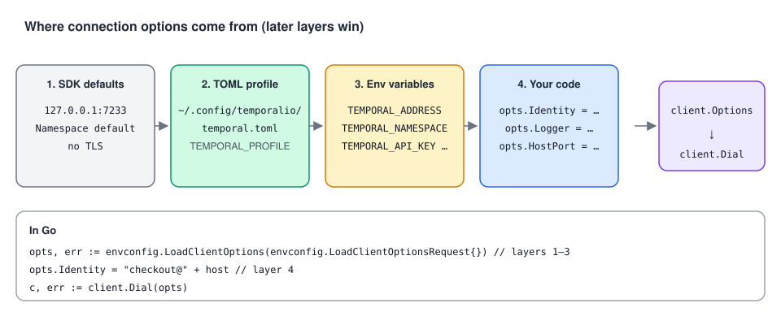

# 02 · Connecting: defaults, environment variables, config files

> **Level:** core concept, daily use · **Read time:** ~12 min
> **Sources:** [Go SDK — Connect to development Temporal Service](https://docs.temporal.io/develop/go/client/temporal-client#connect-to-development-service) · [Environment Configuration reference](https://docs.temporal.io/references/client-environment-configuration)

---

## 1. The problem

The same binary runs on your laptop against `temporal server start-dev`, in CI against a test
cluster, and in production against Temporal Cloud. Hard-coding `HostPort: "localhost:7233"` works on
day one and becomes a deployment bug on day ten. Putting API keys in code is worse.

The Go SDK lets you build the connection options from **code**, **environment variables** or a
**TOML configuration file**, and mix them. The SDK docs recommend environment variables or a config
file to manage connection options securely.

---

## 2. What `client.Dial` needs

`client.Dial(client.Options{…})` creates a `client.Client`. The connection-related options are:

| Option | Meaning | Default |
| --- | --- | --- |
| `HostPort` | Address of the Frontend Service | `127.0.0.1:7233` (`client.DefaultHostPort`), the dev server |
| `Namespace` | Namespace to work in | `default` |
| `ConnectionOptions.TLS` | TLS configuration (`*tls.Config`) | none (plaintext) |
| `Credentials` | API key or mTLS credentials | none |

So against the dev server, `client.Options{}` is enough. Everything else is covered in
[chapter 03](03-cloud-and-security.md).

---

## 3. Where options come from, and who wins



The `go.temporal.io/sdk/contrib/envconfig` package loads options in layers:

1. **SDK defaults** (`127.0.0.1:7233`, `default`).
2. A **profile** from a **TOML file**: `~/.config/temporalio/temporal.toml` by default, or the path in
   `TEMPORAL_CONFIG_FILE`. The profile is `default` unless you choose another one.
3. **Environment variables** (`TEMPORAL_ADDRESS`, `TEMPORAL_NAMESPACE`, `TEMPORAL_API_KEY`, …). They
   **override** the file.
4. **Your code**, last: `envconfig` returns a plain `client.Options` that you can change before
   calling `client.Dial`.

The main environment variables:

| Variable | Sets |
| --- | --- |
| `TEMPORAL_ADDRESS` | `HostPort` |
| `TEMPORAL_NAMESPACE` | `Namespace` |
| `TEMPORAL_API_KEY` | API key credentials (turns TLS on) |
| `TEMPORAL_TLS_CLIENT_CERT_PATH` / `_DATA` | mTLS client certificate |
| `TEMPORAL_TLS_CLIENT_KEY_PATH` / `_DATA` | mTLS client private key |
| `TEMPORAL_TLS_SERVER_CA_CERT_PATH`, `TEMPORAL_TLS_SERVER_NAME` | Server CA and name, for self-hosted TLS |
| `TEMPORAL_CONFIG_FILE` | Path of the TOML file |
| `TEMPORAL_PROFILE` | Which profile of the TOML file to use |
| `TEMPORAL_GRPC_META_<NAME>` | Extra gRPC headers |

Environment variable and config file support were added in Go SDK v1.28.0.

---

## 4. The four ways, in Go

### 4.1 In code (fine for local development and tests)

```go
// file: internal/temporalconn/code.go
package temporalconn

import "go.temporal.io/sdk/client"

// DialLocal connects to the dev server started by `temporal server start-dev`.
func DialLocal() (client.Client, error) {
	return client.Dial(client.Options{
		HostPort:  client.DefaultHostPort, // "127.0.0.1:7233"
		Namespace: "default",
	})
}
```

### 4.2 From environment variables (and the default profile, if a file exists)

```go
// file: internal/temporalconn/env.go
package temporalconn

import (
	"fmt"

	"go.temporal.io/sdk/client"
	"go.temporal.io/sdk/contrib/envconfig"
)

// DialFromEnv reads the "default" profile of the config file (if any), then TEMPORAL_* env vars.
// LoadDefaultClientOptions returns an error. MustLoadDefaultClientOptions panics instead.
func DialFromEnv() (client.Client, error) {
	opts, err := envconfig.LoadDefaultClientOptions()
	if err != nil {
		return nil, fmt.Errorf("load Temporal client options: %w", err)
	}
	return client.Dial(opts)
}
```

### 4.3 From a named profile in a TOML file

```toml
# file: ~/.config/temporalio/temporal.toml
[profile.default]
address = "localhost:7233"
namespace = "default"

[profile.staging]
address = "temporal.staging.acme.internal:7233"
namespace = "shop-staging"
[profile.staging.grpc_meta]
team = "checkout"
```

```go
// file: internal/temporalconn/profile.go
package temporalconn

import (
	"fmt"

	"go.temporal.io/sdk/client"
	"go.temporal.io/sdk/contrib/envconfig"
)

// DialProfile loads one profile. An empty configFile means TEMPORAL_CONFIG_FILE or the default path.
// Env vars still override what the profile says.
func DialProfile(profile, configFile string) (client.Client, error) {
	opts, err := envconfig.LoadClientOptions(envconfig.LoadClientOptionsRequest{
		ConfigFilePath:    configFile,
		ConfigFileProfile: profile,
	})
	if err != nil {
		return nil, fmt.Errorf("load profile %q: %w", profile, err)
	}
	return client.Dial(opts)
}
```

### 4.4 Load, then override in code

```go
// file: internal/temporalconn/override.go
package temporalconn

import (
	"fmt"
	"os"

	"go.temporal.io/sdk/client"
	"go.temporal.io/sdk/contrib/envconfig"
)

// DialForService loads the shared configuration, then sets what only the code knows:
// an Identity that shows up in the Web UI and in poller lists.
func DialForService(serviceName string) (client.Client, error) {
	opts, err := envconfig.LoadDefaultClientOptions()
	if err != nil {
		return nil, fmt.Errorf("load Temporal client options: %w", err)
	}
	host, _ := os.Hostname()
	opts.Identity = fmt.Sprintf("%s@%s", serviceName, host)
	return client.Dial(opts)
}
```

Then a binary doesn't care where it runs:

```sh
go run ./cmd/checkout                                         # laptop: default profile or defaults
TEMPORAL_PROFILE=staging go run ./cmd/checkout                # staging profile from the TOML file
TEMPORAL_ADDRESS=10.0.3.7:7233 TEMPORAL_NAMESPACE=shop-ci ./checkout   # CI: env vars only
```

---

## 5. When does the connection happen?

| Constructor | Behavior |
| --- | --- |
| `client.Dial(opts)` | Connects **now** and checks the Service is reachable. Returns an error if it isn't. |
| `client.DialContext(ctx, opts)` | Same, bounded by `ctx` (e.g. a startup timeout). |
| `client.NewLazyClient(opts)` | Connects on **first use**. Useful when the Service may start after your process. |
| `client.NewClientFromExisting(c, opts)` | A second Client (e.g. another Namespace) that **reuses the connection** of `c`. |

A small startup check makes misconfiguration obvious instead of a mysterious timeout later:

```go
// file: cmd/temporal-doctor/main.go
package main

import (
	"context"
	"log"
	"time"

	"go.temporal.io/sdk/client"
	"go.temporal.io/sdk/contrib/envconfig"
)

// temporal-doctor prints which Service and Namespace this environment points to, and checks them.
func main() {
	opts, err := envconfig.LoadDefaultClientOptions()
	if err != nil {
		log.Fatalln("bad Temporal configuration:", err)
	}
	host := opts.HostPort
	if host == "" {
		host = client.DefaultHostPort
	}
	ns := opts.Namespace
	if ns == "" {
		ns = "default"
	}
	log.Printf("connecting to %s, namespace %q, TLS=%t", host, ns, opts.ConnectionOptions.TLS != nil)

	ctx, cancel := context.WithTimeout(context.Background(), 5*time.Second)
	defer cancel()
	c, err := client.DialContext(ctx, opts)
	if err != nil {
		log.Fatalln("cannot reach Temporal:", err)
	}
	defer c.Close()

	if _, err := c.CheckHealth(ctx, &client.CheckHealthRequest{}); err != nil {
		log.Fatalln("Temporal is not healthy:", err)
	}
	log.Println("OK")
}
```

---

## 6. Key takeaways

- Defaults target the dev server: `127.0.0.1:7233`, Namespace `default`.
- Prefer **env vars** or a **TOML profile** (loaded with `envconfig`) over hard-coded options.
- Precedence: defaults < TOML profile < `TEMPORAL_*` env vars < your code.
- Pick the profile with `TEMPORAL_PROFILE` or `ConfigFileProfile`, and the file with `TEMPORAL_CONFIG_FILE` or `ConfigFilePath`.
- `Dial` connects eagerly. `DialContext` adds a timeout. `NewLazyClient` defers the connection.
