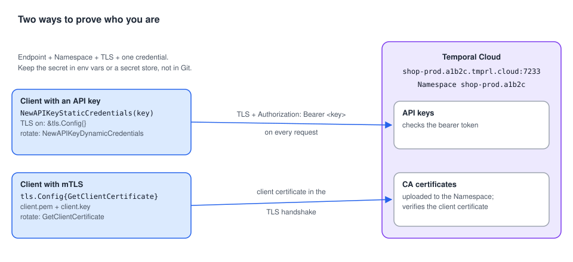

# 03 · Connecting to Temporal Cloud and secured Services

> **Level:** daily use, production · **Read time:** ~15 min
> **Sources:** [Go SDK — Connect to Temporal Cloud](https://docs.temporal.io/develop/go/client/temporal-client#connect-to-temporal-cloud) · [Environment Configuration reference](https://docs.temporal.io/references/client-environment-configuration)

---

## 1. The problem

A dev server accepts anyone. Temporal Cloud, and any self-hosted cluster worth running, must know
**who** is calling and must **encrypt** the traffic. Your Client has to prove its identity, the
credentials must be kept out of Git, and they must be **rotated** without taking Workers down.

---

## 2. What Temporal Cloud needs from your Client



| Piece | Format | Example |
| --- | --- | --- |
| **Endpoint** | The gRPC Namespace endpoint `<namespace>.<account>.tmprl.cloud:7233` | `shop-prod.a1b2c.tmprl.cloud:7233` |
| **Namespace** | `<namespace_id>.<account_id>` | `shop-prod.a1b2c` |
| **TLS** | Always on | `&tls.Config{}` |
| **Credentials** | **either** an **API key** **or** an **mTLS** client certificate and private key | |

The Namespace endpoint works for every Namespace and sends traffic to the active region for
Namespaces with High Availability. You find the Namespace, Account ID and endpoint on the Namespaces
tab of the Cloud UI.

| | **API key** | **mTLS** |
| --- | --- | --- |
| What you hold | A secret string | A client certificate + private key, signed by a CA you uploaded to the Namespace |
| Sent as | A bearer token on each request | Your identity in the TLS handshake |
| Rotation | Swap the key at runtime with dynamic credentials | Replace the files. `GetClientCertificate` reads them on each new connection |
| Typical use | Simplest start, per-service keys | Organizations with an existing PKI or cert-manager |

---

## 3. Option A: config file or environment variables (recommended)

### With an API key

```toml
# file: deploy/temporal.toml
[profile.cloud]
address = "shop-prod.a1b2c.tmprl.cloud:7233"
namespace = "shop-prod.a1b2c"
# api_key = "…"  ← better: set TEMPORAL_API_KEY from your secret store
```

```sh
export TEMPORAL_CONFIG_FILE=deploy/temporal.toml
export TEMPORAL_PROFILE=cloud
export TEMPORAL_API_KEY="$(cat /run/secrets/temporal-api-key)"
./checkout
```

With an API key, TLS is turned on automatically.

### With mTLS

The certificate settings go in the profile's **`tls` table**:

```toml
# file: deploy/temporal.toml
[profile.cloud-mtls]
address = "shop-prod.a1b2c.tmprl.cloud:7233"
namespace = "shop-prod.a1b2c"

[profile.cloud-mtls.tls]
client_cert_path = "/etc/temporal/certs/client.pem"
client_key_path = "/etc/temporal/certs/client.key"
```

Or with environment variables only:

```sh
export TEMPORAL_ADDRESS=shop-prod.a1b2c.tmprl.cloud:7233
export TEMPORAL_NAMESPACE=shop-prod.a1b2c
export TEMPORAL_TLS_CLIENT_CERT_PATH=/etc/temporal/certs/client.pem
export TEMPORAL_TLS_CLIENT_KEY_PATH=/etc/temporal/certs/client.key
```

> ⚠️ The Go Client page shows an mTLS profile with `tls_client_cert_data` and `tls_client_key_path`
> keys written directly under `[profile.cloud]`. `envconfig` v1.0.2 doesn't know those keys and
> **silently ignores them**, so the Client would connect without a certificate. Use the `tls` table
> above (`client_cert_path`, `client_cert_data`, `client_key_path`, `client_key_data`). See the
> notes in the [README](README.md#notes-from-checking-the-docs-against-the-sdk).

The Go code is the same for every profile:

```go
// file: internal/temporalconn/dial.go
package temporalconn

import (
	"fmt"

	"go.temporal.io/sdk/client"
	"go.temporal.io/sdk/contrib/envconfig"
)

// Dial uses TEMPORAL_PROFILE / TEMPORAL_CONFIG_FILE / TEMPORAL_* env vars.
func Dial() (client.Client, error) {
	opts, err := envconfig.LoadClientOptions(envconfig.LoadClientOptionsRequest{})
	if err != nil {
		return nil, fmt.Errorf("load Temporal client options: %w", err)
	}
	return client.Dial(opts)
}
```

---

## 4. Option B: in code

Use this when the credentials come from your own secret manager, or when you need rotation.

### API key, static and rotatable

```go
// file: internal/temporalconn/apikey.go
package temporalconn

import (
	"context"
	"crypto/tls"
	"sync/atomic"

	"go.temporal.io/sdk/client"
)

// DialCloudAPIKey connects with a fixed API key.
func DialCloudAPIKey(endpoint, namespace, apiKey string) (client.Client, error) {
	return client.Dial(client.Options{
		HostPort:          endpoint,  // shop-prod.a1b2c.tmprl.cloud:7233
		Namespace:         namespace, // shop-prod.a1b2c
		ConnectionOptions: client.ConnectionOptions{TLS: &tls.Config{}},
		Credentials:       client.NewAPIKeyStaticCredentials(apiKey),
	})
}

// RotatingAPIKey holds the current key. Call Set from your secret-refresh loop:
// the next request uses the new key, no reconnect, no restart.
type RotatingAPIKey struct{ v atomic.Value }

func NewRotatingAPIKey(initial string) *RotatingAPIKey {
	k := &RotatingAPIKey{}
	k.v.Store(initial)
	return k
}

func (k *RotatingAPIKey) Set(key string) { k.v.Store(key) }

// DialCloudRotatingAPIKey connects with a key that can change at runtime.
func DialCloudRotatingAPIKey(endpoint, namespace string, key *RotatingAPIKey) (client.Client, error) {
	return client.Dial(client.Options{
		HostPort:          endpoint,
		Namespace:         namespace,
		ConnectionOptions: client.ConnectionOptions{TLS: &tls.Config{}},
		Credentials: client.NewAPIKeyDynamicCredentials(func(context.Context) (string, error) {
			return key.v.Load().(string), nil
		}),
	})
}
```

### mTLS, with rotation without restart

Set `GetClientCertificate` instead of `Certificates`. Go's `crypto/tls` calls it on every new
connection, so overwriting the files (by hand or with cert-manager) is enough. The new certificate is
picked up the next time the connection is re-established, for example after Temporal Cloud's periodic
connection recycling.

```go
// file: internal/temporalconn/mtls.go
package temporalconn

import (
	"crypto/tls"

	"go.temporal.io/sdk/client"
)

// DialCloudMTLS reads the client certificate and key from disk on each new connection.
func DialCloudMTLS(endpoint, namespace, certPath, keyPath string) (client.Client, error) {
	return client.Dial(client.Options{
		HostPort:  endpoint,
		Namespace: namespace,
		ConnectionOptions: client.ConnectionOptions{
			TLS: &tls.Config{
				GetClientCertificate: func(*tls.CertificateRequestInfo) (*tls.Certificate, error) {
					cert, err := tls.LoadX509KeyPair(certPath, keyPath)
					if err != nil {
						return nil, err
					}
					return &cert, nil
				},
			},
		},
	})
}
```

### Self-hosted cluster with a private CA

For a self-hosted Frontend behind TLS signed by your own CA, add the CA and the expected server name.
`ConnectionOptions.TLS` is a real `*tls.Config`, so anything `crypto/tls` supports works.

```go
// file: internal/temporalconn/selfhosted.go
package temporalconn

import (
	"crypto/tls"
	"crypto/x509"
	"errors"
	"os"

	"go.temporal.io/sdk/client"
)

// DialSelfHosted connects to a self-hosted Frontend with mTLS and a private CA.
func DialSelfHosted(hostPort, namespace, caPath, certPath, keyPath, serverName string) (client.Client, error) {
	caPEM, err := os.ReadFile(caPath)
	if err != nil {
		return nil, err
	}
	pool := x509.NewCertPool()
	if !pool.AppendCertsFromPEM(caPEM) {
		return nil, errors.New("no CA certificate found in " + caPath)
	}
	cert, err := tls.LoadX509KeyPair(certPath, keyPath)
	if err != nil {
		return nil, err
	}
	return client.Dial(client.Options{
		HostPort:  hostPort,  // temporal-frontend.platform.svc:7233
		Namespace: namespace, // shop-prod
		ConnectionOptions: client.ConnectionOptions{
			TLS: &tls.Config{
				RootCAs:      pool,
				Certificates: []tls.Certificate{cert},
				ServerName:   serverName, // must match the Frontend certificate
			},
		},
	})
}
```

---

## 5. Older SDK versions

The SDK docs keep the older ways to send an API key for reference:

| Go SDK | API key mechanism |
| --- | --- |
| ≥ v1.33 | `Credentials: client.NewAPIKeyStaticCredentials(key)` / `NewAPIKeyDynamicCredentials(fn)` (this chapter) |
| v1.26 – v1.32 | Same credentials, plus a gRPC interceptor that adds the `temporal-namespace` header |
| < v1.26 | A `HeadersProvider` that sets `Authorization: Bearer <key>` and `temporal-namespace` |

If you see a `HeadersProvider` doing this in an existing codebase, upgrading the SDK lets you delete it.

---

## 6. Key takeaways

- Temporal Cloud = endpoint `<ns>.<acct>.tmprl.cloud:7233` + Namespace `<ns>.<acct>` + TLS + API key **or** mTLS.
- Prefer a TOML profile or `TEMPORAL_*` env vars, with secrets injected from your secret store.
- mTLS settings in TOML go in the `[profile.<name>.tls]` table.
- Rotate API keys with `NewAPIKeyDynamicCredentials`, and mTLS certificates with `tls.Config.GetClientCertificate`.
- Self-hosted TLS: set `RootCAs` and `ServerName` on the `*tls.Config`.
