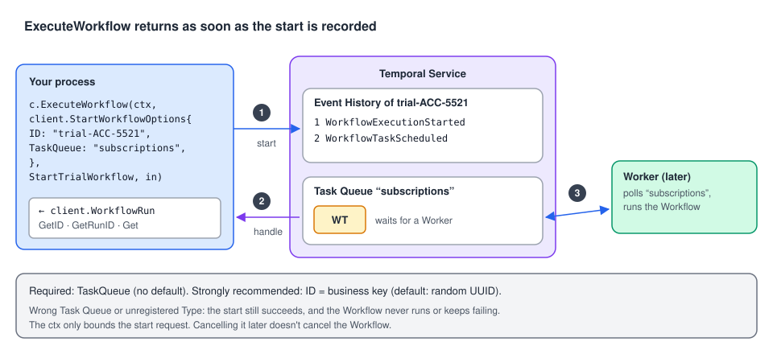

# 04 · Starting Workflow Executions

> **Level:** core concept, daily use · **Read time:** ~15 min
> **Sources:** [Go SDK — Start a Workflow Execution](https://docs.temporal.io/develop/go/client/temporal-client#start-workflow-execution) · [Set a Workflow's Task Queue](https://docs.temporal.io/develop/go/client/temporal-client#set-task-queue) · [Set a Workflow ID](https://docs.temporal.io/develop/go/client/temporal-client#workflow-id)

---

## 1. The problem

Starting a Workflow looks like one function call, but four things must line up or nothing happens:
the **Task Queue** must be one a Worker polls, the **Workflow Type** must be registered on that
Worker, the **arguments** must be serializable, and the **Workflow ID** must express what "the same
process" means for your business. This chapter is about getting those right.

---

## 2. What happens when you call `ExecuteWorkflow`



1. The Client sends a start request with the **Workflow Type**, the **arguments**, the **Task Queue**
   and the other **`StartWorkflowOptions`**.
2. The Service creates the Workflow Execution. Its Event History starts with
   **`WorkflowExecutionStarted`**, then the first Workflow Task is scheduled
   (**`WorkflowTaskScheduled`**).
3. `ExecuteWorkflow` returns a **`client.WorkflowRun`**: a handle with `GetID()`, `GetRunID()` and
   `Get()`. It returns as soon as the start is recorded. It doesn't wait for the Workflow, or even for a Worker.
4. Later, a Worker polling that Task Queue picks up the Workflow Task and runs your code.

The `ctx` you pass to `ExecuteWorkflow` only bounds **the start request**. Cancelling it later doesn't
cancel the Workflow.

---

## 3. The call, in Go

`ExecuteWorkflow(ctx, options, workflow, args...)` takes a `context.Context`, a
`client.StartWorkflowOptions`, the Workflow (function or Type name), and the Workflow's arguments.

### 3.1 By function: when you can import the Workflow

```go
// file: subscriptions/workflow.go
package subscriptions

import (
	"time"

	"go.temporal.io/sdk/workflow"
)

const TaskQueue = "subscriptions"

type StartTrialInput struct {
	AccountID string
	Plan      string // "pro", "team"
	TrialDays int
}

type TrialOutcome struct {
	AccountID string
	Converted bool
}

func StartTrialWorkflow(ctx workflow.Context, in StartTrialInput) (TrialOutcome, error) {
	if err := workflow.Sleep(ctx, time.Duration(in.TrialDays)*24*time.Hour); err != nil {
		return TrialOutcome{}, err
	}
	// … charge the card, convert the account …
	return TrialOutcome{AccountID: in.AccountID, Converted: true}, nil
}
```

```go
// file: cmd/signup/main.go
package main

import (
	"context"
	"log"

	"go.temporal.io/sdk/client"

	"github.com/acme/shop/subscriptions"
)

func main() {
	c, err := client.Dial(client.Options{})
	if err != nil {
		log.Fatalln("unable to create Temporal client", err)
	}
	defer c.Close()

	in := subscriptions.StartTrialInput{AccountID: "ACC-5521", Plan: "pro", TrialDays: 14}
	run, err := c.ExecuteWorkflow(context.Background(), client.StartWorkflowOptions{
		ID:        "trial-" + in.AccountID, // business ID: one trial per account
		TaskQueue: subscriptions.TaskQueue,
	}, subscriptions.StartTrialWorkflow, in) // the function itself: type-checked
	if err != nil {
		log.Fatalln("unable to start trial", err)
	}
	log.Println("Started workflow", "WorkflowID", run.GetID(), "RunID", run.GetRunID())
}
```

Passing the function lets the compiler catch a wrong argument type, and the SDK derives the Workflow
Type name (`StartTrialWorkflow`) from it.

### 3.2 By name: when you can't import the Workflow

When the Workflow lives in another service, an un-importable package, or **another language**, pass
its **Workflow Type name** as a `string`. Here the warehouse team runs a Python Worker with
`AllocateStock` on the `warehouse` Task Queue:

```go
// file: warehouse/contract.go
package warehouse

// The warehouse team's public contract. Keep it next to the code that calls it.
const (
	TaskQueue         = "warehouse"
	AllocateStockType = "AllocateStock" // Workflow Type name registered by the Python Worker
)

// AllocateStockRequest is serialized to JSON. Field names must match what the Python Workflow expects.
type AllocateStockRequest struct {
	OrderID string     `json:"order_id"`
	Lines   []LineItem `json:"lines"`
}

type LineItem struct {
	SKU      string `json:"sku"`
	Quantity int    `json:"quantity"`
}

type AllocateStockResult struct {
	WarehouseCode string `json:"warehouse_code"`
	AllAllocated  bool   `json:"all_allocated"`
}
```

```go
// file: warehouse/client.go
package warehouse

import (
	"context"

	"go.temporal.io/sdk/client"
)

// StartAllocation wraps the string-typed call so the rest of the code stays type-safe.
func StartAllocation(ctx context.Context, c client.Client, req AllocateStockRequest) (client.WorkflowRun, error) {
	return c.ExecuteWorkflow(ctx, client.StartWorkflowOptions{
		ID:        "allocate-" + req.OrderID,
		TaskQueue: TaskQueue,
	}, AllocateStockType, req)
}

// WaitForAllocation blocks until the warehouse Workflow returns.
func WaitForAllocation(ctx context.Context, run client.WorkflowRun) (AllocateStockResult, error) {
	var res AllocateStockResult
	err := run.Get(ctx, &res)
	return res, err
}
```

With a string, a typo in the Type name or the Task Queue isn't caught by the compiler. The start
**succeeds**, and the first Workflow Task fails or waits forever. Keep the names in one place, as
above.

### 3.3 Renaming the Workflow Type

The Type name defaults to the Go function name. To decouple it, for example to rename the function
without breaking callers, register it under an explicit name:

```go
// file: cmd/subscriptions-worker/main.go
package main

import (
	"log"

	"go.temporal.io/sdk/client"
	"go.temporal.io/sdk/worker"
	"go.temporal.io/sdk/workflow"

	"github.com/acme/shop/subscriptions"
)

func main() {
	c, err := client.Dial(client.Options{})
	if err != nil {
		log.Fatalln("unable to create Temporal client", err)
	}
	defer c.Close()

	w := worker.New(c, subscriptions.TaskQueue, worker.Options{})
	// Callers can now start it with the string "StartTrial", whatever the Go function is called.
	w.RegisterWorkflowWithOptions(subscriptions.StartTrialWorkflow, workflow.RegisterOptions{Name: "StartTrial"})
	if err := w.Run(worker.InterruptCh()); err != nil {
		log.Fatalln("worker stopped", err)
	}
}
```

---

## 4. The Task Queue: the only required option

`TaskQueue` is the **only `StartWorkflowOptions` field you must set**. It has no default. For any
code to run, a Worker must poll **the same** Task Queue name and have the Workflow Type registered.

| Mistake | Symptom |
| --- | --- |
| `TaskQueue` empty | `ExecuteWorkflow` returns an error right away |
| Name differs from the Worker's (`"order"` vs `"orders"`) | Start succeeds. The Workflow stays at `WorkflowTaskScheduled` forever |
| Worker doesn't register the Type | Start succeeds. Workflow Tasks fail on the Worker |

You can split load with host-, Worker- or Workflow-specific Task Queues. That is a Worker topic (see the
[Architecture guide, chapter 05](../../architecture/docs/05-workers.md)).

---

## 5. The Workflow ID: name it after the business

`ID` is optional (default: a random UUID), but the SDK docs recommend setting it to a **business
identifier**: an order ID, a customer ID, an invoice number.

| Without a business ID | With `ID: "order-" + orderID` |
| --- | --- |
| A retried HTTP request starts a **second** Workflow for the same order | The second start is rejected or deduplicated ([chapter 05](05-workflow-id-policies.md)) |
| To Signal or Query the order, you must store the UUID somewhere | You can always rebuild the ID from the order ID |
| The Web UI shows `0c5a…` | The Web UI shows `order-ORD-1042` |

A Workflow ID is unique **per Namespace** among **running** Workflows. What happens when you reuse
one is the subject of the next chapter.

---

## 6. Starting from another Workflow

Don't use a Client in Workflow code. To start a Workflow from a Workflow, use a **Child Workflow**
(`workflow.ExecuteChildWorkflow`), or an Activity that calls the Client. See the
[Workflows guide, chapter 07](../../workflows/docs/07-child-workflows.md).

---

## 7. Key takeaways

- `ExecuteWorkflow(ctx, StartWorkflowOptions, workflow, args...)` returns a `WorkflowRun` as soon as the Service records the start.
- Pass the **function** when you can (type-checked). Pass the **Type name string** for other services or languages, wrapped in a typed helper.
- `TaskQueue` is required and must match a Worker. A wrong name doesn't fail the start: the Workflow just never runs.
- Set `ID` to a **business identifier**.
- The `ctx` bounds only the start request.
