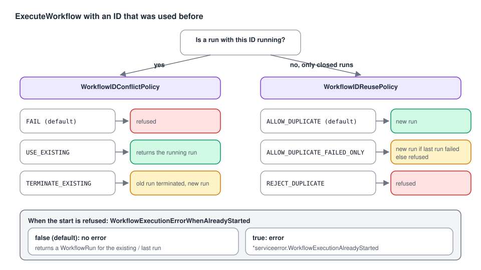

# 05 · Workflow IDs and duplicate starts

> **Level:** daily use · **Read time:** ~15 min
> **Sources:** [Go SDK — Set a Workflow ID](https://docs.temporal.io/develop/go/client/temporal-client#workflow-id) · [StartWorkflowOptions reference](https://docs.temporal.io/develop/go/client/temporal-client#workflow-options-reference) (`WorkflowIDReusePolicy`, `WorkflowExecutionErrorWhenAlreadyStarted`)

---

## 1. The problem

Networks retry. A customer double-clicks "Pay". A Kafka consumer re-delivers a message. Your
checkout API calls `ExecuteWorkflow` **twice for the same order**. Should the second call:

- start a second Workflow (and charge the card twice)?
- return the Workflow that's already running?
- fail, so the caller knows?
- replace the old Workflow with a fresh one?

Temporal lets you choose, per start, with three options on `StartWorkflowOptions`. Choosing them
deliberately is how you make **starting a Workflow idempotent**.

---

## 2. The rule behind everything

> A **Workflow ID** is unique among **running** Workflow Executions in a Namespace.

So a start with an existing ID meets one of two situations, and each has its own option:

| Situation | Option that decides | Values | Default |
| --- | --- | --- | --- |
| A Workflow with this ID is **running** | `WorkflowIDConflictPolicy` | `FAIL`, `USE_EXISTING`, `TERMINATE_EXISTING` | `FAIL` |
| Only **closed** Workflows with this ID exist | `WorkflowIDReusePolicy` | `ALLOW_DUPLICATE`, `ALLOW_DUPLICATE_FAILED_ONLY`, `REJECT_DUPLICATE` (and the legacy `TERMINATE_IF_RUNNING`) | `ALLOW_DUPLICATE` |

And a third option decides **how a refusal reaches your code**:

| `WorkflowExecutionErrorWhenAlreadyStarted` | When the start is refused |
| --- | --- |
| `false` (**default**) | `ExecuteWorkflow` returns **no error** and a `WorkflowRun` for the **existing** (running or last) run |
| `true` | `ExecuteWorkflow` returns a `*serviceerror.WorkflowExecutionAlreadyStarted` error |

The Go Client page lists `WorkflowIDReusePolicy` and `WorkflowExecutionErrorWhenAlreadyStarted`, but
not `WorkflowIDConflictPolicy`, which is the one that governs **running** Workflows. All three are
in `StartWorkflowOptions` in SDK v1.50.0.

---

## 3. What actually happens



Observed against a dev server (Temporal Server 1.32.0, Go SDK v1.50.0):

| Existing Workflow with this ID | Options on the second start | Result |
| --- | --- | --- |
| Running | defaults | **No error.** Returns the **existing** run. Nothing new starts |
| Running | `ErrorWhenAlreadyStarted: true` | `WorkflowExecutionAlreadyStarted` error |
| Running | `ConflictPolicy: USE_EXISTING` (even with `ErrorWhenAlreadyStarted: true`) | No error, returns the existing run |
| Running | `ConflictPolicy: TERMINATE_EXISTING` | Old run **Terminated**, a **new** run starts |
| Completed | defaults (`ALLOW_DUPLICATE`) | A **new** run starts |
| Completed | `ReusePolicy: REJECT_DUPLICATE` | No error, returns the **last** run |
| Completed | `REJECT_DUPLICATE` + `ErrorWhenAlreadyStarted: true` | `WorkflowExecutionAlreadyStarted` error |
| Completed | `ALLOW_DUPLICATE_FAILED_ONLY` + `ErrorWhenAlreadyStarted: true` | `WorkflowExecutionAlreadyStarted` error (only failed, canceled, terminated or timed-out runs can be restarted) |

> **The surprise:** with all defaults, starting a running Workflow ID twice **doesn't fail**. You
> silently get a handle to the first run. That's usually what you want for idempotency, but if your
> code needs to *know*, set `WorkflowExecutionErrorWhenAlreadyStarted: true`.

---

## 4. Recipes

All recipes use the same Workflow:

```go
// file: payments/workflow.go
package payments

import (
	"time"

	"go.temporal.io/sdk/workflow"
)

const TaskQueue = "payments"

type ChargeOrderInput struct {
	OrderID     string
	CustomerID  string
	AmountCents int64
}

type ChargeReceipt struct {
	OrderID   string
	PaymentID string
}

func ChargeOrderWorkflow(ctx workflow.Context, in ChargeOrderInput) (ChargeReceipt, error) {
	ctx = workflow.WithActivityOptions(ctx, workflow.ActivityOptions{StartToCloseTimeout: 30 * time.Second})
	var paymentID string
	if err := workflow.ExecuteActivity(ctx, "CapturePayment", in).Get(ctx, &paymentID); err != nil {
		return ChargeReceipt{}, err
	}
	return ChargeReceipt{OrderID: in.OrderID, PaymentID: paymentID}, nil
}
```

### 4.1 "Start it, or give me the one already running" (idempotent API)

The most common need. `USE_EXISTING` states it explicitly. The defaults behave the same for a running
Workflow, but spelling it out documents the intent.

```go
// file: payments/start.go
package payments

import (
	"context"

	enumspb "go.temporal.io/api/enums/v1"
	"go.temporal.io/sdk/client"
)

func chargeWorkflowID(orderID string) string { return "charge-" + orderID }

// StartCharge is safe to call many times for the same order: while a charge Workflow
// is running, every call returns that same run.
func StartCharge(ctx context.Context, c client.Client, in ChargeOrderInput) (client.WorkflowRun, error) {
	return c.ExecuteWorkflow(ctx, client.StartWorkflowOptions{
		ID:                       chargeWorkflowID(in.OrderID),
		TaskQueue:                TaskQueue,
		WorkflowIDConflictPolicy: enumspb.WORKFLOW_ID_CONFLICT_POLICY_USE_EXISTING,
		// Once the charge has completed, never charge this order again.
		WorkflowIDReusePolicy: enumspb.WORKFLOW_ID_REUSE_POLICY_REJECT_DUPLICATE,
	}, ChargeOrderWorkflow, in)
}
```

With `REJECT_DUPLICATE` and the default `ErrorWhenAlreadyStarted: false`, a call made **after** the
charge completed also returns the completed run. `run.Get` then returns the original receipt. Every
caller gets the same answer, however many times it retries.

### 4.2 "Tell me if it already exists" (exactly-once side effect)

When a duplicate is an error the caller must see (e.g. to answer HTTP 409):

```go
// file: payments/start_once.go
package payments

import (
	"context"
	"errors"

	enumspb "go.temporal.io/api/enums/v1"
	"go.temporal.io/api/serviceerror"
	"go.temporal.io/sdk/client"
)

var ErrChargeAlreadyExists = errors.New("a charge already exists for this order")

func StartChargeOnce(ctx context.Context, c client.Client, in ChargeOrderInput) (client.WorkflowRun, error) {
	run, err := c.ExecuteWorkflow(ctx, client.StartWorkflowOptions{
		ID:                                       chargeWorkflowID(in.OrderID),
		TaskQueue:                                TaskQueue,
		WorkflowIDReusePolicy:                    enumspb.WORKFLOW_ID_REUSE_POLICY_REJECT_DUPLICATE,
		WorkflowExecutionErrorWhenAlreadyStarted: true,
	}, ChargeOrderWorkflow, in)

	var alreadyStarted *serviceerror.WorkflowExecutionAlreadyStarted
	if errors.As(err, &alreadyStarted) {
		return nil, ErrChargeAlreadyExists
	}
	return run, err
}
```

### 4.3 "Retry only if the last attempt failed"

A nightly report may be re-run by an operator, but only if the previous run didn't succeed:

```go
// file: reports/start.go
package reports

import (
	"context"
	"time"

	enumspb "go.temporal.io/api/enums/v1"
	"go.temporal.io/sdk/client"
)

func StartDailySalesReport(ctx context.Context, c client.Client, day time.Time) (client.WorkflowRun, error) {
	return c.ExecuteWorkflow(ctx, client.StartWorkflowOptions{
		ID:                                       "sales-report-" + day.Format("2006-01-02"),
		TaskQueue:                                "reports",
		WorkflowIDReusePolicy:                    enumspb.WORKFLOW_ID_REUSE_POLICY_ALLOW_DUPLICATE_FAILED_ONLY,
		WorkflowExecutionErrorWhenAlreadyStarted: true,
	}, "DailySalesReportWorkflow", day)
}
```

### 4.4 "Replace whatever is running"

A price-sync Workflow for a product should always run with the latest catalog. A new start kills the
old one:

```go
// file: catalog/start.go
package catalog

import (
	"context"

	enumspb "go.temporal.io/api/enums/v1"
	"go.temporal.io/sdk/client"
)

func RestartPriceSync(ctx context.Context, c client.Client, productID string) (client.WorkflowRun, error) {
	return c.ExecuteWorkflow(ctx, client.StartWorkflowOptions{
		ID:                       "price-sync-" + productID,
		TaskQueue:                "catalog",
		WorkflowIDConflictPolicy: enumspb.WORKFLOW_ID_CONFLICT_POLICY_TERMINATE_EXISTING,
	}, "PriceSyncWorkflow", productID)
}
```

Terminating skips any cleanup in the old run. If the old run must clean up, Signal or cancel it
instead ([chapter 08](08-interacting-and-managing.md)).

---

## 5. Choosing

| You want… | `ConflictPolicy` | `ReusePolicy` | `ErrorWhenAlreadyStarted` |
| --- | --- | --- | --- |
| Idempotent start, same answer forever | `USE_EXISTING` | `REJECT_DUPLICATE` | `false` |
| Idempotent while running, re-runnable after | `USE_EXISTING` | `ALLOW_DUPLICATE` (default) | `false` |
| Caller must know about duplicates | `FAIL` (default) | `REJECT_DUPLICATE` | `true` |
| Re-run only after a failure | `FAIL` | `ALLOW_DUPLICATE_FAILED_ONLY` | `true` |
| Newest start wins | `TERMINATE_EXISTING` | `ALLOW_DUPLICATE` | `false` |

The reuse policy only applies while closed Workflows are still **retained** by the Namespace. After the
retention period, the ID is free again.

---

## 6. Key takeaways

- The **Workflow ID** is your deduplication key. Derive it from a business identifier.
- **Running** duplicate → `WorkflowIDConflictPolicy` (default `FAIL`). **Closed** duplicate → `WorkflowIDReusePolicy` (default `ALLOW_DUPLICATE`).
- By default a refused start returns the **existing run without an error**. Set `WorkflowExecutionErrorWhenAlreadyStarted: true` to get `*serviceerror.WorkflowExecutionAlreadyStarted`.
- `USE_EXISTING` + `REJECT_DUPLICATE` makes a start fully idempotent.
