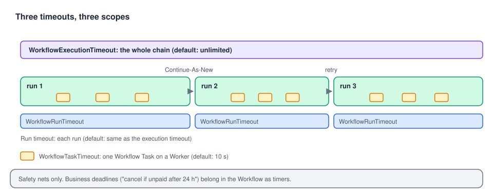

# 06 · StartWorkflowOptions in practice: timeouts, retries, metadata

> **Level:** daily use, reference · **Read time:** ~20 min
> **Sources:** [Go SDK — StartWorkflowOptions reference](https://docs.temporal.io/develop/go/client/temporal-client#workflow-options-reference) · [`client.StartWorkflowOptions`](https://pkg.go.dev/go.temporal.io/sdk/client#StartWorkflowOptions)

---

## 1. The problem

`ID` and `TaskQueue` get a Workflow running. The other fields of `StartWorkflowOptions` decide **how
long** it may run, whether it is **retried**, how you **find** it later, and what operators **see**
in the Web UI. Most should stay at their defaults. The trick is knowing which ones to change.

---

## 2. The fields at a glance

| Field | Default | Use it to… | Section |
| --- | --- | --- | --- |
| `ID` | random UUID | Name the execution after the business entity | [04](04-starting-workflows.md), [05](05-workflow-id-policies.md) |
| `TaskQueue` | **required** | Route to the right Workers | [04](04-starting-workflows.md) |
| `WorkflowIDConflictPolicy`, `WorkflowIDReusePolicy`, `WorkflowExecutionErrorWhenAlreadyStarted` | `FAIL`, `ALLOW_DUPLICATE`, `false` | Handle duplicate starts | [05](05-workflow-id-policies.md) |
| `WorkflowExecutionTimeout` | unlimited | Cap the whole execution, across Continue-As-New and retries | 3 |
| `WorkflowRunTimeout` | = execution timeout | Cap a single run | 3 |
| `WorkflowTaskTimeout` | 10 s | Cap one Workflow Task on a Worker | 3 |
| `RetryPolicy` | none: Workflows aren't retried | Retry the whole Workflow on failure | 4 |
| `Memo` | empty | Attach non-indexed notes | 5 |
| `TypedSearchAttributes` (`SearchAttributes` is deprecated) | empty | Index fields to search and filter Workflows | 5 |
| `StaticSummary`, `StaticDetails` | empty | Human-readable text in the Web UI | 5 |
| `StartDelay` | 0 | Start the first Workflow Task later | 6 |
| `Priority` | none | Order Tasks within a Task Queue | 6 |
| `CronSchedule` | none | Legacy cron. Prefer Schedules | 6 |
| `EnableEagerStart`, `VersioningOverride` | off | Latency optimization, Worker Versioning | — |

The Go Client page documents the first eleven rows (in its older form). Everything from
`WorkflowIDConflictPolicy` to `VersioningOverride` that it doesn't list is in `StartWorkflowOptions`
in SDK v1.50.0.

---

## 3. Workflow timeouts



| Timeout | Measures | When it fires |
| --- | --- | --- |
| **Execution** | From start until the end of the **whole chain** of runs (Continue-As-New, retries, cron) | The current run times out. No further runs |
| **Run** | From the start of **one run** until its end | That run times out. A retry or the next cron run may follow |
| **Task** | From a Worker picking up a **Workflow Task** until it responds | The Task is rescheduled. Usually means the Worker is stuck or overloaded |

Timeouts on Workflows are rarely what you want: a Workflow is meant to wait, sometimes for months.
Prefer **timers inside the Workflow** for business deadlines ("cancel the order if not paid within 24
hours"), because the Workflow can react to a timer and clean up. A Workflow timeout just ends it, and
no code runs after that. Use timeouts as **safety nets** against runaway executions.

```go
// file: onboarding/start.go
package onboarding

import (
	"context"
	"time"

	"go.temporal.io/sdk/client"
)

const TaskQueue = "onboarding"

type OnboardMerchantInput struct {
	MerchantID string
	Country    string
	Tier       string // "standard", "enterprise"
}

// StartOnboarding sets safety-net timeouts. Business deadlines live inside the Workflow as timers.
func StartOnboarding(ctx context.Context, c client.Client, in OnboardMerchantInput) (client.WorkflowRun, error) {
	return c.ExecuteWorkflow(ctx, client.StartWorkflowOptions{
		ID:        "onboard-" + in.MerchantID,
		TaskQueue: TaskQueue,
		// Never let an onboarding live longer than 90 days, whatever happens.
		WorkflowExecutionTimeout: 90 * 24 * time.Hour,
		// WorkflowRunTimeout defaults to the execution timeout. WorkflowTaskTimeout stays at 10s.
	}, "OnboardMerchantWorkflow", in)
}
```

---

## 4. Retrying a whole Workflow

Activities are retried by default. **Workflows are not**: if a Workflow returns an error, it fails.
A `RetryPolicy` on `StartWorkflowOptions` makes the Service start a **new run** of the same
Workflow ID after a failure.

```go
// file: imports/start.go
package imports

import (
	"context"
	"time"

	"go.temporal.io/sdk/client"
	"go.temporal.io/sdk/temporal"
)

// StartSupplierFeedImport retries the whole import from scratch if it fails,
// e.g. because the supplier's file was half-uploaded.
func StartSupplierFeedImport(ctx context.Context, c client.Client, supplierID, feedURL string) (client.WorkflowRun, error) {
	return c.ExecuteWorkflow(ctx, client.StartWorkflowOptions{
		ID:        "feed-import-" + supplierID,
		TaskQueue: "imports",
		RetryPolicy: &temporal.RetryPolicy{
			InitialInterval:        time.Minute,
			BackoffCoefficient:     2.0,
			MaximumInterval:        30 * time.Minute,
			MaximumAttempts:        5,
			NonRetryableErrorTypes: []string{"InvalidFeedFormat"},
		},
		WorkflowExecutionTimeout: 6 * time.Hour, // caps all 5 attempts together
	}, "ImportSupplierFeedWorkflow", supplierID, feedURL)
}
```

Use this sparingly. Retrying individual **Activities** is almost always better: completed steps aren't
redone. A Workflow retry restarts from the beginning, with a new Run ID.

---

## 5. Finding and explaining Workflows: Memo, Search Attributes, summaries

| | **Memo** | **Search Attributes** | **Static summary / details** |
| --- | --- | --- | --- |
| Indexed (usable in `ListWorkflow` queries)? | No | **Yes** | No |
| Shown in `DescribeWorkflowExecution` / UI | Yes | Yes | Yes, as the Workflow's title and description |
| Typed? | Any serializable value | Typed keys: Keyword, Text, Int, Double, Bool, Datetime, KeywordList | Strings (Markdown for details) |
| Must be registered first? | No | **Yes**, on the Namespace | No |

Search Attribute types map to Go types: Keyword and Text → `string`, Int → `int64`, Double →
`float64`, Bool → `bool`, Datetime → `time.Time`, KeywordList → `[]string`.

Register custom Search Attributes once per Namespace:

```sh
temporal operator search-attribute create --name CustomerTier --type Keyword
temporal operator search-attribute create --name OrderTotalCents --type Int
# or, for the dev server: temporal server start-dev --search-attribute CustomerTier=Keyword --search-attribute OrderTotalCents=Int
```

Then set them with **typed keys**. The untyped `SearchAttributes map[string]any` field still works
but is deprecated in the Go SDK.

```go
// file: orders/search.go
package orders

import (
	"context"
	"fmt"

	"go.temporal.io/sdk/client"
	"go.temporal.io/sdk/temporal"
)

const TaskQueue = "orders"

// Typed keys, declared once and shared by the code that writes and the code that queries.
var (
	CustomerTierKey    = temporal.NewSearchAttributeKeyKeyword("CustomerTier")
	OrderTotalCentsKey = temporal.NewSearchAttributeKeyInt64("OrderTotalCents")
)

type PlaceOrderInput struct {
	OrderID      string
	CustomerID   string
	CustomerTier string
	AmountCents  int64
}

func StartOrder(ctx context.Context, c client.Client, in PlaceOrderInput) (client.WorkflowRun, error) {
	return c.ExecuteWorkflow(ctx, client.StartWorkflowOptions{
		ID:        "order-" + in.OrderID,
		TaskQueue: TaskQueue,
		TypedSearchAttributes: temporal.NewSearchAttributes(
			CustomerTierKey.ValueSet(in.CustomerTier),
			OrderTotalCentsKey.ValueSet(in.AmountCents),
		),
		Memo: map[string]any{
			"placedFrom": "mobile-app/4.12.0", // context for humans, not searchable
		},
		StaticSummary: fmt.Sprintf("Order %s (%s)", in.OrderID, in.CustomerTier),
		StaticDetails: fmt.Sprintf("**Customer:** %s  \n**Total:** %.2f EUR", in.CustomerID, float64(in.AmountCents)/100),
	}, "PlaceOrderWorkflow", in)
}

// BigGoldOrdersQuery finds running high-value orders from gold customers.
const BigGoldOrdersQuery = "WorkflowType = 'PlaceOrderWorkflow' AND ExecutionStatus = 'Running' " +
	"AND CustomerTier = 'gold' AND OrderTotalCents > 100000"
```

---

## 6. When and how it runs: StartDelay, Priority, CronSchedule

```go
// file: marketing/start.go
package marketing

import (
	"context"
	"time"

	"go.temporal.io/sdk/client"
	"go.temporal.io/sdk/temporal"
)

// StartAbandonedCartReminder starts now (so the ID is reserved and the Workflow can be
// Signaled or cancelled), but its first Workflow Task only runs in 2 hours.
func StartAbandonedCartReminder(ctx context.Context, c client.Client, cartID string) (client.WorkflowRun, error) {
	return c.ExecuteWorkflow(ctx, client.StartWorkflowOptions{
		ID:         "cart-reminder-" + cartID,
		TaskQueue:  "marketing",
		StartDelay: 2 * time.Hour,
		// Lower number = higher priority. Reminders yield to transactional work on shared queues.
		Priority: temporal.Priority{PriorityKey: 5},
	}, "AbandonedCartReminderWorkflow", cartID)
}
```

| Option | Notes |
| --- | --- |
| `StartDelay` | The execution exists right away (visible, deduplicated by ID). The first Workflow Task waits for the delay. A **Signal-With-Start** during the delay ends the wait. A plain Signal is recorded but doesn't. |
| `Priority` | `PriorityKey` from 1 (highest) to 5 by default. Unset means 3. Tasks with a lower key are dispatched first within a Task Queue. Also has fairness fields (`FairnessKey`, `FairnessWeight`). |
| `CronSchedule` | Still supported (`"15 8 * * *"`, UTC). Each run starts after the previous one ends, and a missed slot is skipped. For new code, prefer **Schedules** (`c.ScheduleClient()`), which can be paused, backfilled and inspected. See the [Workflows guide, chapter 10](../../workflows/docs/10-schedules-and-cron.md). |

A cron Workflow can read the previous run's result with `workflow.HasLastCompletionResult` and
`workflow.GetLastCompletionResult`. See [chapter 07](07-getting-results.md#_6-chains-of-runs-continue-as-new-retries-and-cron).

---

## 7. Key takeaways

- Only `TaskQueue` is required. Most other fields should stay at their defaults.
- Workflow timeouts are safety nets: execution (whole chain) ⊇ run (one run) ⊇ task (one Workflow Task). Model business deadlines as timers.
- Workflows aren't retried by default. A `RetryPolicy` restarts the whole Workflow, so prefer Activity retries.
- Search Attributes are indexed and typed: register them, then use `TypedSearchAttributes`. Memo and static summary/details are for humans.
- `StartDelay` defers the first Task, `Priority` orders Tasks, and Schedules replace `CronSchedule`.
