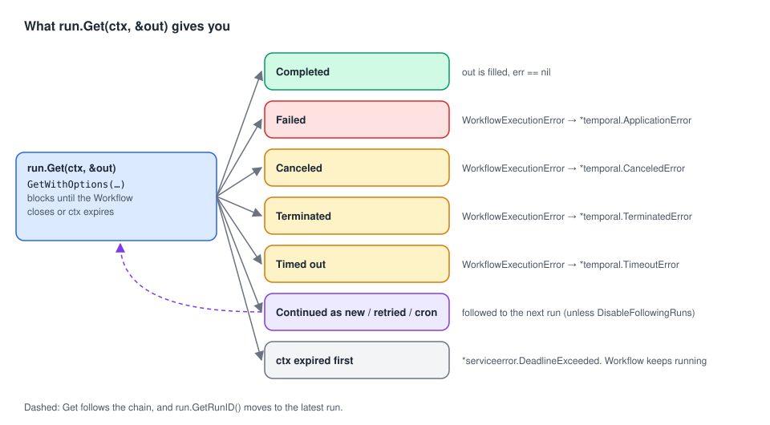

# 07 · Getting Workflow results

> **Level:** core concept, daily use · **Read time:** ~15 min
> **Sources:** [Go SDK — Get Workflow results](https://docs.temporal.io/develop/go/client/temporal-client#get-workflow-results) · [Get last completion result](https://docs.temporal.io/develop/go/client/temporal-client#get-last-completion-result) · [`client.WorkflowRun`](https://pkg.go.dev/go.temporal.io/sdk/client#WorkflowRun)

---

## 1. The problem

A Workflow can finish in 200 ms or in 3 months. The process that started it may have restarted ten
times since. Getting the result must work **synchronously** (wait right here) and
**asynchronously** (from any process, any time later). It must also handle failures, timeouts and
Workflows that continue as new runs.

---

## 2. The `WorkflowRun` handle

`ExecuteWorkflow` and `GetWorkflow` both return a `client.WorkflowRun`:

| Method | Returns |
| --- | --- |
| `GetID()` | The Workflow ID |
| `GetRunID()` | The Run ID this handle currently points to (see [section 6](#_6-chains-of-runs-continue-as-new-retries-and-cron): it **can change** after `Get`) |
| `GetFirstExecutionRunID()` | The Run ID of the first run in the chain (empty for handles from `GetWorkflow`) |
| `Get(ctx, &result)` | Blocks until the Workflow closes, fills `result`, or returns the Workflow's error |
| `GetWithOptions(ctx, &result, opts)` | Same, with options (`DisableFollowingRuns`) |

The **Workflow ID**, **Run ID** and **Namespace** together identify one Workflow Execution. The
result stays available as long as the execution's Event History is **retained** by the Namespace.

---

## 3. Synchronously: wait in the same process

```go
// file: refunds/workflow.go
package refunds

import (
	"time"

	"go.temporal.io/sdk/temporal"
	"go.temporal.io/sdk/workflow"
)

const TaskQueue = "refunds"

type RefundRequest struct {
	OrderID     string
	AmountCents int64
	Reason      string
}

type RefundResult struct {
	RefundID string
	Status   string // "refunded", "store-credit"
}

func IssueRefundWorkflow(ctx workflow.Context, req RefundRequest) (RefundResult, error) {
	if req.AmountCents <= 0 {
		return RefundResult{}, temporal.NewNonRetryableApplicationError("amount must be positive", "InvalidRefund", nil)
	}
	ctx = workflow.WithActivityOptions(ctx, workflow.ActivityOptions{StartToCloseTimeout: time.Minute})
	var refundID string
	if err := workflow.ExecuteActivity(ctx, "RefundCard", req).Get(ctx, &refundID); err != nil {
		return RefundResult{}, err
	}
	return RefundResult{RefundID: refundID, Status: "refunded"}, nil
}
```

```go
// file: refunds/client.go
package refunds

import (
	"context"
	"time"

	"go.temporal.io/sdk/client"
)

// RefundAndWait starts a refund and waits at most maxWait for it.
func RefundAndWait(c client.Client, req RefundRequest, maxWait time.Duration) (RefundResult, error) {
	run, err := c.ExecuteWorkflow(context.Background(), client.StartWorkflowOptions{
		ID:        "refund-" + req.OrderID,
		TaskQueue: TaskQueue,
	}, IssueRefundWorkflow, req)
	if err != nil {
		return RefundResult{}, err
	}

	ctx, cancel := context.WithTimeout(context.Background(), maxWait)
	defer cancel()

	var res RefundResult
	err = run.Get(ctx, &res)
	return res, err
}
```

`Get` is a blocking call, and the `ctx` bounds only the **wait**. If it expires, `Get` returns an
error but **the Workflow keeps running**. Note that this error is a `*serviceerror.DeadlineExceeded`
from the gRPC layer, not `context.DeadlineExceeded`, so `errors.Is(err, context.DeadlineExceeded)` is
`false`. Check your own context instead:

```go
// file: refunds/timeout.go
package refunds

import (
	"context"
	"errors"

	"go.temporal.io/sdk/client"
)

var ErrStillRunning = errors.New("refund still in progress")

// WaitUpTo returns ErrStillRunning if the Workflow didn't finish before ctx expired.
func WaitUpTo(ctx context.Context, run client.WorkflowRun) (RefundResult, error) {
	var res RefundResult
	err := run.Get(ctx, &res)
	if err != nil && ctx.Err() != nil {
		return RefundResult{}, ErrStillRunning
	}
	return res, err
}
```

---

## 4. Asynchronously: from any process, later

All you need is the **Workflow ID**. That's another reason to use business IDs
([chapter 04](04-starting-workflows.md#_5-the-workflow-id-name-it-after-the-business)).

```go
// file: refunds/status.go
package refunds

import (
	"context"

	"go.temporal.io/sdk/client"
)

// RefundOutcome is called by the support back-office, long after the refund was started
// by the checkout service.
func RefundOutcome(ctx context.Context, c client.Client, orderID string) (RefundResult, error) {
	// An empty Run ID means "the latest run with this Workflow ID".
	run := c.GetWorkflow(ctx, "refund-"+orderID, "")
	var res RefundResult
	err := run.Get(ctx, &res)
	return res, err
}

// RefundOutcomeOfRun reads one specific run, e.g. an older refund for the same order.
func RefundOutcomeOfRun(ctx context.Context, c client.Client, orderID, runID string) (RefundResult, error) {
	var res RefundResult
	err := c.GetWorkflow(ctx, "refund-"+orderID, runID).Get(ctx, &res)
	return res, err
}
```

If you only need the **current state** of a Workflow that is still running, don't block on `Get`:
send a **Query** ([chapter 08](08-interacting-and-managing.md)). The SDK docs call Queries an
acceptable, even preferred, way to read state and results.

---

## 5. When the Workflow didn't succeed



`Get` returns the Workflow's outcome as an error. In Go, it is a `*temporal.WorkflowExecutionError`
that **wraps the cause**. Unwrap it with `errors.As`:

| How the Workflow ended | `errors.As` target that matches the cause |
| --- | --- |
| Returned an error (e.g. `temporal.NewApplicationError(…, "CardDeclined")`) | `*temporal.ApplicationError` (check `.Type()`) |
| Cancelled | `*temporal.CanceledError` |
| Terminated | `*temporal.TerminatedError` |
| Timed out (execution or run timeout) | `*temporal.TimeoutError` |

```go
// file: refunds/errors.go
package refunds

import (
	"errors"
	"fmt"

	"go.temporal.io/sdk/temporal"
)

// Explain turns a Get error into a message for the support agent.
func Explain(err error) string {
	var appErr *temporal.ApplicationError
	var canceled *temporal.CanceledError
	var terminated *temporal.TerminatedError
	var timeout *temporal.TimeoutError
	switch {
	case err == nil:
		return "refunded"
	case errors.As(err, &appErr) && appErr.Type() == "InvalidRefund":
		return "rejected: " + appErr.Message()
	case errors.As(err, &canceled):
		return "refund cancelled by an operator"
	case errors.As(err, &terminated):
		return "refund terminated (see the Web UI for the reason)"
	case errors.As(err, &timeout):
		return "refund timed out"
	default:
		return fmt.Sprintf("refund failed: %v", err)
	}
}
```

---

## 6. Chains of runs: Continue-As-New, retries and cron

One Workflow ID can have a **chain of runs**: a Workflow that calls Continue-As-New, a Workflow
retried by its `RetryPolicy`, or a cron Workflow. Each run has its own Run ID.

`Get` **follows the chain** by default: it waits for the **latest** run and returns its result. And
the handle's `GetRunID()` **moves along**:

```go
// file: billing/chain.go
package billing

import (
	"context"
	"errors"
	"log"

	"go.temporal.io/sdk/client"
	"go.temporal.io/sdk/workflow"
)

const TaskQueue = "billing"

// CloseMonthWorkflow processes invoices page by page and continues as new between pages
// to keep each run's Event History small.
func CloseMonthWorkflow(ctx workflow.Context, month string, page int) (int, error) {
	if page < 3 {
		return 0, workflow.NewContinueAsNewError(ctx, CloseMonthWorkflow, month, page+1)
	}
	return page, nil // pages processed
}

func RunAndInspect(ctx context.Context, c client.Client) error {
	run, err := c.ExecuteWorkflow(ctx, client.StartWorkflowOptions{
		ID: "close-month-2024-11", TaskQueue: TaskQueue,
	}, CloseMonthWorkflow, "2024-11", 1)
	if err != nil {
		return err
	}
	firstRunID := run.GetFirstExecutionRunID() // == run.GetRunID() right after the start

	var pages int
	if err := run.Get(ctx, &pages); err != nil { // follows run 1 → run 2 → run 3
		return err
	}
	log.Printf("pages=%d, handle now points to the last run: %t", pages, run.GetRunID() != firstRunID)

	// To read ONE run without following: DisableFollowingRuns.
	// For a run that continued as new, the "result" is a ContinueAsNewError.
	err = c.GetWorkflow(ctx, run.GetID(), firstRunID).
		GetWithOptions(ctx, &pages, client.WorkflowRunGetOptions{DisableFollowingRuns: true})
	var can *workflow.ContinueAsNewError
	if errors.As(err, &can) {
		log.Println("run 1 continued as new")
		return nil
	}
	return err
}
```

Observed with SDK v1.50.0: `GetRunID()` equals the first Run ID right after `ExecuteWorkflow`, then
returns the **last** run's ID once `Get` has followed the chain. `GetFirstExecutionRunID()` keeps the
first one. (The Go Client page says `GetRunID()` "always returns the Run ID of the initial Run",
which is no longer accurate. See the README notes.)

### Reading the previous run's result in a cron Workflow

A cron Workflow can carry a value from one run to the next with `workflow.HasLastCompletionResult` and
`workflow.GetLastCompletionResult`. It gets the result of the last **successfully completed** run,
even if the run just before failed.

```go
// file: billing/cron.go
package billing

import "go.temporal.io/sdk/workflow"

type DunningStats struct {
	RunsSoFar       int
	RemindersIssued int
}

// DailyDunningWorkflow runs on a CronSchedule and keeps a running total across runs.
func DailyDunningWorkflow(ctx workflow.Context) (DunningStats, error) {
	stats := DunningStats{}
	if workflow.HasLastCompletionResult(ctx) {
		if err := workflow.GetLastCompletionResult(ctx, &stats); err != nil {
			workflow.GetLogger(ctx).Warn("could not read last result, starting from zero", "error", err)
		}
	}
	stats.RunsSoFar++
	// … send today's reminders with Activities, then add them to stats.RemindersIssued …
	return stats, nil
}
```

---

## 7. Key takeaways

- `ExecuteWorkflow` and `GetWorkflow` return a `WorkflowRun`. `Get` blocks until the Workflow closes.
- Get a result from **any process** with `c.GetWorkflow(ctx, workflowID, "")`. An empty Run ID means the latest run.
- A `ctx` timeout on `Get` stops the **wait**, not the Workflow. Detect it with `ctx.Err()`, because the error is a gRPC `DeadlineExceeded`.
- Failures come back as `*temporal.WorkflowExecutionError`. Use `errors.As` to find `ApplicationError`, `CanceledError`, `TerminatedError` or `TimeoutError`.
- `Get` follows Continue-As-New, retry and cron chains. `GetRunID()` moves to the latest run. Use `GetFirstExecutionRunID()` for the first, and `DisableFollowingRuns` to read one run.
