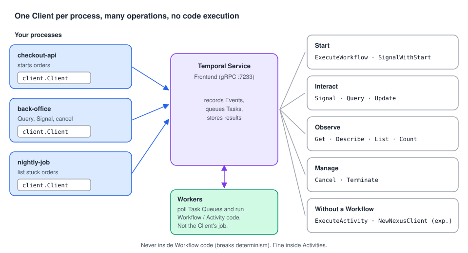

# Temporal Client with Go: a roadmap

> A progressive onboarding guide to the **Temporal Client** for Go developers. It is based on the
> Temporal Encyclopedia (the concept) and the Go SDK's Temporal Client page (how to do it in Go), read
> side by side and checked against the SDK source. Every chapter has **compilable Go examples** with
> production-like names.
>
> Companion guides: [Temporal Architecture with Go](../../architecture/docs/README.md) (where the
> Client fits), [Temporal Workflows with Go](../../workflows/docs/README.md) and
> [Temporal Activities with Go](../../activities/docs/README.md) (what the Client starts).



---

## Why this matters, in 30 seconds

Every Workflow starts with a Client call. So does every Signal from your API, every "where is my
order?" screen, and every operator clean-up script. The Client looks simple
(`client.Dial`, `ExecuteWorkflow`, `Get`), but the details decide whether your system works in
production:

- **Where it connects**: dev server, self-hosted, Temporal Cloud, with credentials you can rotate.
- **What "start" means** when a request is retried: one Workflow, two, or an error.
- **How you get results** across processes, failures, timeouts and Continue-As-New chains.

This guide covers those details, chapter by chapter.

---

## The roadmap

### Stage 1: Foundations *(core concepts, must-know)*

| # | Chapter | You'll be able to… |
| --- | --- | --- |
| 01 | [What is a Temporal Client?](01-what-is-a-client.md) | Explain what a Client does and doesn't do, list its operations, and run a first start-and-wait. Use it in an HTTP service and inside an Activity. |
| 02 | [Connecting](02-connecting.md) | Connect with defaults, environment variables, TOML profiles or code. Know which source wins, and choose between `Dial`, `DialContext` and `NewLazyClient`. |
| 03 | [Temporal Cloud and secured Services](03-cloud-and-security.md) | Connect to Temporal Cloud with an API key or mTLS, rotate credentials without restarts, and connect to a self-hosted cluster with a private CA. |

### Stage 2: Daily use *(starting Workflows and getting results)*

| # | Chapter | You'll be able to… |
| --- | --- | --- |
| 04 | [Starting Workflow Executions](04-starting-workflows.md) | Start by function or by Type name (other services and languages), set the Task Queue and a business Workflow ID, and know what happens on the Service. |
| 05 | [Workflow IDs and duplicate starts](05-workflow-id-policies.md) | Make starts idempotent with the conflict and reuse policies, and decide when a duplicate should be an error. |
| 06 | [StartWorkflowOptions in practice](06-start-options.md) | Use Workflow timeouts, retries, Search Attributes, Memo, summaries, `StartDelay`, `Priority` and cron correctly. |
| 07 | [Getting Workflow results](07-getting-results.md) | Wait synchronously or fetch later from any process, handle each failure type, time out the wait, and read Continue-As-New chains. |

### Stage 3: Beyond starting *(interacting and managing)*

| # | Chapter | You'll be able to… |
| --- | --- | --- |
| 08 | [Interacting with and managing running Workflows](08-interacting-and-managing.md) | Signal, Signal-With-Start, Query, Update, cancel, terminate, describe, list and count Workflows. Run Standalone Activities. |

### Stage 4: Production

| # | Chapter | You'll be able to… |
| --- | --- | --- |
| 09 | [The Client in production](09-client-in-production.md) | Manage the Client's lifecycle, wire identity, logging and multiple Namespaces, shut down cleanly, and unit-test code with `mocks.Client`. |

---

## Core concepts vs. implementation details

| **Core concepts**: understand these first | **Implementation details, options & sub-features**: learn when needed |
| --- | --- |
| The Client talks to the Service. It never runs code ([01](01-what-is-a-client.md)) | Client inside Activities, sharing with Workers ([01](01-what-is-a-client.md), [09](09-client-in-production.md)) |
| Connection = address + Namespace (+ TLS + credentials) ([02](02-connecting.md)) | `envconfig` layers and profiles, `DialContext`, `NewLazyClient`, `NewClientFromExisting` ([02](02-connecting.md), [09](09-client-in-production.md)) |
| Cloud auth: API key or mTLS ([03](03-cloud-and-security.md)) | Dynamic credentials, certificate rotation, private CAs, legacy header providers ([03](03-cloud-and-security.md)) |
| `ExecuteWorkflow` + Task Queue + Workflow ID ([04](04-starting-workflows.md)) | Start by Type name, custom Type names ([04](04-starting-workflows.md)) |
| Workflow ID uniqueness ([05](05-workflow-id-policies.md)) | Conflict and reuse policies, `WorkflowExecutionErrorWhenAlreadyStarted` ([05](05-workflow-id-policies.md)) |
| `WorkflowRun` and `Get` ([07](07-getting-results.md)) | `GetWithOptions`, `DisableFollowingRuns`, `GetFirstExecutionRunID`, last completion result ([07](07-getting-results.md)) |
| — | Timeouts, `RetryPolicy`, Search Attributes, Memo, summaries, `StartDelay`, `Priority`, cron ([06](06-start-options.md)) |
| List, Query, Signal, Standalone Activities ([08](08-interacting-and-managing.md)) | Update, Signal-With-Start, cancel vs terminate, pagination, Nexus ([08](08-interacting-and-managing.md)) |

---

## Which start options do I need?

```text
Will the same start be attempted more than once (HTTP retries, queue re-delivery, double clicks)?
├── No  → ID: business key, TaskQueue. Done.                                    → chapter 04
└── Yes → What should a duplicate do?
    ├── Return the same Workflow and its result, forever
    │       → ConflictPolicy USE_EXISTING + ReusePolicy REJECT_DUPLICATE         → chapter 05
    ├── Return the running one, but allow a new run once it's closed
    │       → ConflictPolicy USE_EXISTING (ReusePolicy default)                  → chapter 05
    ├── Be reported to the caller (HTTP 409)
    │       → ErrorWhenAlreadyStarted: true, catch WorkflowExecutionAlreadyStarted → chapter 05
    └── Replace the old run
            → ConflictPolicy TERMINATE_EXISTING                                  → chapter 05

Should the Workflow be searchable by business fields?   → TypedSearchAttributes  → chapter 06
Must it start later?                                    → StartDelay             → chapter 06
Must it run on a calendar?                              → Schedules (not CronSchedule) → chapter 06
Must it give up after N days whatever happens?          → WorkflowExecutionTimeout → chapter 06
```

---

## Go API cheat sheet

| I want to… | Go API | Chapter |
| --- | --- | --- |
| Connect to the dev server | `client.Dial(client.Options{})` | 01, 02 |
| Connect from env vars / TOML profile | `envconfig.LoadDefaultClientOptions()`, `envconfig.LoadClientOptions(LoadClientOptionsRequest{ConfigFileProfile: …})` | 02 |
| Fail fast at startup | `client.DialContext(ctx, opts)`, `c.CheckHealth(ctx, &client.CheckHealthRequest{})` | 02, 09 |
| Connect to Cloud with an API key | `Credentials: client.NewAPIKeyStaticCredentials(key)` / `NewAPIKeyDynamicCredentials(fn)` + `ConnectionOptions{TLS: &tls.Config{}}` | 03 |
| Connect with mTLS, rotatable | `ConnectionOptions{TLS: &tls.Config{GetClientCertificate: …}}` | 03 |
| Start a Workflow | `c.ExecuteWorkflow(ctx, client.StartWorkflowOptions{ID, TaskQueue}, wf, args...)` | 04 |
| Start by Type name | `c.ExecuteWorkflow(ctx, opts, "AllocateStock", req)` | 04 |
| Make a start idempotent | `WorkflowIDConflictPolicy: enumspb.WORKFLOW_ID_CONFLICT_POLICY_USE_EXISTING`, `WorkflowIDReusePolicy: …REJECT_DUPLICATE` | 05 |
| Get an error on duplicates | `WorkflowExecutionErrorWhenAlreadyStarted: true` + `errors.As(err, &*serviceerror.WorkflowExecutionAlreadyStarted)` | 05 |
| Index business fields | `TypedSearchAttributes: temporal.NewSearchAttributes(key.ValueSet(v))` | 06 |
| Wait for the result | `run.Get(ctx, &out)` | 07 |
| Get the result elsewhere | `c.GetWorkflow(ctx, workflowID, "").Get(ctx, &out)` | 07 |
| Inspect a failure | `errors.As(err, &*temporal.ApplicationError / CanceledError / TerminatedError / TimeoutError)` | 07 |
| Read one run of a chain | `GetWithOptions(ctx, &out, client.WorkflowRunGetOptions{DisableFollowingRuns: true})`, `run.GetFirstExecutionRunID()` | 07 |
| Signal / Signal-With-Start | `c.SignalWorkflow(ctx, id, "", name, arg)`, `c.SignalWithStartWorkflow(ctx, id, name, arg, opts, wf, args...)` | 08 |
| Query / Update | `c.QueryWorkflow(ctx, id, "", name)`, `c.UpdateWorkflow(ctx, client.UpdateWorkflowOptions{…})` | 08 |
| Cancel / terminate | `c.CancelWorkflow(ctx, id, "")`, `c.TerminateWorkflow(ctx, id, "", reason)` | 08 |
| List / count | `c.ListWorkflow(ctx, &workflowservice.ListWorkflowExecutionsRequest{Query, NextPageToken})`, `c.CountWorkflow(…)` | 08 |
| Run a Standalone Activity | `c.ExecuteActivity(ctx, client.StartActivityOptions{ID, TaskQueue, StartToCloseTimeout}, fn, args...)` | 08 |
| Second Namespace, same connection | `client.NewClientFromExisting(c, client.Options{Namespace: …})` | 09 |
| Unit-test code using the Client | `mocks.NewClient(t)`, `mocks.NewWorkflowRun(t)` | 09 |

---

## Diagrams

| Diagram | Used in |
| --- | --- |
| [Client mental model](../img/client-mental-model.svg) | README, 01 |
| [Connection options precedence](../img/client-connection-precedence.svg) | 02 |
| [API key vs mTLS](../img/client-cloud-auth.svg) | 03 |
| [Starting a Workflow Execution](../img/client-start-workflow.svg) | 04 |
| [Workflow ID policies](../img/client-id-policies.svg) | 05 |
| [Workflow timeouts](../img/client-workflow-timeouts.svg) | 06 |
| [Reading a result](../img/client-get-result.svg) | 07 |

---

## About the code samples

- Each chapter is a **self-contained module** named `github.com/acme/shop`. Every Go block starts with
  `// file: <path>` so you can paste it into that path.
- All samples were compiled, `gofmt`-checked and `go vet`-checked against **Go SDK v1.50.0**
  (`go.temporal.io/sdk`) and `go.temporal.io/sdk/contrib/envconfig` v1.0.2. The unit tests in
  chapter 09 pass.
- The behaviors in chapters 05, 06, 07 and 08 (duplicate-start policies, `Get` timeouts and error
  types, Continue-As-New chains, Query/Update/cancel/terminate, `StartDelay`) were checked against a
  dev server (Temporal CLI 1.9.1, Server 1.32.0).
- External systems are **interfaces or fakes**. Run everything locally with `temporal server start-dev`
  (UI at <http://localhost:8233>).

### Notes from checking the docs against the SDK

- **`GetRunID()` after `Get`.** The Go Client page says `GetRunID()` "always returns the Run ID of the
  initial Run". In SDK v1.50.0 it returns the run the handle currently points to: after `Get` follows
  a Continue-As-New chain, it returns the **last** run's ID (checked on a dev server). Use
  **`GetFirstExecutionRunID()`** for the first run ([chapter 07](07-getting-results.md)).
- **mTLS in a TOML profile.** The Go Client page's Cloud mTLS example puts `tls_client_cert_data` and
  `tls_client_key_path` directly under `[profile.cloud]`. `envconfig` v1.0.2 doesn't know these keys
  and **silently ignores** them (the profile loads with no TLS settings). With `ConfigFileStrict: true`
  it fails with `key(s) unrecognized`. The keys belong in a `[profile.<name>.tls]` table:
  `client_cert_path`, `client_cert_data`, `client_key_path`, `client_key_data`
  ([chapter 03](03-cloud-and-security.md)).
- **`StartWorkflowOptions` reference is incomplete.** The page lists 11 fields and links to pkg.go.dev
  pages pinned to SDK v1.10.0. SDK v1.50.0 also has `WorkflowIDConflictPolicy`,
  `TypedSearchAttributes` (the map-based `SearchAttributes` is **deprecated**), `StartDelay`,
  `StaticSummary`, `StaticDetails`, `Priority`, `EnableEagerStart` and `VersioningOverride`
  ([chapters 05](05-workflow-id-policies.md) and [06](06-start-options.md)).
- **Duplicate starts don't fail by default.** The page lists `WorkflowExecutionErrorWhenAlreadyStarted`
  (default `false`) without explaining it. With the defaults, starting a running Workflow ID again
  returns the existing run **with no error** (checked on a dev server) ([chapter 05](05-workflow-id-policies.md)).
- **Run ID "optional".** The page says a Run ID "is optional if more than one closed Workflow
  Execution has the same Workflow ID". In practice an empty Run ID means "the latest run". You need a
  Run ID only to read a specific older run.
- **`Get` with a context timeout.** It returns `*serviceerror.DeadlineExceeded`, which doesn't match
  `errors.Is(err, context.DeadlineExceeded)`. Check `ctx.Err()` instead. (This also fixed a sample in
  the Architecture guide, chapter 03.)
- **Standalone Nexus Operations.** The Encyclopedia lists them among Client operations. In Go SDK
  v1.50.0 they go through `c.NewNexusClient(...)`, marked **experimental**.
- **Credentials wording.** The page asks for "the mTLS CA certificate and mTLS private key". The Client
  actually needs its **client certificate** and private key. The CA certificate is uploaded to the
  Namespace.

---

## Sources

**Encyclopedia:** [Temporal Client](https://docs.temporal.io/encyclopedia/temporal-client)

**Go SDK:** [Temporal Client](https://docs.temporal.io/develop/go/client/temporal-client) · linked from it: [Environment Configuration reference](https://docs.temporal.io/references/client-environment-configuration)
