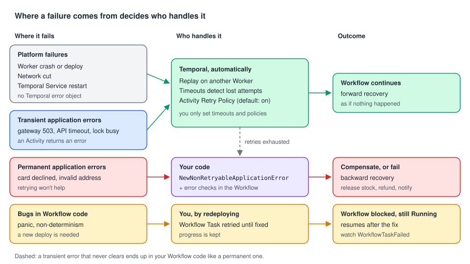

# 01 · Platform failures vs application failures

> **Level:** foundations · **Read time:** ~12 min
> **Sources:** [Encyclopedia — Failures and error handling](https://docs.temporal.io/encyclopedia/failures-and-error-handling) · [Application failures](https://docs.temporal.io/encyclopedia/application-failures) (platform vs application failures)

---

## 1. The problem

A checkout reserves stock, charges a card and books a shipment. Many things can go wrong:

- the Worker running the charge is killed by a deploy;
- the payment gateway answers `503` for thirty seconds;
- the Temporal Service restarts;
- the card is **declined**;
- the shipping address is in a country you don't deliver to.

Without Temporal you would write retry loops, persist progress in a database and run a recovery
job for every one of these. With Temporal, **some** of them need no code at all, and **some** need
very deliberate code. The first skill in error handling is telling the two apart.

---

## 2. Two families of failures



| | **Platform failures** | **Application failures** |
| --- | --- | --- |
| Examples | Worker crash, network cut, Service restart, Worker deploy | Card declined, invalid address, business rule broken, a downstream API that keeps rejecting the request |
| Who produces them | The infrastructure | **Your code** (an Activity or Workflow returns an error) |
| Who handles them | Temporal, transparently | **You**: Retry Policy settings, error checks in the Workflow, compensation |
| Recovery | **Forward recovery**: the step runs again and the Workflow continues where it was | Often **backward recovery**: undo what was already done (release stock, refund) |
| Do retries fix it? | Yes | Only if the cause is transient (a `503`). A declined card stays declined |

The Encyclopedia puts it this way: platform failures "do not produce Temporal failure objects"; the
platform handles them. Application failures **do** reach your code, as typed errors
([chapter 02](02-go-error-types.md)).

---

## 3. What Temporal does for you (no code)

**Durable Execution** covers platform failures:

| What happens | What Temporal does | Your code sees |
| --- | --- | --- |
| The Worker running an Activity crashes | The attempt times out (Start-To-Close or Heartbeat), a new attempt runs on another Worker | Nothing, if a later attempt succeeds |
| The Worker running the Workflow crashes | Another Worker replays the Event History and continues | Nothing |
| The Service restarts | State is in its database; Tasks are dispatched again | Nothing |
| An Activity returns a **transient** error | The default Retry Policy retries it with exponential backoff, forever | Nothing, if a later attempt succeeds |

The last line is the bridge between both families: a `503` is an **application** failure (your
Activity returned an error), but Temporal handles it like a platform failure because Activities
**retry by default**. Retry Policies are [chapter 07](07-retry-policies.md); detecting a crashed
Worker needs timeouts, [chapter 08](08-timeouts-and-heartbeats.md).

---

## 4. What you must still handle

Retries can't fix:

1. **Permanent errors**: bad input, a declined card, a business rule. Retrying wastes time and money.
   Mark them **non-retryable** ([chapter 04](04-application-errors.md)).
2. **The end of retries**: when an Activity gives up (non-retryable error, `MaximumAttempts`,
   Schedule-To-Close), the Workflow gets an error. It must decide: fail, compensate, or take
   another path ([chapter 05](05-handling-errors-in-workflows.md)).
3. **Bugs in Workflow code**: a panic or non-determinism doesn't fail the Workflow, it blocks it
   until you deploy a fix ([chapter 03](03-workflow-task-vs-execution.md)).
4. **Backward recovery**: if stock was reserved and the charge failed, someone must release it.
   Only your code knows how.

---

## 5. A checkout, annotated

The Activities. Infrastructure errors are returned **as is** (retryable). A declined card is a
business answer, so it becomes a non-retryable `ApplicationError`:

```go
// file: checkout/types.go
package checkout

type PlaceOrderInput struct {
	OrderID    string
	CustomerID string
	SKU        string
	Quantity   int
	CardToken  string
	TotalCents int64
}

type OrderConfirmation struct {
	OrderID       string
	ReservationID string
	PaymentID     string
}
```

```go
// file: checkout/ports.go
package checkout

import (
	"context"
	"errors"
)

// ErrCardDeclined is returned by the payment gateway client for a declined card.
var ErrCardDeclined = errors.New("card declined")

type Inventory interface {
	Reserve(ctx context.Context, orderID, sku string, qty int) (reservationID string, err error)
	Release(ctx context.Context, reservationID string) error
}

type PaymentGateway interface {
	Charge(ctx context.Context, idempotencyKey, cardToken string, amountCents int64) (paymentID string, err error)
}
```

```go
// file: checkout/activities.go
package checkout

import (
	"context"
	"errors"

	"go.temporal.io/sdk/temporal"
)

type Activities struct {
	Inventory Inventory
	Payments  PaymentGateway
}

// ReserveStock: any error (timeout, 503…) is transient. Temporal retries it.
func (a *Activities) ReserveStock(ctx context.Context, in PlaceOrderInput) (string, error) {
	return a.Inventory.Reserve(ctx, in.OrderID, in.SKU, in.Quantity)
}

// ChargeCard: a decline is permanent, everything else is retried.
func (a *Activities) ChargeCard(ctx context.Context, in PlaceOrderInput) (string, error) {
	paymentID, err := a.Payments.Charge(ctx, "charge-"+in.OrderID, in.CardToken, in.TotalCents)
	if errors.Is(err, ErrCardDeclined) {
		return "", temporal.NewNonRetryableApplicationError("card declined", "CardDeclined", err)
	}
	return paymentID, err
}

func (a *Activities) ReleaseStock(ctx context.Context, reservationID string) error {
	return a.Inventory.Release(ctx, reservationID)
}
```

The Workflow. It contains **no** retry loop and **no** crash handling. It only decides what a
failed charge means for the business:

```go
// file: checkout/workflow.go
package checkout

import (
	"time"

	"go.temporal.io/sdk/workflow"
)

const TaskQueue = "checkout"

func PlaceOrderWorkflow(ctx workflow.Context, in PlaceOrderInput) (OrderConfirmation, error) {
	ctx = workflow.WithActivityOptions(ctx, workflow.ActivityOptions{
		StartToCloseTimeout: 30 * time.Second, // detects a crashed Worker (platform failure)
	})
	var a *Activities

	var reservationID string
	if err := workflow.ExecuteActivity(ctx, a.ReserveStock, in).Get(ctx, &reservationID); err != nil {
		return OrderConfirmation{}, err // nothing to undo yet
	}

	var paymentID string
	if err := workflow.ExecuteActivity(ctx, a.ChargeCard, in).Get(ctx, &paymentID); err != nil {
		// Application failure: backward recovery. Use a disconnected context so the
		// release still runs if the Workflow itself is being canceled.
		releaseCtx, _ := workflow.NewDisconnectedContext(ctx)
		if relErr := workflow.ExecuteActivity(releaseCtx, a.ReleaseStock, reservationID).Get(releaseCtx, nil); relErr != nil {
			workflow.GetLogger(ctx).Error("Stock release failed", "reservationID", reservationID, "error", relErr)
		}
		return OrderConfirmation{}, err
	}

	return OrderConfirmation{OrderID: in.OrderID, ReservationID: reservationID, PaymentID: paymentID}, nil
}
```

```go
// file: cmd/worker/main.go
package main

import (
	"context"
	"log"

	"go.temporal.io/sdk/client"
	"go.temporal.io/sdk/worker"

	"github.com/acme/shop/checkout"
)

// Fakes stand in for the real inventory service and payment gateway.
type fakeInventory struct{}

func (fakeInventory) Reserve(context.Context, string, string, int) (string, error) {
	return "res-1", nil
}
func (fakeInventory) Release(context.Context, string) error { return nil }

type fakeGateway struct{}

func (fakeGateway) Charge(_ context.Context, _, cardToken string, _ int64) (string, error) {
	if cardToken == "tok_declined" {
		return "", checkout.ErrCardDeclined
	}
	return "pay-1", nil
}

func main() {
	c, err := client.Dial(client.Options{})
	if err != nil {
		log.Fatalln("Unable to create client", err)
	}
	defer c.Close()

	w := worker.New(c, checkout.TaskQueue, worker.Options{})
	w.RegisterWorkflow(checkout.PlaceOrderWorkflow)
	w.RegisterActivity(&checkout.Activities{Inventory: fakeInventory{}, Payments: fakeGateway{}})
	if err := w.Run(worker.InterruptCh()); err != nil {
		log.Fatalln("Unable to start worker", err)
	}
}
```

Reading the code against the failure list from section 1:

| Failure | Handled by | Code needed |
| --- | --- | --- |
| Worker killed during `ChargeCard` | Start-To-Close fires, the attempt runs again elsewhere | The timeout. The gateway call uses an idempotency key, so a second attempt doesn't charge twice |
| Gateway `503` for 30 s | Default Retry Policy | None |
| Service restart | Durable Execution | None |
| Card declined | Your Workflow | Non-retryable error + release the stock |

The `"charge-"+in.OrderID` idempotency key matters: an Activity can run **more than once**
(a crash after the charge but before the result was reported). See
[Activities, chapter 04](../../activities/docs/04-timeouts-retries-heartbeats.md).

---

## 6. Key takeaways

- **Platform failures** (crashes, network, restarts) are handled by Temporal through **forward
  recovery**. Don't write code for them; do set a Start-To-Close Timeout so crashes are detected.
- **Application failures** come from your code. Transient ones are retried by the default Activity
  Retry Policy; permanent ones must be marked **non-retryable**.
- When an Activity finally fails, the **Workflow decides**: fail, compensate (backward recovery) or
  take another path.
- Workflow code has no retry loops and no crash handling, only business decisions.
