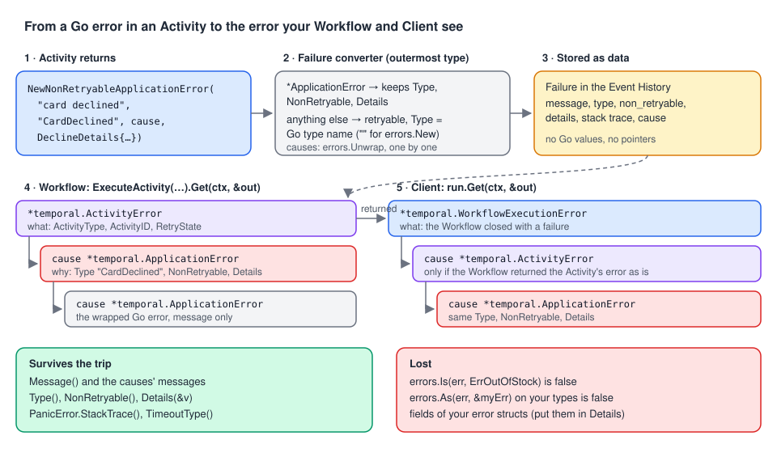

# 02 · Temporal's error types in Go

> **Level:** foundations · **Read time:** ~18 min
> **Sources:** [Encyclopedia — Application failures](https://docs.temporal.io/encyclopedia/application-failures) (how Temporal represents failures, how errors propagate) · [Go SDK — Error handling](https://docs.temporal.io/develop/go/best-practices/error-handling) · [`go.temporal.io/sdk/temporal`](https://pkg.go.dev/go.temporal.io/sdk/temporal)

---

## 1. The problem

Your Workflow calls `ChargeCard` and gets an `err`. Your HTTP handler calls `run.Get` and gets an
`err`. What is inside? Was the card declined, did the gateway time out, was the order canceled by
an operator, did the Activity panic?

In plain Go you would compare with `errors.Is(err, ErrCardDeclined)`. Across Temporal that **doesn't
work**: the error was produced in another process (maybe on another day), serialized, stored in the
Event History and rebuilt on your side. This chapter shows what you get back and what survives the
trip.

---

## 2. No base class: a family of concrete types

Other SDKs have a `TemporalFailure` base class. Go uses **specific error types** in
`go.temporal.io/sdk/temporal`, and you inspect them with `errors.As`:

| Type | Where you meet it | What it tells you |
| --- | --- | --- |
| `*temporal.ApplicationError` | Cause of the wrappers below | **Your** error: `Message()`, `Type()`, `NonRetryable()`, `Details(&v)`, `NextRetryDelay()`, `Category()` |
| `*temporal.ActivityError` | Workflow code, from `ExecuteActivity(...).Get` | Wrapper: `ActivityType()`, `ActivityID()`, `RetryState()`. The real reason is its cause |
| `*temporal.ChildWorkflowExecutionError` | Parent Workflow, from `ExecuteChildWorkflow(...).Get` | Wrapper: `WorkflowID()`, `RunID()`, `WorkflowType()`, `RetryState()` |
| `*temporal.WorkflowExecutionError` | Client code, from `run.Get` | Wrapper around why the Workflow closed |
| `*temporal.TimeoutError` | Cause of an Activity, child or Workflow failure | `TimeoutType()` (ScheduleToStart, StartToClose, ScheduleToClose, Heartbeat), `LastHeartbeatDetails(&v)` |
| `*temporal.CanceledError` | A canceled Activity, Timer, child or Workflow | `Details(&v)` |
| `*temporal.TerminatedError` | Client code, or a parent whose child was terminated | Someone ran `terminate` |
| `*temporal.PanicError` | An Activity that panicked; a Workflow panic under `FailWorkflow` | `Error()`, `StackTrace()` |
| `*temporal.ServerError` | Rare: a failure created by the Temporal Service itself | `Message()` |
| `*temporal.NexusOperationError` | Workflow code, from a Nexus Operation | Wrapper, like `ActivityError` |

Each type also has an `Is…` helper that runs `errors.As` for you: `temporal.IsApplicationError`,
`IsCanceledError`, `IsTimeoutError`, `IsTerminatedError`, `IsPanicError`. Use them when you only
need a yes/no.

The Encyclopedia warns: *do not extend the failure classes*. The Go equivalent: create failures
only with the SDK constructors (`temporal.NewApplicationError…`, `temporal.NewCanceledError`) and
never write your own types that try to look like Temporal's. Only the SDK's types are converted
into Temporal's failure format.

---

## 3. The chain: wrapper → cause → cause

An error is a **chain**. Wrappers say *what* failed (an Activity, a child, the Workflow), causes say
*why*:



What the probes printed for a non-retryable decline returned by an Activity and passed through
unchanged by the Workflow (SDK v1.50.0, Server 1.32.0):

```text
Workflow sees:  activity error (type: ChargeCard, scheduledEventID: 11, …): card declined (type: CardDeclined, retryable: false)
Client sees:    workflow execution error (type: PlaceOrderWorkflow, …): activity error (…): card declined (type: CardDeclined, retryable: false)
```

`errors.As` walks the chain, so you can reach the `ApplicationError` from either side without
unwrapping by hand.

> **Order your checks.** A `TimeoutError` wraps the **last attempt's** error. An Activity that
> failed with "inventory service unavailable" until Schedule-To-Close cut its retries produced
> `ActivityError (RetryState: Timeout)` → `TimeoutError (ScheduleToClose)` → `ApplicationError`.
> `errors.As(err, &appErr)` is **true** there too. Check timeouts **before** application errors.
>
> And don't rely on the `TimeoutError` being there. When a Workflow's 3 s Execution Timeout capped
> an Activity that kept failing with "gateway 503", the chain was just
> `ActivityError (RetryState: Timeout)` → `ApplicationError`, with **no** `TimeoutError`. The reliable
> signal that time ran out is `RetryState() == RETRY_STATE_TIMEOUT` on the wrapper.

A helper that does it in the right order:

```go
// file: failures/classify.go
package failures

import (
	"errors"

	enumspb "go.temporal.io/api/enums/v1"
	"go.temporal.io/sdk/temporal"
)

type Kind string

const (
	KindNone        Kind = ""
	KindCanceled    Kind = "canceled"
	KindTerminated  Kind = "terminated"
	KindTimeout     Kind = "timeout"
	KindPanic       Kind = "panic"
	KindApplication Kind = "application"
	KindOther       Kind = "other"
)

// Classification is a flat view of a Temporal error chain.
type Classification struct {
	Kind         Kind
	AppType      string // ApplicationError.Type(), when Kind is KindApplication
	NonRetryable bool
	TimeoutType  enumspb.TimeoutType
	RetryState   enumspb.RetryState // why retries stopped, for Activity and child failures
}

// Classify works on errors from Workflow code (ActivityError, ChildWorkflowExecutionError)
// and from Client code (WorkflowExecutionError). The order of the checks matters.
func Classify(err error) Classification {
	if err == nil {
		return Classification{Kind: KindNone}
	}
	var c Classification

	var actErr *temporal.ActivityError
	var childErr *temporal.ChildWorkflowExecutionError
	switch {
	case errors.As(err, &actErr):
		c.RetryState = actErr.RetryState()
	case errors.As(err, &childErr):
		c.RetryState = childErr.RetryState()
	}

	var timeoutErr *temporal.TimeoutError
	var appErr *temporal.ApplicationError
	switch {
	case temporal.IsCanceledError(err):
		c.Kind = KindCanceled
	case temporal.IsTerminatedError(err):
		c.Kind = KindTerminated
	case errors.As(err, &timeoutErr): // before ApplicationError: it wraps the last attempt's error
		c.Kind = KindTimeout
		c.TimeoutType = timeoutErr.TimeoutType()
	case c.RetryState == enumspb.RETRY_STATE_TIMEOUT: // retries cut by a timeout, no TimeoutError in the chain
		c.Kind = KindTimeout
	case temporal.IsPanicError(err):
		c.Kind = KindPanic
	case errors.As(err, &appErr):
		c.Kind = KindApplication
		c.AppType = appErr.Type()
		c.NonRetryable = appErr.NonRetryable()
	default:
		c.Kind = KindOther
	}
	return c
}
```

---

## 4. How a plain Go error crosses the boundary

When an Activity (or Workflow) returns an error, the SDK's **failure converter** turns it into a
Temporal failure. In SDK v1.50.0 (`internal/failure_converter.go`) it does this:

1. It looks at the **outermost** error only, with a type switch: `*ApplicationError`,
   `*CanceledError`, `*PanicError`, `*TimeoutError`, … each map to their own failure kind.
2. **Any other type** (your errors, `errors.New`, `fmt.Errorf`) becomes a **retryable**
   Application Failure whose `Type` is the Go type name of the outermost error.
3. It then converts `errors.Unwrap(err)` the same way, and stores it as the **cause**.

The type name comes from `getErrType`: the name of the type behind the pointer, **except** the
standard library's `errorString`, which gives an empty name. What we observed:

| The Activity returns | `ApplicationError.Type()` in the Workflow | Retryable |
| --- | --- | --- |
| `errors.New("boom")` | `""` (empty) | yes |
| `ErrOutOfStock` (a sentinel made with `errors.New`) | `""` | yes |
| `fmt.Errorf("reserve: %w", ErrOutOfStock)` | `"wrapError"` | yes |
| `&CardDeclinedError{Code: "51"}` (your own type) | `"CardDeclinedError"` | yes |
| `temporal.NewApplicationError("…", "RateLimited")` | `"RateLimited"` | yes |
| `temporal.NewNonRetryableApplicationError("…", "InsufficientFunds", nil, details)` | `"InsufficientFunds"` | **no** |
| `panic("nil map write")` | (a `*temporal.PanicError`, not an `ApplicationError`) | yes |

Two things follow:

- A custom error type gives you a usable `Type` for free, so you can list it in a Retry Policy's
  `NonRetryableErrorTypes` ([chapter 07](07-retry-policies.md)): `"CardDeclinedError"` worked in the
  probe. Renaming the Go type silently changes that string, so prefer explicit Types
  ([chapter 04](04-application-errors.md)).
- Because only the **outermost** type is checked, wrapping a non-retryable error in `fmt.Errorf`
  makes it **retryable**. That is [chapter 06](06-wrapping-and-retryability.md).

---

## 5. What survives the trip, and what doesn't

Failures are stored as data in the Event History, not as Go values. In the Workflow, after an
Activity returned these errors:

| Check in the Workflow | Result |
| --- | --- |
| `errors.Is(err, ErrOutOfStock)` (same sentinel variable) | **false** |
| `errors.As(err, &cardDeclined)` with `*CardDeclinedError` | **false** |
| `appErr.Type() == "CardDeclinedError"` | true |
| `appErr.Message()`, the cause's message | kept |
| `appErr.Details(&d)` for a `map[string]int{"missingCents": 1250}` | kept, decoded into `d` |
| `appErr.NonRetryable()` | kept (outermost error only) |
| Stack trace of a panic | kept (`PanicError.StackTrace()`) |

So across a Temporal boundary:

- **Match on `Type()`**, never on Go identity.
- **Put data in `Details`**, not in struct fields. `CardDeclinedError.Code` is lost; a detail value
  isn't.

```go
// file: payments/errors.go
package payments

// Application error Types shared by Activities and Workflows. These strings are a contract:
// they are stored in Event Histories and may be matched by other services.
const (
	ErrTypeCardDeclined      = "CardDeclined"
	ErrTypeInsufficientFunds = "InsufficientFunds"
)

// DeclineDetails travels with a CardDeclined error.
type DeclineDetails struct {
	DeclineCode string // gateway code, e.g. "51"
	Retryable   bool   // e.g. "51" (insufficient funds): the customer may try another card
}
```

```go
// file: payments/activities.go
package payments

import (
	"context"
	"errors"

	"go.temporal.io/sdk/temporal"
)

// GatewayDecline is what our gateway client returns for a decline.
type GatewayDecline struct{ Code string }

func (e *GatewayDecline) Error() string { return "declined with code " + e.Code }

type Gateway interface {
	Charge(ctx context.Context, idempotencyKey string, amountCents int64) (string, error)
}

type Activities struct{ Gateway Gateway }

func (a *Activities) ChargeOrder(ctx context.Context, orderID string, amountCents int64) (string, error) {
	paymentID, err := a.Gateway.Charge(ctx, "charge-"+orderID, amountCents)
	var decline *GatewayDecline
	if errors.As(err, &decline) {
		// Translate the Go type into a Type string + Details: they survive the trip.
		return "", temporal.NewNonRetryableApplicationError(
			"card declined", ErrTypeCardDeclined, err,
			DeclineDetails{DeclineCode: decline.Code, Retryable: decline.Code == "51"},
		)
	}
	return paymentID, err // anything else: retryable
}
```

```go
// file: payments/workflow.go
package payments

import (
	"errors"
	"time"

	"go.temporal.io/sdk/temporal"
	"go.temporal.io/sdk/workflow"
)

type PaymentOutcome struct {
	PaymentID   string
	Declined    bool
	DeclineCode string
	AskNewCard  bool
}

func CollectPaymentWorkflow(ctx workflow.Context, orderID string, amountCents int64) (PaymentOutcome, error) {
	ctx = workflow.WithActivityOptions(ctx, workflow.ActivityOptions{StartToCloseTimeout: 30 * time.Second})
	var a *Activities

	var paymentID string
	err := workflow.ExecuteActivity(ctx, a.ChargeOrder, orderID, amountCents).Get(ctx, &paymentID)
	if err == nil {
		return PaymentOutcome{PaymentID: paymentID}, nil
	}

	var appErr *temporal.ApplicationError
	if errors.As(err, &appErr) && appErr.Type() == ErrTypeCardDeclined && appErr.NonRetryable() {
		var d DeclineDetails
		if err := appErr.Details(&d); err != nil {
			workflow.GetLogger(ctx).Warn("Unreadable decline details", "error", err)
		}
		return PaymentOutcome{Declined: true, DeclineCode: d.DeclineCode, AskNewCard: d.Retryable}, nil
	}
	return PaymentOutcome{}, err // unknown failure: let the Workflow fail
}
```

On the Client side the same tools apply, with `WorkflowExecutionError` as the outer wrapper:

```go
// file: api/status.go
package api

import (
	"context"
	"net/http"

	"go.temporal.io/sdk/client"

	"github.com/acme/shop/failures"
)

// OrderStatusCode maps a finished order Workflow to an HTTP status for the checkout API.
func OrderStatusCode(ctx context.Context, c client.Client, workflowID string) int {
	err := c.GetWorkflow(ctx, workflowID, "").Get(ctx, nil)
	switch f := failures.Classify(err); f.Kind {
	case failures.KindNone:
		return http.StatusOK
	case failures.KindApplication:
		if f.AppType == "CardDeclined" {
			return http.StatusPaymentRequired
		}
		return http.StatusUnprocessableEntity
	case failures.KindCanceled, failures.KindTerminated:
		return http.StatusGone
	default:
		return http.StatusInternalServerError
	}
}
```

When a Workflow times out (`WorkflowExecutionTimeout` of 2 s on a sleeping Workflow), the Client got
a `TimeoutError` whose `TimeoutType()` was **`StartToClose`**, not a Workflow-specific value. Don't
expect to tell a Run Timeout from an Execution Timeout from the error.

---

## 6. Key takeaways

- Go has no base failure class: use `errors.As` with `*temporal.ActivityError`,
  `*temporal.ApplicationError`, `*temporal.TimeoutError`, … or the `temporal.Is…` helpers.
- Wrappers (`ActivityError`, `ChildWorkflowExecutionError`, `WorkflowExecutionError`) say **what**
  failed; their **cause** says why.
- A `TimeoutError` wraps the last attempt's error: check timeouts **before** application errors,
  and treat `RetryState() == RETRY_STATE_TIMEOUT` as a timeout even when no `TimeoutError` is present.
- A plain Go error becomes a **retryable** `ApplicationError` whose `Type` is its Go type name
  (`""` for `errors.New`, `"wrapError"` for `fmt.Errorf`).
- Go identity doesn't survive: `errors.Is`/`errors.As` on your own errors is false in the Workflow.
  Match on `Type()` and carry data in `Details`.
