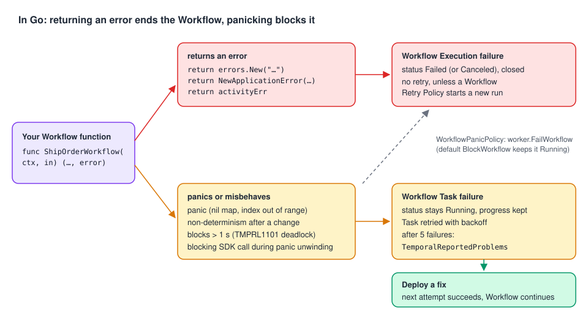

# 03 · Workflow Task failure vs Workflow Execution failure

> **Level:** foundations · **Read time:** ~18 min
> **Sources:** [Encyclopedia — Application failures](https://docs.temporal.io/encyclopedia/application-failures#workflow-task-failures-vs-workflow-execution-failures) · [Detecting Workflow failures](https://docs.temporal.io/encyclopedia/detecting-workflow-failures) (Workflow Task Timeout, detecting Workflow Task failures) · [Go SDK — Error handling](https://docs.temporal.io/develop/go/best-practices/error-handling) (panics and deferred functions)

---

## 1. The problem

Two order Workflows are in trouble:

- `order-1042` shows **Failed** in the Web UI. It's over: nothing will run again.
- `order-1043` shows **Running**, but nothing has happened for three days.

The first one hit a **Workflow Execution failure**. The second one hits a **Workflow Task failure**
every few minutes. They need opposite reactions, and in Go which one you get depends on whether your
Workflow **returns** an error or **panics**. The basics are in
[Workers, chapter 02](../../workers/docs/02-tasks.md); this chapter is the Go error-handling view.

---

## 2. The two outcomes



| | Workflow **Task** failure | Workflow **Execution** failure |
| --- | --- | --- |
| Meaning | This Worker could not run this step of the Workflow code | The Workflow decided it can't succeed |
| Status | Stays **Running** | **Failed** (closed) |
| Retried? | Yes, automatically, with backoff (up to 10 min between attempts), until it succeeds or the Workflow times out | No. Only a Workflow Retry Policy starts a **new run** ([chapter 07](07-retry-policies.md)) |
| Progress | Kept. Deploy a fix and the Workflow continues | Final for this run |
| Typical cause | A **bug**: panic, non-determinism, blocking code | A **business** outcome: rejected order, failed payment |

---

## 3. What does what in Go

The Encyclopedia says that in Workflow code *throwing a Temporal failure fails the Workflow
Execution, while throwing any other error fails the Workflow Task*. That's true for SDKs built on
exceptions. **Go is different**: a Workflow function returns an `error`, and any returned error
closes the Workflow.

Observed with SDK v1.50.0 and Server 1.32.0:

| Your Workflow code… | Result | What the Client's `run.Get` returns |
| --- | --- | --- |
| `return errors.New("plain workflow error")` | Execution **Failed** | `WorkflowExecutionError` → `ApplicationError` with `Type() == ""` |
| `return &OrderRejectedError{Reason: "fraud"}` | Execution **Failed** | → `ApplicationError` with `Type() == "OrderRejectedError"` |
| `return err` (an Activity's non-retryable error) | Execution **Failed** | → `ActivityError` → `ApplicationError` (`CardDeclined`) |
| `return ctx.Err()` after cancellation | Execution **Canceled** | → `CanceledError` |
| `var m map[string]int; m["x"] = 1` (a panic) | Workflow **Task** failed, Running, retried | Nothing yet: `Get` keeps waiting |
| Non-determinism after a code change | Workflow **Task** failed, Running | Nothing yet |
| `time.Sleep(2 * time.Second)` in Workflow code | Workflow **Task** failed: `[TMPRL1101] Potential deadlock detected: workflow goroutine "root" didn't yield for over 1s` | Nothing yet |
| A panic, with `WorkflowPanicPolicy: worker.FailWorkflow` | Execution **Failed** | `WorkflowExecutionError` → `PanicError` (`temporal.IsPanicError` is true) |

So in Go, **"return an error" means "this Workflow failed for good"**. A plain `errors.New` is not a
safe "try again later" signal: it ends the Workflow just like a business failure. If the Workflow
has a Retry Policy, a new run starts, from the beginning.

---

## 4. Return errors for business outcomes

Return an error only when the Workflow has really failed, and give it an explicit Type so callers
can react ([chapter 04](04-application-errors.md)):

```go
// file: shipping/workflow.go
package shipping

import (
	"time"

	"go.temporal.io/sdk/temporal"
	"go.temporal.io/sdk/workflow"
)

const TaskQueue = "shipping"

type ShipOrderInput struct {
	OrderID     string
	Country     string
	Postcode    string
	WeightGrams int
}

type Shipment struct {
	OrderID     string
	TrackingRef string
}

var supportedCountries = map[string]bool{"FR": true, "DE": true, "BE": true}

func ShipOrderWorkflow(ctx workflow.Context, in ShipOrderInput) (Shipment, error) {
	// Business rule: a final answer. Failing the Workflow is correct.
	if !supportedCountries[in.Country] {
		return Shipment{}, temporal.NewNonRetryableApplicationError(
			"we don't ship to "+in.Country, "UnsupportedCountry", nil, in.Country)
	}

	postcode, err := NormalizePostcode(in.Country, in.Postcode)
	if err != nil {
		return Shipment{}, err // already an ApplicationError with Type "InvalidPostcode"
	}

	ctx = workflow.WithActivityOptions(ctx, workflow.ActivityOptions{StartToCloseTimeout: time.Minute})
	var a *Activities
	var tracking string
	if err := workflow.ExecuteActivity(ctx, a.BookCarrier, in.OrderID, in.Country, postcode, in.WeightGrams).Get(ctx, &tracking); err != nil {
		return Shipment{}, err // the Activity gave up: the shipment failed
	}
	return Shipment{OrderID: in.OrderID, TrackingRef: tracking}, nil
}
```

```go
// file: shipping/activities.go
package shipping

import "context"

type Carrier interface {
	Book(ctx context.Context, orderID, country, postcode string, weightGrams int) (trackingRef string, err error)
}

type Activities struct{ Carrier Carrier }

func (a *Activities) BookCarrier(ctx context.Context, orderID, country, postcode string, weightGrams int) (string, error) {
	return a.Carrier.Book(ctx, orderID, country, postcode, weightGrams)
}
```

---

## 5. Let bugs fail the Workflow Task

A bug is the case Temporal handles best, **if you let it panic**. With the default
`WorkflowPanicPolicy` (`BlockWorkflow`), a panicking Workflow stays Running, its Workflow Task is
retried, and the Workflow continues where it was once a fixed Worker is deployed.

We checked it: an `AllocateWorkflow` that wrote to a nil map failed its Workflow Task six times;
after a Worker with the fix was started, the same Workflow completed with
`allocated MUG-01`. No data was lost, no one had to restart anything.

If you prefer bugs to **fail** Workflows (for example, short Workflows where a fast, visible failure
beats a stuck one), set the policy on the Worker:

```go
// file: cmd/worker/main.go
package main

import (
	"context"
	"log"
	"os"

	"go.temporal.io/sdk/client"
	"go.temporal.io/sdk/worker"

	"github.com/acme/shop/shipping"
)

// fakeCarrier stands in for the carrier's booking API.
type fakeCarrier struct{}

func (fakeCarrier) Book(_ context.Context, orderID, _, _ string, _ int) (string, error) {
	return "TRK-" + orderID, nil
}

func main() {
	c, err := client.Dial(client.Options{})
	if err != nil {
		log.Fatalln("Unable to create client", err)
	}
	defer c.Close()

	opts := worker.Options{}
	if os.Getenv("FAIL_WORKFLOW_ON_PANIC") == "true" {
		// Panics and non-determinism fail the Workflow Execution instead of blocking it.
		opts.WorkflowPanicPolicy = worker.FailWorkflow
	}
	w := worker.New(c, shipping.TaskQueue, opts)
	w.RegisterWorkflow(shipping.ShipOrderWorkflow)
	w.RegisterWorkflow(shipping.ProcessReturnWorkflow)
	w.RegisterActivity(&shipping.Activities{Carrier: fakeCarrier{}})
	if err := w.Run(worker.InterruptCh()); err != nil {
		log.Fatalln("Unable to start worker", err)
	}
}
```

With `FailWorkflow`, the panicking Workflow failed with
`Workflow failed on panic due to FailWorkflow workflow panic policy: assignment to entry in nil map`.
You lose the "fix and continue" property, so keep the default unless you have a reason.

---

## 6. Panics, `recover` and `defer` in Workflow code

The Go error-handling page says: *"you cannot `recover()` from a panic inside a `defer`. Deferred
functions that try to interact with the Temporal SDK during panic unwinding will re-panic
immediately."* What we observed is more precise:

| Code | Result |
| --- | --- |
| `defer func() { if r := recover(); r != nil { … } }()` then a nil-map panic | **Works.** The Workflow completed with `recovered: assignment to entry in nil map` |
| A `defer` that calls `workflow.ExecuteActivity(…).Get` when the function **returns an error** (no panic) | **Works.** The compensation Activity ran, then the Workflow failed with the original error |
| A `defer` that calls `workflow.Sleep` (any blocking SDK call) **while a panic unwinds** | Workflow Task fails: `yield during panic unwinding: a deferred function attempted to block the coroutine while a panic was in progress`, and is retried |

So the rule is: **never block on the SDK while a panic is unwinding**. `recover` itself is allowed,
and deferred compensation on the normal error path is fine.

Should you `recover`? Rarely. A recovered panic hides a bug that the default policy would have
surfaced and let you fix in place. One reasonable use is around **pure** third-party code that may
panic on odd input, to turn the panic into a business error:

```go
// file: shipping/postcode.go
package shipping

import (
	"fmt"
	"strings"

	"go.temporal.io/sdk/temporal"
)

// formatPostcode stands for a third-party formatting library that panics on unexpected input.
func formatPostcode(country, raw string) string {
	s := strings.ToUpper(strings.ReplaceAll(raw, " ", ""))
	if country == "FR" && len(s) != 5 {
		panic(fmt.Sprintf("invalid FR postcode %q", raw))
	}
	return s
}

// NormalizePostcode is deterministic and calls no SDK API, so recovering here is safe.
func NormalizePostcode(country, raw string) (postcode string, err error) {
	defer func() {
		if r := recover(); r != nil {
			err = temporal.NewNonRetryableApplicationError(fmt.Sprint(r), "InvalidPostcode", nil, raw)
		}
	}()
	return formatPostcode(country, raw), nil
}
```

And compensation in a `defer`, on the error path only:

```go
// file: shipping/returns.go
package shipping

import (
	"context"
	"time"

	"go.temporal.io/sdk/workflow"
)

func (a *Activities) ReserveReturnSlot(ctx context.Context, orderID string) (string, error) {
	return "slot-" + orderID, nil
}
func (a *Activities) ReleaseReturnSlot(ctx context.Context, slotID string) error { return nil }
func (a *Activities) PrintReturnLabel(ctx context.Context, orderID string) error { return nil }

func ProcessReturnWorkflow(ctx workflow.Context, orderID string) (err error) {
	ctx = workflow.WithActivityOptions(ctx, workflow.ActivityOptions{StartToCloseTimeout: time.Minute})
	var a *Activities

	var slotID string
	if err := workflow.ExecuteActivity(ctx, a.ReserveReturnSlot, orderID).Get(ctx, &slotID); err != nil {
		return err
	}
	defer func() {
		if err == nil {
			return
		}
		// Runs on the error path (no panic in flight), so blocking on an Activity is allowed.
		releaseCtx, _ := workflow.NewDisconnectedContext(ctx)
		_ = workflow.ExecuteActivity(releaseCtx, a.ReleaseReturnSlot, slotID).Get(releaseCtx, nil)
	}()

	return workflow.ExecuteActivity(ctx, a.PrintReturnLabel, orderID).Get(ctx, nil)
}
```

---

## 7. Finding Workflows that are stuck

A Workflow Task failure doesn't change the Workflow's status, so you need to look for it:

| Where | What you see |
| --- | --- |
| Event History | `WorkflowTaskFailed` events, cause `WORKFLOW_TASK_FAILED_CAUSE_WORKFLOW_WORKER_UNHANDLED_FAILURE` for a panic, with the panic message and stack |
| `DescribeWorkflowExecution` | `PendingWorkflowTask.Attempt` keeps growing |
| Search Attribute `TemporalReportedProblems` | Set after **5** consecutive Workflow Task failures, to `["category=WorkflowTaskFailed", "cause=WorkflowTaskFailedCauseWorkflowWorkerUnhandledFailure"]`. Cleared when a Workflow Task succeeds |
| Web UI | The **Task Failures** saved view lists those Workflows |
| SDK metrics | `temporal_workflow_task_execution_failed` counter on the Worker |

On the dev server (Server 1.32.0, no extra config) the attribute appeared at attempt 6, after five
failures, and the Web UI page's statement that self-hosted servers "need to update" the
`system.numConsecutiveWorkflowTaskProblemsToTriggerSearchAttribute` dynamic config didn't hold: the
default of 5 was already active. With the config set to 2, it appeared at attempt 3. Set it to 0 to
turn the feature off.

The flag is not removed when a flagged Workflow is **terminated**: our terminated deadlock probe
still matched the query. Filter on `ExecutionStatus = "Running"`.

An operations helper that lists stuck Workflows with their attempt count:

```go
// file: ops/stuck.go
package ops

import (
	"context"
	"fmt"

	"go.temporal.io/api/workflowservice/v1"
	"go.temporal.io/sdk/client"
)

type StuckWorkflow struct {
	WorkflowID   string
	WorkflowType string
	TaskAttempt  int32
}

// FindStuckWorkflows lists Running Workflows flagged with repeated Workflow Task failures.
func FindStuckWorkflows(ctx context.Context, c client.Client) ([]StuckWorkflow, error) {
	var stuck []StuckWorkflow
	var token []byte
	for {
		resp, err := c.ListWorkflow(ctx, &workflowservice.ListWorkflowExecutionsRequest{
			Query:         `ExecutionStatus = "Running" AND TemporalReportedProblems IN ("category=WorkflowTaskFailed")`,
			NextPageToken: token,
		})
		if err != nil {
			return nil, fmt.Errorf("list stuck workflows: %w", err)
		}
		for _, e := range resp.GetExecutions() {
			d, err := c.DescribeWorkflowExecution(ctx, e.GetExecution().GetWorkflowId(), e.GetExecution().GetRunId())
			if err != nil {
				return nil, fmt.Errorf("describe %s: %w", e.GetExecution().GetWorkflowId(), err)
			}
			stuck = append(stuck, StuckWorkflow{
				WorkflowID:   e.GetExecution().GetWorkflowId(),
				WorkflowType: e.GetType().GetName(),
				TaskAttempt:  d.GetPendingWorkflowTask().GetAttempt(),
			})
		}
		token = resp.GetNextPageToken()
		if len(token) == 0 {
			return stuck, nil
		}
	}
}
```

The same from the CLI:

```bash
temporal workflow list --query 'TemporalReportedProblems IN ("category=WorkflowTaskFailed")'
```

---

## 8. The Workflow Task Timeout

A Workflow Task can also fail by **timing out**: the Worker took the Task and didn't answer within
the **Workflow Task Timeout** (default **10 s**, maximum 120 s). Its main job is to notice a Worker
that died mid-Task, so the Task goes to another Worker. Raise it only for Workflows with very large
histories that take long to replay; the Encyclopedia advises against going beyond the default.

Don't confuse it with Go's **deadlock detector**: Workflow code that doesn't yield for 1 s
(`DeadlockDetectionTimeout`, see [Workers, chapter 05](../../workers/docs/05-worker-options.md))
fails the Task with `TMPRL1101` long before the 10 s timeout.

---

## 9. Key takeaways

- **Task failure** = the Workflow is stuck but alive; fix the code and it continues.
  **Execution failure** = the Workflow is over.
- In Go, **any returned error** fails the Workflow Execution, `errors.New` included. Only panics,
  non-determinism and blocking code fail the Workflow Task.
- Keep the default `BlockWorkflow` policy so bugs can be fixed in place; `FailWorkflow` turns them
  into failed Workflows.
- `recover()` works in Workflow code; blocking SDK calls during panic unwinding don't.
  Deferred compensation on the normal error path is fine.
- Watch `TemporalReportedProblems`, the Task Failures view and
  `temporal_workflow_task_execution_failed` to find stuck Workflows.
