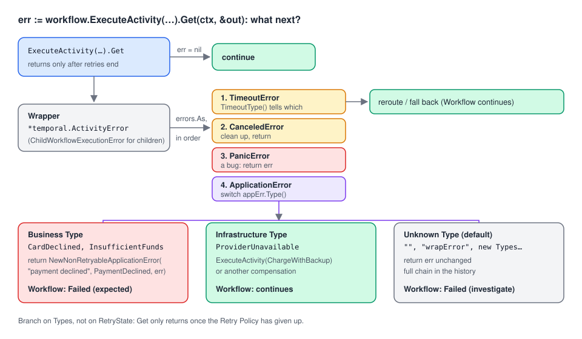

# 05 · Handling errors in Workflows

> **Level:** daily use · **Read time:** ~18 min
> **Sources:** [Encyclopedia — Application failures: How errors propagate](https://docs.temporal.io/encyclopedia/application-failures) · [Go SDK — Error handling](https://docs.temporal.io/develop/go/best-practices/error-handling) · [`temporal` package](https://pkg.go.dev/go.temporal.io/sdk/temporal)

---

## 1. The problem

`workflow.ExecuteActivity(...).Get(ctx, &out)` returned an error. Now what? The Workflow has to decide,
in deterministic code, between very different situations:

- the card was **declined**: tell the customer, don't retry;
- the payment provider is **down**: try the backup provider;
- **no warehouse** has the items: refund, then report;
- something **unexpected** happened: fail loudly, with the whole story in the history.

In Go you make those decisions with `errors.As` on the right error types. This chapter shows which
types arrive, how they're nested, and a complete checkout Workflow that handles each case.

---

## 2. What `Get` returns: always a wrapper, the cause inside



Temporal never hands the Workflow the Activity's error directly. It wraps it:

| You called | Outer error | The cause (`errors.As` target) |
| --- | --- | --- |
| `ExecuteActivity` | `*temporal.ActivityError` | `*temporal.ApplicationError` (your error, or a converted Go error), `*temporal.TimeoutError`, `*temporal.CanceledError`, `*temporal.PanicError` |
| `ExecuteChildWorkflow` | `*temporal.ChildWorkflowExecutionError` | Whatever the child returned (often an ApplicationError), `TimeoutError`, `CanceledError`, `TerminatedError` |

`errors.As` walks the chain, so you rarely need the wrapper itself. When you do, it carries context:

| Wrapper | Useful methods |
| --- | --- |
| `ActivityError` | `ActivityType().GetName()`, `ActivityID()`, `RetryState()`, `Identity()` |
| `ChildWorkflowExecutionError` | `WorkflowType()`, `WorkflowID()`, `RunID()`, `RetryState()` |

`RetryState()` says **why the retries stopped**. Values seen on a dev server (SDK v1.50.0):

| `RetryState` | When |
| --- | --- |
| `MaximumAttemptsReached` | Retryable error, `MaximumAttempts` used up |
| `NonRetryableFailure` | Non-retryable ApplicationError, or Type listed in `NonRetryableErrorTypes` |
| `Timeout` | A timeout that isn't retried (e.g. `ScheduleToStart`, or `ScheduleToClose` reached) |

> **Don't branch on `RetryState`.** It's good for logs, but the SDK's test environment reports
> `RETRY_STATE_UNSPECIFIED` when retries run out (`internal_workflow_testsuite.go`), where a dev server
> reports `MaximumAttemptsReached`. Logic that depends on it works in production and fails in unit tests.
> Branch on the **Type** instead: `Get` only returns once the Retry Policy has given up anyway.

---

## 3. Every type, in one place

The Go SDK page shows a long `if errors.As …` block. It's an excerpt that doesn't compile on its own
(it uses undefined `outcome`, `failure` and `YourActivity`), and it compares one Type with a string
literal and the next with a constant. Here is the same idea as a small, compilable helper:

```go
// file: checkout/classify.go
package checkout

import (
	"errors"
	"fmt"

	enumspb "go.temporal.io/api/enums/v1"
	"go.temporal.io/sdk/temporal"
)

// describeActivityError names the failure behind an Activity error. Every Activity
// error is a *temporal.ActivityError; the useful information is in its cause.
func describeActivityError(err error) string {
	var (
		appErr      *temporal.ApplicationError
		timeoutErr  *temporal.TimeoutError
		canceledErr *temporal.CanceledError
		panicErr    *temporal.PanicError
	)
	switch {
	case errors.As(err, &timeoutErr):
		switch timeoutErr.TimeoutType() {
		case enumspb.TIMEOUT_TYPE_SCHEDULE_TO_START:
			return "no Worker picked it up in time"
		case enumspb.TIMEOUT_TYPE_START_TO_CLOSE:
			return "an attempt ran too long"
		case enumspb.TIMEOUT_TYPE_SCHEDULE_TO_CLOSE:
			return "it ran out of overall time"
		case enumspb.TIMEOUT_TYPE_HEARTBEAT:
			return "it stopped heartbeating"
		}
		return "timeout"
	case errors.As(err, &canceledErr):
		return "canceled"
	case errors.As(err, &panicErr):
		// Message and stack trace of the panic inside the Activity.
		return "panicked: " + panicErr.Error()
	case errors.As(err, &appErr):
		return fmt.Sprintf("application error type=%q non-retryable=%v", appErr.Type(), appErr.NonRetryable())
	}
	return "unknown: " + err.Error()
}
```

Notes from the dev server:

- **Order matters.** A `TimeoutError` or `CanceledError` can also contain an ApplicationError (the last
  failure before the timeout), so check them first.
- **`PanicError`.** An Activity that panics is reported as a `*temporal.PanicError` with the panic message
  (and `StackTrace()`). It's **retryable**: the probe Activity was retried until `MaximumAttempts`.
- **Your own Go types don't survive.** An Activity returning `&CardDeclinedError{}` arrives as an
  ApplicationError with Type `"CardDeclinedError"`. `errors.As(err, &*CardDeclinedError)` is false in
  the Workflow, and `errors.Is(err, ErrOutOfStock)` with a sentinel error is false too. Only Types,
  messages and Details cross the boundary ([chapter 02](02-go-error-types.md)).
- **Unknown Types.** Keep a default branch: a newer Activity version can return a Type this Workflow
  has never seen.

---

## 4. A complete example: checkout with fallback, refund and clear errors

The Activities: a primary and a backup payment provider, and a refund.

```go
// file: payments/errors.go
package payments

const (
	ErrTypeCardDeclined        = "CardDeclined"
	ErrTypeInsufficientFunds   = "InsufficientFunds"
	ErrTypeInvalidCard         = "InvalidCard"
	ErrTypeProviderUnavailable = "ProviderUnavailable"
)
```

```go
// file: payments/activities.go
package payments

import (
	"context"

	"go.temporal.io/sdk/temporal"
)

type ChargeRequest struct {
	OrderID     string
	CardToken   string
	AmountCents int64
}

// Provider is one payment service provider's API.
type Provider interface {
	// Charge returns an authorization ID, or declined=true for a refused card.
	Charge(ctx context.Context, req ChargeRequest) (authID string, declined bool, err error)
	Refund(ctx context.Context, authID string) error
}

type PaymentActivities struct {
	Primary Provider
	Backup  Provider
}

func (a *PaymentActivities) ChargeWithPrimary(ctx context.Context, req ChargeRequest) (string, error) {
	return charge(ctx, a.Primary, req)
}

func (a *PaymentActivities) ChargeWithBackup(ctx context.Context, req ChargeRequest) (string, error) {
	return charge(ctx, a.Backup, req)
}

type RefundRequest struct {
	Provider        string // "primary" or "backup": refund where the money was taken
	AuthorizationID string
}

func (a *PaymentActivities) RefundCharge(ctx context.Context, req RefundRequest) error {
	if req.Provider == "backup" {
		return a.Backup.Refund(ctx, req.AuthorizationID)
	}
	return a.Primary.Refund(ctx, req.AuthorizationID)
}

func charge(ctx context.Context, p Provider, req ChargeRequest) (string, error) {
	authID, declined, err := p.Charge(ctx, req)
	switch {
	case err != nil:
		return "", temporal.NewApplicationErrorWithCause("payment provider unreachable", ErrTypeProviderUnavailable, err)
	case declined:
		return "", temporal.NewNonRetryableApplicationError("card declined", ErrTypeCardDeclined, nil)
	}
	return authID, nil
}
```

The Child Workflow that allocates stock:

```go
// file: shipping/workflow.go
package shipping

import (
	"go.temporal.io/sdk/temporal"
	"go.temporal.io/sdk/workflow"
)

const ErrTypeOutOfStock = "OutOfStock"

type AllocateShipmentInput struct {
	OrderID string
	SKUs    []string
}

// AllocateShipmentWorkflow runs as a Child Workflow of PlaceOrderWorkflow.
func AllocateShipmentWorkflow(ctx workflow.Context, in AllocateShipmentInput) (string, error) {
	// ... pick a warehouse with Activities ...
	if len(in.SKUs) == 0 {
		return "", temporal.NewNonRetryableApplicationError("no warehouse has stock", ErrTypeOutOfStock, nil, in.OrderID)
	}
	return "warehouse-lyon-1", nil
}
```

The Workflow. Read it for **the three kinds of outcome** it produces:

```go
// file: checkout/workflow.go
package checkout

import (
	"errors"
	"time"

	"go.temporal.io/sdk/temporal"
	"go.temporal.io/sdk/workflow"

	"github.com/acme/shop/payments"
	"github.com/acme/shop/shipping"
)

// Error types this Workflow returns to its callers.
const (
	ErrTypePaymentDeclined = "PaymentDeclined"
	ErrTypeOutOfStock      = "OutOfStock"
)

type PlaceOrderInput struct {
	OrderID     string
	CardToken   string
	AmountCents int64
	SKUs        []string
}

type PlaceOrderResult struct {
	AuthorizationID string
	Warehouse       string
}

func PlaceOrderWorkflow(ctx workflow.Context, in PlaceOrderInput) (PlaceOrderResult, error) {
	logger := workflow.GetLogger(ctx)
	ctx = workflow.WithActivityOptions(ctx, workflow.ActivityOptions{
		StartToCloseTimeout: 10 * time.Second,
		RetryPolicy:         &temporal.RetryPolicy{MaximumAttempts: 3},
	})
	var pa *payments.PaymentActivities
	req := payments.ChargeRequest{OrderID: in.OrderID, CardToken: in.CardToken, AmountCents: in.AmountCents}

	// 1. Charge, falling back to the backup provider if the primary is down.
	var authID string
	provider := "primary"
	err := workflow.ExecuteActivity(ctx, pa.ChargeWithPrimary, req).Get(ctx, &authID)
	if err != nil {
		var actErr *temporal.ActivityError
		if errors.As(err, &actErr) {
			logger.Warn("Primary charge failed",
				"activity", actErr.ActivityType().GetName(),
				"retryState", actErr.RetryState(), // e.g. MaximumAttemptsReached, NonRetryableFailure, Timeout
				"reason", describeActivityError(err))
		}
		switch {
		case isPaymentDecline(err):
			// A business outcome: report it to the caller, don't retry the Workflow.
			return PlaceOrderResult{}, temporal.NewNonRetryableApplicationError(
				"payment declined", ErrTypePaymentDeclined, err, in.OrderID)
		case primaryIsDown(err):
			provider = "backup"
			if err := workflow.ExecuteActivity(ctx, pa.ChargeWithBackup, req).Get(ctx, &authID); err != nil {
				if isPaymentDecline(err) {
					return PlaceOrderResult{}, temporal.NewNonRetryableApplicationError(
						"payment declined", ErrTypePaymentDeclined, err, in.OrderID)
				}
				return PlaceOrderResult{}, err
			}
		default:
			// Unknown failure: let it fail the Workflow with the full chain.
			return PlaceOrderResult{}, err
		}
	}

	// 2. Allocate stock in a Child Workflow. Refund if nothing can ship.
	var warehouse string
	err = workflow.ExecuteChildWorkflow(ctx, shipping.AllocateShipmentWorkflow,
		shipping.AllocateShipmentInput{OrderID: in.OrderID, SKUs: in.SKUs}).Get(ctx, &warehouse)
	if err != nil {
		var childErr *temporal.ChildWorkflowExecutionError
		var appErr *temporal.ApplicationError
		if errors.As(err, &childErr) && errors.As(err, &appErr) && appErr.Type() == shipping.ErrTypeOutOfStock {
			logger.Info("Nothing to ship, refunding", "child", childErr.WorkflowID())
			if err := workflow.ExecuteActivity(ctx, pa.RefundCharge,
				payments.RefundRequest{Provider: provider, AuthorizationID: authID}).Get(ctx, nil); err != nil {
				return PlaceOrderResult{}, err
			}
			return PlaceOrderResult{}, temporal.NewNonRetryableApplicationError(
				"items out of stock, payment refunded", ErrTypeOutOfStock, err, in.OrderID)
		}
		return PlaceOrderResult{}, err
	}
	return PlaceOrderResult{AuthorizationID: authID, Warehouse: warehouse}, nil
}

func isPaymentDecline(err error) bool {
	var appErr *temporal.ApplicationError
	if !errors.As(err, &appErr) {
		return false
	}
	switch appErr.Type() {
	case payments.ErrTypeCardDeclined, payments.ErrTypeInsufficientFunds, payments.ErrTypeInvalidCard:
		return true
	}
	return false
}

// primaryIsDown is true when the provider stayed unreachable for every attempt
// (Get only returns after the Retry Policy gave up), or an attempt timed out.
func primaryIsDown(err error) bool {
	var appErr *temporal.ApplicationError
	var timeoutErr *temporal.TimeoutError
	if errors.As(err, &timeoutErr) {
		return true
	}
	return errors.As(err, &appErr) && appErr.Type() == payments.ErrTypeProviderUnavailable
}
```

| Situation | What the Workflow does | Workflow ends |
| --- | --- | --- |
| Primary down for all 3 attempts (Type `ProviderUnavailable`) | Charges with the backup | Completed |
| Card declined (non-retryable `CardDeclined`) | Returns a non-retryable `PaymentDeclined`, original error as cause | **Failed**, Type `PaymentDeclined` |
| Child returns `OutOfStock` | Refunds with the provider that charged, returns `OutOfStock` | **Failed**, Type `OutOfStock` |
| Anything else | Returns the error unchanged | **Failed**, full chain in history |

Design choices worth copying:

- **Translate, don't leak.** Callers of `PlaceOrderWorkflow` see `PaymentDeclined`, not the provider's
  `CardDeclined`. The original stays in the chain as the cause, for debugging.
- **Non-retryable business outcomes.** If someone starts this Workflow with a Retry Policy, a declined
  card still won't be charged again.
- **Unknown errors fail the Workflow.** Swallowing them would hide bugs. Returning them keeps the whole
  chain in the `WorkflowExecutionFailed` event.

Checked on a dev server with the primary provider down: order 1 completed through the backup, order 2
(declined card) failed with `PaymentDeclined`, order 3 (no stock) was refunded through the backup and
failed with `OutOfStock`. The Worker logged `retryState MaximumAttemptsReached` for the primary.

---

## 5. Child Workflow errors

`ChildWorkflowExecutionError` works like `ActivityError`: one `errors.As` for the wrapper (to log the
child's Workflow ID), one for the cause (to read its Type). Checked on a dev server: both
`errors.As(err, &childErr)` and `errors.As(err, &appErr)` with Type `OutOfStock` are true for the
same error.

If the child itself failed because one of *its* Activities failed, the chain is deeper
(`ChildWorkflowExecutionError` → `ApplicationError`/`ActivityError` → …). `errors.As` still finds the
**first** ApplicationError from the outside, which is the one the child chose to return.

---

## 6. How the Client sees it

A Workflow failure reaches `run.Get` as a `*temporal.WorkflowExecutionError`, with your error as its
cause. Map Types to responses at the edge of your system:

```go
// file: api/orders.go
package api

import (
	"context"
	"errors"
	"net/http"

	"go.temporal.io/sdk/client"
	"go.temporal.io/sdk/temporal"

	"github.com/acme/shop/checkout"
)

// PlaceOrder starts the Workflow, waits for it, and maps its failure to an HTTP status.
func PlaceOrder(ctx context.Context, c client.Client, in checkout.PlaceOrderInput) (int, checkout.PlaceOrderResult) {
	run, err := c.ExecuteWorkflow(ctx, client.StartWorkflowOptions{
		ID:        "order-" + in.OrderID,
		TaskQueue: "checkout",
	}, checkout.PlaceOrderWorkflow, in)
	if err != nil {
		return http.StatusServiceUnavailable, checkout.PlaceOrderResult{}
	}

	var res checkout.PlaceOrderResult
	err = run.Get(ctx, &res)

	var wfErr *temporal.WorkflowExecutionError
	var appErr *temporal.ApplicationError
	switch {
	case err == nil:
		return http.StatusOK, res
	case errors.As(err, &wfErr) && errors.As(err, &appErr):
		switch appErr.Type() {
		case checkout.ErrTypePaymentDeclined:
			return http.StatusPaymentRequired, res
		case checkout.ErrTypeOutOfStock:
			return http.StatusConflict, res
		}
	}
	return http.StatusInternalServerError, res
}
```

Since the Workflow returned its own `PaymentDeclined`/`OutOfStock` errors, `errors.As` finds those
first, not the inner provider errors. That's the payoff of translating errors in the Workflow.
Other `run.Get` outcomes (timeouts, cancellation, termination) are covered in the Client guide:
[Getting Workflow results](../../client/docs/07-getting-results.md).

---

## 7. Testing the error paths

The test environment runs Activity retries with a mocked clock, so all three paths are quick unit
tests (this file also uses `github.com/stretchr/testify`):

```go
// file: checkout/workflow_test.go
package checkout

import (
	"errors"
	"testing"

	"github.com/stretchr/testify/mock"
	"github.com/stretchr/testify/require"
	"go.temporal.io/sdk/temporal"
	"go.temporal.io/sdk/testsuite"

	"github.com/acme/shop/payments"
	"github.com/acme/shop/shipping"
)

func newEnv(t *testing.T) (*testsuite.TestWorkflowEnvironment, *payments.PaymentActivities) {
	var ts testsuite.WorkflowTestSuite
	env := ts.NewTestWorkflowEnvironment()
	pa := &payments.PaymentActivities{}
	env.RegisterActivity(pa)
	env.RegisterWorkflow(shipping.AllocateShipmentWorkflow)
	return env, pa
}

var order = PlaceOrderInput{OrderID: "A-1001", CardToken: "tok_visa", AmountCents: 4999, SKUs: []string{"MUG-RED"}}

func TestFallsBackToBackupWhenPrimaryIsDown(t *testing.T) {
	env, pa := newEnv(t)
	down := temporal.NewApplicationError("payment provider unreachable", payments.ErrTypeProviderUnavailable)
	env.OnActivity(pa.ChargeWithPrimary, mock.Anything, mock.Anything).Return("", down).Times(3)
	env.OnActivity(pa.ChargeWithBackup, mock.Anything, mock.Anything).Return("auth-backup-77", nil).Once()

	env.ExecuteWorkflow(PlaceOrderWorkflow, order)

	require.NoError(t, env.GetWorkflowError())
	var res PlaceOrderResult
	require.NoError(t, env.GetWorkflowResult(&res))
	require.Equal(t, "auth-backup-77", res.AuthorizationID)
	env.AssertExpectations(t)
}

func TestDeclineFailsWithPaymentDeclined(t *testing.T) {
	env, pa := newEnv(t)
	declined := temporal.NewNonRetryableApplicationError("card declined", payments.ErrTypeCardDeclined, nil)
	env.OnActivity(pa.ChargeWithPrimary, mock.Anything, mock.Anything).Return("", declined).Once()

	env.ExecuteWorkflow(PlaceOrderWorkflow, order)

	var appErr *temporal.ApplicationError
	require.True(t, errors.As(env.GetWorkflowError(), &appErr))
	require.Equal(t, ErrTypePaymentDeclined, appErr.Type())
	require.True(t, appErr.NonRetryable())
}

func TestOutOfStockRefunds(t *testing.T) {
	env, pa := newEnv(t)
	env.OnActivity(pa.ChargeWithPrimary, mock.Anything, mock.Anything).Return("auth-1", nil)
	env.OnActivity(pa.RefundCharge, mock.Anything,
		payments.RefundRequest{Provider: "primary", AuthorizationID: "auth-1"}).Return(nil).Once()

	noSKUs := order
	noSKUs.SKUs = nil
	env.ExecuteWorkflow(PlaceOrderWorkflow, noSKUs)

	var appErr *temporal.ApplicationError
	require.True(t, errors.As(env.GetWorkflowError(), &appErr))
	require.Equal(t, ErrTypeOutOfStock, appErr.Type())
	env.AssertExpectations(t)
}
```

`.Times(3)` on the primary charge proves the Retry Policy ran before the fallback. All three tests pass
with SDK v1.50.0.

---

## 8. Key takeaways

- `Get` returns a wrapper (`ActivityError`, `ChildWorkflowExecutionError`). Use `errors.As` to reach the
  cause: `ApplicationError`, `TimeoutError`, `CanceledError`, `PanicError`.
- Check timeouts and cancellation before ApplicationError, and keep a default branch for unknown Types.
- Go error types and sentinel errors don't survive the trip. Branch on `appErr.Type()`.
- Branch on Types, not on `RetryState()`: the test environment doesn't report it like the Service does.
- Translate provider errors into your own Workflow-level Types, keep the original as the cause, and make
  business outcomes non-retryable.
- Return unknown errors unchanged so the Workflow fails with the full story in its history.
