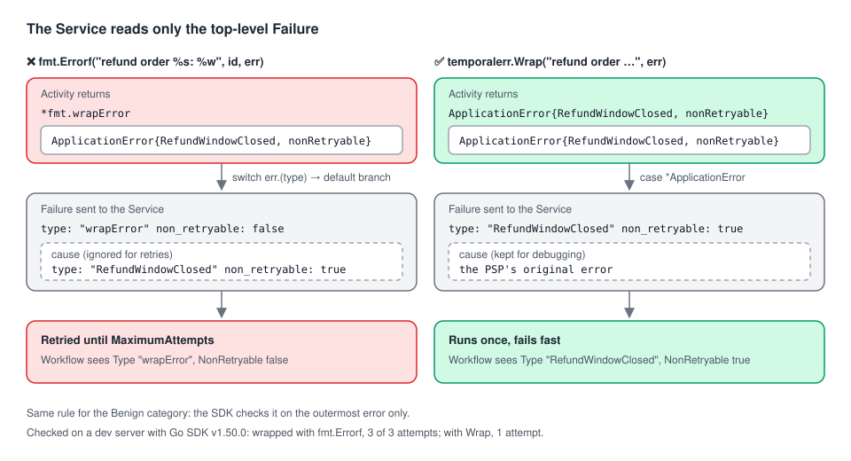

# 06 · Wrapping errors without losing retryability

> **Level:** daily use · **Read time:** ~12 min
> **Sources:** [Encyclopedia — Application failures: The outermost error type determines retryability](https://docs.temporal.io/encyclopedia/application-failures) · [Go SDK — Error handling](https://docs.temporal.io/develop/go/best-practices/error-handling) · [`temporal.ApplicationErrorOptions`](https://pkg.go.dev/go.temporal.io/sdk/temporal#ApplicationErrorOptions)

---

## 1. The problem

Every Go developer learns to add context to errors with
`fmt.Errorf("refund order %s: %w", req.OrderID, err)`. In a Temporal Activity, this habit has a cost. If `err` was a **non-retryable** ApplicationError
("refund window closed"), the wrapped error is **retryable**. The refund is attempted again and again
until the Retry Policy runs out, and the Workflow receives an error whose Type is `"wrapError"`, not
`"RefundWindowClosed"`.

Go's `%w` keeps the inner error reachable with `errors.As`, so it *looks* safe. It isn't, because
Temporal doesn't look inside.

---

## 2. The rule: only the outermost error counts



When an Activity returns an error, the SDK converts it to a `Failure` message for the Service:

1. It looks at the **outermost** error's concrete type (`switch err := err.(type)` in
   `internal/failure_converter.go`, SDK v1.50.0).
2. If it's a `*temporal.ApplicationError`, its Type, NonRetryable flag, Details, NextRetryDelay and
   Category are copied into the Failure.
3. **Any other type** falls into the `default` branch: a **retryable** ApplicationFailure whose Type is
   the Go type name (`"wrapError"` for `fmt.Errorf`).
4. The inner errors are converted too, into the `cause` chain. They're kept for debugging, but the
   Service decides retries from the **top-level** Failure only.

Checked on a dev server: an Activity returning
`fmt.Errorf("charge failed: %w", temporal.NewNonRetryableApplicationError("bad card", "InvalidCard", nil))`
with `MaximumAttempts: 3` ran **3 times** and ended with `RetryState` `MaximumAttemptsReached`. In the
Workflow, `errors.As(err, &appErr)` found Type `"wrapError"`, NonRetryable `false`. The inner
`InvalidCard` error was still in the chain, one level down.

The Encyclopedia warns about this for every SDK. The Go SDK's Error handling page doesn't mention it.

The same rule applies to **`ApplicationErrorCategoryBenign`**: the SDK checks the category on the
outermost error only. A benign error wrapped with `fmt.Errorf` was logged at `ERROR` on the dev
server, not Debug.

---

## 3. The bug, in a realistic Activity

Our PSP client library already returns proper Temporal errors:

```go
// file: refunds/psp.go
package refunds

import (
	"context"

	"go.temporal.io/sdk/temporal"
)

const ErrTypeRefundWindowClosed = "RefundWindowClosed"

type RefundRequest struct {
	OrderID         string
	AuthorizationID string
	AmountCents     int64
}

// PSP is the payment service provider's client library. It already speaks
// Temporal: permanent refusals come back as non-retryable ApplicationErrors.
type PSP interface {
	Refund(ctx context.Context, authorizationID string, amountCents int64) error
}

// ErrWindowClosed is what our PSP client returns for refunds older than 180 days.
func ErrWindowClosed(authorizationID string) error {
	return temporal.NewNonRetryableApplicationError(
		"refund window closed for "+authorizationID, ErrTypeRefundWindowClosed, nil)
}
```

And this Activity, written with ordinary Go habits, breaks it:

```go
// file: refunds/before.go
package refunds

import (
	"context"
	"fmt"
)

type RefundActivities struct {
	PSP PSP
}

// IssueRefundBefore is the buggy version: fmt.Errorf hides the non-retryable error.
func (a *RefundActivities) IssueRefundBefore(ctx context.Context, req RefundRequest) error {
	if err := a.PSP.Refund(ctx, req.AuthorizationID, req.AmountCents); err != nil {
		return fmt.Errorf("refund order %s: %w", req.OrderID, err) // ❌ outermost is now *fmt.wrapError
	}
	return nil
}
```

---

## 4. Fix 1: wrap with an ApplicationError that copies the flags

Wrap in another ApplicationError, copying what matters from the inner one. A small helper keeps this
in one place:

```go
// file: internal/temporalerr/wrap.go
package temporalerr

import (
	"errors"
	"fmt"

	"go.temporal.io/sdk/temporal"
)

// Wrap adds context to err without changing how Temporal treats it. If err holds an
// ApplicationError, the result is an ApplicationError with the same Type,
// NonRetryable flag, NextRetryDelay and Category, and err as its cause. Otherwise
// it falls back to fmt.Errorf, which is retryable anyway.
func Wrap(msg string, err error) error {
	if err == nil {
		return nil
	}
	var appErr *temporal.ApplicationError
	if !errors.As(err, &appErr) {
		return fmt.Errorf("%s: %w", msg, err)
	}
	return temporal.NewApplicationErrorWithOptions(msg, appErr.Type(), temporal.ApplicationErrorOptions{
		NonRetryable:   appErr.NonRetryable(),
		Cause:          err,
		NextRetryDelay: appErr.NextRetryDelay(),
		Category:       appErr.Category(),
	})
}
```

```go
// file: refunds/activities.go
package refunds

import (
	"context"

	"github.com/acme/shop/internal/temporalerr"
)

// IssueRefund adds the order ID to the error and keeps it non-retryable.
func (a *RefundActivities) IssueRefund(ctx context.Context, req RefundRequest) error {
	err := a.PSP.Refund(ctx, req.AuthorizationID, req.AmountCents)
	return temporalerr.Wrap("refund order "+req.OrderID, err) // ✅ outermost is an ApplicationError
}
```

```go
// file: refunds/workflow.go
package refunds

import (
	"time"

	"go.temporal.io/sdk/temporal"
	"go.temporal.io/sdk/workflow"
)

func RefundOrderWorkflow(ctx workflow.Context, req RefundRequest) error {
	ctx = workflow.WithActivityOptions(ctx, workflow.ActivityOptions{
		StartToCloseTimeout: 30 * time.Second,
		RetryPolicy:         &temporal.RetryPolicy{MaximumAttempts: 5},
	})
	var a *RefundActivities
	return workflow.ExecuteActivity(ctx, a.IssueRefund, req).Get(ctx, nil)
}
```

Checked on a dev server: the PSP was called **once**. The Workflow's `errors.As` found the outer error
with Type `RefundWindowClosed`, NonRetryable `true` and message `refund order A-1001`.
`errors.As(outer.Unwrap(), &inner)` reached the PSP's original error (`refund window closed for auth-9`).

One limitation: **Details aren't copied**. They're encoded payloads, so a generic helper can't decode
and re-encode them. They stay on the inner error. To read them, unwrap past the outer error, or pass
the Details again when you build the outer error yourself.

---

## 5. Fix 2: don't wrap at all

Often the context you wanted to add is already there: the Activity Type, Workflow ID and attempt are in
the history and in the SDK's log line. Log the extra context and return the error **as is**:

```go
// file: refunds/logged.go
package refunds

import (
	"context"

	"go.temporal.io/sdk/activity"
)

// IssueRefundLogged puts the context in the log and returns the PSP's error untouched.
func (a *RefundActivities) IssueRefundLogged(ctx context.Context, req RefundRequest) error {
	if err := a.PSP.Refund(ctx, req.AuthorizationID, req.AmountCents); err != nil {
		activity.GetLogger(ctx).Warn("Refund failed", "order", req.OrderID, "error", err)
		return err
	}
	return nil
}
```

| Approach | Keeps retryability | Adds context to the error | Keeps Details on the outermost error |
| --- | --- | --- | --- |
| `fmt.Errorf("…: %w", err)` | ❌ | ✅ | ❌ |
| `temporalerr.Wrap(msg, err)` | ✅ | ✅ | ❌ (on the cause) |
| Log, then `return err` | ✅ | in logs only | ✅ |

`fmt.Errorf` stays fine for errors that are **meant** to be retryable (a network error from an HTTP
client, for example). The problem is only wrapping an ApplicationError.

---

## 6. Test it: one attempt, not five

A unit test catches this regression for good. Run the Activity **through a Workflow** in the test
environment, so the error goes through the same conversion and Retry Policy as in production:

```go
// file: refunds/activities_test.go
package refunds

import (
	"context"
	"errors"
	"testing"
	"time"

	"github.com/stretchr/testify/require"
	"go.temporal.io/sdk/temporal"
	"go.temporal.io/sdk/testsuite"
	"go.temporal.io/sdk/workflow"
)

// closedWindowPSP refuses every refund and counts the calls.
type closedWindowPSP struct{ calls int }

func (p *closedWindowPSP) Refund(ctx context.Context, authID string, _ int64) error {
	p.calls++
	return ErrWindowClosed(authID)
}

// runRefund runs one Activity through a Workflow, so the error goes through the
// same conversion and Retry Policy as in production.
func runRefund(t *testing.T, activity func(*RefundActivities) any) (*closedWindowPSP, error) {
	var ts testsuite.WorkflowTestSuite
	env := ts.NewTestWorkflowEnvironment()
	psp := &closedWindowPSP{}
	acts := &RefundActivities{PSP: psp}
	env.RegisterActivity(acts)
	fn := activity(acts)
	env.ExecuteWorkflow(func(ctx workflow.Context) error {
		ctx = workflow.WithActivityOptions(ctx, workflow.ActivityOptions{
			StartToCloseTimeout: 10 * time.Second,
			RetryPolicy:         &temporal.RetryPolicy{MaximumAttempts: 5},
		})
		return workflow.ExecuteActivity(ctx, fn, RefundRequest{OrderID: "A-1001", AuthorizationID: "auth-9"}).Get(ctx, nil)
	})
	return psp, env.GetWorkflowError()
}

func TestIssueRefundIsNotRetriedWhenWindowClosed(t *testing.T) {
	psp, err := runRefund(t, func(a *RefundActivities) any { return a.IssueRefund })

	require.Equal(t, 1, psp.calls, "a closed refund window must not be retried")
	var appErr *temporal.ApplicationError
	require.True(t, errors.As(err, &appErr))
	require.Equal(t, ErrTypeRefundWindowClosed, appErr.Type())
	require.True(t, appErr.NonRetryable())
}

func TestIssueRefundBeforeIsRetried(t *testing.T) {
	psp, err := runRefund(t, func(a *RefundActivities) any { return a.IssueRefundBefore })

	require.Equal(t, 5, psp.calls, "fmt.Errorf made the error retryable")
	var appErr *temporal.ApplicationError
	require.True(t, errors.As(err, &appErr))
	require.Equal(t, "wrapError", appErr.Type())
	require.False(t, appErr.NonRetryable())
}

func TestIssueRefundLoggedIsNotRetried(t *testing.T) {
	psp, err := runRefund(t, func(a *RefundActivities) any { return a.IssueRefundLogged })

	require.Equal(t, 1, psp.calls)
	var appErr *temporal.ApplicationError
	require.True(t, errors.As(err, &appErr))
	require.Equal(t, ErrTypeRefundWindowClosed, appErr.Type())
}
```

All three tests pass with SDK v1.50.0 (the third one, `TestIssueRefundLoggedIsNotRetried`, covers Fix 2). The test environment reproduces the bug exactly: 5 calls and Type
`"wrapError"` for `IssueRefundBefore`, 1 call and Type `RefundWindowClosed` for `IssueRefund`.

`TestActivityEnvironment` (running the Activity alone) also converts the error. On `IssueRefundBefore`
it returned an `ActivityError` whose first ApplicationError was the retryable `"wrapError"`, so an
assertion on `NonRetryable()` catches it too. It doesn't run retries, though, so you can't count
attempts there.

---

## 7. Key takeaways

- Temporal decides retries from the **outermost** error. `fmt.Errorf("%w")` around a non-retryable
  ApplicationError makes it retryable, with Type `"wrapError"`.
- The inner error stays in the cause chain. It's visible for debugging but ignored for retry decisions.
- To add context, wrap in a new ApplicationError that copies Type, NonRetryable, NextRetryDelay and
  Category (a helper like `temporalerr.Wrap`), or log the context and return the error unchanged.
- The Benign category follows the same rule: only the outermost error counts.
- Pin the behavior with a test that runs the Activity through a Workflow and counts attempts.
