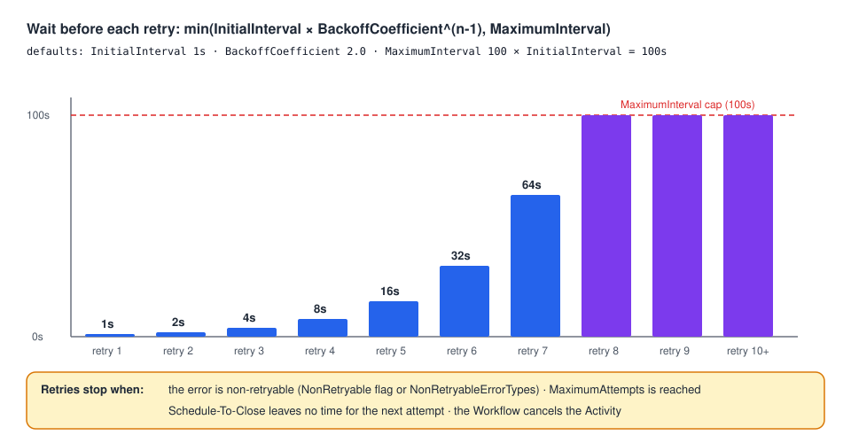

# 07 · Retry Policies

> **Level:** daily use · **Read time:** ~15 min
> **Sources:** [Encyclopedia — Retry Policies](https://docs.temporal.io/encyclopedia/retry-policies) · [Encyclopedia — Detecting Workflow failures](https://docs.temporal.io/encyclopedia/detecting-workflow-failures) · [`temporal.RetryPolicy`](https://pkg.go.dev/go.temporal.io/sdk/temporal#RetryPolicy)

---

## 1. The problem

A payment gateway answers `503` for twenty seconds during a deploy. A carrier API times out once in
a thousand calls. A customer's card is declined. The first two fix themselves if you **try again**.
The third never will.

Writing that "try again, but not forever, and not for everything" logic by hand in every Activity
is error-prone. Temporal makes it **declarative**: you describe the behavior once, in a Retry
Policy, and the Temporal Service schedules the retries for you.

This chapter covers what is retried by default, how the wait between attempts is computed, how to
stop retrying the errors that will never succeed, and when a **Workflow** should retry.

---

## 2. Who retries what, by default

| What failed | Retried? | Governed by |
| --- | --- | --- |
| An **Activity** attempt (error, panic, timeout) | **Yes**, by default, forever | The Activity's Retry Policy (a default one if you set none) |
| A **Workflow Task** (panic, non-determinism, bad Command) | **Yes**, always | **Not** a Retry Policy: exponential backoff up to 10 minutes between attempts, until the Workflow Execution Timeout (unlimited by default). See [chapter 03](03-workflow-task-vs-execution.md) |
| A **Workflow Execution** (the Workflow function returned an error) | **No**, by default | A Workflow Retry Policy, only if you set one on `StartWorkflowOptions` |
| A **Schedule-To-Start** timeout | **No**, never | By design: a retry would land in the same queue. See [chapter 08](08-timeouts-and-heartbeats.md) |

The asymmetry is deliberate. Activities do the failure-prone work (network calls, I/O), so
retrying them is almost always right. A Workflow is deterministic: re-running it from the start
with the same input replays the same logic and usually fails the same way.

---

## 3. The default Activity Retry Policy

If you set no `RetryPolicy` on `workflow.ActivityOptions`, the Service applies this one:

| Field (`temporal.RetryPolicy`) | Default | Meaning |
| --- | --- | --- |
| `InitialInterval` | 1s | Wait before the first retry |
| `BackoffCoefficient` | 2.0 | Each wait is this many times the previous one |
| `MaximumInterval` | 100 × `InitialInterval` | Cap on a single wait |
| `MaximumAttempts` | 0 = unlimited | Total attempts, including the first |
| `NonRetryableErrorTypes` | none | `ApplicationError` types that stop retries at once |

`MaximumInterval` follows `InitialInterval` even when you set only part of a policy. On a dev server
(Server 1.32.0), a policy with `InitialInterval: 200ms` and `MaximumAttempts: 3` was stored on the
`ActivityTaskScheduled` Event as `maximumInterval: 20s`.

---

## 4. How long between attempts



The wait before retry *n* is:

```text
interval(n) = min(InitialInterval × BackoffCoefficient^(n-1), MaximumInterval)
```

With the defaults:

| Retry | Attempt | Wait before it | Time since first failure |
| --- | --- | --- | --- |
| 1 | 2 | 1s | 1s |
| 2 | 3 | 2s | 3s |
| 3 | 4 | 4s | 7s |
| 4 | 5 | 8s | 15s |
| 5 | 6 | 16s | 31s |
| 6 | 7 | 32s | 63s |
| 7 | 8 | 64s | ~2 min |
| 8 | 9 | **100s** (capped) | ~4 min |
| 9+ | 10+ | 100s | +100s each |

A small program prints the plan for any policy, which is handy in a design review:

```go
// file: internal/retryplan/plan.go
package retryplan

import (
	"time"

	"go.temporal.io/sdk/temporal"
)

// Waits returns the wait before each of the first n retries of p, applying the
// same defaults as the Temporal Service for fields left at zero.
func Waits(p temporal.RetryPolicy, n int) []time.Duration {
	initial := p.InitialInterval
	if initial == 0 {
		initial = time.Second
	}
	coef := p.BackoffCoefficient
	if coef == 0 {
		coef = 2.0
	}
	maxInterval := p.MaximumInterval
	if maxInterval == 0 {
		maxInterval = 100 * initial
	}

	waits := make([]time.Duration, 0, n)
	wait := float64(initial)
	for i := 0; i < n; i++ {
		d := time.Duration(wait)
		if d > maxInterval {
			d = maxInterval
		}
		waits = append(waits, d)
		wait *= coef
	}
	return waits
}
```

```go
// file: cmd/retryplan/main.go
package main

import (
	"fmt"
	"time"

	"github.com/acme/shop/internal/retryplan"
	"go.temporal.io/sdk/temporal"
)

func main() {
	gatewayPolicy := temporal.RetryPolicy{
		InitialInterval:    500 * time.Millisecond,
		BackoffCoefficient: 3,
		MaximumInterval:    time.Minute,
	}
	var total time.Duration
	for i, w := range retryplan.Waits(gatewayPolicy, 8) {
		total += w
		fmt.Printf("retry %d (attempt %d): wait %-6v total %v\n", i+1, i+2, w, total)
	}
}
```

---

## 5. A custom Activity Retry Policy

The checkout Workflow charges a card through a gateway. Gateway outages should be retried quickly at
first and then patiently. A declined card should never be retried.

```go
// file: payments/errors.go
package payments

// CardDeclinedError is returned when the issuer refuses the charge. Retrying with the
// same card and amount will not change the answer.
type CardDeclinedError struct {
	DeclineCode string
}

func (e *CardDeclinedError) Error() string { return "card declined: " + e.DeclineCode }
```

```go
// file: payments/activities.go
package payments

import (
	"context"
	"errors"
)

type ChargeRequest struct {
	OrderID     string
	CustomerID  string
	AmountCents int64
}

// Gateway is the payment provider's API (Stripe, Adyen, …).
type Gateway interface {
	Charge(ctx context.Context, req ChargeRequest) (paymentID string, declineCode string, err error)
}

var ErrGatewayUnavailable = errors.New("payment gateway unavailable")

type Activities struct {
	Gateway Gateway
}

func (a *Activities) ChargeCard(ctx context.Context, req ChargeRequest) (string, error) {
	paymentID, declineCode, err := a.Gateway.Charge(ctx, req)
	if err != nil {
		return "", err // transient: retried by the Retry Policy
	}
	if declineCode != "" {
		return "", &CardDeclinedError{DeclineCode: declineCode} // permanent: listed as non-retryable
	}
	return paymentID, nil
}
```

```go
// file: checkout/workflow.go
package checkout

import (
	"time"

	"github.com/acme/shop/payments"
	"go.temporal.io/sdk/temporal"
	"go.temporal.io/sdk/workflow"
)

const TaskQueue = "checkout"

type PlaceOrderInput struct {
	OrderID     string
	CustomerID  string
	AmountCents int64
}

var chargeRetryPolicy = &temporal.RetryPolicy{
	InitialInterval:    500 * time.Millisecond,
	BackoffCoefficient: 3,
	MaximumInterval:    time.Minute,
	// The Go type name of *payments.CardDeclinedError, as recorded by the SDK.
	NonRetryableErrorTypes: []string{"CardDeclinedError"},
}

func PlaceOrderWorkflow(ctx workflow.Context, in PlaceOrderInput) (string, error) {
	ctx = workflow.WithActivityOptions(ctx, workflow.ActivityOptions{
		StartToCloseTimeout: 30 * time.Second, // one attempt
		// Bound the whole retry sequence by time, not by a count.
		ScheduleToCloseTimeout: 15 * time.Minute,
		RetryPolicy:            chargeRetryPolicy,
	})

	var a *payments.Activities
	var paymentID string
	err := workflow.ExecuteActivity(ctx, a.ChargeCard, payments.ChargeRequest{
		OrderID: in.OrderID, CustomerID: in.CustomerID, AmountCents: in.AmountCents,
	}).Get(ctx, &paymentID)
	return paymentID, err
}
```

### How `NonRetryableErrorTypes` matches

The list is compared with the **`Type`** of the `ApplicationError` the Activity returned
([chapter 04](04-application-errors.md)). For an error that isn't an `ApplicationError`, the Go SDK
uses the name of the error's Go type, without package or pointer:

| Activity returns | Recorded `Type` | Can you list it? |
| --- | --- | --- |
| `&CardDeclinedError{…}` | `CardDeclinedError` | Yes |
| `temporal.NewApplicationError("…", "InsufficientFunds")` | `InsufficientFunds` | Yes |
| `errors.New("…")` | `""` (empty) | **No** |
| `fmt.Errorf("…: %w", err)` | `wrapError` | Technically, but it would match every wrapped error |

Checked on a dev server (Go SDK v1.50.0): with `NonRetryableErrorTypes: ["CardDeclinedError"]`, the
Activity ran **once** and the Workflow received an `ActivityError` with `RetryState()` =
`NonRetryableFailure`. Without the entry, it was retried until `MaximumAttempts`.

Only the **outermost** error counts. Wrapping a `*CardDeclinedError` in `fmt.Errorf` turns its type
into `wrapError` and the list no longer matches ([chapter 06](06-wrapping-and-retryability.md)).

### Caller vs implementer

Two places can stop retries:

- The **Activity implementer** returns `temporal.NewNonRetryableApplicationError(…)`. It is never
  retried, whatever the caller's policy says.
- The **Workflow (the caller)** lists types in `NonRetryableErrorTypes`. Each caller decides for
  itself.

Hard-code non-retryable only when no caller could ever want a retry (invalid input, for example).
Otherwise return a retryable typed error and let callers choose.

### A per-error delay

When the gateway answers "rate limited, retry in 30s", the Activity can override the computed
interval for that one retry with `NextRetryDelay`
([chapter 04](04-application-errors.md)). `MaximumAttempts` and
`ScheduleToCloseTimeout` still apply.

---

## 6. `MaximumAttempts` in practice

| Value | Meaning |
| --- | --- |
| `0` (default) | Unlimited |
| `1` | One attempt, **no** retries |
| `n` | At most `n` attempts in total |
| negative | Invalid |

The Encyclopedia says a negative value "results in an error when the execution is invoked". For a
Workflow Activity, there is no error you can catch. On a dev server, `MaximumAttempts: -1` made the
**Workflow Task** fail with:

```text
BadScheduleActivityAttributes: MaximumAttempts cannot be negative on retry policy.
```

The Workflow Task is retried over and over and the Workflow stays **Running** without progress until
you fix and redeploy the code ([chapter 03](03-workflow-task-vs-execution.md)).

> **Prefer time over counts.** "Give up after 15 minutes" (`ScheduleToCloseTimeout`) describes
> what the business wants. "Give up after 7 attempts" depends on the backoff settings and silently
> changes meaning when someone tunes them. Use `MaximumAttempts` for the special case
> `MaximumAttempts: 1`, or for Activities that are expensive per attempt.

---

## 7. Workflow Retry Policies

A Workflow Retry Policy re-runs the **whole Workflow** from the start, as a new Run with the same
Workflow ID, when the Workflow function returns an error. It rarely helps: the same input replays
the same logic. It makes sense when the Workflow is stateless and its failure comes from the outside
world, for example:

- a periodic job that re-reads its inputs each time (catalog sync, nightly export),
- a file-processing Workflow that re-downloads its file on each run.

```go
// file: catalog/sync.go
package catalog

import (
	"context"
	"errors"
	"time"

	"go.temporal.io/sdk/client"
	"go.temporal.io/sdk/temporal"
	"go.temporal.io/sdk/workflow"
)

const TaskQueue = "catalog"

var ErrSupplierFeedIncomplete = errors.New("supplier feed incomplete")

// SyncSupplierCatalogWorkflow re-reads the supplier feed from scratch on every run, so
// re-running it after a failure is safe and useful.
func SyncSupplierCatalogWorkflow(ctx workflow.Context, supplierID string) (int, error) {
	ctx = workflow.WithActivityOptions(ctx, workflow.ActivityOptions{StartToCloseTimeout: 10 * time.Minute})
	workflow.GetLogger(ctx).Info("catalog sync run", "attempt", workflow.GetInfo(ctx).Attempt)

	var imported int
	if err := workflow.ExecuteActivity(ctx, "ImportSupplierFeed", supplierID).Get(ctx, &imported); err != nil {
		return 0, err
	}
	if imported == 0 {
		return 0, ErrSupplierFeedIncomplete // fails this run; the Retry Policy starts a new one
	}
	return imported, nil
}

func StartCatalogSync(ctx context.Context, c client.Client, supplierID string) (client.WorkflowRun, error) {
	return c.ExecuteWorkflow(ctx, client.StartWorkflowOptions{
		ID:        "catalog-sync-" + supplierID,
		TaskQueue: TaskQueue,
		RetryPolicy: &temporal.RetryPolicy{
			InitialInterval: time.Minute,
			MaximumAttempts: 5,
		},
		// Caps all runs together, retries included.
		WorkflowExecutionTimeout: 2 * time.Hour,
	}, SyncSupplierCatalogWorkflow, supplierID)
}
```

What happens, checked on a dev server with a Workflow that fails on its first run:

1. The first run ends with `WorkflowExecutionFailed`, `retryState: RETRY_STATE_IN_PROGRESS` and a
   `newExecutionRunId`.
2. The new run is created at once. Its `WorkflowExecutionStarted` Event has `attempt: 2` and
   `firstWorkflowTaskBackoff: 1s` (the retry interval): its first Workflow Task waits that long.
3. `run.Get` on the original handle **follows** the chain and returns the result of the successful
   run (see the [Client guide](../../client/docs/07-getting-results.md)).

Each run has its own Event History. `workflow.GetInfo(ctx).Attempt` tells the code which run it is.

> **Don't use a Workflow Retry Policy to retry Activities.** Retry the failing Activity (its own
> policy) or the failing part of the Workflow (a loop in Workflow code). A Workflow retry throws
> away the progress of the failed run.

---

## 8. Key takeaways

- Activities retry **by default**, forever, with 1s × 2.0 backoff capped at 100s. Workflows **don't**
  retry by default. Workflow Tasks always retry and aren't governed by a Retry Policy.
- `MaximumInterval` defaults to **100 × `InitialInterval`**.
- `NonRetryableErrorTypes` matches the **outermost** error's `Type`. A Go error type's name works;
  `errors.New` (empty type) can't be listed.
- `NewNonRetryableApplicationError` (implementer) beats any Retry Policy (caller).
- Bound retries with **`ScheduleToCloseTimeout`** rather than `MaximumAttempts`. A negative
  `MaximumAttempts` blocks the Workflow on a failing Workflow Task.
- A Workflow Retry Policy starts a **new Run**. Reserve it for stateless, re-runnable Workflows.
