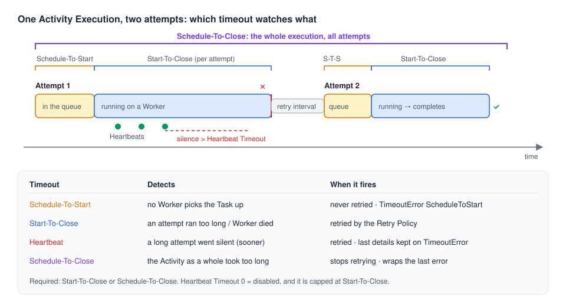

# 08 · Detecting failures with timeouts and Heartbeats

> **Level:** daily use · **Read time:** ~15 min
> **Sources:** [Encyclopedia — Detecting Activity failures](https://docs.temporal.io/encyclopedia/detecting-activity-failures) · [Encyclopedia — Detecting Workflow failures](https://docs.temporal.io/encyclopedia/detecting-workflow-failures) · [`temporal.TimeoutError`](https://pkg.go.dev/go.temporal.io/sdk/temporal#TimeoutError)

---

## 1. The problem

A Worker running your `ImportStockFile` Activity is OOM-killed. No error is returned, no Event is
written: the process is simply gone. From the Temporal Service's point of view, a crashed Worker
and a slow one look exactly the same: **silence**.

The Service can't detect a crash. It can only notice that something took **too long**. Timeouts are
Temporal's failure detectors. Each one watches a different kind of silence, and each one reaches
your Workflow as a `*temporal.TimeoutError` with its own type.

This chapter is about choosing which silence to watch and handling the result. For tuning values and
writing resumable Activities, see the
[Activities guide, chapter 04](../../activities/docs/04-timeouts-retries-heartbeats.md).

---

## 2. Four Activity timeouts, four kinds of silence



| Timeout | Watches | Scope | Default | When it fires | Go `TimeoutType()` |
| --- | --- | --- | --- | --- | --- |
| **Schedule-To-Start** | Task waiting in the queue | Each attempt | ∞ | **No retry**, ever | `TIMEOUT_TYPE_SCHEDULE_TO_START` |
| **Start-To-Close** | One attempt running | Each attempt | none (see below) | Retried per Retry Policy | `TIMEOUT_TYPE_START_TO_CLOSE` |
| **Heartbeat** | Gap between two Heartbeats | Each attempt | 0 = disabled | Retried per Retry Policy | `TIMEOUT_TYPE_HEARTBEAT` |
| **Schedule-To-Close** | The whole Activity Execution | All attempts | ∞ | Stops retrying | `TIMEOUT_TYPE_SCHEDULE_TO_CLOSE` |

You must set **Start-To-Close or Schedule-To-Close** (or both). Set Start-To-Close **always**: it
is the only way the Service finds out that a Worker died in the middle of an attempt.

---

## 3. Start-To-Close: "this attempt is taking too long"

Start-To-Close bounds a **single attempt**. When it expires, the Service records the attempt as
timed out and, if the Retry Policy allows, schedules another one. Set it a little above the
**longest** normal run of one attempt, not the average one.

If you set neither Start-To-Close nor Schedule-To-Close, the Activity is rejected. In a Workflow,
nothing is returned to your code. On a dev server (Server 1.32.0), the **Workflow Task** failed with:

```text
BadScheduleActivityAttributes: a valid StartToCloseTimeout or ScheduleToCloseTimeout must be set on the activity.
```

That Task is retried until the code is fixed, and the Workflow stays **Running** without progress
([chapter 03](03-workflow-task-vs-execution.md)). If you set only Schedule-To-Close, the Service
uses it as the Start-To-Close too.

## 4. Schedule-To-Close: "give up on this Activity"

Schedule-To-Close bounds **all attempts together**, from the first scheduling to the end. It is the
cleanest way to say "keep retrying for at most 15 minutes" ([chapter 07](07-retry-policies.md)).

The Service gives up **before** the deadline when the next retry can't fit. With
Schedule-To-Close = 3s and a 500ms retry interval, on a dev server, the Workflow got:

```text
activity error (…): Not enough time to schedule next retry before activity ScheduleToClose timeout,
giving up retrying (type: ScheduleToClose): gateway 503
```

The `TimeoutError` wraps the **last attempt's error** (`gateway 503`). `errors.As` still finds it,
so you can tell "timed out while the gateway kept answering 503" from "timed out while running".

Don't rely on the `TimeoutError` alone. When retries are cut short by a timeout, the chain doesn't
always contain one: if the **Workflow** Execution Timeout cuts them, for example, the Workflow sees
`ActivityError` → `ApplicationError` only. The reliable signal is `RetryState() == RETRY_STATE_TIMEOUT`
on the `ActivityError`, and checking timeouts **before** `ApplicationError`
([chapter 02](02-go-error-types.md), [chapter 05](05-handling-errors-in-workflows.md)).

## 5. Schedule-To-Start: "nobody is picking this up"

Schedule-To-Start bounds the time an Activity Task waits in the Task Queue before a Worker takes it.
It's enforced per attempt and is **never retried**: a retry would go back into the same queue that
nobody is polling. On a dev server, an Activity sent to a queue without Workers failed after 2s with
`TimeoutType()` = `ScheduleToStart` and `RetryState()` = `Timeout`, after **one** attempt.

It answers two questions: "has the Worker fleet died?" and "is it too slow to keep up?". Most of the
time a **metric** answers them better: alert on `temporal_activity_schedule_to_start_latency`
instead of failing Activities. Set the timeout only if you have a plan for the failure, for example
sending the work to another Task Queue (see the example in section 7).

## 6. Heartbeat Timeout: "this long attempt has gone quiet"

A long Activity (importing a 2 GB stock file) needs a large Start-To-Close, which means a crash is
noticed late. A **Heartbeat Timeout** fixes that: the Activity calls `activity.RecordHeartbeat`
regularly, and if no Heartbeat arrives within the timeout, the attempt fails.

Rules worth knowing:

| Rule | Detail |
| --- | --- |
| `0` means **disabled** | Not "infinite", not "immediately". An unset Heartbeat Timeout is stored as `0s`. |
| Capped at Start-To-Close | A dev server stored `HeartbeatTimeout: 1m` with `StartToCloseTimeout: 10s` as **10s** on the `ActivityTaskScheduled` Event. |
| Heartbeats are throttled | The SDK sends at most one every `min(0.8 × HeartbeatTimeout, 60s)` (or every 30s without a Heartbeat Timeout). Tune with `worker.Options.DefaultHeartbeatThrottleInterval` / `MaxHeartbeatThrottleInterval`. The last Heartbeat before a failure is always sent. |
| Cancellation rides on Heartbeats | An Activity that never Heartbeats never learns it was canceled. |
| Details survive the attempt | The next attempt reads them with `activity.GetHeartbeatDetails`; the Workflow reads the last ones from the `TimeoutError`. |

Heartbeat only when you can show **progress** (rows imported, bytes uploaded). A quick API call
doesn't need it. Checkpointing patterns are in the
[Activities guide, chapter 04](../../activities/docs/04-timeouts-retries-heartbeats.md) and the
[Workers guide, chapter 10](../../workers/docs/10-graceful-shutdown.md).

---

## 7. Handling each timeout in a Workflow

The inventory service imports supplier stock files. The Workflow reacts differently to each timeout:

```go
// file: inventory/activities.go
package inventory

import (
	"context"

	"go.temporal.io/sdk/activity"
)

type StockFile struct {
	SupplierID string
	URL        string
}

// StockStore reads supplier files and writes stock levels.
type StockStore interface {
	CountRows(ctx context.Context, f StockFile) (int, error)
	ImportRow(ctx context.Context, f StockFile, row int) error
}

type Activities struct {
	Store StockStore
}

// ImportStockFile imports one row at a time and heartbeats the last imported row,
// so a retry resumes where the previous attempt stopped.
func (a *Activities) ImportStockFile(ctx context.Context, f StockFile) (int, error) {
	start := 0
	if activity.HasHeartbeatDetails(ctx) {
		var lastRow int
		if err := activity.GetHeartbeatDetails(ctx, &lastRow); err == nil {
			start = lastRow + 1
		}
	}
	total, err := a.Store.CountRows(ctx, f)
	if err != nil {
		return 0, err
	}
	for row := start; row < total; row++ {
		if err := a.Store.ImportRow(ctx, f, row); err != nil {
			return row, err
		}
		activity.RecordHeartbeat(ctx, row)
	}
	return total, nil
}
```

```go
// file: inventory/workflow.go
package inventory

import (
	"errors"
	"time"

	enumspb "go.temporal.io/api/enums/v1"
	"go.temporal.io/sdk/temporal"
	"go.temporal.io/sdk/workflow"
)

const (
	TaskQueue       = "inventory-import"
	BulkImportQueue = "inventory-import-bulk" // a bigger Worker pool, used as a fallback
)

type ImportResult struct {
	Rows         int
	UsedBulk     bool
	StalledAtRow int
}

func ImportSupplierStockWorkflow(ctx workflow.Context, f StockFile) (ImportResult, error) {
	var a *Activities
	logger := workflow.GetLogger(ctx)

	importCtx := workflow.WithActivityOptions(ctx, workflow.ActivityOptions{
		ScheduleToStartTimeout: 10 * time.Minute, // the regular pool is saturated or down
		StartToCloseTimeout:    2 * time.Hour,    // the biggest file we've seen took 70 min
		HeartbeatTimeout:       time.Minute,      // detect a dead Worker within a minute
		ScheduleToCloseTimeout: 6 * time.Hour,    // give up on this file after 6 hours
	})

	var rows int
	err := workflow.ExecuteActivity(importCtx, a.ImportStockFile, f).Get(ctx, &rows)
	if err == nil {
		return ImportResult{Rows: rows}, nil
	}

	var timeoutErr *temporal.TimeoutError
	if !errors.As(err, &timeoutErr) {
		return ImportResult{}, err // an application error: let it fail the Workflow
	}

	switch timeoutErr.TimeoutType() {
	case enumspb.TIMEOUT_TYPE_SCHEDULE_TO_START:
		// Nobody picked it up: reroute to the bulk pool once.
		logger.Warn("regular import pool not polling, rerouting", "supplier", f.SupplierID)
		bulkCtx := workflow.WithActivityOptions(ctx, workflow.ActivityOptions{
			TaskQueue:           BulkImportQueue,
			StartToCloseTimeout: 2 * time.Hour,
			HeartbeatTimeout:    time.Minute,
		})
		if err := workflow.ExecuteActivity(bulkCtx, a.ImportStockFile, f).Get(ctx, &rows); err != nil {
			return ImportResult{}, err
		}
		return ImportResult{Rows: rows, UsedBulk: true}, nil

	case enumspb.TIMEOUT_TYPE_HEARTBEAT, enumspb.TIMEOUT_TYPE_SCHEDULE_TO_CLOSE:
		// Retries are exhausted. Report how far the last attempt got.
		var lastRow int
		if timeoutErr.HasLastHeartbeatDetails() {
			_ = timeoutErr.LastHeartbeatDetails(&lastRow)
		}
		logger.Error("stock import gave up", "supplier", f.SupplierID, "lastRow", lastRow, "cause", errors.Unwrap(timeoutErr))
		return ImportResult{StalledAtRow: lastRow}, temporal.NewNonRetryableApplicationError(
			"stock import did not finish", "StockImportStalled", err, lastRow)

	default: // START_TO_CLOSE after the last attempt
		return ImportResult{}, err
	}
}
```

Checked on a dev server (`MaximumAttempts: 2`):

| Scenario | What the Workflow got |
| --- | --- |
| Activity heartbeats `42`, then goes quiet past a 2s Heartbeat Timeout | `TimeoutType()` = `Heartbeat`, `HasLastHeartbeatDetails()` = true, details = `42` |
| Activity runs 5s with a 2s Start-To-Close | `TimeoutType()` = `StartToClose`, no details |
| Activity keeps failing, 3s Schedule-To-Close | `TimeoutType()` = `ScheduleToClose`, `RetryState()` = `Timeout`, unwraps to the last error |

The timeout always arrives **inside** an `ActivityError`. `errors.As` walks through it; you don't need
to unwrap by hand ([chapter 05](05-handling-errors-in-workflows.md)).

---

## 8. Workflow timeouts

Three timeouts can be set on `client.StartWorkflowOptions`:

| Timeout | Bounds | Default | When it fires |
| --- | --- | --- | --- |
| `WorkflowExecutionTimeout` | The whole Execution, **including** retries and Continue-As-New | ∞ | Workflow closes as **Timed Out** |
| `WorkflowRunTimeout` | One Run | = Execution Timeout | The Run closes as **Timed Out** (a Retry Policy may start a new one) |
| `WorkflowTaskTimeout` | One Workflow Task on a Worker | 10s | The Task is retried, the Workflow stays open |

### Prefer a Timer to a Workflow timeout

The Encyclopedia generally **advises against** Workflow Execution and Run timeouts. When one fires,
the Service closes the Workflow **without running any of your code**: no compensation, no
notification, no cleanup. A deadline expressed with a Timer stays inside your Workflow, where you
can react to it.

Checked on a dev server: a Workflow sleeping for an hour, with a `defer` that runs a cleanup
Activity on a disconnected context, was started with `WorkflowExecutionTimeout: 3s`. Its history
ends `TimerStarted` → `WorkflowExecutionTimedOut`. The cleanup Activity was **never scheduled**.
`run.Get` returned a `TimeoutError` whose `TimeoutType()` is `StartToClose`, not an
"execution" type, so don't rely on the type to tell a Run Timeout from an Execution Timeout.

The same deadline written with a Timer:

```go
// file: checkout/await_payment.go
package checkout

import (
	"time"

	"go.temporal.io/sdk/temporal"
	"go.temporal.io/sdk/workflow"
)

const PaymentConfirmedSignal = "payment-confirmed"

type PaymentConfirmation struct {
	PaymentID string
}

// AwaitBankTransferWorkflow waits up to 3 days for a bank transfer. On expiry it
// releases the reserved stock and emails the customer, which a WorkflowExecutionTimeout
// could never do.
func AwaitBankTransferWorkflow(ctx workflow.Context, orderID string) (string, error) {
	var confirmation PaymentConfirmation
	received := false
	workflow.Go(ctx, func(ctx workflow.Context) {
		workflow.GetSignalChannel(ctx, PaymentConfirmedSignal).Receive(ctx, &confirmation)
		received = true
	})

	ok, err := workflow.AwaitWithTimeout(ctx, 72*time.Hour, func() bool { return received })
	if err != nil {
		return "", err // the Workflow was canceled
	}
	if ok {
		return confirmation.PaymentID, nil
	}

	actCtx := workflow.WithActivityOptions(ctx, workflow.ActivityOptions{StartToCloseTimeout: time.Minute})
	if err := workflow.ExecuteActivity(actCtx, "ReleaseReservedStock", orderID).Get(ctx, nil); err != nil {
		return "", err
	}
	if err := workflow.ExecuteActivity(actCtx, "SendPaymentExpiredEmail", orderID).Get(ctx, nil); err != nil {
		return "", err
	}
	return "", temporal.NewNonRetryableApplicationError("bank transfer not received in time", "PaymentExpired", nil)
}
```

Keep `WorkflowExecutionTimeout` as a **safety net** for Workflows that must never run forever (a
Cron or a Workflow with a Retry Policy, for example), set well above any normal duration.

### Workflow Task Timeout

The Workflow Task Timeout detects a Worker that died while running a Workflow Task. Leave it at
10s. Raise it only if loading a very large history takes longer. The Service caps it at **120s**:
on a dev server, `--task-timeout 90s` was stored as 90s, and `5m` was stored as **120s**, without
an error. The Go SDK's doc comment on `ChildWorkflowOptions.WorkflowTaskTimeout` still says the
maximum is 1 minute.

### Spotting Workflows stuck on failing Workflow Tasks

A Workflow whose Tasks keep failing never fails; it just stops moving. The Service can tag such
Workflows with the `TemporalReportedProblems` Search Attribute (shown in the Web UI's Task Failures
View). It must be enabled per Namespace in the Dynamic Config. On a default dev server the attribute
exists, but no Workflow was tagged. Until it is enabled, alert on Workflow Task failure metrics
instead.

---

## 9. Key takeaways

- The Service can't see a crash, only silence. **Timeouts are the failure detectors.**
- Always set **Start-To-Close**. Without it (and without Schedule-To-Close) the Workflow Task fails
  and the Workflow stops moving.
- **Schedule-To-Close** bounds all retries; the Service gives up early when the next retry can't fit,
  and the `TimeoutError` wraps the last real error.
- **Schedule-To-Start** is never retried. Prefer the latency metric unless you can reroute.
- **Heartbeat Timeout**: `0` means disabled, it's capped at Start-To-Close, and the Workflow can read
  the last Heartbeat details from the `TimeoutError`.
- Switch on `TimeoutError.TimeoutType()` to react to each case.
- Prefer a **Timer** to a Workflow Execution or Run timeout: a timeout closes the Workflow without
  running your code. The Workflow Task Timeout is capped at 120s.
