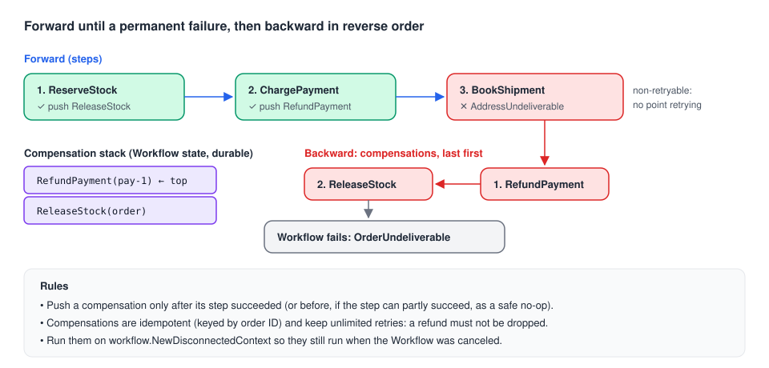

# 09 · Backward recovery and an error strategy

> **Level:** production · **Read time:** ~20 min
> **Sources:** [Encyclopedia — Application failures](https://docs.temporal.io/encyclopedia/application-failures) · [Encyclopedia — Retry Policies](https://docs.temporal.io/encyclopedia/retry-policies) · [Encyclopedia — Failures and error handling](https://docs.temporal.io/encyclopedia/failures-and-error-handling) · [`temporal.DefaultFailureConverterOptions`](https://pkg.go.dev/go.temporal.io/sdk/temporal#DefaultFailureConverterOptions)

---

## 1. The problem

Checkout reserves stock, charges the card, then books the shipment. The carrier rejects the address.
Retrying won't help, and failing the Workflow isn't enough either: the customer has been **charged**
and the stock is **held** for an order that will never ship.

Temporal recovers from platform failures by going **forward** (retry until it works). An application
failure often needs the opposite: go **backward** and undo what was already done. This chapter puts
the previous ones together into a strategy: classify each failure, pick the tool, undo with a Saga,
find failures in the history, and keep sensitive error text out of it.

---

## 2. Classify, then choose the tool

| Failure kind | Example | Fixes itself? | Tool | Chapter |
| --- | --- | --- | --- | --- |
| **Transient** | Gateway `503` during a deploy, a dropped connection | Yes, in seconds | Default Retry Policy | [07](07-retry-policies.md) |
| **Intermittent / throttled** | `429 Retry-After: 30` | Yes, after a known delay | `NextRetryDelay` on the error | [04](04-application-errors.md) |
| **Slow or dead Worker** | OOM kill, hung call | Yes, on another Worker | Start-To-Close + Heartbeat Timeout | [08](08-timeouts-and-heartbeats.md) |
| **Permanent, business** | Card declined, address undeliverable | **No** | Non-retryable error, then **compensate** | [04](04-application-errors.md), this chapter |
| **Permanent, bug** | Nil map write in Workflow code, non-determinism | No, until redeployed | Let the Workflow Task fail and retry; fix and deploy | [03](03-workflow-task-vs-execution.md) |
| **Needs a human** | Fraud review, manual refund | No | Wait for a Signal or Update, with a Timer as a deadline | [08](08-timeouts-and-heartbeats.md) |

Two questions decide most cases: **will a retry with the same input ever succeed?** If not, make it
non-retryable. **Has anything already happened that must be undone?** If so, compensate.

---

## 3. Undoing work: the Saga pattern



A Saga pairs each step that changes the outside world with a **compensation** that undoes it. As
each step succeeds, its compensation is pushed on a stack. When a later step fails for good, the
compensations run **in reverse order**.

Temporal makes Sagas simple: the list of compensations lives in Workflow state, which is durable. A
Worker crash in the middle of compensating doesn't lose track of what's left to undo.

```go
// file: checkout/saga.go
package checkout

import (
	"errors"

	"go.temporal.io/sdk/workflow"
)

// Saga collects compensations and runs them in reverse order.
type Saga struct {
	compensations []func(ctx workflow.Context) error
}

// AddCompensation registers the undo action of a step that has just succeeded.
func (s *Saga) AddCompensation(fn func(ctx workflow.Context) error) {
	s.compensations = append(s.compensations, fn)
}

// Compensate runs every compensation, last one first, on a disconnected context so
// they still run when the Workflow itself was canceled. It runs all of them even if
// one fails, and returns the joined errors.
func (s *Saga) Compensate(ctx workflow.Context) error {
	disconnected, cancel := workflow.NewDisconnectedContext(ctx)
	defer cancel()

	var errs []error
	for i := len(s.compensations) - 1; i >= 0; i-- {
		if err := s.compensations[i](disconnected); err != nil {
			workflow.GetLogger(ctx).Error("compensation failed", "step", i, "error", err)
			errs = append(errs, err)
		}
	}
	return errors.Join(errs...)
}
```

```go
// file: checkout/activities.go
package checkout

import (
	"context"
	"errors"

	"go.temporal.io/sdk/temporal"
)

type Order struct {
	OrderID     string
	CustomerID  string
	SKU         string
	Quantity    int
	AmountCents int64
	Address     string
}

// The external systems. Every call takes the order ID as an idempotency key.
type InventoryService interface {
	Reserve(ctx context.Context, orderID, sku string, qty int) error
	Release(ctx context.Context, orderID string) error
}

type PaymentService interface {
	Charge(ctx context.Context, orderID string, amountCents int64) (paymentID string, err error)
	Refund(ctx context.Context, orderID, paymentID string) error
}

type ShippingService interface {
	BookShipment(ctx context.Context, orderID, address string) (trackingID string, err error)
}

// ErrUndeliverable is returned by the carrier for an address it can't serve.
var ErrUndeliverable = errors.New("address undeliverable")

type Activities struct {
	Inventory InventoryService
	Payments  PaymentService
	Shipping  ShippingService
}

func (a *Activities) ReserveStock(ctx context.Context, o Order) error {
	return a.Inventory.Reserve(ctx, o.OrderID, o.SKU, o.Quantity)
}

// ReleaseStock must be idempotent: it can run twice if a Worker crashes after the
// release but before reporting success.
func (a *Activities) ReleaseStock(ctx context.Context, orderID string) error {
	return a.Inventory.Release(ctx, orderID)
}

func (a *Activities) ChargePayment(ctx context.Context, o Order) (string, error) {
	return a.Payments.Charge(ctx, o.OrderID, o.AmountCents)
}

func (a *Activities) RefundPayment(ctx context.Context, orderID, paymentID string) error {
	return a.Payments.Refund(ctx, orderID, paymentID)
}

func (a *Activities) BookShipment(ctx context.Context, o Order) (string, error) {
	trackingID, err := a.Shipping.BookShipment(ctx, o.OrderID, o.Address)
	if errors.Is(err, ErrUndeliverable) {
		// Permanent: convert to a typed, non-retryable error here, inside the Activity.
		return "", temporal.NewNonRetryableApplicationError(err.Error(), "AddressUndeliverable", nil, o.Address)
	}
	return trackingID, err
}
```

```go
// file: checkout/workflow.go
package checkout

import (
	"errors"
	"time"

	"go.temporal.io/sdk/temporal"
	"go.temporal.io/sdk/workflow"
)

const TaskQueue = "checkout"

type Receipt struct {
	PaymentID  string
	TrackingID string
}

func CheckoutWorkflow(ctx workflow.Context, o Order) (receipt Receipt, err error) {
	ctx = workflow.WithActivityOptions(ctx, workflow.ActivityOptions{
		StartToCloseTimeout:    30 * time.Second,
		ScheduleToCloseTimeout: 10 * time.Minute,
	})
	var a *Activities
	var saga Saga

	// If any step fails, undo the completed ones before failing the Workflow.
	defer func() {
		if err == nil {
			return
		}
		if compErr := saga.Compensate(ctx); compErr != nil {
			err = errors.Join(err, compErr)
		}
	}()

	if err = workflow.ExecuteActivity(ctx, a.ReserveStock, o).Get(ctx, nil); err != nil {
		return Receipt{}, err
	}
	saga.AddCompensation(func(ctx workflow.Context) error {
		return workflow.ExecuteActivity(ctx, a.ReleaseStock, o.OrderID).Get(ctx, nil)
	})

	if err = workflow.ExecuteActivity(ctx, a.ChargePayment, o).Get(ctx, &receipt.PaymentID); err != nil {
		return Receipt{}, err
	}
	paymentID := receipt.PaymentID
	saga.AddCompensation(func(ctx workflow.Context) error {
		return workflow.ExecuteActivity(ctx, a.RefundPayment, o.OrderID, paymentID).Get(ctx, nil)
	})

	if err = workflow.ExecuteActivity(ctx, a.BookShipment, o).Get(ctx, &receipt.TrackingID); err != nil {
		var appErr *temporal.ApplicationError
		if errors.As(err, &appErr) && appErr.Type() == "AddressUndeliverable" {
			return Receipt{}, temporal.NewNonRetryableApplicationError(
				"order cancelled: carrier cannot deliver", "OrderUndeliverable", err)
		}
		return Receipt{}, err
	}
	return receipt, nil
}
```

Things to get right:

- **Register a compensation only after its step succeeded.** A failed charge has nothing to refund.
  If a step can partially succeed (a charge that may have gone through before a timeout), register
  the compensation **before** the step and make it a no-op when there is nothing to undo.
- **Compensations must be idempotent** (keyed by order ID). An Activity runs at least once; a refund
  can be retried after it actually happened.
- **Run them on a disconnected context.** If the Workflow is canceled, `ctx` is canceled too and every
  Activity started on it fails at once. `workflow.NewDisconnectedContext` lets cleanup run anyway.
- **Use `defer` for the call, not for `recover`-style tricks.** The deferred function here runs after a
  normal `return`, so it may call Temporal APIs. Calling them while a **panic** is unwinding fails the
  Workflow Task ([chapter 05](05-handling-errors-in-workflows.md)).
- **Give compensations generous retries.** They usually keep the default (unlimited) Retry Policy: a
  refund that fails must be retried, not dropped.

Checked on a dev server with fakes where the carrier rejects the address: the Activities ran in the
order `ReserveStock`, `ChargePayment`, `BookShipment` (1 attempt, non-retryable), then
`RefundPayment`, `ReleaseStock`. The Workflow closed as **Failed** with type `OrderUndeliverable`,
caused by the `AddressUndeliverable` Activity failure.

---

## 4. Where failures are recorded

### In the Event History

| What happened | Event(s) |
| --- | --- |
| Activity failed for good (no retries left, or non-retryable) | `ActivityTaskStarted` + `ActivityTaskFailed` with the failure |
| Activity timed out for good | `ActivityTaskStarted` + `ActivityTaskTimedOut` |
| Activity is **still retrying** | Only `ActivityTaskScheduled`. Intermediate attempts aren't in the history |
| Workflow failed | `WorkflowExecutionFailed`, with the failure chain (e.g. the Activity failure as its cause) |

`ActivityTaskStarted` is written only when the Activity **closes**, because it carries the final
attempt number. So while an Activity is retrying, the history doesn't tell you why. Ask the Service
with `DescribeWorkflowExecution`:

```go
// file: ops/pending.go
package ops

import (
	"context"
	"fmt"
	"io"

	"go.temporal.io/sdk/client"
)

// PrintPendingActivities shows, for each running Activity of a Workflow, its current
// attempt and the error of the previous attempt. It's what the Web UI's
// "Pending Activities" panel shows.
func PrintPendingActivities(ctx context.Context, c client.Client, w io.Writer, workflowID string) error {
	desc, err := c.DescribeWorkflowExecution(ctx, workflowID, "")
	if err != nil {
		return fmt.Errorf("describe %s: %w", workflowID, err)
	}
	for _, pa := range desc.PendingActivities {
		fmt.Fprintf(w, "%s (id %s): state=%s attempt=%d/%d\n",
			pa.GetActivityType().GetName(), pa.GetActivityId(), pa.GetState(),
			pa.GetAttempt(), pa.GetMaximumAttempts())
		if f := pa.GetLastFailure(); f != nil {
			fmt.Fprintf(w, "  last failure: %s\n", f.GetMessage())
		}
		if t := pa.GetLastHeartbeatTime(); t != nil {
			fmt.Fprintf(w, "  last heartbeat: %s\n", t.AsTime())
		}
	}
	return nil
}
```

`MaximumAttempts` prints as `0` when attempts are unlimited.

---

## 5. Keeping sensitive text out of failures

Error messages and stack traces are stored **in plain text** in the Event History, even if your
payloads are encrypted. A message such as `card 4111… declined for jane@example.com` is readable by
anyone with access to the Web UI.

The Failure Converter can move the message and stack trace into an **encoded payload**, which your
payload codec then encrypts:

```go
// file: internal/temporalcodec/codec.go
package temporalcodec

import (
	"crypto/aes"
	"crypto/cipher"
	"crypto/rand"
	"fmt"

	commonpb "go.temporal.io/api/common/v1"
	"go.temporal.io/sdk/converter"
)

const (
	metadataEncoding = "encoding"
	encodingAESGCM   = "binary/encrypted-aes-gcm"
)

// AESGCMCodec encrypts every payload with AES-GCM. The key comes from your KMS.
type AESGCMCodec struct {
	aead cipher.AEAD
}

func NewAESGCMCodec(key []byte) (*AESGCMCodec, error) {
	block, err := aes.NewCipher(key)
	if err != nil {
		return nil, err
	}
	aead, err := cipher.NewGCM(block)
	if err != nil {
		return nil, err
	}
	return &AESGCMCodec{aead: aead}, nil
}

func (c *AESGCMCodec) Encode(payloads []*commonpb.Payload) ([]*commonpb.Payload, error) {
	out := make([]*commonpb.Payload, len(payloads))
	for i, p := range payloads {
		plain, err := p.Marshal()
		if err != nil {
			return nil, err
		}
		nonce := make([]byte, c.aead.NonceSize())
		if _, err := rand.Read(nonce); err != nil {
			return nil, err
		}
		out[i] = &commonpb.Payload{
			Metadata: map[string][]byte{metadataEncoding: []byte(encodingAESGCM)},
			Data:     c.aead.Seal(nonce, nonce, plain, nil),
		}
	}
	return out, nil
}

func (c *AESGCMCodec) Decode(payloads []*commonpb.Payload) ([]*commonpb.Payload, error) {
	out := make([]*commonpb.Payload, len(payloads))
	for i, p := range payloads {
		if string(p.GetMetadata()[metadataEncoding]) != encodingAESGCM {
			out[i] = p
			continue
		}
		n := c.aead.NonceSize()
		if len(p.Data) < n {
			return nil, fmt.Errorf("encrypted payload too short")
		}
		plain, err := c.aead.Open(nil, p.Data[:n], p.Data[n:], nil)
		if err != nil {
			return nil, err
		}
		decoded := &commonpb.Payload{}
		if err := decoded.Unmarshal(plain); err != nil {
			return nil, err
		}
		out[i] = decoded
	}
	return out, nil
}

var _ converter.PayloadCodec = (*AESGCMCodec)(nil)
```

```go
// file: internal/temporalcodec/options.go
package temporalcodec

import (
	"go.temporal.io/sdk/client"
	"go.temporal.io/sdk/converter"
	"go.temporal.io/sdk/temporal"
)

// SecureClientOptions encrypts payloads AND failure messages/stack traces.
// Use the same options for every Client and Worker of the application.
func SecureClientOptions(base client.Options, key []byte) (client.Options, error) {
	codec, err := NewAESGCMCodec(key)
	if err != nil {
		return client.Options{}, err
	}
	dc := converter.NewCodecDataConverter(converter.GetDefaultDataConverter(), codec)

	base.DataConverter = dc
	base.FailureConverter = temporal.NewDefaultFailureConverter(temporal.DefaultFailureConverterOptions{
		DataConverter:          dc,   // encodes the moved attributes with the codec
		EncodeCommonAttributes: true, // moves message + stack trace into an encoded payload
	})
	return base, nil
}
```

What changes, checked on a dev server with the checkout Workflow (the `ActivityTaskFailed` Event of
`BookShipment`):

| Setup | `message` in the history / Web UI | `encodedAttributes` |
| --- | --- | --- |
| Defaults | `address undeliverable` | none |
| `EncodeCommonAttributes: true`, default data converter | `Encoded failure` | `{"message":"address undeliverable","stack_trace":""}`, **readable** |
| `EncodeCommonAttributes: true` + the AES-GCM codec | `Encoded failure` | encrypted bytes |

In all three cases the Go code (`run.Get`, `errors.As`) saw the real message: the SDK decodes it.
The same applies to stack traces, which the Go SDK records for **panics** (a returned
`ApplicationError` has none).

Both settings are needed: `EncodeCommonAttributes` alone only **moves** the text into a JSON
payload. Error **types** (`AddressUndeliverable`) stay in clear text,
so don't put customer data in them. Run a Codec Server if operators need to read failures in the Web
UI.

---

## 6. Expected failures: benign errors

Some Activities fail on purpose, over and over: `WaitForRestock` polls a supplier and fails until the
item is back. Those failures pollute logs and failure metrics. Mark them **benign**:

```go
// file: inventory/restock.go
package inventory

import (
	"context"
	"time"

	"go.temporal.io/sdk/temporal"
)

type SupplierAPI interface {
	InStock(ctx context.Context, sku string) (bool, error)
}

type RestockActivities struct {
	Supplier SupplierAPI
}

// WaitForRestock fails with a benign error until the supplier has stock again.
// Use it with a long Retry Policy (e.g. InitialInterval 1m, BackoffCoefficient 1).
func (a *RestockActivities) WaitForRestock(ctx context.Context, sku string) error {
	ok, err := a.Supplier.InStock(ctx, sku)
	if err != nil {
		return err // a real failure: logged and counted
	}
	if !ok {
		return temporal.NewApplicationErrorWithOptions("not in stock yet", "NotYetInStock",
			temporal.ApplicationErrorOptions{
				Category:       temporal.ApplicationErrorCategoryBenign,
				NextRetryDelay: 15 * time.Minute,
			})
	}
	return nil
}
```

In Go SDK v1.50.0, a benign error is logged at **Debug** instead of Error ("Activity error.") and
isn't counted in the Activity or Workflow **failure** metrics. Retries are unchanged. Like
non-retryable, the category is read from the **outermost** error only, so return it as is. More in
the [Activities guide, chapter 05](../../activities/docs/05-failures-and-cancellation.md).

---

## 7. A checklist

**Activities**

- [ ] Every Activity has a **Start-To-Close**; long ones also Heartbeat with a Heartbeat Timeout.
- [ ] Retries are bounded by **Schedule-To-Close**, not by a guessed `MaximumAttempts`.
- [ ] Permanent failures are returned as **typed, non-retryable** `ApplicationError`s, created where the
      error is understood (inside the Activity).
- [ ] Context is added with `NewApplicationErrorWithCause` or `NewNonRetryableApplicationError(…, cause)`,
      never `fmt.Errorf("%w")` around an `ApplicationError` ([chapter 06](06-wrapping-and-retryability.md)).
- [ ] Every side effect is **idempotent** (keyed by a business ID).
- [ ] Expected, repeated failures are **benign**.

**Workflows**

- [ ] Errors are matched with `errors.As` + `Type()`, not `errors.Is` on sentinel values
      ([chapter 05](05-handling-errors-in-workflows.md)).
- [ ] Steps with side effects register **compensations**, run in reverse on a disconnected context.
- [ ] A Workflow fails only through a deliberate `ApplicationError`; bugs are left to fail the
      Workflow Task, so a fix and redeploy resumes them ([chapter 03](03-workflow-task-vs-execution.md)).
- [ ] Deadlines are **Timers**, not Workflow Execution timeouts.

**Operations**

- [ ] Alerts on Workflow Task failures and Schedule-To-Start latency.
- [ ] Error messages are encrypted (`EncodeCommonAttributes` + codec) if they can contain personal data.
- [ ] People know how to read **Pending Activities** to see what is retrying and why.

---

## 8. Key takeaways

- Platform failures recover **forward** (retries). Business failures often need **backward**
  recovery: undo what was done.
- Classify each failure: transient → retry; throttled → `NextRetryDelay`; dead Worker → timeouts;
  permanent → non-retryable + compensate; bug → let the Workflow Task fail and redeploy.
- A **Saga** registers a compensation after each successful step and runs them in reverse, on a
  disconnected context. Compensations must be idempotent.
- While an Activity retries, the history shows only `ActivityTaskScheduled`; use
  `DescribeWorkflowExecution` (Pending Activities) to see the attempt and last failure.
- Failure messages are plain text by default. `EncodeCommonAttributes: true` **plus** an encrypting
  codec hides them.
- Mark expected failures **benign** to keep logs and failure metrics clean.
