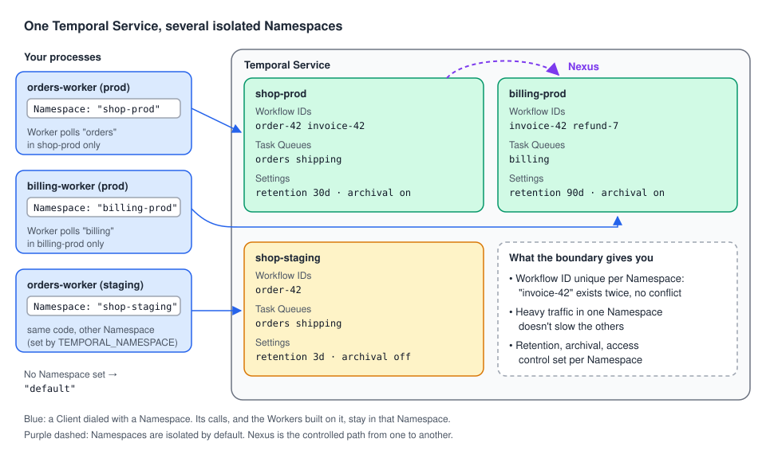

# 01 · What is a Namespace?

> **Level:** foundations · **Read time:** ~10 min
> **Sources:** [Encyclopedia — Temporal Namespace](https://docs.temporal.io/namespaces) · [Go SDK — Namespaces](https://docs.temporal.io/develop/go/client/namespaces)

---

## 1. The problem

Your company runs one Temporal Service. On it you want:

- the **production** checkout, and a **staging** copy of the same code that testers can break freely;
- the **billing** team's Workflows, which must keep their history for 90 days for audits, while
  checkout only needs 30;
- a guarantee that a load test in staging, or a runaway loop in billing, doesn't slow down checkout;
- no surprise when both teams pick the Workflow ID `invoice-42`.

Running one Temporal Service per need is expensive. Putting everything in one pile is fragile.
**Namespaces** are the middle ground: one Service, several isolated compartments.

---

## 2. A unit of isolation

> A **Namespace** is a unit of isolation within the Temporal Platform.

Every Workflow Execution and every Task Queue **belongs to exactly one Namespace**. When you start a
Workflow, it is created in the Namespace of the Client that started it. When a Worker polls, it polls
Task Queues of its Client's Namespace.



What the boundary gives you:

| Property | What it means | Example |
| --- | --- | --- |
| **Workflow ID uniqueness** | A Workflow ID is unique **within** a Namespace only | `invoice-42` can run in `shop-prod` and in `billing-prod` at the same time |
| **Resource isolation** | Heavy traffic in one Namespace doesn't impact the others on the same Service | A staging load test doesn't slow production |
| **Configuration boundary** | Settings such as the **Retention Period** and **Archival** are set per Namespace | 90 days for `billing-prod`, 3 days for `shop-staging` |
| **Access control** | Who may use a Namespace is decided per Namespace | Only the billing team can terminate billing Workflows |
| **No calls across, by default** | Namespaces are isolated. **Nexus** is the controlled path between them | Checkout calls a billing operation through a Nexus Endpoint |

On a dev server (Temporal Server 1.32.0), the same Workflow ID `invoice-42` ran in two Namespaces
side by side: two separate Workflow Executions with their own Run IDs, no conflict.

---

## 3. Task Queues belong to a Namespace too

A Task Queue name is only meaningful **inside a Namespace**. The `orders` Task Queue of `shop-prod` and
the `orders` Task Queue of `shop-staging` are two different queues. That's what lets you deploy the
same Worker code to both environments, unchanged: only the Namespace differs.

The flip side: a Worker started against the wrong Namespace polls an empty queue, and Workflows
started in the right one wait forever. It's the Namespace version of the Task Queue name mismatch
described in the [Workers guide](../../workers/docs/03-task-queues.md).

---

## 4. The `default` Namespace

If you don't set a Namespace, the SDKs and the Temporal CLI use the Namespace named **`default`**.
In Go it is the constant `client.DefaultNamespace`, so `client.Dial(client.Options{})` connects to
`default`.

The dev server (`temporal server start-dev`) creates `default` for you. Any other Namespace must be
**registered** before a Client can use it ([chapter 03](03-registering-namespaces.md)).

---

## 5. A Workflow knows its Namespace

A first program: an invoicing Worker and starter that work in whatever Namespace you give them. The
Workflow reads its Namespace from `workflow.GetInfo`, which is handy in logs and when a Workflow must
build IDs or call other services per environment.

```go
// file: billing/workflow.go
package billing

import (
	"go.temporal.io/sdk/workflow"
)

const TaskQueue = "billing"

type IssueInvoiceInput struct {
	OrderID     string
	AmountCents int64
}

type InvoiceReceipt struct {
	InvoiceID string
	Namespace string // where this Workflow Execution lives
}

func IssueInvoiceWorkflow(ctx workflow.Context, in IssueInvoiceInput) (InvoiceReceipt, error) {
	info := workflow.GetInfo(ctx)
	workflow.GetLogger(ctx).Info("issuing invoice",
		"namespace", info.Namespace,
		"workflowID", info.WorkflowExecution.ID,
		"taskQueue", info.TaskQueueName)

	return InvoiceReceipt{
		InvoiceID: "inv-" + in.OrderID,
		Namespace: info.Namespace,
	}, nil
}
```

```go
// file: cmd/worker/main.go
package main

import (
	"log"
	"os"

	"go.temporal.io/sdk/client"
	"go.temporal.io/sdk/worker"

	"github.com/acme/shop/billing"
)

func main() {
	namespace := os.Getenv("BILLING_NAMESPACE") // e.g. "billing-prod"; empty means "default"

	c, err := client.Dial(client.Options{Namespace: namespace})
	if err != nil {
		log.Fatalln("unable to create Temporal client:", err)
	}
	defer c.Close()

	// This Worker polls the "billing" Task Queue of that Namespace only.
	w := worker.New(c, billing.TaskQueue, worker.Options{})
	w.RegisterWorkflow(billing.IssueInvoiceWorkflow)

	if err := w.Run(worker.InterruptCh()); err != nil {
		log.Fatalln("worker stopped:", err)
	}
}
```

```go
// file: cmd/starter/main.go
package main

import (
	"context"
	"fmt"
	"log"
	"os"

	"go.temporal.io/sdk/client"

	"github.com/acme/shop/billing"
)

func main() {
	c, err := client.Dial(client.Options{Namespace: os.Getenv("BILLING_NAMESPACE")})
	if err != nil {
		log.Fatalln("unable to create Temporal client:", err)
	}
	defer c.Close()

	run, err := c.ExecuteWorkflow(context.Background(), client.StartWorkflowOptions{
		ID:        "invoice-order-42", // unique in this Namespace only
		TaskQueue: billing.TaskQueue,
	}, billing.IssueInvoiceWorkflow, billing.IssueInvoiceInput{OrderID: "order-42", AmountCents: 12900})
	if err != nil {
		log.Fatalln("unable to start workflow:", err)
	}

	var receipt billing.InvoiceReceipt
	if err := run.Get(context.Background(), &receipt); err != nil {
		log.Fatalln("workflow failed:", err)
	}
	fmt.Printf("invoice %s issued in Namespace %q (run %s)\n", receipt.InvoiceID, receipt.Namespace, run.GetRunID())
}
```

Run one Worker per Namespace and start the same Workflow ID in each:

```text
$ temporal operator namespace create -n billing-dev --retention 72h
$ BILLING_NAMESPACE=billing-dev go run ./cmd/worker &
$ go run ./cmd/worker &                                   # Namespace "default"

$ BILLING_NAMESPACE=billing-dev go run ./cmd/starter
invoice inv-order-42 issued in Namespace "billing-dev" (run 01a174c3-dd86-…)
$ go run ./cmd/starter
invoice inv-order-42 issued in Namespace "default" (run 01a174c3-ddb3-…)
```

Same code, same Workflow ID, same Task Queue name: two independent Workflow Executions.

---

## 6. One Namespace is still shared

A Namespace isolates you from **other Namespaces**, not from your neighbors **inside** it. If two
applications or teams share a Namespace, they share its Workflow ID space and its Task Queue names:

- Two services starting `invoice-42` in the same Namespace collide (the Workflow ID policies from the
  [Client guide](../../client/docs/05-workflow-id-policies.md) decide what happens).
- Two Worker fleets polling `orders` in the same Namespace receive each other's Tasks.

If you share a Namespace, agree on prefixes (`checkout-…`, `billing-…`) for Workflow IDs and Task
Queues. [Chapter 06](06-namespace-strategy.md) covers how to split Namespaces in the first place.

---

## 7. Self-hosted vs Temporal Cloud

The concept is the same on both, and moving between them needs no code change: only the Client's
address, Namespace and credentials change. Temporal Cloud Namespaces add:

| Temporal Cloud adds | What it gives you |
| --- | --- |
| Authentication **per Namespace** | API keys or mTLS certificates scoped to one Namespace ([Client guide, chapter 03](../../client/docs/03-cloud-and-security.md)) |
| Role-based access control | Namespace-level permissions instead of a custom Authorizer |
| Separate rate limits | Limits per Namespace |
| High availability | Replication of a Namespace to another region or cloud |
| Tags and descriptions | Metadata to organize many Namespaces |

On a self-hosted Service, you restrict who can use or manage a Namespace with a custom **Authorizer**
plugin on the Frontend Service.

---

## 8. Key takeaways

- A **Namespace** is a unit of isolation. Workflow Executions and Task Queues belong to exactly one.
- **Workflow IDs** and **Task Queue names** are unique only within a Namespace.
- Retention, archival and access control are set **per Namespace**. Load in one doesn't affect others.
- No Namespace set means **`default`** (`client.DefaultNamespace`). Other Namespaces must be registered first.
- Namespaces don't call each other by default. **Nexus** is the controlled path between them.
- A shared Namespace is still shared: agree on ID and Task Queue prefixes.
