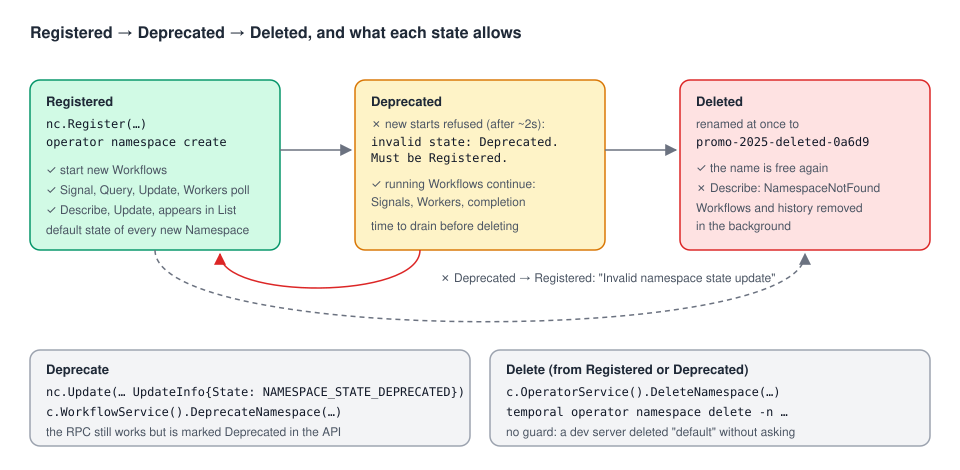

# 05 · Deprecating and deleting Namespaces

> **Level:** advanced · **Read time:** ~15 min
> **Sources:** [Go SDK — Manage Namespaces](https://docs.temporal.io/develop/go/client/namespaces#manage-namespaces) · [Encyclopedia — Temporal Namespace](https://docs.temporal.io/namespaces) · [`DeleteNamespace` (OperatorService)](https://github.com/temporalio/api/blob/main/temporal/api/operatorservice/v1/service.proto) · [`UpdateNamespaceInfo`](https://github.com/temporalio/api/blob/main/temporal/api/namespace/v1/message.proto)

---

## 1. The problem

Marketing ran a summer sale in its own Namespace, `promo-summer-2025`. The sale is over, but a few
campaign Workflows are still waiting for their final "close campaign" Signal. You want to:

1. stop **new** Workflows from starting there,
2. let the running ones **finish**,
3. then **remove** the Namespace and its data,

without ever touching `shop-prod` by mistake. Temporal has two tools for this: **deprecation** and
**deletion**. Both are easy to call and easy to get wrong.

---

## 2. The lifecycle



| State | New Workflow starts | Running Workflows | Listed | `Describe` |
| --- | --- | --- | --- | --- |
| `Registered` | ✓ | ✓ | ✓ | ✓ |
| `Deprecated` | ✗ refused | ✓ Signals, Workers and completion keep working | ✓ | ✓ |
| Deleted (`DeleteNamespace`) | ✗ | ✗ removed in the background | ✗ | `NamespaceNotFound` |

The state only moves forward. `UpdateNamespaceInfo.State` documents the allowed transitions as
`Registered -> [ Deleted | Deprecated | Handover ]`. Trying to bring a Deprecated Namespace back to
`Registered` failed on a dev server with `Invalid namespace state update`. **Deprecation is one-way.**

---

## 3. Deprecating

`NamespaceClient` has no `Deprecate` method. Set the state with `Update`:

```go
// file: internal/nsadmin/deprecate.go
package nsadmin

import (
	"context"

	enumspb "go.temporal.io/api/enums/v1"
	namespacepb "go.temporal.io/api/namespace/v1"
	"go.temporal.io/api/workflowservice/v1"
	"go.temporal.io/sdk/client"
)

// Deprecate stops new Workflow starts in the Namespace. It can't be undone.
func Deprecate(ctx context.Context, nc client.NamespaceClient, name string) error {
	return nc.Update(ctx, &workflowservice.UpdateNamespaceRequest{
		Namespace:  name,
		UpdateInfo: &namespacepb.UpdateNamespaceInfo{State: enumspb.NAMESPACE_STATE_DEPRECATED},
	})
}
```

There is also a dedicated RPC, `c.WorkflowService().DeprecateNamespace(…)`. It still works (it
deprecated a Namespace on a dev server), but the API marks it **"Deprecated."** itself. Use `Update`.

What deprecation does, observed on a dev server (Server 1.32.0):

- **New starts are refused**, with `Namespace has invalid state: Deprecated. Must be Registered.`
- **Not instantly.** A start sent right after the `Update` call still succeeded; one sent 2 seconds later
  was refused. The Frontend caches Namespace state, so expect a short window.
- **Running Workflows continue.** A campaign Workflow waiting for a Signal received it after the
  deprecation and completed normally. Its Worker kept polling. This matches the API comment:
  *"Existing workflow executions will continue to run on deprecated namespaces."*

That makes deprecation the right **first** step of a retirement: it closes the door and lets the
house empty itself.

---

## 4. Deleting

Deletion goes through the **Operator Service**:

```go
// file: internal/nsadmin/delete.go
package nsadmin

import (
	"context"

	"go.temporal.io/api/operatorservice/v1"
	"go.temporal.io/sdk/client"
)

// Delete removes a Namespace and all its Workflow Executions. It returns the name
// the Service gave the deleted Namespace. Prefer RetireNamespace, which checks first.
func Delete(ctx context.Context, c client.Client, name string) (string, error) {
	resp, err := c.OperatorService().DeleteNamespace(ctx, &operatorservice.DeleteNamespaceRequest{Namespace: name})
	if err != nil {
		return "", err
	}
	return resp.GetDeletedNamespace(), nil
}
```

The API describes it as *"synchronously deletes a namespace and asynchronously reclaims all namespace
resources"*. On a dev server:

| Step | What happened |
| --- | --- |
| `DeleteNamespace("billing-dev")` | Returned `DeletedNamespace: "billing-dev-deleted-fa1ec"`: the Namespace is **renamed** at once |
| `Describe("billing-dev")` right after | `NamespaceNotFound` |
| `ListNamespaces` | Neither name is listed |
| `Register("billing-dev")` 3 seconds later | Succeeded: **the name is free again** |
| Its Workflow Executions | Removed in the background, running ones included (the Go page says so too) |

### No safety net

The Service doesn't protect anything. On a dev server, `DeleteNamespace("default")` succeeded with no
confirmation, and every Workflow in `default` went with it. Your tooling must refuse protected names
itself (section 6).

### "Deleted" through `Update` is not a delete

`UpdateNamespaceInfo.State` also accepts `NAMESPACE_STATE_DELETED`. Setting it **doesn't** delete
anything: on a dev server the Namespace disappeared from `ListNamespaces` and refused new starts
(`invalid state: Deleted`), but `Describe` still returned it and its data stayed. It still needed a
real `DeleteNamespace`. Don't use this path.

---

## 5. Workers don't notice

Stop the Workers **before** you delete their Namespace. In a dev-server test, a Worker polling a
Namespace kept running after `DeleteNamespace`: `Run` didn't return, `OnFatalError` wasn't called and
nothing was logged for 30+ seconds. `NamespaceNotFound` is one of the errors the SDK treats as fatal
([Workers guide, chapter 04](../../workers/docs/04-running-a-worker.md)), but polling a deleted
Namespace didn't produce it.

So a forgotten Worker just sits there, using a connection and showing as healthy. Remove its
Deployment first, and alert on Workers whose Namespace no longer exists (for example by checking the
Namespace with `Describe` in the Worker's health check).

---

## 6. A guarded `RetireNamespace`

The three steps (deprecate, drain, delete) in one function. It refuses protected names, waits for
running Workflows to finish (counted with a Visibility query, as in the
[Client guide, chapter 08](../../client/docs/08-interacting-and-managing.md)), and deletes only
when the Namespace is empty, unless you force it:

```go
// file: internal/nsadmin/retire.go
package nsadmin

import (
	"context"
	"errors"
	"fmt"
	"log/slog"
	"time"

	enumspb "go.temporal.io/api/enums/v1"
	"go.temporal.io/api/workflowservice/v1"
	"go.temporal.io/sdk/client"
)

// protected Namespaces can never be retired by this tool. The Service itself
// doesn't stop you: a dev server deleted "default" without a question.
var protected = map[string]bool{
	"default":         true,
	"temporal-system": true,
	"shop-prod":       true,
	"billing-prod":    true,
}

var ErrProtected = errors.New("namespace is protected")

type RetireOptions struct {
	// How long to wait for running Workflows to finish after deprecation.
	DrainTimeout time.Duration
	// How often to count running Workflows while draining.
	PollInterval time.Duration
	// Delete even if Workflows are still running when DrainTimeout expires.
	Force bool
}

// RetireNamespace deprecates a Namespace (no new Workflows), waits for its running
// Workflows to drain, then deletes it. It returns the name the Service gave the
// deleted Namespace (e.g. "promo-2025-deleted-1a2b3").
//
// c is any Client on the same Service; nc is a NamespaceClient.
func RetireNamespace(ctx context.Context, c client.Client, nc client.NamespaceClient, name string, opts RetireOptions, log *slog.Logger) (string, error) {
	if protected[name] {
		return "", fmt.Errorf("retire %q: %w", name, ErrProtected)
	}

	// 1. Deprecate (section 3), unless a previous run already did.
	desc, err := nc.Describe(ctx, name)
	if err != nil {
		return "", fmt.Errorf("describe %q: %w", name, err)
	}
	if desc.GetNamespaceInfo().GetState() == enumspb.NAMESPACE_STATE_REGISTERED {
		if err := Deprecate(ctx, nc, name); err != nil {
			return "", fmt.Errorf("deprecate %q: %w", name, err)
		}
		log.Info("namespace deprecated, new Workflow starts are refused", "namespace", name)
	}

	// 2. Drain: running Workflows keep going in a Deprecated Namespace.
	nsClient, err := client.NewClientFromExisting(c, client.Options{Namespace: name})
	if err != nil {
		return "", err
	}
	defer nsClient.Close()

	deadline := time.Now().Add(opts.DrainTimeout)
	for {
		resp, err := nsClient.CountWorkflow(ctx, &workflowservice.CountWorkflowExecutionsRequest{
			Namespace: name,
			Query:     `ExecutionStatus = "Running"`,
		})
		if err != nil {
			return "", fmt.Errorf("count running workflows in %q: %w", name, err)
		}
		running := resp.GetCount()
		if running == 0 {
			break
		}
		if time.Now().After(deadline) {
			if !opts.Force {
				return "", fmt.Errorf("retire %q: %d Workflows still running after %s", name, running, opts.DrainTimeout)
			}
			log.Warn("deleting with running Workflows", "namespace", name, "running", running)
			break
		}
		log.Info("waiting for Workflows to finish", "namespace", name, "running", running)
		select {
		case <-ctx.Done():
			return "", ctx.Err()
		case <-time.After(opts.PollInterval):
		}
	}

	// 3. Delete (section 4). The Namespace is renamed at once and its Workflows are
	// removed in the background.
	renamed, err := Delete(ctx, c, name)
	if err != nil {
		return "", fmt.Errorf("delete %q: %w", name, err)
	}
	log.Info("namespace deleted", "namespace", name, "renamedTo", renamed)
	return renamed, nil
}
```

A command around it, for the platform team:

```go
// file: cmd/retire-namespace/main.go
package main

import (
	"context"
	"flag"
	"log"
	"log/slog"
	"os"
	"time"

	"go.temporal.io/sdk/client"
	"go.temporal.io/sdk/contrib/envconfig"

	"github.com/acme/shop/internal/nsadmin"
)

func main() {
	drain := flag.Duration("drain-timeout", 30*time.Minute, "how long to wait for running Workflows")
	force := flag.Bool("force", false, "delete even if Workflows are still running")
	flag.Parse()
	if flag.NArg() != 1 {
		log.Fatal("usage: retire-namespace [-drain-timeout 30m] [-force] <namespace>")
	}
	name := flag.Arg(0)

	opts, err := envconfig.LoadDefaultClientOptions()
	if err != nil {
		log.Fatal(err)
	}
	c, err := client.Dial(opts)
	if err != nil {
		log.Fatal(err)
	}
	defer c.Close()
	nc, err := client.NewNamespaceClient(opts)
	if err != nil {
		log.Fatal(err)
	}
	defer nc.Close()

	logger := slog.New(slog.NewTextHandler(os.Stderr, nil))
	ctx, cancel := context.WithTimeout(context.Background(), *drain+time.Minute)
	defer cancel()
	renamed, err := nsadmin.RetireNamespace(ctx, c, nc, name, nsadmin.RetireOptions{
		DrainTimeout: *drain,
		PollInterval: 5 * time.Second,
		Force:        *force,
	}, logger)
	if err != nil {
		log.Fatal(err)
	}
	logger.Info("done", "deletedAs", renamed)
}
```

And the campaign Workflow from section 1, still running when retirement starts:

```go
// file: promotions/workflow.go
package promotions

import (
	"go.temporal.io/sdk/workflow"
)

const TaskQueue = "promotions"

// SummerSaleWorkflow runs until marketing closes the campaign.
func SummerSaleWorkflow(ctx workflow.Context, campaignID string) (string, error) {
	var closedBy string
	workflow.GetSignalChannel(ctx, "close-campaign").Receive(ctx, &closedBy)
	return "campaign " + campaignID + " closed by " + closedBy, nil
}
```

A dev-server run, with one campaign still open (log trimmed, Namespace name adapted):

```text
retire "default": namespace is protected
level=INFO msg="namespace deprecated, new Workflow starts are refused" namespace=promo-summer-2025
level=INFO msg="waiting for Workflows to finish" namespace=promo-summer-2025 running=1
level=INFO msg="waiting for Workflows to finish" namespace=promo-summer-2025 running=1
   new start in the deprecated Namespace → Namespace has invalid state: Deprecated. Must be Registered.
   Signal "close-campaign" → delivered, Workflow completed: "campaign summer-2025 closed by marketing@acme"
level=INFO msg="namespace deleted" namespace=promo-summer-2025 renamedTo=promo-summer-2025-deleted-0a6d9
```

What to adapt for production:

- Keep the **protected list** in configuration, and include every production Namespace.
- Make the drain timeout match your longest Workflows. If some never end (entity Workflows), close them
  first with a Signal or cancellation ([Workflows guide, chapter 08](../../workflows/docs/08-cancel-terminate-pause-reset.md)).
- Run it **after** removing the Namespace's Workers (section 5).
- On Temporal Cloud, deletion goes through the Cloud UI or `temporal cloud namespace delete`, with its
  own protection settings.

---

## 7. Key takeaways

- Deprecate with `nc.Update(… UpdateInfo{State: NAMESPACE_STATE_DEPRECATED})`. It refuses new starts
  after a short delay, lets running Workflows finish, and **can't be undone**.
- Delete with `c.OperatorService().DeleteNamespace`. The Namespace is renamed to `<name>-deleted-<id>`
  at once, the name is reusable, and all its Workflows are removed in the background.
- The Service has **no guard**: it deleted `default` on a dev server. Protect names in your own tools.
- Setting the state to `Deleted` with `Update` hides a Namespace but doesn't delete it.
- Workers of a deleted Namespace keep running silently. Stop them first.
