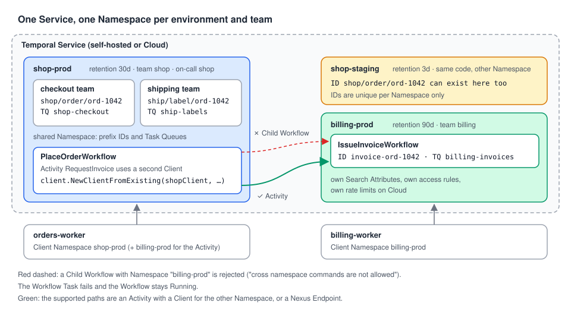

# 06 · Designing your Namespaces

> **Level:** production · **Read time:** ~15 min
> **Sources:** [Encyclopedia — Temporal Namespace](https://docs.temporal.io/namespaces) · [Go SDK — Namespaces](https://docs.temporal.io/develop/go/client/namespaces) · [Multi-tenant application patterns](https://docs.temporal.io/best-practices/multi-tenant-patterns) · [Temporal Nexus](https://docs.temporal.io/nexus)

---

## 1. The problem

The shop started with everything in `default`. Now there are three teams (checkout, shipping,
billing), a staging environment, an audit requirement to keep invoices for 90 days, and an incident
where a load test in staging slowed down production Workflows. Someone asks: "how many Namespaces
should we have, and how do they talk to each other?"

Namespaces are cheap to create, but they are **hard boundaries**: Workflows in one can't call
Workflows in another directly. This chapter helps you draw those boundaries on purpose.

---

## 2. What a Namespace boundary gives you

| Per Namespace | Why it matters |
| --- | --- |
| **Workflow ID uniqueness** | `order-1042` can run in `shop-prod` and `shop-staging` at the same time ([chapter 01](01-what-is-a-namespace.md)) |
| **Resource isolation** | Heavy traffic in one Namespace doesn't slow down another on the same Service |
| **Retention and archival** | Billing keeps 90 days, staging 3 days ([chapter 04](04-managing-namespaces.md)) |
| **Search Attributes** | Each Namespace has its own custom attributes ([chapter 04](04-managing-namespaces.md)) |
| **Access control** | An Authorizer (self-hosted) or roles and API keys (Cloud) per Namespace |
| **Lifecycle** | Deprecate and delete one without touching the others ([chapter 05](05-deprecating-and-deleting.md)) |
| **On Temporal Cloud** | Its own rate limits, high-availability replication, tags and endpoint |

What it does **not** give you: a separate deployment of your code. The same Worker binary can serve
`shop-staging` and `shop-prod`; only the Client's `Namespace` option changes
([chapter 02](02-using-a-namespace.md)).

---

## 3. Where to draw the lines



Three common splits, usually combined:

| Split by | Example | Choose it when |
| --- | --- | --- |
| **Environment** | `shop-staging`, `shop-prod` | Always. Staging tests must never share IDs, load or retention with production |
| **Team / bounded context** | `shop-prod`, `billing-prod` | Teams deploy on their own, need different retention or access, or own a clear service boundary |
| **Tenant** | `acme-eu-prod` for a large customer | A customer needs hard isolation (contract, data residency, its own rate limits). Rare: most tenants share a Namespace |

A few rules of thumb:

- **Start coarse.** One Namespace per environment and team is enough for most companies. Splitting
  later is easier than merging: Workflows can't move between Namespaces.
- **Name for humans and tools:** `<domain>-<env>`, lowercase, stable. Tools like `RetireNamespace`
  match on these names.
- **Don't use a Namespace per developer in a shared Service.** Use the dev server locally
  (`temporal server start-dev --namespace shop-dev`).

---

## 4. Sharing a Namespace safely

Inside one Namespace, **everyone shares the Workflow ID space and the Task Queue names**. Two
teams that both start `order-1042`, or both poll `default-queue`, will collide: the second start is
refused or joins the wrong Workflow, and Workers pick up Tasks they can't run. Prefix both with the
owning team:

```go
// file: internal/tenancy/names.go
package tenancy

import "fmt"

// When several teams share one Namespace, Workflow IDs and Task Queues are
// shared too. Prefix both with the owning team so they never collide.

// WorkflowID builds "<team>/<kind>/<businessKey>", e.g. "shop/order/ord-1042".
func WorkflowID(team, kind, businessKey string) string {
	return fmt.Sprintf("%s/%s/%s", team, kind, businessKey)
}

// TaskQueue builds "<team>-<purpose>", e.g. "shop-checkout".
func TaskQueue(team, purpose string) string {
	return team + "-" + purpose
}
```

The checkout team then starts `shop/order/ord-1042` on `shop-checkout`, and shipping starts
`ship/label/ord-1042` on `ship-labels`, in the same `shop-prod` Namespace. For more patterns (one
Task Queue per tenant, fairness keys), see the
[Multi-tenant application patterns](https://docs.temporal.io/best-practices/multi-tenant-patterns) page.

---

## 5. Crossing Namespaces

Checkout must ask billing for an invoice. Billing's Workflows live in `billing-prod`.

### The path that no longer works: a cross-Namespace Child Workflow

`workflow.ChildWorkflowOptions` still has a `Namespace` field, but the SDK marks it **deprecated**:
*"Cross-namespace operations are disabled by default as of server 1.30.1."* The code compiles:

```go
// file: orders/child_cross_namespace.go
package orders

import (
	"go.temporal.io/sdk/workflow"

	"github.com/acme/shop/billing"
)

// Don't do this: the Service rejects Child Workflows in another Namespace.
// The Workflow Task fails with BadStartChildExecutionAttributes and the Workflow
// stays Running, retrying the same failing Task.
func PlaceOrderWithChildInvoiceWorkflow(ctx workflow.Context, order Order) (string, error) {
	ctx = workflow.WithChildOptions(ctx, workflow.ChildWorkflowOptions{
		Namespace: "billing-prod", // deprecated field: cross-Namespace commands are off by default
		TaskQueue: billing.TaskQueue,
	})
	var inv billing.Invoice
	err := workflow.ExecuteChildWorkflow(ctx, billing.IssueInvoiceWorkflow, billing.InvoiceRequest{
		OrderID: order.ID, CustomerID: order.CustomerID, AmountCents: order.AmountCents,
	}).Get(ctx, &inv)
	return inv.InvoiceNumber, err
}
```

On a dev server (Server 1.32.0), the parent's Workflow Task failed with
`BadStartChildExecutionAttributes: cross namespace commands are not allowed`. The Workflow didn't
fail: it stayed **Running**, retrying the same Task. This is the Workflow Task failure pattern from the
[Error handling guide](../../error-handling/docs/03-workflow-task-vs-execution.md).

### Path 1: an Activity with a Client for the other Namespace

An Activity can do anything, including calling Temporal. Give it a Client for `billing-prod`, built
from the Worker's own connection with `client.NewClientFromExisting`
([Client guide, chapter 09](../../client/docs/09-client-in-production.md)). The billing team keeps its
Workflow and its Worker:

```go
// file: billing/workflow.go
package billing

import (
	"fmt"

	"go.temporal.io/sdk/workflow"
)

// Owned by the billing team, running in the billing Namespace.
const TaskQueue = "billing-invoices"

type InvoiceRequest struct {
	OrderID     string
	CustomerID  string
	AmountCents int64
}

type Invoice struct {
	InvoiceNumber string
	OrderID       string
}

func IssueInvoiceWorkflow(ctx workflow.Context, req InvoiceRequest) (Invoice, error) {
	// A real implementation would call Activities (tax, PDF, e-mail).
	return Invoice{InvoiceNumber: fmt.Sprintf("INV-%s", req.OrderID), OrderID: req.OrderID}, nil
}
```

```go
// file: cmd/billing-worker/main.go
package main

import (
	"log"
	"os"

	"go.temporal.io/sdk/client"
	"go.temporal.io/sdk/worker"

	"github.com/acme/shop/billing"
)

func main() {
	ns := os.Getenv("BILLING_NAMESPACE")
	if ns == "" {
		ns = "billing-prod"
	}
	c, err := client.Dial(client.Options{Namespace: ns})
	if err != nil {
		log.Fatal(err)
	}
	defer c.Close()

	w := worker.New(c, billing.TaskQueue, worker.Options{})
	w.RegisterWorkflow(billing.IssueInvoiceWorkflow)
	if err := w.Run(worker.InterruptCh()); err != nil {
		log.Fatal(err)
	}
}
```

The checkout side calls it through an Activity. The Workflow ID `invoice-<order>` with
`USE_EXISTING` makes Activity retries safe: a retry joins the same invoice instead of issuing a
second one ([Client guide, chapter 05](../../client/docs/05-workflow-id-policies.md)):

```go
// file: orders/invoicing.go
package orders

import (
	"context"

	enumspb "go.temporal.io/api/enums/v1"
	"go.temporal.io/sdk/client"

	"github.com/acme/shop/billing"
)

// InvoicingActivities reach the billing Namespace with their own Client.
// Workflows can't start a Child Workflow in another Namespace; an Activity can.
type InvoicingActivities struct {
	Billing client.Client // a Client for the billing Namespace
}

// RequestInvoice starts (or joins) the billing Workflow for this order and waits for it.
// The Workflow ID makes retries of this Activity safe.
func (a *InvoicingActivities) RequestInvoice(ctx context.Context, req billing.InvoiceRequest) (billing.Invoice, error) {
	run, err := a.Billing.ExecuteWorkflow(ctx, client.StartWorkflowOptions{
		ID:                       "invoice-" + req.OrderID,
		TaskQueue:                billing.TaskQueue,
		WorkflowIDConflictPolicy: enumspb.WORKFLOW_ID_CONFLICT_POLICY_USE_EXISTING,
	}, billing.IssueInvoiceWorkflow, req)
	if err != nil {
		return billing.Invoice{}, err
	}
	var inv billing.Invoice
	err = run.Get(ctx, &inv)
	return inv, err
}
```

```go
// file: orders/workflow.go
package orders

import (
	"time"

	"go.temporal.io/sdk/workflow"

	"github.com/acme/shop/billing"
)

const TaskQueue = "shop-checkout"

type Order struct {
	ID          string
	CustomerID  string
	AmountCents int64
}

func PlaceOrderWorkflow(ctx workflow.Context, order Order) (string, error) {
	ctx = workflow.WithActivityOptions(ctx, workflow.ActivityOptions{StartToCloseTimeout: 2 * time.Minute})

	var a *InvoicingActivities
	var inv billing.Invoice
	err := workflow.ExecuteActivity(ctx, a.RequestInvoice, billing.InvoiceRequest{
		OrderID: order.ID, CustomerID: order.CustomerID, AmountCents: order.AmountCents,
	}).Get(ctx, &inv)
	if err != nil {
		return "", err
	}
	return inv.InvoiceNumber, nil
}
```

```go
// file: cmd/orders-worker/main.go
package main

import (
	"log"
	"os"

	"go.temporal.io/sdk/client"
	"go.temporal.io/sdk/worker"

	"github.com/acme/shop/orders"
)

func main() {
	shopNS := envOr("SHOP_NAMESPACE", "shop-prod")
	billingNS := envOr("BILLING_NAMESPACE", "billing-prod")

	shop, err := client.Dial(client.Options{Namespace: shopNS})
	if err != nil {
		log.Fatal(err)
	}
	defer shop.Close()
	// Same connection, other Namespace (see the Client guide, chapter 09).
	billingClient, err := client.NewClientFromExisting(shop, client.Options{Namespace: billingNS})
	if err != nil {
		log.Fatal(err)
	}
	defer billingClient.Close()

	w := worker.New(shop, orders.TaskQueue, worker.Options{})
	w.RegisterWorkflow(orders.PlaceOrderWorkflow)
	w.RegisterActivity(&orders.InvoicingActivities{Billing: billingClient})
	if err := w.Run(worker.InterruptCh()); err != nil {
		log.Fatal(err)
	}
}

func envOr(key, fallback string) string {
	if v := os.Getenv(key); v != "" {
		return v
	}
	return fallback
}
```

On a dev server, `PlaceOrderWorkflow` in the shop Namespace completed with `"INV-ord-1042"`. The
`invoice-ord-1042` Workflow existed **only** in the billing Namespace (describing it in the shop
Namespace returned "workflow not found").

The cost of this path: checkout needs credentials for `billing-prod`, and the Activity's
Start-To-Close timeout must cover the whole billing Workflow.

### Path 2: Nexus

[Nexus](https://docs.temporal.io/nexus) is the path the Encyclopedia names for calls between
Namespaces. Billing publishes a Nexus **Endpoint** with typed operations; checkout calls it from its
Workflow, without credentials for `billing-prod` and without knowing its Task Queues or Workflow IDs.
See the [Go Nexus guide](https://docs.temporal.io/develop/go/nexus). Prefer it when the two sides
belong to different teams.

| | Activity + second Client | Nexus |
| --- | --- | --- |
| Setup | Nothing new | An Endpoint and a Nexus Service |
| Caller needs | Access to the other Namespace | Access to the Endpoint only |
| Contract | Workflow type + Task Queue (implicit) | Named operations with typed input and output |
| Good for | Same team, two Namespaces | Team-to-team APIs |

---

## 6. Access control

The boundary is only as strong as who can reach it:

- **Self-hosted:** the Service has no per-Namespace permissions out of the box. Add a custom
  [Authorizer](https://docs.temporal.io/self-hosted-guide/security#authorization) to the Frontend
  Service to decide who can use, create, update or delete each Namespace. Restrict
  `DeleteNamespace` to the platform team: the Service itself won't stop anyone
  ([chapter 05](05-deprecating-and-deleting.md)).
- **Temporal Cloud:** use the built-in Namespace roles and API keys or mTLS certificates **per
  Namespace**. A Worker for `shop-prod` should hold credentials for `shop-prod` only, plus whatever
  Path 1 above needs.

---

## 7. Namespaces as code

Keep the list of Namespaces in Git and apply it on every deploy. Chapter 03's `Ensure` creates
missing Namespaces. `Reconcile` goes one step further and also corrects **drift**: someone changed the
retention by hand, or the spec gained a new label:

```go
// file: internal/nsadmin/reconcile.go
package nsadmin

import (
	"context"
	"errors"
	"fmt"
	"maps"
	"time"

	namespacepb "go.temporal.io/api/namespace/v1"
	"go.temporal.io/api/serviceerror"
	"go.temporal.io/api/workflowservice/v1"
	"go.temporal.io/sdk/client"
	"google.golang.org/protobuf/types/known/durationpb"
)

// DesiredNamespace is the desired state of one Namespace, kept in Git.
type DesiredNamespace struct {
	Name        string
	Retention   time.Duration
	Description string
	OwnerEmail  string
	Data        map[string]string // e.g. team, cost-center
}

// Reconcile makes the Namespace match spec: it registers it if it's missing and
// updates it if it drifted (chapter 03's Ensure only does the first part).
// Safe to run on every deploy. It returns "created", "updated" or "unchanged".
func Reconcile(ctx context.Context, nc client.NamespaceClient, spec DesiredNamespace) (string, error) {
	desc, err := nc.Describe(ctx, spec.Name)
	var notFound *serviceerror.NamespaceNotFound
	switch {
	case errors.As(err, &notFound):
		err = nc.Register(ctx, &workflowservice.RegisterNamespaceRequest{
			Namespace:                        spec.Name,
			Description:                      spec.Description,
			OwnerEmail:                       spec.OwnerEmail,
			Data:                             spec.Data,
			WorkflowExecutionRetentionPeriod: durationpb.New(spec.Retention),
		})
		var exists *serviceerror.NamespaceAlreadyExists
		if errors.As(err, &exists) {
			// Another deploy created it between our Describe and Register: reconcile it next run.
			return "unchanged", nil
		}
		if err != nil {
			return "", fmt.Errorf("register %q: %w", spec.Name, err)
		}
		return "created", nil
	case err != nil:
		return "", fmt.Errorf("describe %q: %w", spec.Name, err)
	}

	info, cfg := desc.GetNamespaceInfo(), desc.GetConfig()
	req := &workflowservice.UpdateNamespaceRequest{Namespace: spec.Name}
	if cfg.GetWorkflowExecutionRetentionTtl().AsDuration() != spec.Retention {
		req.Config = &namespacepb.NamespaceConfig{WorkflowExecutionRetentionTtl: durationpb.New(spec.Retention)}
	}
	if info.GetDescription() != spec.Description || info.GetOwnerEmail() != spec.OwnerEmail || !containsAll(info.GetData(), spec.Data) {
		// Empty strings mean "don't change", and Data is merged: Update can't clear values.
		req.UpdateInfo = &namespacepb.UpdateNamespaceInfo{
			Description: spec.Description,
			OwnerEmail:  spec.OwnerEmail,
			Data:        spec.Data,
		}
	}
	if req.Config == nil && req.UpdateInfo == nil {
		return "unchanged", nil
	}
	if err := updateWhenVisible(ctx, nc, req); err != nil {
		return "", fmt.Errorf("update %q: %w", spec.Name, err)
	}
	return "updated", nil
}

// updateWhenVisible retries Update while the Service still answers NamespaceNotFound.
// Right after a Namespace is registered, Describe already finds it but Update and
// Workflow starts can miss it for a moment (about 1s on a dev server, when the name was
// looked up before it existed). The docs allow up to 10 seconds.
func updateWhenVisible(ctx context.Context, nc client.NamespaceClient, req *workflowservice.UpdateNamespaceRequest) error {
	ctx, cancel := context.WithTimeout(ctx, 10*time.Second)
	defer cancel()
	for {
		err := nc.Update(ctx, req)
		var notFound *serviceerror.NamespaceNotFound
		if !errors.As(err, &notFound) {
			return err
		}
		select {
		case <-ctx.Done():
			return err
		case <-time.After(250 * time.Millisecond):
		}
	}
}

func containsAll(have, want map[string]string) bool {
	merged := maps.Clone(have)
	if merged == nil {
		merged = map[string]string{}
	}
	maps.Copy(merged, want)
	return maps.Equal(merged, have)
}
```

```go
// file: cmd/ns-reconcile/main.go
package main

import (
	"context"
	"log"
	"time"

	"go.temporal.io/sdk/client"
	"go.temporal.io/sdk/contrib/envconfig"

	"github.com/acme/shop/internal/nsadmin"
)

// desired is the source of truth for the Namespaces of this self-hosted Service.
var desired = []nsadmin.DesiredNamespace{
	{Name: "shop-prod", Retention: 30 * 24 * time.Hour, Description: "Checkout, orders, shipping", OwnerEmail: "shop-oncall@acme.example", Data: map[string]string{"team": "shop", "env": "prod"}},
	{Name: "billing-prod", Retention: 90 * 24 * time.Hour, Description: "Invoices and refunds", OwnerEmail: "billing-oncall@acme.example", Data: map[string]string{"team": "billing", "env": "prod"}},
	{Name: "shop-staging", Retention: 3 * 24 * time.Hour, Description: "Checkout, staging", OwnerEmail: "shop-oncall@acme.example", Data: map[string]string{"team": "shop", "env": "staging"}},
}

func main() {
	opts, err := envconfig.LoadDefaultClientOptions()
	if err != nil {
		log.Fatal(err)
	}
	nc, err := client.NewNamespaceClient(opts)
	if err != nil {
		log.Fatal(err)
	}
	defer nc.Close()

	ctx, cancel := context.WithTimeout(context.Background(), time.Minute)
	defer cancel()
	for _, spec := range desired {
		action, err := nsadmin.Reconcile(ctx, nc, spec)
		if err != nil {
			log.Fatal(err)
		}
		log.Printf("%-14s %s", spec.Name, action)
	}
}
```

On a dev server, five runs of `Reconcile` against one spec gave `created`, `unchanged`, `updated`
(retention 14d → 30d), `updated` (a `cost-center` label added) and `unchanged`.

Two details from those runs:

- **`Update` can lag behind `Register`.** When the name had been looked up before it existed (the
  `Describe` at the top of `Reconcile` does exactly that), `Update` and Workflow starts returned
  `NamespaceNotFound` for about a second after `Register`, while `Describe` already found it. That's why
  `Reconcile` retries `NamespaceNotFound` for up to 10 seconds, the delay the Go page warns about
  ([chapter 03](03-registering-namespaces.md)).
- **It can only add.** `Update` ignores empty strings and merges `Data`, so `Reconcile` can't remove a
  label or clear a description ([chapter 04](04-managing-namespaces.md)). Remove those by hand, and keep
  deletion out of the reconciler: retire Namespaces with the guarded tool from
  [chapter 05](05-deprecating-and-deleting.md).

On Temporal Cloud, use the Cloud Terraform provider or `temporal cloud namespace` commands instead:
`NamespaceClient` doesn't work there.

---

## 8. Key takeaways

- Split Namespaces by **environment** always, by **team or bounded context** when teams deploy or
  retain data differently, and by **tenant** only for hard isolation needs.
- Inside a shared Namespace, **prefix Workflow IDs and Task Queues** with the owning team.
- Cross-Namespace Child Workflows are rejected by the Service (Workflow Task failure, Workflow stuck
  Running). Cross with an **Activity and a second Client**, or with **Nexus** between teams.
- Protect Namespaces with an Authorizer (self-hosted) or roles and per-Namespace credentials (Cloud).
- Manage Namespaces as code with an idempotent `Reconcile`, and retry `NamespaceNotFound` briefly
  after creating one.
