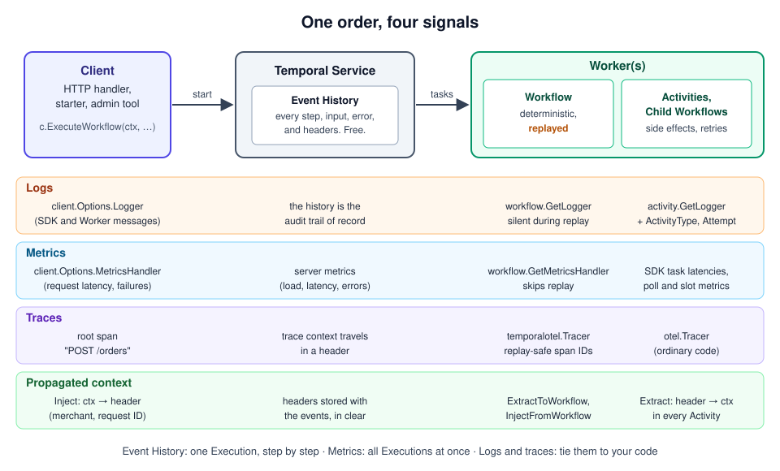

# 01 · Observability in Temporal: what you can see and what you add

> **Level:** foundations · **Read time:** ~12 min
> **Sources:** [Go SDK — Observability](https://docs.temporal.io/develop/go/platform/observability) · [Encyclopedia — Context Propagation](https://docs.temporal.io/encyclopedia/context-propagation) · [Go SDK — OpenTelemetry v2 integration](https://docs.temporal.io/develop/go/integrations/opentelemetry-v2)

---

## 1. The problem

In a classic web service, one request is one process, one goroutine, a few hundred milliseconds. Logs,
metrics and a trace all line up on the same timeline.

An order in the shop is different. `PlaceOrderWorkflow` starts from an HTTP handler, charges the card
on one Worker, waits two days for the warehouse, ships from another Worker after a deploy, and retries
the shipping label three times because the carrier's API is flaky. During those two days the Workflow
may be **replayed** several times. When a merchant asks "why did order A-1001 take three days?", you
need to answer:

- **What happened**, step by step, for this one order?
- **Is it just this order**, or are all orders slow right now?
- **Where did the time go**: in our code, in the payment provider, in the queue waiting for a Worker?
- **Who** was it for: which merchant, which request?

Temporal already records a lot of this. The rest you add: logs, metrics, traces, and the context that
ties them together. This guide covers both.

---

## 2. The mental model



| Signal | Answers | Where it comes from | Chapter |
| --- | --- | --- | --- |
| **Event History** | What happened to this Execution, in order, with inputs and errors | Recorded by the Temporal Service, for free | this chapter |
| **Logs** | What our code did and decided | `workflow.GetLogger`, `activity.GetLogger`, `client.Options.Logger` | [02](02-logging.md) |
| **Propagated context** | Who and what this work is for (merchant, request ID) | A context propagator writing Temporal headers | [03](03-context-propagation.md), [04](04-propagation-in-depth.md) |
| **Metrics** | How much, how fast, how often, across all Executions | `client.Options.MetricsHandler`, SDK metrics | [05](05-metrics.md) |
| **Traces** | Where the time went, across services and Workers | The OpenTelemetry v2 plugin | [06](06-tracing-with-opentelemetry.md), [07](07-tracing-options-and-migration.md) |

The Event History answers questions about **one** Execution. Metrics answer questions about **all** of
them. Logs and traces connect the two to your own code and to the systems around Temporal.
[Chapter 08](08-observability-in-production.md) puts them together into dashboards, alerts and an
incident routine.

---

## 3. What Temporal gives you without any code

Before adding anything, know what is already there:

| Tool | Shows | Example |
| --- | --- | --- |
| Web UI | Every Execution, its status, its Event History, pending Activities with their last failure | <http://localhost:8233> with `temporal server start-dev` |
| `temporal workflow describe` | Status, pending Activities, attempt count, last failure, next retry | below |
| `temporal workflow show` | The full Event History, in order | `temporal workflow show -w order-A-1001` |
| `temporal workflow stack` | Where the Workflow code is blocked right now | needs a running Worker |
| Temporal Service metrics | Server-side load, latencies, errors | the dev server exposes them at `http://localhost:<metrics-port>/metrics` |

Here is the order Workflow of section 5, with a payment provider that is down for the first two
attempts. While it retries, `describe` already tells you most of the story:

```text
$ temporal workflow describe -w order-A-1001
Execution Info:
  WorkflowId            order-A-1001
  RunId                 01a17532-e56d-7639-9d6d-0dd4157c6b4e
  Type                  PlaceOrderWorkflow
  Namespace             default
  TaskQueue             orders
  AssignedBuildId        
  StartTime             14 seconds ago
  ExecutionTime         14 seconds ago
  SearchAttributes      map[BuildIds:metadata:{key:"encoding" value:"json/plain"} metadata:{key:"type" value:"KeywordList"} data:"[\"unversioned\",\"unversioned:85c1cdd69d9ac7be3aeabbb4a3fa69fe\"]"]
  StateTransitionCount  6
  HistoryLength         5
  HistorySize           701
  RootWorkflowId        order-A-1001
  RootRunId             01a17532-e56d-7639-9d6d-0dd4157c6b4e
Extended Execution Info:
  CancelRequested    false
  OriginalStartTime  14 seconds ago

Pending Activities: 1

  ActivityId          5
  Type                ChargePayment
  State               Scheduled
  Attempt             3
  MaximumAttempts     0
  ScheduledTime       15 seconds from now
  LastFailure         {"message":"payment provider: 503 service unavailable","source":"GoSDK","applicationFailureInfo":{}}
  LastWorkerIdentity  99136@J9L636DG4L@

Pending Child Workflows: 0
Pending Nexus Operations: 0
```

The pending Activity says it all, without a single log line: `ChargePayment` failed twice
(`LastFailure`), attempt 3 is `Scheduled` 15 seconds from now, and `MaximumAttempts 0` means it will
retry forever. What `describe` can't tell you: which merchant this is, whether every order is failing the same
way, or how long the payment provider takes when it answers. That's what you add.

---

## 4. Replay changes the rules

Workflow code is **replayed**: when a Worker doesn't have the Workflow in its cache (after a restart, a
deploy, a full cache), it re-runs the code from the beginning against the Event History. Anything with a
side effect runs again. For observability that means:

| Naive approach in a Workflow | During replay | Use instead | Chapter |
| --- | --- | --- | --- |
| `fmt.Println`, `slog.Info` | Prints again | `workflow.GetLogger(ctx)`: silent while replaying | [02](02-logging.md) |
| Counting with a Prometheus counter | Counts again | `workflow.GetMetricsHandler(ctx)`: skips replay | [05](05-metrics.md) |
| `otel.Tracer(…).Start` | Emits a duplicate span with a new random ID and a wrong start time | `temporalotel.Tracer(…)` with the replay-safe tracer provider | [06](06-tracing-with-opentelemetry.md) |
| Reading a value from a global variable set by the starter | Not there: the Workflow runs on another process | A context propagator | [03](03-context-propagation.md) |

Activities are not replayed. In Activity code, ordinary logging, metrics and tracing libraries work, as
long as they get the Activity's `context.Context`.

---

## 5. Wiring it once: shared Client options

Every process that creates a Client (Workers, starters, admin tools) needs the same logger,
propagators, metrics handler and tracing plugin. Build the options in **one** function and grow it as
you go through the guide:

```go
// file: internal/observability/options.go
package observability

import (
	"log/slog"
	"os"

	"go.temporal.io/sdk/client"
	"go.temporal.io/sdk/log"
	"go.temporal.io/sdk/workflow"
)

// ClientOptions returns the Client options every process of the shop uses.
// Workers created from the Client inherit all of them.
func ClientOptions(service string, propagators ...workflow.ContextPropagator) client.Options {
	logger := slog.New(slog.NewJSONHandler(os.Stdout, &slog.HandlerOptions{Level: slog.LevelInfo}))
	return client.Options{
		HostPort: os.Getenv("TEMPORAL_ADDRESS"), // empty: localhost:7233

		// Chapter 02: a structured, levelled logger instead of the SDK default.
		Logger: log.NewStructuredLogger(logger.With("service", service)),

		// Chapter 03: tenant and request IDs carried in Temporal headers.
		ContextPropagators: propagators,

		// Chapter 05: MetricsHandler. Chapter 06: Plugins (OpenTelemetry).
	}
}
```

The Workflow and Activity:

```go
// file: orders/workflow.go
package orders

import (
	"time"

	"go.temporal.io/sdk/temporal"
	"go.temporal.io/sdk/workflow"
)

type PlaceOrderInput struct {
	OrderID     string
	AmountCents int64
}

func PlaceOrderWorkflow(ctx workflow.Context, in PlaceOrderInput) (string, error) {
	logger := workflow.GetLogger(ctx)
	logger.Info("Placing order", "OrderID", in.OrderID)

	ctx = workflow.WithActivityOptions(ctx, workflow.ActivityOptions{
		StartToCloseTimeout: 10 * time.Second,
		RetryPolicy: &temporal.RetryPolicy{
			InitialInterval:    10 * time.Second,
			BackoffCoefficient: 2,
		},
	})
	var a *Activities
	var paymentRef string
	if err := workflow.ExecuteActivity(ctx, a.ChargePayment, in.OrderID, in.AmountCents).Get(ctx, &paymentRef); err != nil {
		return "", err
	}
	logger.Info("Order paid", "OrderID", in.OrderID, "PaymentRef", paymentRef)
	return paymentRef, nil
}
```

```go
// file: orders/activities.go
package orders

import (
	"context"
	"errors"
	"fmt"
	"sync/atomic"

	"go.temporal.io/sdk/activity"
)

// PaymentGateway charges a card through the payment provider.
type PaymentGateway interface {
	Charge(ctx context.Context, orderID string, amountCents int64) (string, error)
}

type Activities struct {
	Gateway PaymentGateway
}

func (a *Activities) ChargePayment(ctx context.Context, orderID string, amountCents int64) (string, error) {
	activity.GetLogger(ctx).Info("Charging card", "OrderID", orderID, "AmountCents", amountCents)
	return a.Gateway.Charge(ctx, orderID, amountCents)
}

// UnstableGateway fails its first FailFirst calls, like a provider in an outage.
type UnstableGateway struct {
	FailFirst int32
	calls     atomic.Int32
}

func (g *UnstableGateway) Charge(_ context.Context, orderID string, amountCents int64) (string, error) {
	if g.calls.Add(1) <= g.FailFirst {
		return "", errors.New("payment provider: 503 service unavailable")
	}
	return fmt.Sprintf("pay_%s_%d", orderID, amountCents), nil
}
```

```go
// file: cmd/worker/main.go
package main

import (
	"log"

	"go.temporal.io/sdk/client"
	"go.temporal.io/sdk/worker"

	"github.com/acme/shop/internal/observability"
	"github.com/acme/shop/orders"
)

func main() {
	c, err := client.Dial(observability.ClientOptions("orders-worker"))
	if err != nil {
		log.Fatalln("dial:", err)
	}
	defer c.Close()

	w := worker.New(c, "orders", worker.Options{})
	w.RegisterWorkflow(orders.PlaceOrderWorkflow)
	w.RegisterActivity(&orders.Activities{Gateway: &orders.UnstableGateway{FailFirst: 2}})
	if err := w.Run(worker.InterruptCh()); err != nil {
		log.Fatalln("worker:", err)
	}
}
```

```go
// file: cmd/starter/main.go
package main

import (
	"context"
	"log"

	"go.temporal.io/sdk/client"

	"github.com/acme/shop/internal/observability"
	"github.com/acme/shop/orders"
)

func main() {
	c, err := client.Dial(observability.ClientOptions("orders-api"))
	if err != nil {
		log.Fatalln("dial:", err)
	}
	defer c.Close()

	run, err := c.ExecuteWorkflow(context.Background(), client.StartWorkflowOptions{
		ID:        "order-A-1001",
		TaskQueue: "orders",
	}, orders.PlaceOrderWorkflow, orders.PlaceOrderInput{OrderID: "A-1001", AmountCents: 4999})
	if err != nil {
		log.Fatalln("start:", err)
	}
	var ref string
	if err := run.Get(context.Background(), &ref); err != nil {
		log.Fatalln("order failed:", err)
	}
	log.Println("paid:", ref)
}
```

The Worker's log for this order, in JSON (fields trimmed to the interesting ones):

```text
{"time": "23:33:52.241", "level": "INFO", "msg": "Placing order", "service": "orders-worker", "WorkflowID": "order-A-1001", "Attempt": 1, "OrderID": "A-1001"}
{"time": "23:33:52.243", "level": "INFO", "msg": "Charging card", "service": "orders-worker", "WorkflowID": "order-A-1001", "ActivityType": "ChargePayment", "Attempt": 1, "OrderID": "A-1001"}
{"time": "23:33:52.243", "level": "ERROR", "msg": "Activity error.", "service": "orders-worker", "WorkflowID": "order-A-1001", "ActivityType": "ChargePayment", "Attempt": 1, "Error": "payment provider: 503 service unavailable"}
{"time": "23:34:02.247", "level": "INFO", "msg": "Charging card", "service": "orders-worker", "WorkflowID": "order-A-1001", "ActivityType": "ChargePayment", "Attempt": 2, "OrderID": "A-1001"}
{"time": "23:34:02.247", "level": "ERROR", "msg": "Activity error.", "service": "orders-worker", "WorkflowID": "order-A-1001", "ActivityType": "ChargePayment", "Attempt": 2, "Error": "payment provider: 503 service unavailable"}
{"time": "23:34:22.253", "level": "INFO", "msg": "Charging card", "service": "orders-worker", "WorkflowID": "order-A-1001", "ActivityType": "ChargePayment", "Attempt": 3, "OrderID": "A-1001"}
{"time": "23:34:22.258", "level": "INFO", "msg": "Order paid", "service": "orders-worker", "WorkflowID": "order-A-1001", "Attempt": 1, "OrderID": "A-1001", "PaymentRef": "pay_A-1001_4999"}
```

The two failed attempts appear as the SDK's own "Activity error." lines; the third succeeds about 30
seconds after the first (10 s, then 20 s of backoff).

---

## 6. Where each Go API lives

| I want to… | Go API | Chapter |
| --- | --- | --- |
| Log from a Workflow without duplicates | `workflow.GetLogger(ctx)` | [02](02-logging.md) |
| Log from an Activity with its IDs | `activity.GetLogger(ctx)` | [02](02-logging.md) |
| Send SDK logs to my backend | `client.Options{Logger: log.NewStructuredLogger(slog.New(h))}` | [02](02-logging.md) |
| Carry a merchant ID across every call | `client.Options{ContextPropagators: …}` + a `workflow.ContextPropagator` | [03](03-context-propagation.md) |
| Propagate to Signals, Updates, tests, Nexus | headers, interceptors, `SetContextPropagators` | [04](04-propagation-in-depth.md) |
| Emit SDK and custom metrics | `client.Options{MetricsHandler: …}`, `workflow.GetMetricsHandler(ctx)` | [05](05-metrics.md) |
| Trace across Client, Workflow, Activities | `temporalotel.NewPlugin`, `temporalotel.NewReplaySafeTracerProvider` | [06](06-tracing-with-opentelemetry.md) |
| Add my own spans in a Workflow | `temporalotel.Tracer(name).Start(ctx, …)` | [06](06-tracing-with-opentelemetry.md) |
| Tune or migrate tracing | `PluginOptions`, `tracing.TracerOptions` | [07](07-tracing-options-and-migration.md) |

---

## 7. Key takeaways

- Temporal records **what happened** to each Execution (Event History, UI, `describe`, `show`, `stack`)
  without any code. Start there.
- You add **logs** (what your code decided), **metrics** (all Executions at once), **traces** (where
  the time went) and **propagated context** (who it was for).
- Workflow code is **replayed**: use the SDK's replay-aware logger, metrics handler and tracer, never
  the plain libraries.
- Build the Client options (logger, propagators, metrics, plugins) in **one** function and use it in
  every process.
