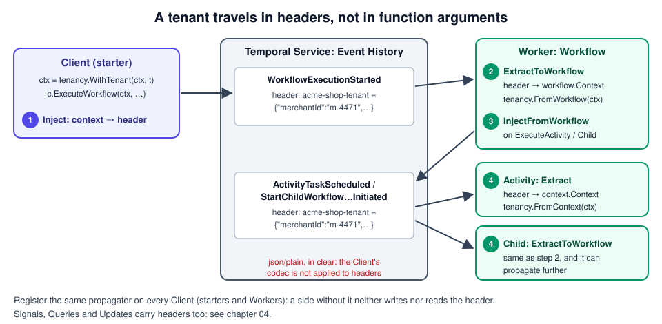

# 03 · Context propagation

> **Level:** foundations · **Read time:** ~15 min
> **Sources:** [Encyclopedia — Context Propagation](https://docs.temporal.io/encyclopedia/context-propagation) · [Go SDK — Context propagation](https://docs.temporal.io/develop/go/best-practices/context-propagation) · [`workflow.ContextPropagator`](https://pkg.go.dev/go.temporal.io/sdk/workflow#ContextPropagator)

---

## 1. The problem

The shop is multi-tenant: every order belongs to a **merchant**. The HTTP handler that receives
`POST /orders` knows the merchant from the request's API key. The Workflow needs it too, to log it.
The payment Activity needs it to pick the merchant's payment account. The shipping Child Workflow
needs it to pick the merchant's carrier.

You could add a `MerchantID` field to every input struct and pass it by hand at every call. It works
until someone forgets one call, and it clutters every signature with data that isn't about the
business step. In ordinary Go code you would put it on the `context.Context` instead. But a Workflow
doesn't share memory with the process that started it: it runs on another Worker, maybe days later,
maybe after a replay. A value on the starter's context is lost unless something carries it.

**Context propagation** carries it. You write a small **context propagator**. The SDK calls it at every
boundary to copy values from the context into Temporal **headers**, and back from headers into the
context on the other side.

---

## 2. How it works



Headers are a `map[string]*Payload` that travels with every start, Activity, Child Workflow, Signal,
Query and Update request. The Service stores them with the request (in the Event History for starts,
Activities and Child Workflows) and hands them to the Worker that runs the code.

| Step | Who | Propagator method |
| --- | --- | --- |
| 1. Start a Workflow from a Client | `c.ExecuteWorkflow(ctx, …)` | `Inject(context.Context, HeaderWriter)`: context → header |
| 2. Workflow starts on a Worker | the SDK | `ExtractToWorkflow(workflow.Context, HeaderReader)`: header → `workflow.Context` |
| 3. Workflow calls an Activity or Child Workflow | `workflow.ExecuteActivity(ctx, …)` | `InjectFromWorkflow(workflow.Context, HeaderWriter)`: `workflow.Context` → header |
| 4a. Activity runs | the SDK | `Extract(context.Context, HeaderReader)`: header → `context.Context` |
| 4b. Child Workflow runs | the SDK | `ExtractToWorkflow` again |

There are **two pairs** of methods because Go code outside Workflows uses `context.Context`, and
Workflow code uses `workflow.Context`. You need all four for a value to go Client → Workflow →
Activity / Child Workflow.

You register the propagator once, on `client.Options.ContextPropagators`. A Worker created from that
Client uses the same propagators, so the starter and the Worker must **both** register it (section 7).

> **Tracing context is a special case.** To carry OpenTelemetry trace context, don't write your own
> propagator: the OpenTelemetry plugin does it for you ([chapter 06](06-tracing-with-opentelemetry.md)).
> A custom propagator is for your own values: tenant, user, request ID, feature flags.

---

## 3. The tenant and its context helpers

Keep the context key unexported, and give the rest of the code typed helpers. Callers then can't put a
`*Tenant` in one place and a `Tenant` in another (the docs' sample does exactly that, see section 8):

```go
// file: internal/tenancy/tenant.go
package tenancy

import (
	"context"

	"go.temporal.io/sdk/log"
	"go.temporal.io/sdk/workflow"
)

// Tenant is the merchant an order belongs to.
type Tenant struct {
	MerchantID string `json:"merchantId"`
	Plan       string `json:"plan"` // "starter", "growth", "enterprise"
}

// tenantKey is unexported: only this package can read or write the value.
type tenantKey struct{}

// WithTenant returns a copy of ctx carrying the tenant. Use it before c.ExecuteWorkflow.
func WithTenant(ctx context.Context, t Tenant) context.Context {
	return context.WithValue(ctx, tenantKey{}, t)
}

// FromContext reads the tenant in Activities and other non-Workflow code.
func FromContext(ctx context.Context) (Tenant, bool) {
	t, ok := ctx.Value(tenantKey{}).(Tenant)
	return t, ok
}

// WithWorkflowTenant overrides the tenant for the calls made with the returned context.
func WithWorkflowTenant(ctx workflow.Context, t Tenant) workflow.Context {
	return workflow.WithValue(ctx, tenantKey{}, t)
}

// FromWorkflow reads the tenant in Workflow code.
func FromWorkflow(ctx workflow.Context) (Tenant, bool) {
	t, ok := ctx.Value(tenantKey{}).(Tenant)
	return t, ok
}

// WorkflowLogger is workflow.GetLogger with the merchant added to every line.
func WorkflowLogger(ctx workflow.Context) log.Logger {
	logger := workflow.GetLogger(ctx)
	if t, ok := FromWorkflow(ctx); ok {
		logger = log.With(logger, "MerchantID", t.MerchantID)
	}
	return logger
}
```

`WorkflowLogger` is the hook [chapter 02](02-logging.md) promised: every log line of the Workflow now
says which merchant it is about.

---

## 4. The propagator

```go
// file: internal/tenancy/propagator.go
package tenancy

import (
	"context"

	"go.temporal.io/sdk/converter"
	"go.temporal.io/sdk/workflow"
)

// HeaderKey is the Temporal header that carries the tenant. Prefix it with your
// company or service so it can't clash with another propagator's key.
const HeaderKey = "acme-shop-tenant"

type propagator struct{}

// NewPropagator returns the propagator to put in client.Options.ContextPropagators.
func NewPropagator() workflow.ContextPropagator {
	return propagator{}
}

// Inject: Client or Activity context → header.
func (propagator) Inject(ctx context.Context, writer workflow.HeaderWriter) error {
	t, ok := FromContext(ctx)
	if !ok {
		return nil // no tenant: write no header, so "not set" stays "not set"
	}
	return writeTenant(t, writer)
}

// InjectFromWorkflow: Workflow context → header of an Activity or Child Workflow.
func (propagator) InjectFromWorkflow(ctx workflow.Context, writer workflow.HeaderWriter) error {
	t, ok := FromWorkflow(ctx)
	if !ok {
		return nil
	}
	return writeTenant(t, writer)
}

// Extract: header → Activity context.
func (propagator) Extract(ctx context.Context, reader workflow.HeaderReader) (context.Context, error) {
	if t, ok := readTenant(reader); ok {
		ctx = WithTenant(ctx, t)
	}
	return ctx, nil
}

// ExtractToWorkflow: header → Workflow context.
func (propagator) ExtractToWorkflow(ctx workflow.Context, reader workflow.HeaderReader) (workflow.Context, error) {
	if t, ok := readTenant(reader); ok {
		ctx = WithWorkflowTenant(ctx, t)
	}
	return ctx, nil
}

func writeTenant(t Tenant, writer workflow.HeaderWriter) error {
	// The default data converter, not the Client's: a codec configured on the
	// Client is NOT applied to headers (see section 9).
	payload, err := converter.GetDefaultDataConverter().ToPayload(t)
	if err != nil {
		return err
	}
	writer.Set(HeaderKey, payload)
	return nil
}

func readTenant(reader workflow.HeaderReader) (Tenant, bool) {
	payload, ok := reader.Get(HeaderKey)
	if !ok {
		return Tenant{}, false
	}
	var t Tenant
	if err := converter.GetDefaultDataConverter().FromPayload(payload, &t); err != nil {
		// An unreadable header is dropped, as in the docs' sample. Returning the
		// error instead would fail the Workflow Task or Activity on every attempt.
		return Tenant{}, false
	}
	return t, true
}
```

Two differences from the docs' propagator, both fixing behavior we observed (section 8):

- `Inject` and `InjectFromWorkflow` write **nothing** when there is no tenant. The docs' version always
  writes a header, `null` when the value is missing.
- Values always go in and out as the same type, `Tenant`, through the helpers.

---

## 5. Using it in Workflows and Activities

The Workflow reads the tenant from its context. It doesn't pass it to the Activity or the Child
Workflow: the propagator does.

```go
// file: orders/workflow.go
package orders

import (
	"time"

	"go.temporal.io/sdk/temporal"
	"go.temporal.io/sdk/workflow"

	"github.com/acme/shop/internal/tenancy"
	"github.com/acme/shop/shipping"
)

type PlaceOrderInput struct {
	OrderID     string
	AmountCents int64
}

type PlaceOrderResult struct {
	OrderID    string
	PaymentRef string
	Carrier    string
}

func PlaceOrderWorkflow(ctx workflow.Context, in PlaceOrderInput) (PlaceOrderResult, error) {
	tenant, ok := tenancy.FromWorkflow(ctx)
	if !ok {
		// Every order must belong to a merchant. Fail fast instead of charging the wrong account.
		return PlaceOrderResult{}, temporal.NewNonRetryableApplicationError(
			"order has no tenant: start it with tenancy.WithTenant", "MissingTenant", nil)
	}
	logger := tenancy.WorkflowLogger(ctx)
	logger.Info("Placing order", "OrderID", in.OrderID, "Plan", tenant.Plan)

	actx := workflow.WithActivityOptions(ctx, workflow.ActivityOptions{StartToCloseTimeout: 30 * time.Second})
	var a *Activities
	var paymentRef string
	if err := workflow.ExecuteActivity(actx, a.ChargePayment, in.OrderID, in.AmountCents).Get(ctx, &paymentRef); err != nil {
		return PlaceOrderResult{}, err
	}

	cctx := workflow.WithChildOptions(ctx, workflow.ChildWorkflowOptions{
		WorkflowID: "ship-" + in.OrderID,
	})
	var carrier string
	if err := workflow.ExecuteChildWorkflow(cctx, shipping.ShipOrderWorkflow, in.OrderID).Get(ctx, &carrier); err != nil {
		return PlaceOrderResult{}, err
	}

	logger.Info("Order placed", "OrderID", in.OrderID, "PaymentRef", paymentRef, "Carrier", carrier)
	return PlaceOrderResult{OrderID: in.OrderID, PaymentRef: paymentRef, Carrier: carrier}, nil
}
```

```go
// file: orders/activities.go
package orders

import (
	"context"
	"fmt"

	"go.temporal.io/sdk/activity"
	"go.temporal.io/sdk/temporal"

	"github.com/acme/shop/internal/tenancy"
)

// PaymentGateway charges a merchant's payment account.
type PaymentGateway interface {
	Charge(ctx context.Context, account, orderID string, amountCents int64) (ref string, err error)
}

type Activities struct {
	Gateway PaymentGateway
}

func (a *Activities) ChargePayment(ctx context.Context, orderID string, amountCents int64) (string, error) {
	tenant, ok := tenancy.FromContext(ctx)
	if !ok {
		return "", temporal.NewNonRetryableApplicationError("no tenant on the Activity context", "MissingTenant", nil)
	}
	account := "acct_" + tenant.MerchantID
	activity.GetLogger(ctx).Info("Charging", "MerchantID", tenant.MerchantID, "Account", account)
	return a.Gateway.Charge(ctx, account, orderID, amountCents)
}

// FakeGateway stands in for the real payment provider.
type FakeGateway struct{}

func (FakeGateway) Charge(_ context.Context, account, orderID string, amountCents int64) (string, error) {
	return fmt.Sprintf("pay_%s_%s_%d", account, orderID, amountCents), nil
}
```

```go
// file: shipping/workflow.go
package shipping

import (
	"go.temporal.io/sdk/workflow"

	"github.com/acme/shop/internal/tenancy"
)

// ShipOrderWorkflow is started as a Child Workflow. The tenant arrives in its
// context through the same propagator.
func ShipOrderWorkflow(ctx workflow.Context, orderID string) (string, error) {
	carrier := "postnord"
	if t, ok := tenancy.FromWorkflow(ctx); ok && t.Plan == "enterprise" {
		carrier = "dhl-express"
	}
	tenancy.WorkflowLogger(ctx).Info("Shipping", "OrderID", orderID, "Carrier", carrier)
	return carrier, nil
}
```

`workflow.WithValue` works too: `tenancy.WithWorkflowTenant(ctx, other)` changes the tenant for the
calls made with the returned context only. We checked it: an Activity started with such a context
received the new value, the others kept the original one.

---

## 6. Registering it on the Client and the Worker

```go
// file: cmd/worker/main.go
package main

import (
	"log"
	"log/slog"
	"os"

	"go.temporal.io/sdk/client"
	sdklog "go.temporal.io/sdk/log"
	"go.temporal.io/sdk/worker"
	"go.temporal.io/sdk/workflow"

	"github.com/acme/shop/internal/tenancy"
	"github.com/acme/shop/orders"
	"github.com/acme/shop/shipping"
)

func main() {
	c, err := client.Dial(client.Options{
		HostPort: os.Getenv("TEMPORAL_ADDRESS"), // empty: localhost:7233
		Logger: sdklog.NewStructuredLogger(slog.New(slog.NewTextHandler(os.Stdout,
			&slog.HandlerOptions{Level: slog.LevelInfo}))),
		// The Worker built from this Client uses the same propagators.
		ContextPropagators: []workflow.ContextPropagator{tenancy.NewPropagator()},
	})
	if err != nil {
		log.Fatalln("dial:", err)
	}
	defer c.Close()

	w := worker.New(c, "orders", worker.Options{})
	w.RegisterWorkflow(orders.PlaceOrderWorkflow)
	w.RegisterWorkflow(shipping.ShipOrderWorkflow)
	w.RegisterActivity(&orders.Activities{Gateway: orders.FakeGateway{}})
	if err := w.Run(worker.InterruptCh()); err != nil {
		log.Fatalln("worker:", err)
	}
}
```

The starter puts the tenant on the context it passes to `ExecuteWorkflow`. In a real service that is
the HTTP request's context, enriched by an authentication middleware:

```go
// file: cmd/starter/main.go
package main

import (
	"context"
	"flag"
	"fmt"
	"log"
	"os"

	"go.temporal.io/sdk/client"
	"go.temporal.io/sdk/workflow"

	"github.com/acme/shop/internal/tenancy"
	"github.com/acme/shop/orders"
)

func main() {
	merchant := flag.String("merchant", "", "merchant ID (empty: start without a tenant)")
	plan := flag.String("plan", "growth", "merchant plan")
	orderID := flag.String("order", "A-1001", "order ID")
	flag.Parse()

	c, err := client.Dial(client.Options{
		HostPort:           os.Getenv("TEMPORAL_ADDRESS"), // empty: localhost:7233
		ContextPropagators: []workflow.ContextPropagator{tenancy.NewPropagator()},
	})
	if err != nil {
		log.Fatalln("dial:", err)
	}
	defer c.Close()

	ctx := context.Background()
	if *merchant != "" {
		ctx = tenancy.WithTenant(ctx, tenancy.Tenant{MerchantID: *merchant, Plan: *plan})
	}
	run, err := c.ExecuteWorkflow(ctx, client.StartWorkflowOptions{
		ID:        "order-" + *orderID,
		TaskQueue: "orders",
	}, orders.PlaceOrderWorkflow, orders.PlaceOrderInput{OrderID: *orderID, AmountCents: 4999})
	if err != nil {
		log.Fatalln("start:", err)
	}
	var res orders.PlaceOrderResult
	if err := run.Get(ctx, &res); err != nil {
		log.Fatalln("order failed:", err)
	}
	fmt.Printf("%+v\n", res)
}
```

Run it against `temporal server start-dev`:

```text
$ go run ./cmd/starter -merchant m-4471 -plan enterprise -order A-1001
{OrderID:A-1001 PaymentRef:pay_acct_m-4471_A-1001_4999 Carrier:dhl-express}

$ go run ./cmd/starter -order A-1002
2026/10/25 23:29:49 order failed: workflow execution error (type: PlaceOrderWorkflow, workflowID: order-A-1002, runID: 01a1752f-32b1-71a1-ac2e-65f216291a50): order has no tenant: start it with tenancy.WithTenant (type: MissingTenant, retryable: false)
exit status 1
```

The Worker's log for the first order (timestamps removed). Every line carries the merchant, though no input struct has a
merchant field:

```text
level=INFO msg="Placing order" Namespace=default TaskQueue=orders WorkerID=96469@J9L636DG4L@ WorkflowType=PlaceOrderWorkflow WorkflowID=order-A-1001 RunID=01a1752f-327b-77c4-a51a-cc75262fde33 Attempt=1 MerchantID=m-4471 OrderID=A-1001 Plan=enterprise
level=INFO msg=Charging Namespace=default TaskQueue=orders WorkerID=96469@J9L636DG4L@ ActivityID=5 ActivityType=ChargePayment Attempt=1 WorkflowType=PlaceOrderWorkflow WorkflowID=order-A-1001 RunID=01a1752f-327b-77c4-a51a-cc75262fde33 MerchantID=m-4471 Account=acct_m-4471
level=INFO msg=Shipping Namespace=default TaskQueue=orders WorkerID=96469@J9L636DG4L@ WorkflowType=ShipOrderWorkflow WorkflowID=ship-A-1001 RunID=01a1752f-328b-72ea-9ced-96b461eff293 Attempt=1 MerchantID=m-4471 OrderID=A-1001 Carrier=dhl-express
level=INFO msg="Order placed" Namespace=default TaskQueue=orders WorkerID=96469@J9L636DG4L@ WorkflowType=PlaceOrderWorkflow WorkflowID=order-A-1001 RunID=01a1752f-327b-77c4-a51a-cc75262fde33 Attempt=1 MerchantID=m-4471 OrderID=A-1001 PaymentRef=pay_acct_m-4471_A-1001_4999 Carrier=dhl-express
```

---

## 7. Both sides must register it

The propagator is a Client option, and a Worker uses its Client's propagators. What we observed when
only one side had it (rows 1–2 with the docs' propagator, row 3 with ours):

| Starter Client | Worker's Client | Workflow saw | Activity saw |
| --- | --- | --- | --- |
| propagator | propagator | the value | the value |
| **no** propagator | propagator | `nil` (no header) | a **zero** value (the docs' `InjectFromWorkflow` wrote `null`) |
| propagator | **no** propagator | nothing: the header is in the history, but nobody extracts it. With the propagator of section 4, `PlaceOrderWorkflow` failed with `MissingTenant` | nothing |

Treat the propagator list like the Data Converter: build it in one shared function and use it in every
process that creates a Client (starters, Workers, admin tools). [Chapter 01](01-what-is-observability.md)
does this with `observability.ClientOptions`.

---

## 8. What we observed with the docs' propagator

We ran the docs' sample propagator (Go SDK v1.50.0, dev server, Temporal Server 1.32.0):

| Situation | Result |
| --- | --- |
| Value set on the Client context | Reached the Workflow, an Activity, a **Local Activity** and a Child Workflow |
| `workflow.WithValue` in the Workflow | The next Activity got the new value |
| **No** value set on the Client context | `Inject` still wrote a header containing JSON `null`. `Extract` decoded it into a zero `Values{}`, so the Workflow's `if val := ctx.Value(key); val != nil` check was **true** with empty fields |
| Starter sets `&Values{…}` (a pointer) | The Workflow's `val.(Values)` (not a pointer) still worked, but only because `Extract` decodes into a value type: the type changes when it crosses the boundary |

Neither problem shows up in the docs' happy path, where a value is always set. Both show up in
production, where some starters (a cron, an admin script) don't set one. The propagator in section 4
avoids both.

---

## 9. Headers are not encrypted

A context propagator calls a converter **itself** to build the header payload. The Client's
`DataConverter`, and the `PayloadCodec` that encrypts or compresses your payloads, are **not** applied to
headers. We checked with a Client using a zlib codec (`AlwaysEncode: true`) and read back the
`WorkflowExecutionStarted` event:

| Payload | Stored as |
| --- | --- |
| Workflow input | `encoding=binary/zlib`, compressed bytes |
| Propagated header | `encoding=json/plain`, the JSON in clear |

`temporal workflow show -w order-A-1001 -o json` prints the header of the order started in section 6
for anyone who can read the history:

```text
"header": {
  "fields": {
    "acme-shop-tenant": {
      "metadata": {
        "encoding": "anNvbi9wbGFpbg=="
      },
      "data": "eyJtZXJjaGFudElkIjoibS00NDcxIiwicGxhbiI6ImVudGVycHJpc2UifQ=="
    }
  }
}
```

That is base64 for `json/plain` and `{"merchantId":"m-4471","plan":"enterprise"}`. The docs list "auth tokens" as a use case. If you
propagate one, it sits in the Event History for the whole retention period. Propagate **identifiers**
(merchant ID, user ID, request ID) and look up secrets where they're needed. If something sensitive
must travel, encrypt it inside `writeTenant` yourself.

---

## 10. What else to know

The SDK also extracts headers for Signals, Queries and Updates, but they don't all reach your code the
same way, and propagators need care in tests and over Nexus. [Chapter 04](04-propagation-in-depth.md)
covers these, plus several propagators on one Client.

---

## 11. Key takeaways

- A **context propagator** copies your values from the context into Temporal **headers** and back, at
  every boundary: Client → Workflow → Activity, Local Activity, Child Workflow.
- Implement all **four** methods: `Inject`/`Extract` for `context.Context`, `InjectFromWorkflow`/`ExtractToWorkflow`
  for `workflow.Context`.
- Register it on `client.Options.ContextPropagators` in **every** process: starters and Workers.
- Wrap the context key in typed helpers (`WithTenant`, `FromWorkflow`), and write **no** header when
  there is no value. The docs' sample writes `null` and turns "not set" into a zero value.
- Headers are stored **in clear**, outside your codec. Propagate IDs, not secrets.
- For trace context, use the OpenTelemetry plugin ([chapter 06](06-tracing-with-opentelemetry.md)), not a
  hand-written propagator.
