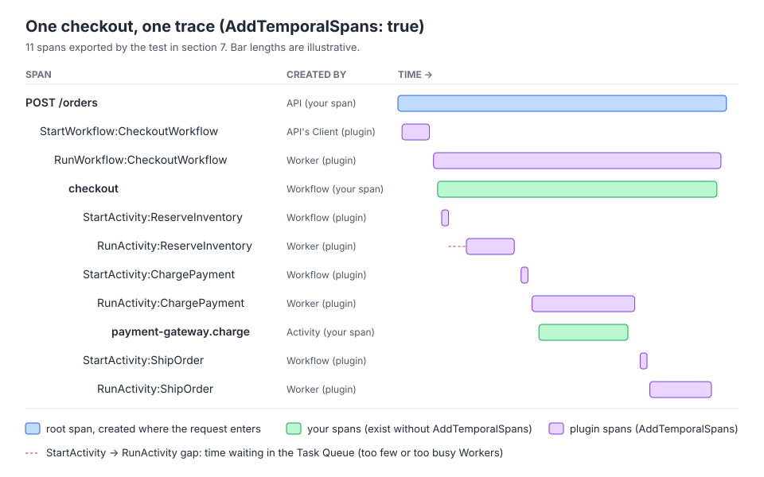

# 06 · Tracing with OpenTelemetry

> **Level:** advanced · **Read time:** ~16 min
> **Sources:** [Go SDK — OpenTelemetry v2 integration](https://docs.temporal.io/develop/go/integrations/opentelemetry-v2) · [Go SDK — Observability: Tracing](https://docs.temporal.io/develop/go/platform/observability#tracing) · [`contrib/opentelemetry-v2`](https://pkg.go.dev/go.temporal.io/sdk/contrib/opentelemetry-v2) · [OpenTelemetry traces](https://opentelemetry.io/docs/concepts/signals/traces/)

---

## 1. The problem

A customer clicks **Pay** and nothing happens for 40 seconds. Your HTTP service has a trace for
`POST /orders` that ends after 30 ms: it started a Workflow and returned `202 Accepted`. The rest of the
story (inventory reserved, card charged, parcel booked) ran on Workers, maybe on other machines, maybe
after a Worker restart. Without help, each of those pieces is a separate trace fragment, or no trace at
all.

Workflows make tracing harder in two ways:

- **The trace crosses process boundaries through the Temporal Service.** The Client, the Workflow and
  each Activity run in different processes, and the only thing they share is the Workflow's Event
  History.
- **Workflow code replays.** A Worker that picks up a Workflow after a restart re-runs the Workflow code
  from the start. A normal tracer would create every span again, with new random IDs and new start
  times.

The OpenTelemetry v2 integration solves both: it carries the span context in **Temporal headers**, and
it gives you a **replay-safe** Tracer Provider and Tracer for Workflow code. This chapter wires it into
the `shop` checkout and looks at the traces it really produces.

---

## 2. Install

```bash
go get go.temporal.io/sdk/contrib/opentelemetry-v2@latest
go get go.opentelemetry.io/otel/exporters/otlp/otlptrace/otlptracegrpc
```

The examples import the module as `temporalotel`.

| Module | Version used here | Status |
| --- | --- | --- |
| `go.temporal.io/sdk/contrib/opentelemetry-v2` | v0.1.0 | **Pre-release.** The README says "Experimental: APIs may change between releases"; every exported symbol is marked `NOTE: Experimental` |
| `go.temporal.io/sdk` | v1.50.0 | The module requires v1.48.0 or later |
| `go.opentelemetry.io/otel`, `…/sdk` | v1.44.0 | |

The older interceptor-based module, `go.temporal.io/sdk/contrib/opentelemetry` (v0.8.1), still exists.
[Chapter 07](07-tracing-options-and-migration.md) compares the two and shows how to migrate.

---

## 3. A replay-safe Tracer Provider

A standard OpenTelemetry Tracer Provider gives each new span a **random** span ID. When a Workflow
replays, the same `tracer.Start` call runs again and would get a different ID: the "same" span would
exist twice in your backend.

`temporalotel.NewReplaySafeTracerProvider` wraps the OpenTelemetry SDK's provider and replaces its ID
generator. Inside a Workflow, span and trace IDs are read from a deterministic random stream tied to the
Workflow (`workflow.GetRandomStream`); elsewhere, from `crypto/rand`. Same Workflow, same code path, same
IDs on every replay.

```go
// file: internal/telemetry/tracing.go
package telemetry

import (
	"context"
	"fmt"

	"go.opentelemetry.io/otel"
	"go.opentelemetry.io/otel/exporters/otlp/otlptrace/otlptracegrpc"
	"go.opentelemetry.io/otel/sdk/resource"
	sdktrace "go.opentelemetry.io/otel/sdk/trace"
	semconv "go.opentelemetry.io/otel/semconv/v1.41.0"
	temporalotel "go.temporal.io/sdk/contrib/opentelemetry-v2"
)

// SetupTracing creates the replay-safe Tracer Provider, exporting over OTLP/gRPC
// to a collector (Jaeger, Tempo, Honeycomb…), and installs it as the global one.
// Call it before temporalotel.NewPlugin. The caller must Shutdown the provider.
func SetupTracing(ctx context.Context, serviceName, collector string) (*temporalotel.ReplaySafeTracerProvider, error) {
	exporter, err := otlptracegrpc.New(ctx,
		otlptracegrpc.WithEndpoint(collector), // e.g. "otel-collector:4317"
		otlptracegrpc.WithInsecure(),          // plain gRPC inside the cluster
	)
	if err != nil {
		return nil, fmt.Errorf("otlp trace exporter: %w", err)
	}

	provider := temporalotel.NewReplaySafeTracerProvider(
		// WithBatcher exports in the background, outside the Workflow goroutine.
		sdktrace.WithBatcher(exporter),
		sdktrace.WithResource(resource.NewWithAttributes(
			semconv.SchemaURL,
			semconv.ServiceName(serviceName),
		)),
	)
	otel.SetTracerProvider(provider) // must happen before NewPlugin and Tracer
	return provider, nil
}
```

Three rules, all from the module's source:

| Rule | What happens otherwise |
| --- | --- |
| Install the provider with `otel.SetTracerProvider` **before** calling `NewPlugin` or `temporalotel.Tracer` | Both **panic** with `global tracer provider must be created by NewReplaySafeTracerProvider`. `NewPlugin` has an `error` return value, but this case doesn't use it |
| Don't pass your own `sdktrace.WithIDGenerator` | It's silently overridden: the provider appends its own generator last |
| Use `WithBatcher` in production | Export I/O happens in the background, not in the Workflow goroutine. Tests can use `WithSyncer` |

Your application owns the provider. Shut it down **after** the Worker and the Client have stopped, so the
last spans are flushed ([section 4](#_4-the-plugin-on-the-client)).

---

## 4. The plugin on the Client

`temporalotel.NewPlugin` returns a Client plugin. Put it in `client.Options.Plugins`: every Worker
created from that Client inherits it, so you don't configure Workers separately.

```go
// file: cmd/worker/main.go
package main

import (
	"context"
	"log"
	"os"
	"time"

	"go.temporal.io/sdk/client"
	temporalotel "go.temporal.io/sdk/contrib/opentelemetry-v2"
	"go.temporal.io/sdk/interceptor/tracing"
	"go.temporal.io/sdk/worker"

	"github.com/acme/shop/checkout"
	"github.com/acme/shop/internal/telemetry"
)

type stripeGateway struct{}

func (stripeGateway) Charge(ctx context.Context, customerID string, amountCents int64) (string, error) {
	return "ch_live_123", nil
}

func main() {
	ctx := context.Background()

	// 1. Tracer Provider first: NewPlugin panics without a replay-safe global one.
	provider, err := telemetry.SetupTracing(ctx, "shop-checkout-worker", os.Getenv("OTEL_COLLECTOR"))
	if err != nil {
		log.Fatalln(err)
	}
	// 4. Runs last: flush the spans still in the batcher.
	defer func() {
		shutdownCtx, cancel := context.WithTimeout(context.Background(), 5*time.Second)
		defer cancel()
		if err := provider.Shutdown(shutdownCtx); err != nil {
			log.Println("tracer provider shutdown:", err)
		}
	}()

	// 2. The plugin, on the Client. Workers built from this Client inherit it.
	plugin, err := temporalotel.NewPlugin(temporalotel.PluginOptions{
		TracerOptions: tracing.TracerOptions{AddTemporalSpans: true},
	})
	if err != nil {
		log.Fatalln(err)
	}
	c, err := client.Dial(client.Options{
		HostPort: os.Getenv("TEMPORAL_ADDRESS"),
		Plugins:  []client.Plugin{plugin},
	})
	if err != nil {
		log.Fatalln(err)
	}
	defer c.Close() // 3b. runs before the provider shutdown

	// 3. The Worker.
	w := worker.New(c, checkout.TaskQueue, worker.Options{})
	w.RegisterWorkflow(checkout.CheckoutWorkflow)
	w.RegisterActivity(&checkout.Activities{Gateway: stripeGateway{}})
	if err := w.Run(worker.InterruptCh()); err != nil { // 3a. stops on SIGINT/SIGTERM
		log.Println("worker:", err)
	}
}
```

Shutdown runs in the reverse order of setup, which `defer` gives you for free:

1. `w.Run` returns on `SIGINT`/`SIGTERM`, after the Worker has stopped polling and running Tasks have
   finished.
2. `c.Close()` closes the connection to the Service.
3. `provider.Shutdown` flushes the spans still in the batcher, then stops the exporter.

If the process exits without step 3, the batcher's buffer is lost: typically the **last** spans, which
are the ones you wanted when investigating a crash.

### What the plugin does by default

With `PluginOptions{}`, the plugin creates **no spans of its own**. It only propagates the span context:
on every outbound call (start a Workflow, schedule an Activity, start a Child Workflow, signal…) it writes
the current span context into a Temporal header, and on every inbound call it reads it back. Spans that
**your** code creates stay connected across processes.

`AddTemporalSpans: true` (in `TracerOptions`, from `go.temporal.io/sdk/interceptor/tracing`) also creates
one span per Temporal operation: `StartWorkflow`, `RunWorkflow`, `StartActivity`, `RunActivity`,
`SignalWorkflow`, `HandleSignal`, `QueryWorkflow`, `HandleQuery`, `ContinueAsNew` and so on. The worker
above turns it on; [section 7](#_7-what-the-trace-looks-like) shows the difference.

---

## 5. Your own spans: Workflows vs Activities

### In a Workflow: `temporalotel.Tracer`

`otel.Tracer` isn't safe in Workflow code: it stamps spans with the wall clock and ends them again on
every replay. Use `temporalotel.Tracer` instead. Its spans:

- get replay-stable IDs from the provider of [section 3](#_3-a-replay-safe-tracer-provider);
- start at `workflow.Now` when they are recreated during a replay;
- are **not ended again** during replay, so they are exported once.

```go
// file: checkout/workflow.go
package checkout

import (
	"time"

	temporalotel "go.temporal.io/sdk/contrib/opentelemetry-v2"
	"go.temporal.io/sdk/workflow"
)

const TaskQueue = "checkout"

type Order struct {
	ID          string
	CustomerID  string
	SKU         string
	AmountCents int64
}

type Receipt struct {
	OrderID    string
	ChargeID   string
	TrackingID string
}

func CheckoutWorkflow(ctx workflow.Context, order Order) (Receipt, error) {
	// A replay-safe Tracer: span IDs come from the Workflow's deterministic random
	// stream, and a span that already ended isn't exported again during replay.
	// Get it here, not in a package-level var: Tracer panics if the global
	// provider isn't replay-safe yet, and package vars run before main.
	tracer := temporalotel.Tracer("github.com/acme/shop/checkout")
	ctx, span := tracer.Start(ctx, "checkout")
	defer span.End()

	ctx = workflow.WithActivityOptions(ctx, workflow.ActivityOptions{
		StartToCloseTimeout: 30 * time.Second,
	})
	var a *Activities // nil receiver: only the method names are used

	if err := workflow.ExecuteActivity(ctx, a.ReserveInventory, order).Get(ctx, nil); err != nil {
		return Receipt{}, err
	}
	var chargeID string
	if err := workflow.ExecuteActivity(ctx, a.ChargePayment, order).Get(ctx, &chargeID); err != nil {
		return Receipt{}, err
	}
	var trackingID string
	if err := workflow.ExecuteActivity(ctx, a.ShipOrder, order).Get(ctx, &trackingID); err != nil {
		return Receipt{}, err
	}
	return Receipt{OrderID: order.ID, ChargeID: chargeID, TrackingID: trackingID}, nil
}
```

`tracer.Start` returns a new `workflow.Context` carrying the span. Pass **that** context to
`ExecuteActivity` so the Activity spans become children of `checkout`.

### Trap: a package-level Workflow Tracer panics

The first version of this file had `var tracer = temporalotel.Tracer("…")` at package level. The test
binary crashed before any test ran:

```text
panic: global tracer provider must be created by NewReplaySafeTracerProvider
...
github.com/acme/shop/checkout.init()
	checkout/workflow.go:28
```

`Tracer` looks up the global provider **when it is called**, and package variables are initialized before
`main` installs the provider. Call it inside the Workflow function. It's cheap.

### In an Activity, a Client or an HTTP handler: `otel.Tracer`

Outside Workflows nothing replays, so the ordinary OpenTelemetry Tracer is right. The plugin has already
put the parent span in the Activity's `context.Context`:

```go
// file: checkout/activities.go
package checkout

import (
	"context"

	"go.opentelemetry.io/otel"
	"go.opentelemetry.io/otel/attribute"
	"go.opentelemetry.io/otel/codes"
)

// PaymentGateway is the card processor (Stripe, Adyen…), faked in tests.
type PaymentGateway interface {
	Charge(ctx context.Context, customerID string, amountCents int64) (chargeID string, err error)
}

type Activities struct {
	Gateway PaymentGateway
}

func (a *Activities) ReserveInventory(ctx context.Context, order Order) error {
	return nil
}

func (a *Activities) ChargePayment(ctx context.Context, order Order) (string, error) {
	// Outside Workflows, use an ordinary OpenTelemetry Tracer.
	ctx, span := otel.Tracer("github.com/acme/shop/checkout").Start(ctx, "payment-gateway.charge")
	defer span.End()
	span.SetAttributes(
		attribute.String("shop.order_id", order.ID),
		attribute.Int64("shop.amount_cents", order.AmountCents),
	)

	chargeID, err := a.Gateway.Charge(ctx, order.CustomerID, order.AmountCents)
	if err != nil {
		span.RecordError(err)
		span.SetStatus(codes.Error, "charge failed")
		return "", err
	}
	return chargeID, nil
}

func (a *Activities) ShipOrder(ctx context.Context, order Order) (string, error) {
	return "TRK-" + order.ID, nil
}
```

Here too, the Tracer is fetched inside the function rather than stored in a package variable. A package
variable works in a long-running process, but OpenTelemetry's global delegation binds a Tracer obtained
before the first `otel.SetTracerProvider` to **that first** provider forever. In a test that installs a
fresh provider per sub-test, such a Tracer kept writing to the first, already shut down, provider: the
`payment-gateway.charge` span silently disappeared from the second sub-test.

Status is your job in your own spans. On a failed Activity, the plugin marks its own `RunActivity` and
`RunWorkflow` spans as errors (see [section 8](#_8-replay-retries-and-worker-restarts)), but your
`checkout` span stays `Unset` unless you call `span.SetStatus`.

---

## 6. A root span at the edge

The trace should start where the user's request enters your system. The API creates the root span and
passes its `ctx` to `ExecuteWorkflow`; the plugin on the API's Client injects it into the Workflow's
headers.

```go
// file: cmd/api/main.go
package main

import (
	"context"
	"encoding/json"
	"log"
	"net/http"
	"os"

	"go.opentelemetry.io/otel"
	"go.opentelemetry.io/otel/codes"
	"go.temporal.io/sdk/client"
	temporalotel "go.temporal.io/sdk/contrib/opentelemetry-v2"

	"github.com/acme/shop/checkout"
	"github.com/acme/shop/internal/telemetry"
)

var apiTracer = otel.Tracer("github.com/acme/shop/api")

func placeOrder(c client.Client) http.HandlerFunc {
	return func(w http.ResponseWriter, r *http.Request) {
		// The root span of the trace. Every Temporal span will be its descendant.
		ctx, span := apiTracer.Start(r.Context(), "POST /orders")
		defer span.End()

		var order checkout.Order
		if err := json.NewDecoder(r.Body).Decode(&order); err != nil {
			http.Error(w, "bad order", http.StatusBadRequest)
			return
		}
		// Pass ctx: the plugin injects the span context into the Workflow's headers.
		run, err := c.ExecuteWorkflow(ctx, client.StartWorkflowOptions{
			ID:        "checkout-" + order.ID,
			TaskQueue: checkout.TaskQueue,
		}, checkout.CheckoutWorkflow, order)
		if err != nil {
			span.RecordError(err)
			span.SetStatus(codes.Error, "start workflow failed")
			http.Error(w, "could not start checkout", http.StatusInternalServerError)
			return
		}
		w.WriteHeader(http.StatusAccepted)
		_ = json.NewEncoder(w).Encode(map[string]string{"workflow_id": run.GetID()})
	}
}

func main() {
	ctx := context.Background()
	provider, err := telemetry.SetupTracing(ctx, "shop-api", os.Getenv("OTEL_COLLECTOR"))
	if err != nil {
		log.Fatalln(err)
	}
	defer func() { _ = provider.Shutdown(context.Background()) }()

	plugin, err := temporalotel.NewPlugin(temporalotel.PluginOptions{})
	if err != nil {
		log.Fatalln(err)
	}
	c, err := client.Dial(client.Options{
		HostPort: os.Getenv("TEMPORAL_ADDRESS"),
		Plugins:  []client.Plugin{plugin},
	})
	if err != nil {
		log.Fatalln(err)
	}
	defer c.Close()

	http.HandleFunc("POST /orders", placeOrder(c))
	log.Fatalln(http.ListenAndServe(":8080", nil))
}
```

In a real service, an HTTP middleware such as `otelhttp` would create this server span and also extract a
`traceparent` sent by the browser or the API gateway. The principle is the same: whatever span is in `ctx`
when you call the Temporal Client becomes the parent of the Workflow.

---

## 7. What the trace looks like

You don't need a Jaeger instance to see the trace. The OpenTelemetry SDK's in-memory exporter collects
spans in a slice, and `testsuite.StartDevServer` gives you a real Temporal Service. This test runs the
checkout once with each value of `AddTemporalSpans` and prints the span tree.

```go
// file: checkout/trace_test.go
package checkout

import (
	"context"
	"fmt"
	"os"
	"sort"
	"strings"
	"testing"

	"go.opentelemetry.io/otel"
	sdktrace "go.opentelemetry.io/otel/sdk/trace"
	"go.opentelemetry.io/otel/sdk/trace/tracetest"
	"go.opentelemetry.io/otel/trace"
	"go.temporal.io/sdk/client"
	temporalotel "go.temporal.io/sdk/contrib/opentelemetry-v2"
	"go.temporal.io/sdk/interceptor/tracing"
	"go.temporal.io/sdk/testsuite"
	"go.temporal.io/sdk/worker"
)

type fakeGateway struct{}

func (fakeGateway) Charge(ctx context.Context, customerID string, amountCents int64) (string, error) {
	return "ch_test_1", nil
}

func TestCheckoutTrace(t *testing.T) {
	for _, addTemporalSpans := range []bool{false, true} {
		t.Run(fmt.Sprintf("AddTemporalSpans=%v", addTemporalSpans), func(t *testing.T) {
			ctx := context.Background()

			// In-memory exporter: spans are kept in a slice we can inspect.
			exporter := tracetest.NewInMemoryExporter()
			provider := temporalotel.NewReplaySafeTracerProvider(sdktrace.WithSyncer(exporter))
			otel.SetTracerProvider(provider)
			defer func() { _ = provider.Shutdown(ctx) }()

			srv, err := testsuite.StartDevServer(ctx, testsuite.DevServerOptions{
				ExistingPath: os.Getenv("TEMPORAL_CLI"), // empty: the SDK downloads the CLI
				LogLevel:     "error",
			})
			if err != nil {
				t.Fatal(err)
			}
			defer func() { _ = srv.Stop() }()

			plugin, err := temporalotel.NewPlugin(temporalotel.PluginOptions{
				TracerOptions: tracing.TracerOptions{AddTemporalSpans: addTemporalSpans},
			})
			if err != nil {
				t.Fatal(err)
			}
			c, err := client.Dial(client.Options{HostPort: srv.FrontendHostPort(), Plugins: []client.Plugin{plugin}})
			if err != nil {
				t.Fatal(err)
			}
			defer c.Close()

			w := worker.New(c, TaskQueue, worker.Options{})
			w.RegisterWorkflow(CheckoutWorkflow)
			w.RegisterActivity(&Activities{Gateway: fakeGateway{}})
			if err := w.Start(); err != nil {
				t.Fatal(err)
			}
			defer w.Stop()

			rootCtx, root := otel.Tracer("test").Start(ctx, "POST /orders")
			run, err := c.ExecuteWorkflow(rootCtx, client.StartWorkflowOptions{ID: "checkout-A1001", TaskQueue: TaskQueue},
				CheckoutWorkflow, Order{ID: "A1001", CustomerID: "C42", SKU: "MUG-01", AmountCents: 1800})
			if err != nil {
				t.Fatal(err)
			}
			if err := run.Get(ctx, nil); err != nil {
				t.Fatal(err)
			}
			root.End()

			spans := exporter.GetSpans()
			for _, s := range spans {
				if s.SpanContext.TraceID() != root.SpanContext().TraceID() {
					t.Errorf("span %q is in another trace", s.Name)
				}
			}
			t.Logf("%d spans, one trace\n%s", len(spans), tree(spans))
		})
	}
}

// tree prints spans as an indented parent/child tree, ordered by start time.
func tree(spans tracetest.SpanStubs) string {
	children := map[trace.SpanID][]tracetest.SpanStub{}
	for _, s := range spans {
		children[s.Parent.SpanID()] = append(children[s.Parent.SpanID()], s)
	}
	var b strings.Builder
	var walk func(parent trace.SpanID, depth int)
	walk = func(parent trace.SpanID, depth int) {
		kids := children[parent]
		sort.Slice(kids, func(i, j int) bool { return kids[i].StartTime.Before(kids[j].StartTime) })
		for _, s := range kids {
			fmt.Fprintf(&b, "%s%s\n", strings.Repeat("  ", depth), s.Name)
			walk(s.SpanContext.SpanID(), depth+1)
		}
	}
	walk(trace.SpanID{}, 0)
	return b.String()
}
```

```text
$ TEMPORAL_CLI=$(which temporal) go test -run TestCheckoutTrace -v ./checkout
    trace_test.go:86: 3 spans, one trace
        POST /orders
          checkout
            payment-gateway.charge
    trace_test.go:86: 11 spans, one trace
        POST /orders
          StartWorkflow:CheckoutWorkflow
            RunWorkflow:CheckoutWorkflow
              checkout
                StartActivity:ReserveInventory
                  RunActivity:ReserveInventory
                StartActivity:ChargePayment
                  RunActivity:ChargePayment
                    payment-gateway.charge
                StartActivity:ShipOrder
                  RunActivity:ShipOrder
--- PASS: TestCheckoutTrace (2.52s)
```



What to read in it:

- **One trace.** The test checks that every span has the root's trace ID: the context went from the
  test, through the Service, into the Workflow, and from the Workflow into each Activity.
- **Without `AddTemporalSpans`**, only your spans exist, but they're still connected: `checkout` (created
  on the Worker) is a child of `POST /orders` (created in the test process).
- **With `AddTemporalSpans`**, the Temporal operations appear between them. `StartActivity` is the
  Workflow **scheduling** the Activity; `RunActivity` is the Activity **running** on a Worker. A gap
  between the two is time spent in the Task Queue: a strong signal that Workers are too few or too busy.
- `ReserveInventory` and `ShipOrder` have no custom span; `RunActivity` still gives you their duration.

Start with `AddTemporalSpans: true`. If the volume is too high, sample in the collector, or switch it off
and keep only your own spans.

---

## 8. Replay, retries and Worker restarts

Replay safety is the reason this module exists, so it's worth checking. The same checkout code ran on a
dev server with `AddTemporalSpans: true`, in situations that make Workflow code run more than once.

| Situation | What was exported |
| --- | --- |
| Full replay on **every** Workflow Task (`worker.SetStickyWorkflowCacheSize(0)`) | Each span **once**. No duplicates despite the Workflow code running three times |
| Workflow **restarted on another Worker**: Worker 1 stopped while the Workflow waited for a Signal, Worker 2 finished it | `RunWorkflow` and `checkout` exported **once**, by Worker 2, with the **original start time** (from `workflow.Now` of the first Workflow Task) and ended when the Workflow completed. Worker 1 exported nothing for them |
| A **Workflow Task failed** twice (a panic in Workflow code) then succeeded | `RunWorkflow` and `checkout` exported **three times with the same span ID**: two zero-length copies from the failed attempts, then the real one |
| Activity returned a non-retryable `ApplicationError` | `RunActivity` and `RunWorkflow` have status **Error**; `StartActivity` and your `checkout` span stay `Unset` |
| Activity returned an error with `Category: ApplicationErrorCategoryBenign` | All spans `Unset`. The plugin records the error but doesn't mark the span as failed |
| Two Queries on a running Workflow, from a Client without a parent span | Each Query is its own small trace: `QueryWorkflow` → `HandleQuery`, with a **new random ID** every time (Queries run in a read-only context, which never replays) |
| A Signal from a Client without a parent span | Its own trace: `SignalWorkflow` → `HandleSignal`, not part of the checkout trace |

Practical consequences:

- **Long Workflows produce long spans.** `checkout` is exported when the Workflow ends. For a 30-day
  subscription Workflow, that is 30 days later, and the span is missing from your backend until then.
  Prefer spans around **steps** (one per order phase) over one span around the whole Workflow.
- **Failed Workflow Tasks show up as duplicate span IDs.** Most backends display them as repeated spans.
  It's a useful signal: a Workflow Task failure is a bug in Workflow code (see the
  [Error handling guide](../../error-handling/docs/README.md)).
- **Queries and Signals join the trace only if you give them a parent.** Start them with a `ctx` that
  carries the request's span, as the API does for `ExecuteWorkflow`.

---

## 9. Key takeaways

- Install `temporalotel.NewReplaySafeTracerProvider` with `otel.SetTracerProvider` **first**;
  `NewPlugin` and `temporalotel.Tracer` panic otherwise.
- Put `temporalotel.NewPlugin` in `client.Options.Plugins`. Workers inherit it. By default it only
  propagates context; `AddTemporalSpans: true` adds `StartWorkflow`, `RunWorkflow`, `StartActivity`,
  `RunActivity`… spans.
- In Workflows, use `temporalotel.Tracer` (called inside the function, not in a package variable). In
  Activities, Clients and handlers, use `otel.Tracer`.
- Start a root span where the request enters, and pass its `ctx` to the Temporal Client.
- Shut down in reverse order: Worker, Client, then the Tracer Provider, or the last spans are lost.
- Replay doesn't duplicate spans, and a Workflow moved to another Worker keeps one span with its original
  start time. Failed Workflow Tasks do produce repeated span IDs.
- The module is pre-release (v0.1.0): pin its version.
