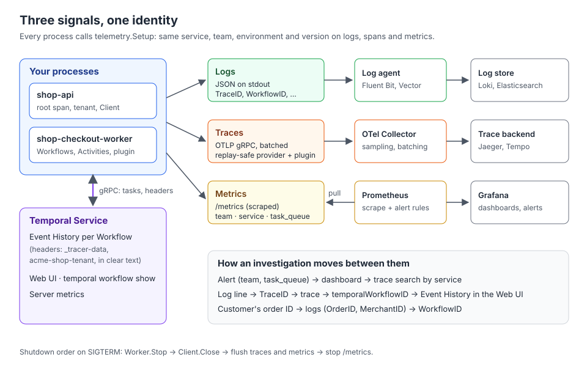

# 08 · Observability in production

> **Level:** production · **Read time:** ~18 min
> **Sources:** [Go SDK — Observability](https://docs.temporal.io/develop/go/platform/observability) · [Go SDK — OpenTelemetry v2 integration](https://docs.temporal.io/develop/go/integrations/opentelemetry-v2) · [SDK metrics reference](https://docs.temporal.io/references/sdk-metrics) · [Go SDK — Context propagation](https://docs.temporal.io/develop/go/best-practices/context-propagation)

---

## 1. The problem

The previous chapters each added one signal: logs ([02](02-logging.md)), a tenant carried across
boundaries ([03](03-context-propagation.md), [04](04-propagation-in-depth.md)), SDK metrics
([05](05-metrics.md)), traces ([06](06-tracing-with-opentelemetry.md), [07](07-tracing-options-and-migration.md)).
In production they have to work **together**:

- An alert fires on a metric. You need the Workers behind it: **which team, which service, which version**.
- A merchant reports a stuck order. You need to go from the order ID to its logs, from a log line to its
  trace, and from the trace to the Workflow in the Web UI.
- A pod is killed during a deploy. The last spans and metrics must not vanish with it.

This chapter assembles everything into one `telemetry` package used by the API and the Worker, proves with
a test that one checkout produces a connected trace, correlated logs and tagged metrics, and ends with a
checklist.

---

## 2. The target picture



Each process emits three signals, each through the channel that suits it:

| Signal | Leaves the process as | Goes to | Joined by |
| --- | --- | --- | --- |
| Logs | JSON lines on stdout | A log agent (Fluent Bit, Vector…), then Loki, Elasticsearch… | `TraceID`, `WorkflowID`, `MerchantID`, `service` fields |
| Traces | OTLP over gRPC | The OpenTelemetry Collector, then Jaeger, Tempo, Honeycomb… | trace ID; `temporalWorkflowID` and `temporalRunID` span attributes |
| Metrics | `/metrics`, scraped by Prometheus | Prometheus, Grafana | `team`, `service`, `environment`, `namespace`, `task_queue`, `workflow_type` labels |

The Temporal Service keeps its own record next to them: the **Event History** of each Workflow, visible in
the Web UI and with `temporal workflow show`, and its server metrics. Your logs and traces explain what
your code did; the history explains what Temporal did.

---

## 3. One `Setup` for all three signals

Every process (the Worker, the API, a backfill job) calls the same function, so the identity fields can't
drift between signals:

```go
// file: internal/telemetry/telemetry.go
package telemetry

import (
	"context"
	"errors"
	"fmt"
	"io"
	"log/slog"
	"net/http"
	"os"

	"github.com/prometheus/client_golang/prometheus"
	"github.com/prometheus/client_golang/prometheus/promhttp"
	"go.opentelemetry.io/otel"
	"go.opentelemetry.io/otel/attribute"
	"go.opentelemetry.io/otel/exporters/otlp/otlptrace/otlptracegrpc"
	otelprom "go.opentelemetry.io/otel/exporters/prometheus"
	sdkmetric "go.opentelemetry.io/otel/sdk/metric"
	"go.opentelemetry.io/otel/sdk/resource"
	sdktrace "go.opentelemetry.io/otel/sdk/trace"
	semconv "go.opentelemetry.io/otel/semconv/v1.41.0"
	"go.temporal.io/sdk/client"
	temporalotel "go.temporal.io/sdk/contrib/opentelemetry-v2"
	"go.temporal.io/sdk/interceptor/tracing"
	"go.temporal.io/sdk/log"
)

// Config identifies the process. The same four values tag logs, traces and metrics,
// so one dashboard filter works everywhere.
type Config struct {
	Service     string // "shop-checkout-worker"
	Team        string // "checkout"
	Environment string // "production"
	Version     string // the build's git SHA
	Collector   string // OTLP gRPC endpoint, e.g. "otel-collector:4317"

	// Overrides for tests: an in-memory span exporter and a log buffer.
	SpanExporter sdktrace.SpanExporter
	LogOutput    io.Writer
}

// Telemetry is everything a process needs to be observable.
type Telemetry struct {
	Logger   log.Logger    // for client.Options.Logger
	Plugin   client.Plugin // for client.Options.Plugins: tracing + SDK metrics
	Metrics  http.Handler  // serve it on /metrics for Prometheus
	Shutdown func(context.Context) error
}

func Setup(ctx context.Context, cfg Config) (*Telemetry, error) {
	// Logs: JSON on stdout, collected by the platform's log agent.
	var logOutput io.Writer = os.Stdout
	if cfg.LogOutput != nil {
		logOutput = cfg.LogOutput
	}
	slogger := slog.New(slog.NewJSONHandler(logOutput, &slog.HandlerOptions{Level: slog.LevelInfo})).With(
		"service", cfg.Service, "team", cfg.Team, "environment", cfg.Environment, "version", cfg.Version)

	res := resource.NewWithAttributes(semconv.SchemaURL,
		semconv.ServiceName(cfg.Service),
		semconv.ServiceVersion(cfg.Version),
		semconv.DeploymentEnvironmentNameKey.String(cfg.Environment),
	)

	// Traces: OTLP to the collector, through the replay-safe provider (chapter 06).
	traceExporter := cfg.SpanExporter
	if traceExporter == nil {
		otlp, err := otlptracegrpc.New(ctx, otlptracegrpc.WithEndpoint(cfg.Collector), otlptracegrpc.WithInsecure())
		if err != nil {
			return nil, fmt.Errorf("otlp trace exporter: %w", err)
		}
		traceExporter = otlp
	}
	tracerProvider := temporalotel.NewReplaySafeTracerProvider(
		sdktrace.WithBatcher(traceExporter),
		sdktrace.WithResource(res),
	)
	otel.SetTracerProvider(tracerProvider)

	// Metrics: a Prometheus registry scraped on /metrics (chapter 05).
	registry := prometheus.NewRegistry()
	promExporter, err := otelprom.New(otelprom.WithRegisterer(registry))
	if err != nil {
		return nil, fmt.Errorf("prometheus exporter: %w", err)
	}
	meterProvider := sdkmetric.NewMeterProvider(sdkmetric.WithReader(promExporter), sdkmetric.WithResource(res))
	otel.SetMeterProvider(meterProvider)

	plugin, err := temporalotel.NewPlugin(temporalotel.PluginOptions{
		TracerOptions: tracing.TracerOptions{
			AddTemporalSpans:        true,
			AllowInvalidParentSpans: true, // a bad header must never fail an order (chapter 07)
		},
		MetricsHandlerOptions: &temporalotel.MetricsHandlerOptions{
			Meter:                meterProvider.Meter("temporal-sdk-go"),
			UseMonotonicCounters: true,
			// Low-cardinality ownership tags on every SDK metric.
			InitialAttributes: attribute.NewSet(
				attribute.String("team", cfg.Team),
				attribute.String("service", cfg.Service),
				attribute.String("environment", cfg.Environment),
			),
			// The default panics on a meter error: log it instead.
			OnError: func(err error) { slogger.Error("temporal metrics", "error", err) },
		},
	})
	if err != nil {
		return nil, err
	}

	return &Telemetry{
		Logger:  log.NewStructuredLogger(slogger),
		Plugin:  plugin,
		Metrics: promhttp.HandlerFor(registry, promhttp.HandlerOpts{}),
		Shutdown: func(ctx context.Context) error {
			// Flush the last spans and metrics. Call after the Worker and Client stop.
			return errors.Join(tracerProvider.Shutdown(ctx), meterProvider.Shutdown(ctx))
		},
	}, nil
}
```

The choices in it, and why:

- **Same identity everywhere.** `service`, `team`, `environment` and `version` are on every log line
  (`slog.With`), on every span (the OpenTelemetry resource) and on every SDK metric
  (`InitialAttributes`). The Go Observability page recommends these ownership tags for metrics; putting the
  same values on logs and traces lets one filter work across all three.
- **Metrics through the plugin.** `MetricsHandlerOptions` replaces the Client's `MetricsHandler`, so the
  plugin carries both traces and SDK metrics. With the plugin there's no handler to call `WithTags` on:
  `InitialAttributes` is how you add global tags ([chapter 05](05-metrics.md) covers metrics in depth).
- **`OnError` is set.** Its default is `func(err error) { panic(err) }`: a misbehaving meter would crash
  the Worker.
- **`AllowInvalidParentSpans: true`.** A malformed tracing header otherwise fails the Workflow Execution
  ([chapter 07](07-tracing-options-and-migration.md#_6-allowinvalidparentspans-a-bad-header-fails-the-workflow)).
- **A private Prometheus registry**, so only what you register is exposed.
- **Test hooks.** `SpanExporter` and `LogOutput` let the test of [section 7](#_7-prove-it-with-a-test)
  capture spans and logs without a collector.

---

## 4. The Worker

```go
// file: cmd/worker/main.go
package main

import (
	"context"
	"errors"
	"log"
	"net/http"
	"os"
	"os/signal"
	"syscall"
	"time"

	"go.temporal.io/sdk/client"
	"go.temporal.io/sdk/worker"
	"go.temporal.io/sdk/workflow"

	"github.com/acme/shop/checkout"
	"github.com/acme/shop/internal/telemetry"
	"github.com/acme/shop/internal/tenancy"
)

type stripeGateway struct{}

func (stripeGateway) Charge(ctx context.Context, merchantID, customerID string, amountCents int64) (string, error) {
	return "ch_live_123", nil
}

func main() {
	// Cancelled on SIGINT/SIGTERM (Kubernetes sends SIGTERM before killing the pod).
	ctx, stop := signal.NotifyContext(context.Background(), os.Interrupt, syscall.SIGTERM)
	defer stop()

	tel, err := telemetry.Setup(ctx, telemetry.Config{
		Service:     "shop-checkout-worker",
		Team:        "checkout",
		Environment: os.Getenv("ENVIRONMENT"),
		Version:     os.Getenv("GIT_SHA"),
		Collector:   os.Getenv("OTEL_COLLECTOR"),
	})
	if err != nil {
		log.Fatalln(err)
	}

	metricsServer := &http.Server{Addr: ":9464", Handler: tel.Metrics}
	go func() {
		if err := metricsServer.ListenAndServe(); err != nil && !errors.Is(err, http.ErrServerClosed) {
			tel.Logger.Error("metrics server", "error", err)
		}
	}()

	c, err := client.Dial(client.Options{
		HostPort:           os.Getenv("TEMPORAL_ADDRESS"),
		Logger:             tel.Logger,
		Plugins:            []client.Plugin{tel.Plugin},
		ContextPropagators: []workflow.ContextPropagator{tenancy.NewPropagator()},
	})
	if err != nil {
		log.Fatalln(err)
	}

	w := worker.New(c, checkout.TaskQueue, worker.Options{
		// Default 0: no grace period. Leave room for the flush below in the pod's 30s.
		WorkerStopTimeout: 15 * time.Second,
	})
	w.RegisterWorkflow(checkout.CheckoutWorkflow)
	w.RegisterActivity(&checkout.Activities{Gateway: stripeGateway{}})
	if err := w.Start(); err != nil {
		log.Fatalln(err)
	}
	tel.Logger.Info("worker started", "TaskQueue", checkout.TaskQueue)

	<-ctx.Done()

	// Shutdown order: stop taking work, close the connection, then flush telemetry.
	w.Stop()  // running Activities get up to WorkerStopTimeout to finish
	c.Close() // no more calls to the Service
	flushCtx, cancel := context.WithTimeout(context.Background(), 10*time.Second)
	defer cancel()
	if err := tel.Shutdown(flushCtx); err != nil { // last spans and metrics
		log.Println("telemetry shutdown:", err)
	}
	_ = metricsServer.Shutdown(flushCtx) // last: Prometheus may scrape until the end
}
```

The shutdown sequence is the part that is easy to get wrong:

| Step | Why this order |
| --- | --- |
| 1. `<-ctx.Done()` on `SIGTERM` | Kubernetes sends `SIGTERM`, then `SIGKILL` after the grace period (30 s by default). Everything below must fit in it |
| 2. `w.Stop()` | Stops polling. Running Activities get `WorkerStopTimeout` to finish (default **0**: no grace period, hence the 15 s above; see the [Workers guide](../../workers/docs/10-graceful-shutdown.md)). Their spans and log lines are produced now |
| 3. `c.Close()` | No more calls to the Service, so no more `temporal_request` metrics or Client spans |
| 4. `tel.Shutdown` | Flushes the batched spans and the last metric values. Before step 2, it would drop the spans of the Activities that were finishing |
| 5. `metricsServer.Shutdown` | Last, so Prometheus can still scrape while the process drains |

---

## 5. The API and the checkout code

The API sets the root span and the tenant, then starts the Workflow. It returns the trace ID to the caller:
support can paste it into the tracing UI.

```go
// file: cmd/api/main.go
package main

import (
	"context"
	"encoding/json"
	"log"
	"net/http"
	"os"

	"go.opentelemetry.io/otel"
	"go.temporal.io/sdk/client"
	"go.temporal.io/sdk/workflow"

	"github.com/acme/shop/checkout"
	"github.com/acme/shop/internal/telemetry"
	"github.com/acme/shop/internal/tenancy"
)

func main() {
	ctx := context.Background()
	tel, err := telemetry.Setup(ctx, telemetry.Config{
		Service: "shop-api", Team: "checkout",
		Environment: os.Getenv("ENVIRONMENT"), Version: os.Getenv("GIT_SHA"),
		Collector: os.Getenv("OTEL_COLLECTOR"),
	})
	if err != nil {
		log.Fatalln(err)
	}
	defer func() { _ = tel.Shutdown(context.Background()) }()

	c, err := client.Dial(client.Options{
		HostPort:           os.Getenv("TEMPORAL_ADDRESS"),
		Logger:             tel.Logger,
		Plugins:            []client.Plugin{tel.Plugin},
		ContextPropagators: []workflow.ContextPropagator{tenancy.NewPropagator()},
	})
	if err != nil {
		log.Fatalln(err)
	}
	defer c.Close()

	http.Handle("GET /metrics", tel.Metrics)
	http.HandleFunc("POST /orders", func(w http.ResponseWriter, r *http.Request) {
		ctx, span := otel.Tracer("github.com/acme/shop/api").Start(r.Context(), "POST /orders")
		defer span.End()

		// The merchant comes from the authenticated API key, resolved by middleware.
		ctx = tenancy.WithTenant(ctx, tenancy.Tenant{MerchantID: r.Header.Get("X-Merchant-ID"), Plan: "growth"})

		var order checkout.Order
		if err := json.NewDecoder(r.Body).Decode(&order); err != nil {
			http.Error(w, "bad order", http.StatusBadRequest)
			return
		}
		run, err := c.ExecuteWorkflow(ctx, client.StartWorkflowOptions{
			ID: "checkout-" + order.ID, TaskQueue: checkout.TaskQueue,
		}, checkout.CheckoutWorkflow, order)
		if err != nil {
			tel.Logger.Error("start checkout", "OrderID", order.ID, "error", err)
			http.Error(w, "could not start checkout", http.StatusInternalServerError)
			return
		}
		w.WriteHeader(http.StatusAccepted)
		_ = json.NewEncoder(w).Encode(map[string]string{"workflow_id": run.GetID(), "trace_id": span.SpanContext().TraceID().String()})
	})
	log.Fatalln(http.ListenAndServe(":8080", nil))
}
```

The checkout code uses chapter 03's `internal/tenancy` package unchanged (the `Tenant` type, the
propagator and `WorkflowLogger`). Copy `internal/tenancy/tenant.go` and `internal/tenancy/propagator.go`
from [chapter 03](03-context-propagation.md) into this module.

```go
// file: checkout/workflow.go
package checkout

import (
	"time"

	temporalotel "go.temporal.io/sdk/contrib/opentelemetry-v2"
	"go.temporal.io/sdk/workflow"

	"github.com/acme/shop/internal/tenancy"
)

const TaskQueue = "checkout"

type Order struct {
	ID          string
	CustomerID  string
	AmountCents int64
}

func CheckoutWorkflow(ctx workflow.Context, order Order) (string, error) {
	ctx, span := temporalotel.Tracer("github.com/acme/shop/checkout").Start(ctx, "checkout")
	defer span.End()

	logger := tenancy.WorkflowLogger(ctx) // + MerchantID; the plugin adds TraceID and SpanID
	logger.Info("checkout started", "OrderID", order.ID)

	ctx = workflow.WithActivityOptions(ctx, workflow.ActivityOptions{StartToCloseTimeout: 30 * time.Second})
	var a *Activities
	if err := workflow.ExecuteActivity(ctx, a.ReserveInventory, order).Get(ctx, nil); err != nil {
		return "", err
	}
	var chargeID string
	if err := workflow.ExecuteActivity(ctx, a.ChargePayment, order).Get(ctx, &chargeID); err != nil {
		logger.Error("payment failed", "OrderID", order.ID, "Error", err)
		return "", err
	}
	logger.Info("checkout completed", "OrderID", order.ID, "ChargeID", chargeID)
	return chargeID, nil
}
```

```go
// file: checkout/activities.go
package checkout

import (
	"context"

	"go.opentelemetry.io/otel"
	"go.opentelemetry.io/otel/attribute"
	"go.opentelemetry.io/otel/codes"
	"go.temporal.io/sdk/activity"

	"github.com/acme/shop/internal/tenancy"
)

type PaymentGateway interface {
	Charge(ctx context.Context, merchantID, customerID string, amountCents int64) (string, error)
}

type Activities struct {
	Gateway PaymentGateway
}

func (a *Activities) ReserveInventory(ctx context.Context, order Order) error {
	activity.GetLogger(ctx).Info("stock reserved", "OrderID", order.ID)
	return nil
}

func (a *Activities) ChargePayment(ctx context.Context, order Order) (string, error) {
	tenant, _ := tenancy.FromContext(ctx) // propagated by the tenancy propagator (chapter 03)

	ctx, span := otel.Tracer("github.com/acme/shop/checkout").Start(ctx, "payment-gateway.charge")
	defer span.End()
	// The merchant on the span, not on metrics: span attributes may be high-cardinality.
	span.SetAttributes(attribute.String("shop.merchant_id", tenant.MerchantID), attribute.String("shop.order_id", order.ID))

	chargeID, err := a.Gateway.Charge(ctx, tenant.MerchantID, order.CustomerID, order.AmountCents)
	if err != nil {
		span.SetStatus(codes.Error, "charge failed")
		return "", err
	}
	// activity.GetLogger already carries TraceID and SpanID: logs and traces join up.
	activity.GetLogger(ctx).Info("payment captured", "OrderID", order.ID, "MerchantID", tenant.MerchantID)
	return chargeID, nil
}
```

Two details:

- The Workflow logs through `tenancy.WorkflowLogger`, which adds `MerchantID`. Nothing in this code adds
  `TraceID` and `SpanID`: **the plugin does**. With the plugin installed, `workflow.GetLogger` and
  `activity.GetLogger` return loggers that already carry the current trace and span IDs (the plugin's
  tracer implements the SDK's `GetLogger` hook). This works even without `AddTemporalSpans`.
- `shop.merchant_id` goes on the **span**, not on a metric. Span attributes can be high-cardinality (one
  value per merchant or order); metric labels must not be (section 8).

---

## 6. Two propagators side by side

The Worker's Client has both the tracing plugin and the tenant propagator. They don't interfere: each
writes its own header field, `_tracer-data` and `acme-shop-tenant`. They also don't share a lifecycle:

| | Tracing context (plugin) | Tenant (your propagator) |
| --- | --- | --- |
| Purpose | Observability: connect spans | Business logic: which merchant's data to use |
| If it's lost | A trace is split in two | The order may be charged to the wrong account |
| Readable in Workflow code | No (no accessor in v0.1.0) | Yes, `tenancy.FromWorkflow` |
| Tested by | The test below | Chapter 03's tests |

Keep anything the business logic depends on out of tracing baggage
([chapter 07](07-tracing-options-and-migration.md#_4-baggage)).

---

## 7. Prove it with a test

"We have observability" is a claim you can test. This test runs one checkout against a dev server with the
real `telemetry.Setup` and checks the three signals:

```go
// file: checkout/observability_test.go
package checkout

import (
	"bufio"
	"bytes"
	"context"
	"encoding/json"
	"net/http/httptest"
	"os"
	"strings"
	"testing"

	"go.opentelemetry.io/otel"
	"go.opentelemetry.io/otel/sdk/trace/tracetest"
	"go.temporal.io/sdk/client"
	temporalotel "go.temporal.io/sdk/contrib/opentelemetry-v2"
	"go.temporal.io/sdk/testsuite"
	"go.temporal.io/sdk/worker"
	"go.temporal.io/sdk/workflow"

	"github.com/acme/shop/internal/telemetry"
	"github.com/acme/shop/internal/tenancy"
)

type fakeGateway struct{}

func (fakeGateway) Charge(ctx context.Context, merchantID, customerID string, amountCents int64) (string, error) {
	return "ch_test_1", nil
}

// TestCheckoutIsObservable checks the three signals of one checkout: a single trace,
// logs that carry its trace ID and the merchant, and SDK metrics with ownership tags.
func TestCheckoutIsObservable(t *testing.T) {
	ctx := context.Background()
	spans := tracetest.NewInMemoryExporter()
	var logs bytes.Buffer
	tel, err := telemetry.Setup(ctx, telemetry.Config{
		Service: "shop-checkout-worker", Team: "checkout", Environment: "test", Version: "dev",
		SpanExporter: spans, LogOutput: &logs,
	})
	if err != nil {
		t.Fatal(err)
	}
	defer func() { _ = tel.Shutdown(ctx) }()

	srv, err := testsuite.StartDevServer(ctx, testsuite.DevServerOptions{ExistingPath: os.Getenv("TEMPORAL_CLI"), LogLevel: "error"})
	if err != nil {
		t.Fatal(err)
	}
	defer func() { _ = srv.Stop() }()

	c, err := client.Dial(client.Options{
		HostPort:           srv.FrontendHostPort(),
		Logger:             tel.Logger,
		Plugins:            []client.Plugin{tel.Plugin},
		ContextPropagators: []workflow.ContextPropagator{tenancy.NewPropagator()},
	})
	if err != nil {
		t.Fatal(err)
	}
	defer c.Close()
	w := worker.New(c, TaskQueue, worker.Options{})
	w.RegisterWorkflow(CheckoutWorkflow)
	w.RegisterActivity(&Activities{Gateway: fakeGateway{}})
	if err := w.Start(); err != nil {
		t.Fatal(err)
	}
	defer w.Stop()

	reqCtx, root := otel.Tracer("test").Start(ctx, "POST /orders")
	reqCtx = tenancy.WithTenant(reqCtx, tenancy.Tenant{MerchantID: "m-7731", Plan: "growth"})
	run, err := c.ExecuteWorkflow(reqCtx, client.StartWorkflowOptions{ID: "checkout-A1003", TaskQueue: TaskQueue},
		CheckoutWorkflow, Order{ID: "A1003", CustomerID: "C42", AmountCents: 3200})
	if err != nil {
		t.Fatal(err)
	}
	if err := run.Get(ctx, nil); err != nil {
		t.Fatal(err)
	}
	root.End()
	traceID := root.SpanContext().TraceID().String()

	// 1. Traces: everything in the request's trace.
	if err := otel.GetTracerProvider().(*temporalotel.ReplaySafeTracerProvider).ForceFlush(ctx); err != nil {
		t.Fatal(err)
	}
	for _, s := range spans.GetSpans() {
		if s.SpanContext.TraceID().String() != traceID {
			t.Errorf("span %q is not in the request's trace", s.Name)
		}
	}
	t.Logf("traces: %d spans in trace %s", len(spans.GetSpans()), traceID)

	// 2. Logs: the Workflow's and Activities' lines carry the trace ID and the merchant.
	scanner := bufio.NewScanner(&logs)
	for scanner.Scan() {
		var line map[string]any
		if json.Unmarshal(scanner.Bytes(), &line) != nil {
			continue
		}
		switch line["msg"] {
		case "checkout started", "payment captured", "checkout completed":
			if line["TraceID"] != traceID {
				t.Errorf("log %q has TraceID %v", line["msg"], line["TraceID"])
			}
			t.Logf("log: %s", scanner.Text())
		}
	}

	// 3. Metrics: scrape /metrics as Prometheus would.
	rec := httptest.NewRecorder()
	tel.Metrics.ServeHTTP(rec, httptest.NewRequest("GET", "/metrics", nil))
	for _, l := range strings.Split(rec.Body.String(), "\n") {
		if strings.HasPrefix(l, "temporal_workflow_completed") || strings.HasPrefix(l, "temporal_activity_execution_latency_seconds_count") {
			if !strings.Contains(l, `team="checkout"`) {
				t.Errorf("metric without the team tag: %s", l)
			}
			t.Logf("metric: %s", l)
		}
	}
}
```

```text
$ TEMPORAL_CLI=$(which temporal) go test -run TestCheckoutIsObservable -v ./checkout
    observability_test.go:93: traces: 9 spans in trace 18b3388ed5547fb1a1f7f547a188d93c
    observability_test.go:107: log: {"time":"2026-10-25T23:38:34.230391+01:00","level":"INFO","msg":"checkout started","service":"shop-checkout-worker","team":"checkout","environment":"test","version":"dev","Namespace":"default","TaskQueue":"checkout","WorkerID":"1125@J9L636DG4L@","WorkflowType":"CheckoutWorkflow","WorkflowID":"checkout-A1003","RunID":"01a17537-32ef-78d5-ae8e-f88ba066d9f1","Attempt":1,"TraceID":"18b3388ed5547fb1a1f7f547a188d93c","SpanID":"cd115e3e6e9c89f9","MerchantID":"m-7731","OrderID":"A1003"}
    observability_test.go:107: log: {"time":"2026-10-25T23:38:34.235742+01:00","level":"INFO","msg":"payment captured","service":"shop-checkout-worker","team":"checkout","environment":"test","version":"dev","Namespace":"default","TaskQueue":"checkout","WorkerID":"1125@J9L636DG4L@","ActivityID":"11","ActivityType":"ChargePayment","Attempt":1,"WorkflowType":"CheckoutWorkflow","WorkflowID":"checkout-A1003","RunID":"01a17537-32ef-78d5-ae8e-f88ba066d9f1","TraceID":"18b3388ed5547fb1a1f7f547a188d93c","SpanID":"9d3dbaad6e32d246","OrderID":"A1003","MerchantID":"m-7731"}
    observability_test.go:107: log: {"time":"2026-10-25T23:38:34.237475+01:00","level":"INFO","msg":"checkout completed","service":"shop-checkout-worker","team":"checkout","environment":"test","version":"dev","Namespace":"default","TaskQueue":"checkout","WorkerID":"1125@J9L636DG4L@","WorkflowType":"CheckoutWorkflow","WorkflowID":"checkout-A1003","RunID":"01a17537-32ef-78d5-ae8e-f88ba066d9f1","Attempt":1,"TraceID":"18b3388ed5547fb1a1f7f547a188d93c","SpanID":"cd115e3e6e9c89f9","MerchantID":"m-7731","OrderID":"A1003","ChargeID":"ch_test_1"}
    observability_test.go:119: metric: temporal_activity_execution_latency_seconds_count{activity_type="ChargePayment",client_name="temporal_go",environment="test",namespace="default",otel_scope_name="temporal-sdk-go",otel_scope_schema_url="",otel_scope_version="",service="shop-checkout-worker",task_queue="checkout",team="checkout",worker_type="none",workflow_type="CheckoutWorkflow"} 1
    observability_test.go:119: metric: temporal_activity_execution_latency_seconds_count{activity_type="ReserveInventory",client_name="temporal_go",environment="test",namespace="default",otel_scope_name="temporal-sdk-go",otel_scope_schema_url="",otel_scope_version="",service="shop-checkout-worker",task_queue="checkout",team="checkout",worker_type="none",workflow_type="CheckoutWorkflow"} 1
    observability_test.go:119: metric: temporal_workflow_completed_total{activity_type="none",client_name="temporal_go",environment="test",namespace="default",otel_scope_name="temporal-sdk-go",otel_scope_schema_url="",otel_scope_version="",service="shop-checkout-worker",task_queue="checkout",team="checkout",worker_type="none",workflow_type="CheckoutWorkflow"} 1
--- PASS: TestCheckoutIsObservable (1.27s)
```

What the output proves:

- **Logs ↔ traces.** The `TraceID` on the Workflow's and the Activity's log lines is the request's trace
  ID. In your log UI, a click on it opens the trace. The Workflow lines share one `SpanID` (the Workflow's
  span); the Activity line has the `RunActivity` span's ID.
- **Logs ↔ Temporal.** Each line has `WorkflowID` and `RunID` (added by the SDK), so you can jump to the
  Event History. With `MerchantID` and `OrderID`, support can search by what the customer reports.
- **Metrics ↔ owners.** Every SDK metric has the `team`, `service` and `environment` labels from
  `InitialAttributes`, next to the SDK's own `namespace`, `task_queue` and `workflow_type`.
- **Prometheus names differ from the reference.** The OpenTelemetry Prometheus exporter adds unit and type
  suffixes: the SDK's `temporal_activity_execution_latency` becomes
  `temporal_activity_execution_latency_seconds_*`, `temporal_workflow_completed` becomes
  `temporal_workflow_completed_total`, and `temporal_sticky_cache_total_forced_eviction` showed up as
  `temporal_sticky_cache_forced_eviction_total`. Build dashboards from what `/metrics` actually exposes.

Run this test in CI. It fails if someone drops the plugin from a Client, forgets the propagator, or
replaces the logger with one that loses the fields.

---

## 8. Production checklist

### Alert on

Names as in the [SDK metrics reference](https://docs.temporal.io/references/sdk-metrics) (add the
Prometheus suffixes as shown above). Each alert should route to the `team` label.

| Metric | Bad sign | Usual cause |
| --- | --- | --- |
| `temporal_workflow_task_schedule_to_start_latency` | High p95 (seconds, not milliseconds) | Not enough Workers, or Workers saturated, for Workflow Tasks |
| `temporal_activity_schedule_to_start_latency` | High p95 | Not enough Activity slots or Workers; the `StartActivity` → `RunActivity` gap in traces |
| `temporal_worker_task_slots_available` | At 0 for minutes | Workers saturated: scale out or raise slot limits |
| `temporal_workflow_task_execution_failed` | Any sustained rate | A bug or non-determinism in Workflow code; it blocks the Workflows (see the [Error handling guide](../../error-handling/docs/README.md)) |
| `temporal_activity_execution_failed` | Rate above normal | A dependency (payment gateway, inventory API) is failing |
| `temporal_workflow_failed` | Rate above normal | Business failures reaching the end of the Workflow |
| `temporal_request_failure`, `temporal_long_request_failure` | Any sustained rate | Workers can't reach the Temporal Service (network, auth, rate limits) |

### Put on the dashboard

- Started vs completed vs failed Workflows per `workflow_type`.
- Schedule-to-start latency (Workflow and Activity) per `task_queue`: the first graph to look at in an
  incident.
- Activity execution latency and failure rate per `activity_type`.
- Task slots used vs available per `service`.
- `temporal_sticky_cache_hit` vs `temporal_sticky_cache_miss`, and forced evictions: a low hit rate means
  full replays and higher CPU.
- A link from each panel to the trace search filtered by the same `service`.

### Never

| Never… | Because |
| --- | --- |
| Put credentials, tokens or personal data in baggage or in your own propagated headers | Headers are stored in clear text in the Event History, not encrypted by your payload codec ([chapter 07](07-tracing-options-and-migration.md#_3-the-header-in-the-event-history)) |
| Use a Workflow ID, order ID or merchant ID as a **metric** label | One time series per value: the metrics backend's storage explodes. Put them on spans and log lines instead |
| Log full Workflow or Activity inputs | They often contain addresses and card data; log IDs |
| Use `otel.Tracer` or `time.Now` for spans in Workflow code | Not replay-safe: duplicate spans with wrong times ([chapter 06](06-tracing-with-opentelemetry.md#_5-your-own-spans-workflows-vs-activities)) |
| Let a process exit without flushing | The last spans are the ones you need after a crash |
| Leave `MetricsHandlerOptions.OnError` at its default | It panics |

---

## 9. Key takeaways

- Build telemetry in one `Setup` shared by every process. The same `service`, `team`, `environment` and
  `version` go on logs, spans and metrics.
- The plugin carries both traces and SDK metrics. Use `MetricsHandlerOptions.InitialAttributes` for global
  tags and set `OnError`, whose default panics.
- With the plugin, `workflow.GetLogger` and `activity.GetLogger` add `TraceID` and `SpanID` by themselves:
  logs and traces are joined with no extra code.
- Stop in this order: Worker, Client, telemetry flush, metrics endpoint.
- Business context (the tenant) travels in your own propagator; observability context in the plugin.
  Neither may contain secrets: both are stored in the Event History.
- High-cardinality IDs belong on spans and log lines, never on metric labels.
- Test observability like any other feature: one checkout, one trace, correlated logs, tagged metrics.
