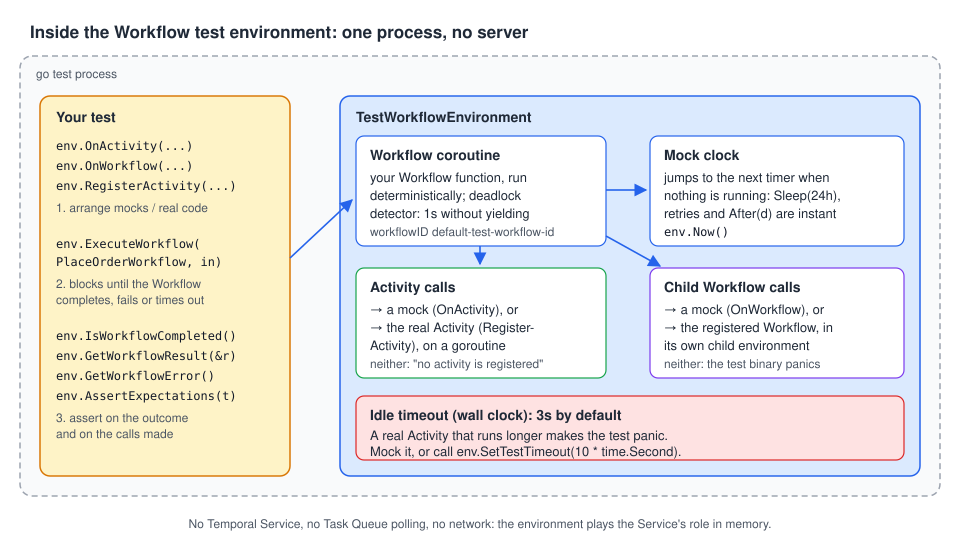

# 02 · The Workflow test environment

> **Level:** foundations · **Read time:** ~14 min
> **Sources:** [Go SDK — Test setup](https://docs.temporal.io/develop/go/best-practices/testing-suite#test-setup) · [Go SDK — Testing Workflows](https://docs.temporal.io/develop/go/best-practices/testing-suite#testing-workflows) · [`testsuite.TestWorkflowEnvironment`](https://pkg.go.dev/go.temporal.io/sdk/testsuite#TestWorkflowEnvironment)

---

## 1. The problem

[Chapter 01](01-testing-strategy.md) ran a first test. Now the order service has a dozen of them, and
they need a structure: a fresh environment for each test, a check that every mock was used, real
Activities wired to fakes for some tests, mocks for others, and clear assertions on results and
errors. You also need to know what the environment does with time, with IDs and with a test that
hangs, because those are where its behavior surprises people.

---

## 2. How the environment works



`testsuite.TestWorkflowEnvironment` runs your Workflow **inside the test process**. There is no
Temporal Service:

| Piece | What it does |
| --- | --- |
| **Workflow coroutine** | Runs your Workflow function with the same deterministic scheduler a Worker uses, including the deadlock detector (1 second without yielding) |
| **Mock clock** | `workflow.Now`, timers and retry delays use it. When nothing is running, it **jumps** to the next timer: a 72-hour timer takes milliseconds |
| **Activity calls** | Go to a mock (`OnActivity`) or to a real Activity you registered (`RegisterActivity`) |
| **Child Workflow calls** | Go to a mock (`OnWorkflow`) or to a registered Workflow |
| **Idle timeout** | A **wall-clock** guard, 3 seconds by default, against a test that waits forever |

`ExecuteWorkflow` **blocks** until the Workflow completes, fails or times out. Afterwards you read the
outcome from the environment.

---

## 3. The testify suite

The docs build tests on [testify](https://pkg.go.dev/github.com/stretchr/testify/suite)'s `suite`
package. The suite struct embeds two things:

- `suite.Suite`, testify's suite (assertions like `s.NoError`, `s.Equal`, and the setup hooks);
- `testsuite.WorkflowTestSuite`, the Temporal test suite, which provides
  `NewTestWorkflowEnvironment()` and `NewTestActivityEnvironment()`.

The example module from chapter 01 gets a few changes: `ChargePayment` turns a declined card into a
**non-retryable** `ApplicationError`, and a `fakes` package stands in for the external systems.

```go
// file: orders/activities.go
package orders

import (
	"context"
	"errors"

	"go.temporal.io/sdk/temporal"
)

type Inventory interface {
	Reserve(ctx context.Context, sku string, qty int) error
}

type PaymentGateway interface {
	Charge(ctx context.Context, customerID string, amountCents int64) (paymentID string, err error)
}

type Carrier interface {
	CreateShipment(ctx context.Context, orderID string) (trackingNumber string, err error)
}

// ErrCardDeclined is returned by a PaymentGateway when the bank says no.
var ErrCardDeclined = errors.New("card declined")

type Activities struct {
	Inventory Inventory
	Payments  PaymentGateway
	Carrier   Carrier
}

func (a *Activities) ReserveInventory(ctx context.Context, sku string, qty int) error {
	return a.Inventory.Reserve(ctx, sku, qty)
}

func (a *Activities) ChargePayment(ctx context.Context, customerID string, amountCents int64) (string, error) {
	id, err := a.Payments.Charge(ctx, customerID, amountCents)
	if errors.Is(err, ErrCardDeclined) {
		// Retrying won't help: tell Temporal not to.
		return "", temporal.NewNonRetryableApplicationError("card declined", "PaymentDeclined", err)
	}
	return id, err
}

func (a *Activities) CreateShipment(ctx context.Context, orderID string) (string, error) {
	return a.Carrier.CreateShipment(ctx, orderID)
}
```

`orders/workflow.go` is the same `PlaceOrderWorkflow` as in chapter 01.

```go
// file: internal/fakes/fakes.go
package fakes

import (
	"context"
	"time"
)

// Inventory always has stock.
type Inventory struct{}

func (Inventory) Reserve(ctx context.Context, sku string, qty int) error { return nil }

// Payments approves every charge, unless Decline is set.
type Payments struct{ Decline error }

func (p Payments) Charge(ctx context.Context, customerID string, amountCents int64) (string, error) {
	if p.Decline != nil {
		return "", p.Decline
	}
	return "pay_fake_1", nil
}

// Carrier answers after Delay, like a slow carrier API.
type Carrier struct{ Delay time.Duration }

func (c Carrier) CreateShipment(ctx context.Context, orderID string) (string, error) {
	select {
	case <-time.After(c.Delay):
		return "TRACK-" + orderID, nil
	case <-ctx.Done():
		return "", ctx.Err()
	}
}
```

The suite:

```go
// file: orders/suite_test.go
package orders_test

import (
	"errors"
	"testing"

	"github.com/stretchr/testify/mock"
	"github.com/stretchr/testify/suite"
	"go.temporal.io/sdk/temporal"
	"go.temporal.io/sdk/testsuite"

	"github.com/acme/shop/internal/fakes"
	"github.com/acme/shop/orders"
)

type PlaceOrderSuite struct {
	suite.Suite
	testsuite.WorkflowTestSuite

	env *testsuite.TestWorkflowEnvironment
}

// SetupTest runs before each test: every test gets a fresh, isolated environment.
func (s *PlaceOrderSuite) SetupTest() {
	s.env = s.NewTestWorkflowEnvironment()
	// Real Activities, wired to in-memory fakes, for tests that don't mock them.
	s.env.RegisterActivity(&orders.Activities{
		Inventory: fakes.Inventory{},
		Payments:  fakes.Payments{},
		Carrier:   fakes.Carrier{},
	})
}

// AfterTest runs after each test: fail if a mock was set up but never called.
func (s *PlaceOrderSuite) AfterTest(suiteName, testName string) {
	s.env.AssertExpectations(s.T())
}

func (s *PlaceOrderSuite) Test_CompletesWithRealActivities() {
	s.env.ExecuteWorkflow(orders.PlaceOrderWorkflow, orders.PlaceOrderInput{
		OrderID: "ord_1001", CustomerID: "cus_42", SKU: "SKU-RED-MUG", Quantity: 2, AmountCents: 2400,
	})

	s.True(s.env.IsWorkflowCompleted())
	s.NoError(s.env.GetWorkflowError())

	var res orders.PlaceOrderResult
	s.NoError(s.env.GetWorkflowResult(&res))
	s.Equal("pay_fake_1", res.PaymentID)
	s.Equal("TRACK-ord_1001", res.TrackingNumber)
}

func (s *PlaceOrderSuite) Test_FailsWhenCardDeclined() {
	var a *orders.Activities
	s.env.OnActivity(a.ChargePayment, mock.Anything, "cus_42", int64(2400)).
		Return("", temporal.NewNonRetryableApplicationError("card declined", "PaymentDeclined", nil))

	s.env.ExecuteWorkflow(orders.PlaceOrderWorkflow, orders.PlaceOrderInput{
		OrderID: "ord_1002", CustomerID: "cus_42", SKU: "SKU-RED-MUG", Quantity: 2, AmountCents: 2400,
	})

	s.True(s.env.IsWorkflowCompleted())
	err := s.env.GetWorkflowError()
	s.Error(err)

	var appErr *temporal.ApplicationError
	s.True(errors.As(err, &appErr))
	s.Equal("PaymentDeclined", appErr.Type())
	s.True(appErr.NonRetryable())
}

func TestPlaceOrderSuite(t *testing.T) {
	suite.Run(t, new(PlaceOrderSuite))
}
```

| Piece | Why |
| --- | --- |
| `SetupTest` | testify calls it before **each** test. A new environment per test means no state leaks between tests (mocks, mock clock, results) |
| `RegisterActivity(&orders.Activities{…})` | Registers the real Activities with fakes inside. A test that mocks an Activity overrides it; the others run the real code |
| `AfterTest` + `AssertExpectations` | Fails the test if a mock was set up but never called |
| `suite.Run` | The only function `go test` sees; it runs every `Test_…` method |

In `Test_FailsWhenCardDeclined`, only `ChargePayment` is mocked. `ReserveInventory` runs for real
(against the fake inventory), and `CreateShipment` is never reached.

```text
$ go test -v -run TestPlaceOrderSuite ./orders
=== RUN   TestPlaceOrderSuite
=== RUN   TestPlaceOrderSuite/Test_CompletesWithRealActivities
=== RUN   TestPlaceOrderSuite/Test_FailsWhenCardDeclined
2026/10/25 23:06:05 ERROR Activity error. WorkflowID default-test-workflow-id RunID default-test-run-id ActivityType ChargePayment Attempt 1 Error card declined (type: PaymentDeclined, retryable: false)
--- PASS: TestPlaceOrderSuite (0.00s)
    --- PASS: TestPlaceOrderSuite/Test_CompletesWithRealActivities (0.00s)
    --- PASS: TestPlaceOrderSuite/Test_FailsWhenCardDeclined (0.00s)
PASS
```

(`DEBUG` lines removed.) The `ERROR Activity error` log line is expected: the environment logs
Activity failures the way a Worker would.

---

## 4. Without testify's suite

The suite is a convenience, not a requirement. With plain `testing`, create one environment per
test function from a `testsuite.WorkflowTestSuite` value:

```go
// file: orders/plain_test.go
package orders_test

import (
	"errors"
	"testing"

	"go.temporal.io/sdk/temporal"
	"go.temporal.io/sdk/testsuite"

	"github.com/acme/shop/internal/fakes"
	"github.com/acme/shop/orders"
)

// The same kind of test without testify's suite: one environment per test function.
func TestPlaceOrderWorkflow_RealDeclineError(t *testing.T) {
	var ts testsuite.WorkflowTestSuite
	env := ts.NewTestWorkflowEnvironment()
	env.RegisterActivity(&orders.Activities{
		Inventory: fakes.Inventory{},
		Payments:  fakes.Payments{Decline: orders.ErrCardDeclined},
		Carrier:   fakes.Carrier{},
	})

	env.ExecuteWorkflow(orders.PlaceOrderWorkflow, orders.PlaceOrderInput{
		OrderID: "ord_1003", CustomerID: "cus_7", SKU: "SKU-TEAPOT", Quantity: 1, AmountCents: 3900,
	})

	if !env.IsWorkflowCompleted() {
		t.Fatal("workflow did not complete")
	}
	var appErr *temporal.ApplicationError
	if err := env.GetWorkflowError(); !errors.As(err, &appErr) || appErr.Type() != "PaymentDeclined" {
		t.Fatalf("want a PaymentDeclined ApplicationError, got %v", err)
	}
	t.Logf("workflow error: %v", env.GetWorkflowError())
}
```

This one runs the **real** `ChargePayment`: the fake gateway returns `ErrCardDeclined`, and the
Activity converts it. The error you get back is a chain, and `errors.As` finds the
`*temporal.ApplicationError` at its end:

```text
plain_test.go:36: workflow error: workflow execution error (type: PlaceOrderWorkflow, workflowID: default-test-workflow-id, runID: default-test-run-id): activity error (type: ChargePayment, scheduledEventID: 0, startedEventID: 0, identity: ): card declined (type: PaymentDeclined, retryable: false): card declined
```

Never compare the error string. Use `errors.As` and check `Type()`, as in production code (see the
[Error handling guide](../../error-handling/docs/README.md)).

---

## 5. Reading the outcome

| Method | Returns | Notes |
| --- | --- | --- |
| `IsWorkflowCompleted()` | `true` once the Workflow has finished, successfully or not | A failed Workflow is "completed" too |
| `GetWorkflowError()` | `nil`, or the Workflow's error | Wraps Activity and Child Workflow errors: use `errors.As` |
| `GetWorkflowResult(&v)` | Decodes the result into `v`; returns the Workflow error if it failed | Goes through the data converter, like a real Client |
| `Now()` | The mock clock's current time | Compare before/after to see how much Workflow time passed |
| `AssertExpectations(t)` | `false` and a test error if a mock was never called | Put it in `AfterTest` |

Unless you set them, the Workflow runs with fixed identifiers: Workflow ID
`default-test-workflow-id`, Run ID `default-test-run-id`, Task Queue `default-test-taskqueue`. They
show up in error messages and logs.

---

## 6. Real Activities: register or mock, and mind the clock

The docs warn that unless an Activity is mocked or replaced, the test environment runs the **actual**
Activity code, "including any calls to outside services". Two more things happen in practice:

**Neither registered nor mocked.** The Workflow fails:

```go
// file: orders/notregistered_test.go
package orders_test

import (
	"testing"

	"github.com/stretchr/testify/require"
	"go.temporal.io/sdk/testsuite"

	"github.com/acme/shop/orders"
)

// A real Activity that is neither registered nor mocked fails the Workflow.
func TestPlaceOrder_ActivityNotRegistered(t *testing.T) {
	var ts testsuite.WorkflowTestSuite
	env := ts.NewTestWorkflowEnvironment()

	env.ExecuteWorkflow(orders.PlaceOrderWorkflow, mugOrder)

	require.ErrorContains(t, env.GetWorkflowError(), "no activity is registered for taskqueue 'default-test-taskqueue'")
}
```

**Slower than the idle timeout.** The mock clock can skip Workflow timers, but it can't speed up a
real Activity: a real Activity runs in real time. If nothing happens for **3 seconds of wall clock**,
the environment gives up, and it does so with a **panic**, not an error:

```text
panic: test timeout: 3s, workflow stack: coroutine root [blocked on chan-4.Receive]:
```

Mock the slow Activity, or raise the idle timeout with `SetTestTimeout`:

```go
// file: orders/options_test.go
package orders_test

import (
	"testing"
	"time"

	"github.com/stretchr/testify/require"
	"go.temporal.io/sdk/client"
	"go.temporal.io/sdk/testsuite"

	"github.com/acme/shop/internal/fakes"
	"github.com/acme/shop/orders"
)

func newEnv(carrierDelay time.Duration) *testsuite.TestWorkflowEnvironment {
	var ts testsuite.WorkflowTestSuite
	env := ts.NewTestWorkflowEnvironment()
	env.RegisterActivity(&orders.Activities{
		Inventory: fakes.Inventory{},
		Payments:  fakes.Payments{},
		Carrier:   fakes.Carrier{Delay: carrierDelay},
	})
	return env
}

var mugOrder = orders.PlaceOrderInput{
	OrderID: "ord_1004", CustomerID: "cus_42", SKU: "SKU-RED-MUG", Quantity: 1, AmountCents: 1200,
}

// A real Activity slower than the 3s idle timeout makes the test panic.
func TestSlowRealActivity_DefaultTimeoutPanics(t *testing.T) {
	env := newEnv(4 * time.Second)
	require.Panics(t, func() { env.ExecuteWorkflow(orders.PlaceOrderWorkflow, mugOrder) })
}

// Raising the idle timeout lets the slow Activity finish.
func TestSlowRealActivity_WithSetTestTimeout(t *testing.T) {
	env := newEnv(4 * time.Second)
	env.SetTestTimeout(10 * time.Second)
	env.ExecuteWorkflow(orders.PlaceOrderWorkflow, mugOrder)
	require.NoError(t, env.GetWorkflowError())
}

// Start options: the test environment uses fixed IDs unless you set them.
func TestStartWorkflowOptions(t *testing.T) {
	env := newEnv(0)
	env.SetStartWorkflowOptions(client.StartWorkflowOptions{
		ID:        "order-ord_1004",
		TaskQueue: "orders",
	})
	env.ExecuteWorkflow(orders.PlaceOrderWorkflow, mugOrder)
	require.NoError(t, env.GetWorkflowError())
}
```

```text
--- PASS: TestSlowRealActivity_DefaultTimeoutPanics (3.04s)
--- PASS: TestSlowRealActivity_WithSetTestTimeout (4.00s)
--- PASS: TestStartWorkflowOptions (0.00s)
```

With `SetStartWorkflowOptions`, `workflow.GetInfo(ctx)` inside the Workflow reports
`order-ord_1004` and `orders` instead of the defaults. Use it when your Workflow builds IDs or
routes Activities from its own Workflow ID or Task Queue.

---

## 7. Two clocks: `SetTestTimeout` vs `SetWorkflowRunTimeout`

The environment has two timeouts, measured on **different clocks**:

| Setting | Clock | Default | What happens when it's reached |
| --- | --- | --- | --- |
| `SetTestTimeout(d)` | Wall clock, while the Workflow is idle | 3s | The test **panics** with `test timeout` |
| `SetWorkflowRunTimeout(d)` | Mock clock (`workflow.Now`) | 10 years | The Workflow fails with `deadline exceeded` |

A Workflow that waits for a bank transfer, with a 3-day reminder timer:

```go
// file: orders/confirm.go
package orders

import (
	"time"

	"go.temporal.io/sdk/workflow"
)

// AwaitBankTransferWorkflow waits for the bank to confirm a transfer, then sends a
// reminder if the customer hasn't paid within 3 days.
func AwaitBankTransferWorkflow(ctx workflow.Context, orderID string) (string, error) {
	var reference string
	confirmed := workflow.GetSignalChannel(ctx, "transfer-confirmed")

	timer := workflow.NewTimer(ctx, 72*time.Hour)
	sel := workflow.NewSelector(ctx)
	sel.AddReceive(confirmed, func(c workflow.ReceiveChannel, more bool) { c.Receive(ctx, &reference) })
	sel.AddFuture(timer, func(f workflow.Future) { reference = "expired" })
	sel.Select(ctx)
	return reference, nil
}

// WaitForWarehouseWorkflow blocks until the warehouse signals; it has no timer.
func WaitForWarehouseWorkflow(ctx workflow.Context, orderID string) (string, error) {
	var slot string
	workflow.GetSignalChannel(ctx, "slot-booked").Receive(ctx, &slot)
	return slot, nil
}
```

```go
// file: orders/clock_test.go
package orders_test

import (
	"testing"
	"time"

	"github.com/stretchr/testify/require"
	"go.temporal.io/sdk/testsuite"

	"github.com/acme/shop/orders"
)

// The 72h timer fires on the mock clock: the test takes milliseconds.
func TestAwaitBankTransfer_Expires(t *testing.T) {
	var ts testsuite.WorkflowTestSuite
	env := ts.NewTestWorkflowEnvironment()
	start := env.Now()

	env.ExecuteWorkflow(orders.AwaitBankTransferWorkflow, "ord_1005")

	var ref string
	require.NoError(t, env.GetWorkflowResult(&ref))
	require.Equal(t, "expired", ref)
	require.Equal(t, 72*time.Hour, env.Now().Sub(start))
}

// SetWorkflowRunTimeout is measured on the mock clock too.
func TestAwaitBankTransfer_RunTimeout(t *testing.T) {
	var ts testsuite.WorkflowTestSuite
	env := ts.NewTestWorkflowEnvironment()
	env.SetWorkflowRunTimeout(24 * time.Hour)

	env.ExecuteWorkflow(orders.AwaitBankTransferWorkflow, "ord_1005")

	require.ErrorContains(t, env.GetWorkflowError(), "deadline exceeded")
}

// Nobody sends the Signal: the mock clock jumps ahead and the Workflow times out at once.
func TestWaitForWarehouse_NoSignal(t *testing.T) {
	var ts testsuite.WorkflowTestSuite
	env := ts.NewTestWorkflowEnvironment()

	env.ExecuteWorkflow(orders.WaitForWarehouseWorkflow, "ord_1006")

	require.True(t, env.IsWorkflowCompleted())
	require.ErrorContains(t, env.GetWorkflowError(), "deadline exceeded (type: ScheduleToClose)")
	t.Log(env.GetWorkflowError())
}
```

The last test shows a trap. A Workflow waiting for a Signal that the test never sends doesn't hang:
nothing is running, so the mock clock jumps straight to the end of the run timeout, and the Workflow
fails **within a millisecond**:

```text
clock_test.go:48: workflow execution error (type: WaitForWarehouseWorkflow, workflowID: default-test-workflow-id, runID: default-test-run-id): deadline exceeded (type: ScheduleToClose)
```

If you see `deadline exceeded` in a test that should be waiting, you probably forgot to send a
Signal. Sending Signals, Queries and Updates at the right moment is the subject of chapter 05.

---

## 8. Key takeaways

- The Workflow test environment runs your Workflow in-process, with a mock clock and no server.
  `ExecuteWorkflow` blocks until the Workflow ends.
- With testify: embed `suite.Suite` and `testsuite.WorkflowTestSuite`, create the environment in
  `SetupTest`, call `AssertExpectations` in `AfterTest`, and start the suite with `suite.Run`.
- Read the outcome with `IsWorkflowCompleted`, `GetWorkflowResult` and `GetWorkflowError`, and
  check errors with `errors.As(err, &appErr)` and `appErr.Type()`.
- Unmocked Activities run for real, in real time. Unregistered ones fail the Workflow.
- `SetTestTimeout` (wall clock, 3s, panics) and `SetWorkflowRunTimeout` (mock clock, fails the
  Workflow) are different clocks. A forgotten Signal shows up as an instant `deadline exceeded`.
