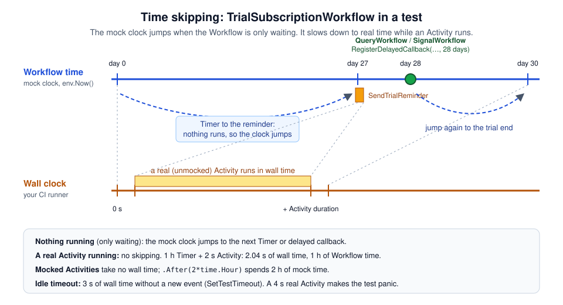

# 05 · Time, Signals, Queries and Updates

> **Level:** daily use · **Read time:** ~16 min
> **Sources:** [Go SDK: Query tests](https://docs.temporal.io/develop/go/best-practices/testing-suite#query-tests) · [Go SDK: Skip time](https://docs.temporal.io/develop/go/best-practices/testing-suite#skip-time) · [`testsuite.TestWorkflowEnvironment`](https://pkg.go.dev/go.temporal.io/sdk/testsuite#TestWorkflowEnvironment)

---

## 1. The problem

A free trial lasts 30 days. Three days before the end, the customer gets a reminder. If they upgrade,
they move to a paid plan; if not, they go back to the free plan. Support can extend a trial, and the
account page shows how many days are left.

That one Workflow mixes everything that is hard to test with a real Service:

- **Time:** nobody wants a test that takes 30 days.
- **Signals** that arrive in the middle of the run ("upgrade" on day 10).
- **Queries** whose answer depends on when you ask.
- **Updates** that can be accepted or rejected.

The Workflow test environment runs on a **mock clock** and lets you schedule Signals, Queries and Updates
at precise Workflow times. The 30-day trial runs in milliseconds.

---

## 2. The mock clock



The environment never sleeps for real. When the Workflow is only **waiting** (on a Timer, a Signal, an
Update), the mock clock jumps straight to the next event: the next Timer, the next delayed callback, or
the end of a mocked Activity's `.After()` delay.

The one exception is a **real (unmocked) Activity**. While it runs, the clock doesn't skip; it follows
the wall clock. Measured on SDK v1.50.0: a Workflow that started a real Activity taking 2 s and, in
parallel, a 1-hour `workflow.Sleep`, took **2.04 s** of wall time and saw exactly **1 h** of Workflow
time. The Timer waited for the Activity, then the clock jumped.

So:

- Mock Activities (`OnActivity`, [chapter 03](03-mocking-activities.md)) in time-heavy tests.
- Use `workflow.Sleep`, `workflow.NewTimer` and `workflow.Now` in Workflow code, never `time.Sleep` or
  `time.Now`. The mock clock only controls the Workflow APIs.
- The wall-clock idle limit of 3 s (`SetTestTimeout`) and the Workflow-time limit (`SetWorkflowRunTimeout`)
  are explained in [chapter 02](02-workflow-test-environment.md).

| You want to… | API |
| --- | --- |
| Fix the Workflow's start time | `env.SetStartTime(t)` (before `ExecuteWorkflow`) |
| Read the mock clock | `env.Now()` |
| Run code at a Workflow time | `env.RegisterDelayedCallback(fn, delay)` |
| Send a Signal | `env.SignalWorkflow(name, arg)` (inside a callback) |
| Signal-With-Start | `env.RegisterDelayedCallback(…, 0)` |
| Query | `env.QueryWorkflow(name, args…)` (inside a callback, or after `ExecuteWorkflow`) |
| Send an Update | `env.UpdateWorkflow(name, id, callbacks, args…)` |
| Spend mock time in a mocked Activity | `env.OnActivity(…).Return(…).After(d)` |

---

## 3. The Workflow under test

The Activities talk to the mailer and the billing system. The Workflow tests mock them all:

```go
// file: subscriptions/activities.go
package subscriptions

import (
	"context"
	"time"
)

// Mailer and Billing are external systems. Workflow tests mock the Activities instead.
type Mailer interface {
	Send(ctx context.Context, to, template string, data map[string]any) error
}

type Billing interface {
	StartPlan(ctx context.Context, customerID, plan string) error
	Downgrade(ctx context.Context, customerID string) error
}

type Activities struct {
	Mailer  Mailer
	Billing Billing
}

func (a *Activities) SendTrialReminder(ctx context.Context, email string, endsAt time.Time) error {
	return a.Mailer.Send(ctx, email, "trial-ending", map[string]any{"ends_at": endsAt})
}

func (a *Activities) StartPaidPlan(ctx context.Context, customerID, plan string) error {
	return a.Billing.StartPlan(ctx, customerID, plan)
}

func (a *Activities) DowngradeToFree(ctx context.Context, customerID string) error {
	return a.Billing.Downgrade(ctx, customerID)
}
```

The Workflow keeps its state in a `TrialStatus` that the Query returns. It waits with
`workflow.AwaitWithTimeout` until the next deadline (the reminder, then the end of the trial), or until a
Signal or an Update changes the state:

```go
// file: subscriptions/workflow.go
package subscriptions

import (
	"errors"
	"time"

	"go.temporal.io/sdk/workflow"
)

const (
	TrialLength    = 30 * 24 * time.Hour
	ReminderBefore = 3 * 24 * time.Hour

	StatusQuery   = "trial-status"
	UpgradeSignal = "upgrade"
	ExtendUpdate  = "extend-trial"
)

type TrialInput struct {
	CustomerID string
	Email      string
}

type Upgrade struct {
	Plan string
}

type TrialStatus struct {
	EndsAt        time.Time
	Plan          string // empty while on trial
	RemindersSent int
}

type TrialOutcome struct {
	Plan    string // "free" when the trial ran out
	EndedAt time.Time
}

// TrialSubscriptionWorkflow runs a 30-day free trial: a reminder 3 days before
// the end, then a paid plan (if the customer upgraded) or the free plan.
func TrialSubscriptionWorkflow(ctx workflow.Context, in TrialInput) (TrialOutcome, error) {
	ctx = workflow.WithActivityOptions(ctx, workflow.ActivityOptions{StartToCloseTimeout: time.Minute})
	var a *Activities
	st := TrialStatus{EndsAt: workflow.Now(ctx).Add(TrialLength)}

	if err := workflow.SetQueryHandler(ctx, StatusQuery, func() (TrialStatus, error) {
		return st, nil
	}); err != nil {
		return TrialOutcome{}, err
	}

	upgrades := workflow.GetSignalChannel(ctx, UpgradeSignal)
	workflow.Go(ctx, func(ctx workflow.Context) {
		var u Upgrade
		upgrades.Receive(ctx, &u)
		st.Plan = u.Plan
	})

	if err := workflow.SetUpdateHandlerWithOptions(ctx, ExtendUpdate,
		func(ctx workflow.Context, days int) (time.Time, error) {
			st.EndsAt = st.EndsAt.Add(time.Duration(days) * 24 * time.Hour)
			return st.EndsAt, nil
		},
		workflow.UpdateHandlerOptions{Validator: func(ctx workflow.Context, days int) error {
			if days < 1 || days > 14 {
				return errors.New("a trial can be extended by 1 to 14 days")
			}
			if st.Plan != "" {
				return errors.New("customer already upgraded")
			}
			return nil
		}},
	); err != nil {
		return TrialOutcome{}, err
	}

	reminded := false
	for st.Plan == "" && workflow.Now(ctx).Before(st.EndsAt) {
		endsAt := st.EndsAt
		remindAt := endsAt.Add(-ReminderBefore)
		wakeAt := endsAt
		if !reminded && workflow.Now(ctx).Before(remindAt) {
			wakeAt = remindAt
		}
		// Wake up at the next deadline, or as soon as the customer upgrades or extends.
		if _, err := workflow.AwaitWithTimeout(ctx, wakeAt.Sub(workflow.Now(ctx)), func() bool {
			return st.Plan != "" || !st.EndsAt.Equal(endsAt)
		}); err != nil {
			return TrialOutcome{}, err
		}
		if !reminded && st.Plan == "" && st.EndsAt.Equal(endsAt) && !workflow.Now(ctx).Before(remindAt) {
			if err := workflow.ExecuteActivity(ctx, a.SendTrialReminder, in.Email, st.EndsAt).Get(ctx, nil); err != nil {
				return TrialOutcome{}, err
			}
			reminded = true
			st.RemindersSent++
		}
	}

	if st.Plan != "" {
		err := workflow.ExecuteActivity(ctx, a.StartPaidPlan, in.CustomerID, st.Plan).Get(ctx, nil)
		return TrialOutcome{Plan: st.Plan, EndedAt: workflow.Now(ctx)}, err
	}
	err := workflow.ExecuteActivity(ctx, a.DowngradeToFree, in.CustomerID).Get(ctx, nil)
	return TrialOutcome{Plan: "free", EndedAt: workflow.Now(ctx)}, err
}
```

The suite fixes the start time with `SetStartTime`, so every date in the assertions is a constant.
`AfterTest` checks that every mock marked `.Once()` was called:

```go
// file: subscriptions/trial_suite_test.go
package subscriptions

import (
	"testing"
	"time"

	"github.com/stretchr/testify/suite"
	"go.temporal.io/sdk/testsuite"
)

var signupDay = time.Date(2026, time.March, 1, 9, 0, 0, 0, time.UTC)

const day = 24 * time.Hour

type TrialSuite struct {
	suite.Suite
	testsuite.WorkflowTestSuite

	env *testsuite.TestWorkflowEnvironment
	a   *Activities
	in  TrialInput
}

func (s *TrialSuite) SetupTest() {
	s.env = s.NewTestWorkflowEnvironment()
	s.env.SetStartTime(signupDay) // workflow.Now() starts here: dates are predictable
	s.a = &Activities{}
	s.env.RegisterActivity(s.a)
	s.in = TrialInput{CustomerID: "cus-1042", Email: "ada@example.com"}
}

func (s *TrialSuite) AfterTest(suiteName, testName string) {
	s.env.AssertExpectations(s.T())
}

func (s *TrialSuite) outcome() TrialOutcome {
	s.Require().True(s.env.IsWorkflowCompleted())
	s.Require().NoError(s.env.GetWorkflowError())
	var out TrialOutcome
	s.Require().NoError(s.env.GetWorkflowResult(&out))
	return out
}

func TestTrialSuite(t *testing.T) {
	suite.Run(t, new(TrialSuite))
}
```

---

## 4. Skipping 30 days

The simplest scenario: nobody upgrades. The reminder goes out on day 27, the downgrade on day 30.

```go
// file: subscriptions/trial_timers_test.go
package subscriptions

import (
	"time"

	"github.com/stretchr/testify/mock"
)

func (s *TrialSuite) Test_NoUpgrade_RemindsThenDowngrades() {
	ends := signupDay.Add(30 * day)
	s.env.OnActivity(s.a.SendTrialReminder, mock.Anything, "ada@example.com", ends).Return(nil).Once()
	s.env.OnActivity(s.a.DowngradeToFree, mock.Anything, "cus-1042").Return(nil).Once()

	start := time.Now()
	s.env.ExecuteWorkflow(TrialSubscriptionWorkflow, s.in)

	out := s.outcome()
	s.Equal("free", out.Plan)
	s.Equal(ends, out.EndedAt)
	// The mock clock moved 30 days. env.Now() is in local time: compare instants.
	s.True(ends.Equal(s.env.Now()))
	s.T().Logf("30 days of Workflow time took %s of wall time", time.Since(start).Round(time.Microsecond))
}
```

```text
$ go test -run 'TestTrialSuite/Test_NoUpgrade' -v ./subscriptions
    trial_timers_test.go:23: 30 days of Workflow time took 41.348ms of wall time
--- PASS: TestTrialSuite (0.04s)
```

Two details:

- The mock on `SendTrialReminder` pins the **exact** arguments, including `ends`. If someone breaks the
  date arithmetic, the mock doesn't match and the test fails.
- `env.Now()` returns the time in the **local** time zone, even though `SetStartTime` got a UTC time.
  `s.Equal(ends, s.env.Now())` fails on a machine that isn't in UTC (it failed on ours, in UTC+2:
  `time.Date(2026, time.March, 31, 11, 0, 0, 0, time.Local)`). Compare instants with `Equal`.

---

## 5. Signals in the middle of a run

`RegisterDelayedCallback(fn, d)` runs `fn` when the mock clock reaches start + `d`. Inside it, send the
Signal with `env.SignalWorkflow`:

```go
// file: subscriptions/trial_signals_test.go
package subscriptions

import (
	"time"

	"github.com/stretchr/testify/mock"
)

func (s *TrialSuite) Test_UpgradeOnDay10() {
	s.env.RegisterDelayedCallback(func() {
		s.env.SignalWorkflow(UpgradeSignal, Upgrade{Plan: "pro"})
	}, 10*day)
	// The billing system takes 2 hours: After() spends mock time, not wall time.
	s.env.OnActivity(s.a.StartPaidPlan, mock.Anything, "cus-1042", "pro").Return(nil).After(2 * time.Hour).Once()

	s.env.ExecuteWorkflow(TrialSubscriptionWorkflow, s.in)

	out := s.outcome()
	s.Equal("pro", out.Plan)
	s.Equal(signupDay.Add(10*day+2*time.Hour), out.EndedAt)
	s.env.AssertActivityNotCalled(s.T(), "SendTrialReminder", mock.Anything, mock.Anything, mock.Anything)
}

func (s *TrialSuite) Test_SignalWithStart() {
	// Upgrade sent together with the start (Signal-With-Start): delay 0.
	s.env.RegisterDelayedCallback(func() {
		s.env.SignalWorkflow(UpgradeSignal, Upgrade{Plan: "team"})
	}, 0)
	s.env.OnActivity(s.a.StartPaidPlan, mock.Anything, "cus-1042", "team").Return(nil).Once()

	s.env.ExecuteWorkflow(TrialSubscriptionWorkflow, s.in)

	out := s.outcome()
	s.Equal("team", out.Plan)
	s.Equal(signupDay, out.EndedAt)
}
```

`Test_UpgradeOnDay10` shows two things:

- The callback fires at **day 10 of Workflow time**, between the Workflow's own Timers.
- `.After(2 * time.Hour)` on the mock makes `StartPaidPlan` take 2 hours of Workflow time and no wall
  time. The outcome's `EndedAt` is day 10 + 2 h.

`AssertActivityNotCalled` checks that no reminder went out. It takes the Activity **name** and the
arguments (`mock.Anything` for each, context included).

`Test_SignalWithStart` registers the callback with a delay of **0**: the Signal is delivered before the
Workflow's first Timer, like a Signal-With-Start from a Client. The upgrade happens on day 0 and nothing
is mocked except `StartPaidPlan`.

---

## 6. Queries

`env.QueryWorkflow` runs the Query handler and returns a `converter.EncodedValue`. Call it **inside a
delayed callback** to see the state at a given time, or **after** `ExecuteWorkflow` to see the final
state:

```go
// file: subscriptions/trial_query_test.go
package subscriptions

import (
	"github.com/stretchr/testify/mock"
)

func (s *TrialSuite) Test_StatusQuery() {
	s.env.OnActivity(s.a.SendTrialReminder, mock.Anything, mock.Anything, mock.Anything).Return(nil)
	s.env.OnActivity(s.a.DowngradeToFree, mock.Anything, mock.Anything).Return(nil)

	// Day 28: the reminder (day 27) has gone out, the trial is still running.
	s.env.RegisterDelayedCallback(func() {
		val, err := s.env.QueryWorkflow(StatusQuery)
		s.Require().NoError(err)
		var st TrialStatus
		s.Require().NoError(val.Get(&st))
		s.Equal(1, st.RemindersSent)
		s.Equal("", st.Plan)
		s.Equal(signupDay.Add(30*day), st.EndsAt)
	}, 28*day)

	s.env.ExecuteWorkflow(TrialSubscriptionWorkflow, s.in)
	s.outcome()

	// A completed Workflow can still be queried.
	val, err := s.env.QueryWorkflow(StatusQuery)
	s.Require().NoError(err)
	var st TrialStatus
	s.Require().NoError(val.Get(&st))
	s.Equal(1, st.RemindersSent)
}
```

Calling `QueryWorkflow` **before** `ExecuteWorkflow` doesn't return an error: it panics with
`runtime error: invalid memory address or nil pointer dereference`, as the Go SDK page warns. The
Workflow doesn't exist yet. Put the Query in a callback instead.

---

## 7. Updates

`env.UpdateWorkflow(name, updateID, callbacks, args…)` sends an Update. The callbacks receive the
outcome:

| Callback | Called when |
| --- | --- |
| `OnAccept()` | The validator passed |
| `OnReject(err)` | The validator returned an error (the handler doesn't run) |
| `OnComplete(result, err)` | The handler returned |

`testsuite.TestUpdateCallback` is a ready-made struct with these three fields. An empty `updateID` gets
a generated UUID.

```go
// file: subscriptions/trial_update_test.go
package subscriptions

import (
	"github.com/stretchr/testify/mock"
	"go.temporal.io/sdk/testsuite"
)

func (s *TrialSuite) Test_ExtendTrial() {
	newEnd := signupDay.Add(37 * day)
	s.env.OnActivity(s.a.SendTrialReminder, mock.Anything, "ada@example.com", newEnd).Return(nil).Once()
	s.env.OnActivity(s.a.DowngradeToFree, mock.Anything, "cus-1042").Return(nil).Once()

	s.env.RegisterDelayedCallback(func() {
		s.env.UpdateWorkflow(ExtendUpdate, "support-ticket-881", &testsuite.TestUpdateCallback{
			OnAccept: func() {},
			OnReject: func(err error) { s.Fail("update rejected", err.Error()) },
			OnComplete: func(result any, err error) {
				s.NoError(err)
				s.Equal(newEnd, result)
			},
		}, 7)
	}, 5*day)

	s.env.ExecuteWorkflow(TrialSubscriptionWorkflow, s.in)

	s.Equal(newEnd, s.outcome().EndedAt)
}

func (s *TrialSuite) Test_ExtendTrial_RejectedWhenTooLong() {
	s.env.OnActivity(s.a.SendTrialReminder, mock.Anything, mock.Anything, mock.Anything).Return(nil)
	s.env.OnActivity(s.a.DowngradeToFree, mock.Anything, mock.Anything).Return(nil)

	var rejected error
	s.env.RegisterDelayedCallback(func() {
		s.env.UpdateWorkflow(ExtendUpdate, "", &testsuite.TestUpdateCallback{
			OnAccept:   func() { s.Fail("update should be rejected") },
			OnReject:   func(err error) { rejected = err },
			OnComplete: func(any, error) {},
		}, 30)
	}, 5*day)

	s.env.ExecuteWorkflow(TrialSubscriptionWorkflow, s.in)

	s.Equal(signupDay.Add(30*day), s.outcome().EndedAt)
	s.ErrorContains(rejected, "1 to 14 days")
}
```

- In `Test_ExtendTrial`, support extends the trial by 7 days on day 5. The reminder mock expects the
  **new** end date (day 37), so the test also proves the Workflow recomputed its Timers.
- In `Test_ExtendTrial_RejectedWhenTooLong`, the validator rejects 30 days; the trial still ends on
  day 30.
- In `OnComplete`, `result` is the handler's return value as is (here a `time.Time`), not an encoded
  payload.
- When you only care that an Update is accepted, `env.UpdateWorkflowNoRejection(name, id, t, args…)`
  fails the test on rejection. It isn't on the Go SDK page.

---

## 8. A safety net on Workflow time

By default, the Workflow run timeout of the environment is **10 years** of mock time. A Workflow that
waits for a Signal nobody sends doesn't hang: the clock skips 10 years and the Workflow fails with
`deadline exceeded (type: ScheduleToClose)` ([chapter 02](02-workflow-test-environment.md)).

`SetWorkflowRunTimeout` makes that limit match your business rule. A trial must be over within 20 days
of Workflow time in this deliberately wrong test, so it fails the same way:

```go
// file: subscriptions/trial_timeout_test.go
package subscriptions

import (
	"errors"

	"github.com/stretchr/testify/mock"
	"go.temporal.io/sdk/temporal"
)

func (s *TrialSuite) Test_RunTimeoutCatchesARunawayTrial() {
	s.env.OnActivity(s.a.SendTrialReminder, mock.Anything, mock.Anything, mock.Anything).Return(nil).Maybe()
	s.env.OnActivity(s.a.DowngradeToFree, mock.Anything, mock.Anything).Return(nil).Maybe()
	s.env.SetWorkflowRunTimeout(20 * day) // Workflow time, not wall time

	s.env.ExecuteWorkflow(TrialSubscriptionWorkflow, s.in)

	s.Require().True(s.env.IsWorkflowCompleted())
	err := s.env.GetWorkflowError()
	var timeoutErr *temporal.TimeoutError
	s.Require().True(errors.As(err, &timeoutErr), "got %v", err)
	s.T().Log(err)
}
```

```text
    trial_timeout_test.go:22: workflow execution error (type: TrialSubscriptionWorkflow, workflowID: default-test-workflow-id, runID: default-test-run-id): deadline exceeded (type: ScheduleToClose)
```

The error is a `*temporal.TimeoutError` with type `ScheduleToClose`, even though it is the
Workflow's **run** timeout. Use `.Maybe()` on mocks that the run may or may not reach, or `AfterTest`
fails on the uncalled ones.

---

## 9. Key takeaways

- The mock clock jumps whenever the Workflow is only waiting. A 30-day trial runs in milliseconds. A **real** Activity stops the jump: mock Activities in time-heavy tests.
- `SetStartTime` makes dates predictable. `env.Now()` is in local time: compare with `Equal`.
- `RegisterDelayedCallback(fn, d)` is how you act at a Workflow time: Signals, Queries, Updates. Delay
  `0` simulates Signal-With-Start.
- Query inside a callback or after `ExecuteWorkflow`, never before (it panics).
- `UpdateWorkflow` with `testsuite.TestUpdateCallback` tests both the validator and the handler.
- `.After(d)` on a mock spends Workflow time, not wall time.
- `SetWorkflowRunTimeout` turns "the Workflow should be done by now" into a failing test.
