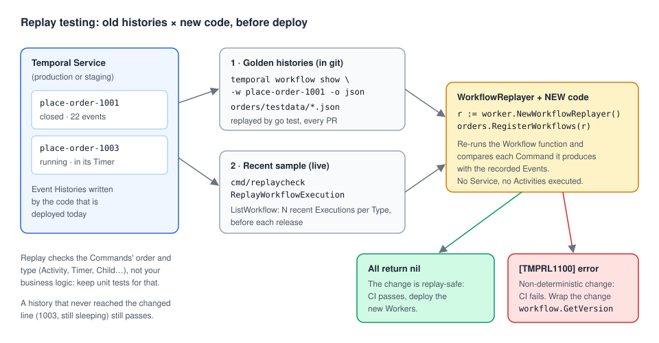

# 07 · Replay testing

> **Level:** advanced · **Read time:** ~15 min
> **Sources:** [Go SDK — Replay a Workflow Execution](https://docs.temporal.io/develop/go/best-practices/testing-suite#replay) · [Go SDK — Debugging](https://docs.temporal.io/develop/go/best-practices/debugging) · [`worker.WorkflowReplayer`](https://pkg.go.dev/go.temporal.io/sdk/worker#WorkflowReplayer)

---

## 1. The problem

The fraud team wants every order screened before the card is charged. The change is three lines in
`PlaceOrderWorkflow`, and every unit test from [chapter 02](02-workflow-test-environment.md) and
[chapter 03](03-mocking-activities.md) stays green: they all start **new** Executions.

But thousands of orders are already running, recorded with the old code. When a new Worker picks one
up, it **replays** the Event History through the new code ([Workflows guide, chapter 03](../../workflows/docs/03-determinism-and-replay.md)).
If the new code produces different Commands than the ones recorded, the Workflow Task fails with a
non-determinism error and the order is stuck until you roll back or patch.

Unit tests can't catch this. **Replay tests** can: they run real recorded histories through the new
code, in `go test` or in CI, before anything is deployed.

---

## 2. How replay testing works



A `worker.WorkflowReplayer` is a Worker without a Service. You register your Workflow functions on it
and hand it an Event History. It re-runs the Workflow function and checks each Command against the
recorded Events, exactly as a real Worker would after a cache eviction:

| Replay result | Meaning |
| --- | --- |
| `nil` | The current code produces the same Commands as the code that wrote the history |
| `[TMPRL1100] nondeterministic workflow: …` | A Command doesn't match an Event (different Activity, missing Timer, extra Command…) |
| `unable to find workflow type: …` | Nothing is registered under the Workflow Type name stored in the history |

Activities are **not** executed: their results come from the history. Replay checks the order and type
of Commands, not your business logic; keep the unit tests for that.

The Go SDK docs recommend this CI recipe:

1. Determine which Workflow Types or Task Queues the Worker code under test serves.
2. Download the Event Histories of a representative set of recent open and closed Workflows.
3. Run them through replay.
4. Fail CI if any replay returns an error.

This chapter builds both halves: golden histories committed to git (section 4) and a tool that samples
live histories before a release (section 6).

---

## 3. The Workflow under test, registered once

The replayer must register each function under the **same Workflow Type name** as the history. If the
Worker uses `RegisterWorkflowWithOptions` with a custom name and the replayer uses `RegisterWorkflow`,
replay fails before it starts:

```text
unable to find workflow type: PlaceOrder. Supported types: [PlaceOrderWorkflow]
```

So put the registration in one function that both the Worker and the replayer call. `worker.Worker` and
`worker.WorkflowReplayer` both have `RegisterWorkflowWithOptions`, so one small interface covers both:

```go
// file: orders/workflow.go
package orders

import (
	"time"

	"go.temporal.io/sdk/workflow"
)

// PlaceOrderWorkflowType is the Workflow Type name stored in every Event History.
// Worker and replayer must both register the function under this name.
const PlaceOrderWorkflowType = "PlaceOrder"

// WorkflowRegistry is implemented by worker.Worker and worker.WorkflowReplayer.
type WorkflowRegistry interface {
	RegisterWorkflowWithOptions(w any, options workflow.RegisterOptions)
}

// RegisterWorkflows is the single place that names our Workflow Types.
func RegisterWorkflows(r WorkflowRegistry) {
	r.RegisterWorkflowWithOptions(PlaceOrderWorkflow, workflow.RegisterOptions{Name: PlaceOrderWorkflowType})
}

type PlaceOrderInput struct {
	OrderID     string
	CustomerID  string
	AmountCents int64
	SKUs        []string
	// CancelWindow is how long the customer can still cancel before we charge.
	CancelWindow time.Duration
}

type PlaceOrderResult struct {
	ReservationID string
	PaymentID     string
}

func PlaceOrderWorkflow(ctx workflow.Context, in PlaceOrderInput) (PlaceOrderResult, error) {
	ctx = workflow.WithActivityOptions(ctx, workflow.ActivityOptions{StartToCloseTimeout: 30 * time.Second})
	var a *Activities
	var res PlaceOrderResult

	if err := workflow.ExecuteActivity(ctx, a.ReserveInventory, in.OrderID, in.SKUs).Get(ctx, &res.ReservationID); err != nil {
		return res, err
	}
	if err := workflow.Sleep(ctx, in.CancelWindow); err != nil {
		return res, err
	}
	if err := workflow.ExecuteActivity(ctx, a.ChargePayment, in.CustomerID, in.AmountCents).Get(ctx, &res.PaymentID); err != nil {
		return res, err
	}
	workflow.GetLogger(ctx).Info("Order placed", "OrderID", in.OrderID, "PaymentID", res.PaymentID)
	return res, nil
}
```

```go
// file: orders/activities.go
package orders

import "context"

type InventoryService interface {
	Reserve(ctx context.Context, orderID string, skus []string) (reservationID string, err error)
}

type PaymentGateway interface {
	Charge(ctx context.Context, customerID string, amountCents int64) (paymentID string, err error)
}

type Activities struct {
	Inventory InventoryService
	Payments  PaymentGateway
}

func (a *Activities) ReserveInventory(ctx context.Context, orderID string, skus []string) (string, error) {
	return a.Inventory.Reserve(ctx, orderID, skus)
}

func (a *Activities) ChargePayment(ctx context.Context, customerID string, amountCents int64) (string, error) {
	return a.Payments.Charge(ctx, customerID, amountCents)
}
```

```go
// file: cmd/worker/main.go
package main

import (
	"context"
	"fmt"
	"log"
	"os"

	"go.temporal.io/sdk/client"
	"go.temporal.io/sdk/worker"

	"github.com/acme/shop/orders"
)

type fakeInventory struct{}

func (fakeInventory) Reserve(_ context.Context, orderID string, _ []string) (string, error) {
	return "rsv-" + orderID, nil
}

type fakeGateway struct{}

func (fakeGateway) Charge(_ context.Context, customerID string, _ int64) (string, error) {
	return fmt.Sprintf("pay-%s", customerID), nil
}

func main() {
	c, err := client.Dial(client.Options{HostPort: os.Getenv("TEMPORAL_ADDRESS")}) // empty: localhost:7233
	if err != nil {
		log.Fatalln("dial:", err)
	}
	defer c.Close()

	w := worker.New(c, "orders", worker.Options{})
	orders.RegisterWorkflows(w) // registers "PlaceOrder", exactly like the replayer
	w.RegisterActivity(&orders.Activities{Inventory: fakeInventory{}, Payments: fakeGateway{}})
	if err := w.Run(worker.InterruptCh()); err != nil {
		log.Fatalln("worker:", err)
	}
}
```

---

## 4. Golden histories in `testdata/`

Export a few real histories (one per important code path) with the CLI and commit them:

```text
$ temporal workflow show -w place-order-1001 -o json > orders/testdata/place-order-1001.json
$ temporal workflow show -w place-order-1002 -o json > orders/testdata/place-order-1002.json
```

The JSON has one `events` array: 22 Events for this Workflow (start, Activity, Timer, Activity, completion).

Then replay every file in a normal test. Pass a logger that discards output: with `nil`, the replayer
does **not** stay quiet (the godoc says "Defaults to the noop logger", but the code uses the SDK's
default logger), and every mismatch prints an `ERROR Workflow panic …` line with a stack trace on top
of the error it returns.

```go
// file: internal/replaylog/replaylog.go
package replaylog

import (
	"io"
	"log/slog"

	"go.temporal.io/sdk/log"
)

// Discard returns a logger that drops everything.
// Passing nil to the replayer does NOT do that: it falls back to the SDK's default
// logger, which prints a "Workflow panic" ERROR with a stack trace on every mismatch.
func Discard() log.Logger {
	return log.NewStructuredLogger(slog.New(slog.NewTextHandler(io.Discard, nil)))
}
```

```go
// file: orders/replay_test.go
package orders_test

import (
	"path/filepath"
	"testing"

	"go.temporal.io/sdk/worker"

	"github.com/acme/shop/internal/replaylog"
	"github.com/acme/shop/orders"
)

// TestReplayRecordedHistories replays every history exported to testdata/
// against the current code. A non-deterministic change fails here, in CI,
// instead of in production.
func TestReplayRecordedHistories(t *testing.T) {
	files, err := filepath.Glob(filepath.Join("testdata", "place-order-*.json"))
	if err != nil {
		t.Fatal(err)
	}
	if len(files) == 0 {
		t.Fatal("no histories in testdata/: export some with `temporal workflow show -o json`")
	}

	replayer := worker.NewWorkflowReplayer()
	orders.RegisterWorkflows(replayer) // same names as the production Worker

	for _, f := range files {
		t.Run(filepath.Base(f), func(t *testing.T) {
			if err := replayer.ReplayWorkflowHistoryFromJSONFile(replaylog.Discard(), f); err != nil {
				t.Fatalf("%s no longer replays with the current code: %v", f, err)
			}
		})
	}
}
```

```text
$ go test -v ./orders
=== RUN   TestReplayRecordedHistories
=== RUN   TestReplayRecordedHistories/place-order-1001.json
=== RUN   TestReplayRecordedHistories/place-order-1002.json
--- PASS: TestReplayRecordedHistories (0.05s)
    --- PASS: TestReplayRecordedHistories/place-order-1001.json (0.04s)
    --- PASS: TestReplayRecordedHistories/place-order-1002.json (0.00s)
PASS
```

One replayer can replay many histories: register every Workflow Type once, then call
`ReplayWorkflowHistoryFromJSONFile` in a loop.

---

## 5. Catching the breaking change

Here is the fraud-screening change, written the naive way:

```diff
 	if err := workflow.Sleep(ctx, in.CancelWindow); err != nil {
 		return res, err
 	}
+	if err := workflow.ExecuteActivity(ctx, a.ScreenForFraud, in.CustomerID, in.AmountCents).Get(ctx, nil); err != nil {
+		return res, err
+	}
 	if err := workflow.ExecuteActivity(ctx, a.ChargePayment, in.CustomerID, in.AmountCents).Get(ctx, &res.PaymentID); err != nil {
```

The replay test fails on both golden histories (output trimmed):

```text
$ go test ./orders
--- FAIL: TestReplayRecordedHistories (0.04s)
    --- FAIL: TestReplayRecordedHistories/place-order-1001.json (0.04s)
        replay_test.go:32: testdata/place-order-1001.json no longer replays with the current code:
        [TMPRL1100] nondeterministic workflow: history event is ActivityTaskScheduled: (ActivityId:16,
        ActivityType:(Name:ChargePayment), …), replay command is ScheduleActivityTask: (ActivityId:16,
        ActivityType:(Name:ScreenForFraud), …)
    --- FAIL: TestReplayRecordedHistories/place-order-1002.json (0.00s)
        …
FAIL
```

The message says exactly what went wrong: the history has `ChargePayment` at that point, the new code
asks for `ScreenForFraud`. The fix is to **version** the change so old Executions keep the old path
([Workflows guide, chapter 11](../../workflows/docs/11-versioning.md#_4-patching-with-workflow-getversion)):

```diff
-	if err := workflow.ExecuteActivity(ctx, a.ScreenForFraud, in.CustomerID, in.AmountCents).Get(ctx, nil); err != nil {
-		return res, err
+	if v := workflow.GetVersion(ctx, "fraud-screening", workflow.DefaultVersion, 1); v == 1 {
+		if err := workflow.ExecuteActivity(ctx, a.ScreenForFraud, in.CustomerID, in.AmountCents).Get(ctx, nil); err != nil {
+			return res, err
+		}
 	}
```

With `GetVersion`, both golden histories replay cleanly again.

---

## 6. Replaying live histories before a release

Golden files only cover the paths you thought of. Before a release, also replay a **sample of recent
Executions** straight from the Service. `ReplayWorkflowExecution` downloads the history for you; to
replay one Execution you already fetched (to save it, or to inspect it), use `GetWorkflowHistory` and
`ReplayWorkflowHistory`, as the Go docs show:

```go
// file: internal/histories/fetch.go
package histories

import (
	"context"

	"go.temporal.io/api/enums/v1"
	"go.temporal.io/api/history/v1"
	"go.temporal.io/sdk/client"
)

// Fetch downloads the full Event History of one Workflow Execution.
// An empty runID means the latest run.
func Fetch(ctx context.Context, c client.Client, workflowID, runID string) (*history.History, error) {
	var h history.History
	iter := c.GetWorkflowHistory(ctx, workflowID, runID, false, enums.HISTORY_EVENT_FILTER_TYPE_ALL_EVENT)
	for iter.HasNext() {
		event, err := iter.Next()
		if err != nil {
			return nil, err
		}
		h.Events = append(h.Events, event)
	}
	return &h, nil
}
```

```go
// file: cmd/replayone/main.go
package main

import (
	"context"
	"flag"
	"log"
	"os"

	"go.temporal.io/sdk/client"
	"go.temporal.io/sdk/worker"

	"github.com/acme/shop/internal/histories"
	"github.com/acme/shop/internal/replaylog"
	"github.com/acme/shop/orders"
)

// replayone replays a single Execution: handy when a ticket names one order.
func main() {
	workflowID := flag.String("workflow-id", "", "Workflow ID to replay")
	runID := flag.String("run-id", "", "Run ID (empty: latest run)")
	flag.Parse()

	c, err := client.Dial(client.Options{HostPort: os.Getenv("TEMPORAL_ADDRESS")})
	if err != nil {
		log.Fatalln("dial:", err)
	}
	defer c.Close()

	h, err := histories.Fetch(context.Background(), c, *workflowID, *runID)
	if err != nil {
		log.Fatalln("fetch history:", err)
	}
	replayer := worker.NewWorkflowReplayer()
	orders.RegisterWorkflows(replayer)
	if err := replayer.ReplayWorkflowHistory(replaylog.Discard(), h); err != nil {
		log.Fatalf("%s does not replay: %v", *workflowID, err)
	}
	log.Printf("%s replays cleanly (%d events)", *workflowID, len(h.Events))
}
```

```text
$ TEMPORAL_ADDRESS=127.0.0.1:7255 go run ./cmd/replayone -workflow-id place-order-1001
2026/10/25 23:05:27 place-order-1001 replays cleanly (22 events)
```

`cmd/replaycheck` does the CI recipe from section 2: it lists recent Executions of each Workflow Type
with a Visibility query, replays them all, and exits with status 1 on any failure:

```go
// file: cmd/replaycheck/main.go
package main

import (
	"context"
	"flag"
	"fmt"
	"log"
	"os"
	"time"

	"go.temporal.io/api/workflowservice/v1"
	"go.temporal.io/sdk/client"
	"go.temporal.io/sdk/worker"
	"go.temporal.io/sdk/workflow"

	"github.com/acme/shop/internal/replaylog"
	"github.com/acme/shop/orders"
)

// replaycheck downloads recent Executions of each Workflow Type from a real
// Namespace and replays them against the code being built. CI fails on any error.
func main() {
	address := flag.String("address", "localhost:7233", "Temporal frontend address")
	namespace := flag.String("namespace", "default", "Namespace to sample")
	perType := flag.Int("per-type", 50, "Executions to replay per Workflow Type")
	since := flag.Duration("since", 7*24*time.Hour, "only Executions started this recently")
	flag.Parse()

	c, err := client.Dial(client.Options{HostPort: *address, Namespace: *namespace})
	if err != nil {
		log.Fatalln("dial:", err)
	}
	defer c.Close()

	replayer := worker.NewWorkflowReplayer()
	orders.RegisterWorkflows(replayer)

	ctx, cancel := context.WithTimeout(context.Background(), 10*time.Minute)
	defer cancel()

	failed := 0
	for _, wfType := range []string{orders.PlaceOrderWorkflowType} {
		query := fmt.Sprintf("WorkflowType = '%s' AND StartTime > '%s'",
			wfType, time.Now().Add(-*since).UTC().Format(time.RFC3339))
		execs, err := listExecutions(ctx, c, *namespace, query, *perType)
		if err != nil {
			log.Fatalln("list:", err)
		}
		for _, e := range execs {
			err := replayer.ReplayWorkflowExecution(ctx, c.WorkflowService(), replaylog.Discard(), *namespace, e)
			if err != nil {
				failed++
				fmt.Printf("FAIL %s %s/%s: %v\n", wfType, e.ID, e.RunID, err)
				continue
			}
			fmt.Printf("ok   %s %s/%s\n", wfType, e.ID, e.RunID)
		}
	}
	if failed > 0 {
		fmt.Printf("%d Execution(s) don't replay with this build\n", failed)
		os.Exit(1)
	}
}

func listExecutions(ctx context.Context, c client.Client, namespace, query string, limit int) ([]workflow.Execution, error) {
	var out []workflow.Execution
	var token []byte
	for len(out) < limit {
		resp, err := c.ListWorkflow(ctx, &workflowservice.ListWorkflowExecutionsRequest{
			Namespace:     namespace,
			Query:         query,
			PageSize:      int32(limit),
			NextPageToken: token,
		})
		if err != nil {
			return nil, err
		}
		for _, info := range resp.GetExecutions() {
			out = append(out, workflow.Execution{ID: info.GetExecution().GetWorkflowId(), RunID: info.GetExecution().GetRunId()})
			if len(out) == limit {
				break
			}
		}
		token = resp.GetNextPageToken()
		if len(token) == 0 {
			break
		}
	}
	return out, nil
}
```

Against a dev server with two closed orders and one still sleeping in its cancel window, using the
naive (unversioned) change, the output was (trimmed):

```text
$ go run ./cmd/replaycheck -address 127.0.0.1:7255
ok   PlaceOrder place-order-1003/01a17515-bd72-7b27-81a3-6f9fe8ad81a9
FAIL PlaceOrder place-order-1002/01a17515-…: [TMPRL1100] nondeterministic workflow: history event is ActivityTaskScheduled: (… ChargePayment …), replay command is ScheduleActivityTask: (… ScreenForFraud …)
FAIL PlaceOrder place-order-1001/01a17515-…: [TMPRL1100] nondeterministic workflow: …
2 Execution(s) don't replay with this build
exit status 1
```

Note `place-order-1003`: it was still in its Timer, so its history ends **before** the changed line and
it replays fine. When its Timer fires, the new code simply schedules `ScreenForFraud` as a new Command.
A sample made only of young Executions can hide a break, which is why the sample should include closed
Executions that went through the whole Workflow. With the `GetVersion` fix, all three lines are `ok`
and the tool exits 0.

In CI, run it against staging (or production with a read-only API key) with the code of the pull
request: `go run ./cmd/replaycheck -address … -namespace shop-prod -per-type 50`.

---

## 7. What replay testing doesn't catch

| Problem | Caught by replay? | Use instead |
| --- | --- | --- |
| Activity added, removed, reordered or renamed | Yes | — |
| Timer added or removed, Child Workflow changes | Yes | — |
| Changed Activity input or options | No: only type and order are compared | Unit tests ([chapter 03](03-mocking-activities.md)) |
| Non-determinism on a path no history took | No | More golden histories, a bigger sample |
| Changed result for the same Commands | No | Unit tests |
| Workflow Type renamed | Yes, as `unable to find workflow type` | Keep names in `RegisterWorkflows` |

---

## 8. Key takeaways

- Unit tests start new Executions; only **replay** proves running Executions survive a deploy.
- Register Workflows under the **same name** in the Worker and the replayer: share one `RegisterWorkflows` function.
- Commit golden histories from `temporal workflow show -o json` and replay them in `go test` with `ReplayWorkflowHistoryFromJSONFile`.
- Before a release, replay a sample of recent Executions with `ListWorkflow` and `ReplayWorkflowExecution`, and fail CI on any error.
- Pass a discarding logger: `nil` falls back to the default logger and prints a stack trace for every mismatch.
- A `[TMPRL1100]` error names the recorded Event and the new Command. Fix it with `workflow.GetVersion`, then replay again.

⬅️ Previous: [06 · Mocking Nexus Operations](06-mocking-nexus.md) · ➡️ Next: [08 · End-to-end tests with a dev server](08-end-to-end-dev-server.md)
