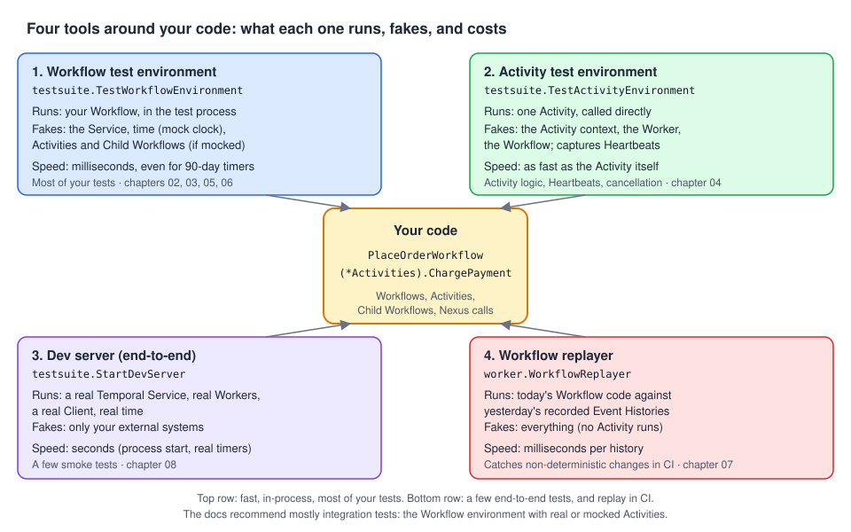

# Temporal Testing with Go: a roadmap

> A progressive onboarding guide to **testing and debugging Temporal applications** in Go. It is based on
> the Go SDK's Testing and Debugging pages (the Temporal Encyclopedia has no page on testing), checked
> against the SDK source and by running every test. Every chapter has **compilable, passing Go tests**
> with production-like names.
>
> Companion guides: [Temporal Workflows with Go](../../workflows/docs/README.md) (what you're testing, and
> why replay matters), [Temporal Activities with Go](../../activities/docs/README.md) (the side effects you
> mock), [Temporal Error handling with Go](../../error-handling/docs/README.md) (the failures you assert on),
> [Temporal Workers with Go](../../workers/docs/README.md) (what the end-to-end tests run).



---

## Why this matters, in 30 seconds

A Workflow can sleep for 30 days, retry an Activity for hours, wait for a Signal that comes next week,
and must keep replaying the same way after every deploy. You can't test that by running it and waiting.
The Go SDK gives you four tools:

- The **Workflow test environment** runs your Workflow in the test process with a **mock clock**: 30 days
  pass in milliseconds, and Activities, Child Workflows and Nexus Operations can be mocked.
- The **Activity test environment** runs one Activity with a fake context, so you can check Heartbeats and
  cancellation.
- The **Workflow replayer** replays real Event Histories against your new code and catches a
  non-deterministic change **before** it breaks running Workflows.
- **`testsuite.StartDevServer`** starts a real Temporal Service for end-to-end tests.

Each has traps that only show up when you run it: a 3-second idle timeout that panics, retry delays that
don't grow, a replayer that logs scary stack traces, a `TEMPORAL_DEBUG=false` that turns debug mode **on**.
This guide covers them.

---

## The roadmap

### Stage 1: Foundations *(core concepts, must-know)*

| # | Chapter | You'll be able to… |
| --- | --- | --- |
| 01 | [Testing strategy](01-testing-strategy.md) | Tell unit, integration and end-to-end tests apart, pick the right Go tool for each question, and write a first Workflow test. |
| 02 | [The Workflow test environment](02-workflow-test-environment.md) | Set up a testify suite (or plain `testing`), run a Workflow, read its result and error, and keep the two timeouts apart. |

### Stage 2: Daily use *(the tests you'll write every day)*

| # | Chapter | You'll be able to… |
| --- | --- | --- |
| 03 | [Mocking Activities and Child Workflows](03-mocking-activities.md) | Mock or override Activities and Child Workflows, inject failures, test retries, and assert on calls. |
| 04 | [Testing Activities](04-testing-activities.md) | Test an Activity in isolation with fake dependencies, Heartbeats, resume-from-heartbeat and cancellation. |
| 05 | [Time, Signals, Queries and Updates](05-time-signals-queries.md) | Skip 30 days in milliseconds, send Signals and Updates mid-run, and Query the Workflow's state. |

### Stage 3: Advanced *(Nexus and determinism)*

| # | Chapter | You'll be able to… |
| --- | --- | --- |
| 06 | [Mocking Nexus Operations](06-mocking-nexus.md) | Test a Workflow that calls another team's Nexus Service, with sync and async mocks or a fake Service. |
| 07 | [Replay testing](07-replay-testing.md) | Replay golden and live histories in `go test` and CI, and catch a breaking change before deploy. |

### Stage 4: Production

| # | Chapter | You'll be able to… |
| --- | --- | --- |
| 08 | [End-to-end tests with a dev server](08-end-to-end-dev-server.md) | Start a real Service from `TestMain`, run a real Worker with fake Activities, and isolate each test. |
| 09 | [Debugging Workflows](09-debugging.md) | Step through a Workflow without tripping the deadlock detector, and debug a production failure by replaying it locally. |

---

## Core concepts vs. implementation details

| **Core concepts**: understand these first | **Implementation details, options & sub-features**: learn when needed |
| --- | --- |
| Unit, integration, end-to-end; mostly integration tests ([01](01-testing-strategy.md)) | Four Go tools and when to use which ([01](01-testing-strategy.md)) |
| The Workflow runs in-process with a mock clock, no server ([02](02-workflow-test-environment.md)) | testify suite vs plain `testing`, `SetTestTimeout` vs `SetWorkflowRunTimeout` ([02](02-workflow-test-environment.md)) |
| Real Activities run unless you mock them ([02](02-workflow-test-environment.md), [03](03-mocking-activities.md)) | Matchers, `.Once`/`.Times`/`.After`/`.Run`, `OnWorkflow`, `Assert*` ([03](03-mocking-activities.md)) |
| An Activity can be tested alone ([04](04-testing-activities.md)) | Heartbeat listener, `SetHeartbeatDetails`, cancellation, local Activities ([04](04-testing-activities.md)) |
| Time skips when nothing runs ([05](05-time-signals-queries.md)) | `RegisterDelayedCallback`, `SetStartTime`, Signal-With-Start, `UpdateWorkflow` callbacks ([05](05-time-signals-queries.md)) |
| Nexus calls can be mocked like Activities ([06](06-mocking-nexus.md)) | Operation references, async tokens, fake Services ([06](06-mocking-nexus.md)) |
| Replay proves new code matches old histories ([07](07-replay-testing.md)) | Golden histories, `cmd/replaycheck`, quiet logger ([07](07-replay-testing.md)) |
| End-to-end runs a real Service, in real time ([08](08-end-to-end-dev-server.md)) | `DevServerOptions`, `TestMain`, per-test Task Queues, `-short` ([08](08-end-to-end-dev-server.md)) |
| The deadlock detector vs the debugger ([09](09-debugging.md)) | `TEMPORAL_DEBUG`, `DeadlockDetectionTimeout`, CLI `show`/`stack`, replay under a debugger ([09](09-debugging.md)) |

---

## Which test do I need?

```text
Does my Workflow take the right steps, branches, results?   → Workflow test env, Activities mocked     → 02, 03
What happens when an Activity fails or is retried?          → mock returning errors, then success      → 03
Is my Activity code itself right?
├── Pure logic (parsing, mapping)                           → plain Go test, no Temporal              → 04
└── Uses its context (Heartbeats, cancellation, GetInfo)    → Activity test env                       → 04
Does it wait / time out / react to Signals, Queries, Updates? → mock clock + RegisterDelayedCallback  → 05
Does it call a Nexus Operation?                             → OnNexusOperation or a fake Service      → 06
Will my change break Workflows already running?             → replay golden + live histories in CI    → 07
Is everything wired (registration, Task Queues, converters)? → StartDevServer + real Worker           → 08
A test hangs in the debugger with "Potential deadlock"?     → TEMPORAL_DEBUG=1 (any non-empty value)  → 09
A production Execution failed and I want to step through it? → download its history, replay locally  → 09
```

---

## Go API cheat sheet

| I want to… | Go API | Chapter |
| --- | --- | --- |
| Create a Workflow test environment | `var ts testsuite.WorkflowTestSuite; env := ts.NewTestWorkflowEnvironment()` (or embed `testsuite.WorkflowTestSuite` in a testify suite) | 02 |
| Run the Workflow and read the outcome | `env.ExecuteWorkflow(fn, args…)`, `env.IsWorkflowCompleted()`, `env.GetWorkflowResult(&v)`, `env.GetWorkflowError()` | 02 |
| Raise the 3s idle timeout | `env.SetTestTimeout(d)` (wall clock) | 02 |
| Cap Workflow time | `env.SetWorkflowRunTimeout(d)` (mock clock) | 02, 05 |
| Mock an Activity | `env.OnActivity(act, mock.Anything, …).Return(result, err)` or `.Return(func(…) (…, error))` | 03 |
| Mock a Child Workflow | `env.OnWorkflow(child, mock.Anything, …).Return(result, err)` | 03 |
| Check mocks were used | `env.AssertExpectations(t)`, `env.AssertActivityNumberOfCalls(t, "Name", n)` | 03 |
| Test one Activity | `env := ts.NewTestActivityEnvironment(); env.RegisterActivity(a); v, err := env.ExecuteActivity(a, args…)` | 04 |
| See Heartbeats / resume from one | `env.SetOnActivityHeartbeatListener(…)`, `env.SetHeartbeatDetails(progress)` | 04 |
| Cancel an Activity under test | `env.SetWorkerOptions(worker.Options{BackgroundActivityContext: ctx})`, then `cancel()` | 04 |
| Do something at a given Workflow time | `env.RegisterDelayedCallback(func(){…}, d)` | 05 |
| Signal, Query, Update | `env.SignalWorkflow(name, arg)`, `env.QueryWorkflow(name)`, `env.UpdateWorkflow(name, id, &testsuite.TestUpdateCallback{…}, args…)` | 05 |
| Set the start time | `env.SetStartTime(t)`; read it with `env.Now()` | 05 |
| Mock a Nexus Operation | `env.OnNexusOperation(service, nexus.NewOperationReference[In, Out](name), in, mock.Anything).Return(…)` | 06 |
| Complete an async Nexus mock | `env.RegisterNexusAsyncOperationCompletion(service, op, token, result, err, delay)` | 06 |
| Replay a history | `r := worker.NewWorkflowReplayer(); r.RegisterWorkflowWithOptions(fn, …); r.ReplayWorkflowHistory(logger, hist)` | 07 |
| Replay from a CLI export | `temporal workflow show -w ID -o json > h.json`, then `r.ReplayWorkflowHistoryFromJSONFile(logger, "h.json")` | 07 |
| Replay a live Execution | `r.ReplayWorkflowExecution(ctx, c.WorkflowService(), logger, ns, workflow.Execution{ID: …})` | 07, 09 |
| Start a real Service in tests | `srv, err := testsuite.StartDevServer(ctx, testsuite.DevServerOptions{…}); c := srv.Client(); defer srv.Stop()` | 08 |
| Step through Workflow code | `TEMPORAL_DEBUG=1` in the debugger's environment | 09 |

---

## Diagrams

| Diagram | Used in |
| --- | --- |
| [Testing mental model](../img/testing-mental-model.svg) | README, 01 |
| [Inside the Workflow test environment](../img/testing-test-environment.svg) | 02 |
| [Time skipping](../img/testing-time-skipping.svg) | 05 |
| [Replay testing in CI](../img/testing-replay-ci.svg) | 07 |

---

## About the code samples

- Each chapter is a **self-contained module** named `github.com/acme/shop`. Every Go block starts with
  `// file: <path>` so you can paste it into that path.
- All samples were compiled, `gofmt`-checked and `go vet`-checked against **Go SDK v1.50.0**
  (`go.temporal.io/sdk`) with `github.com/stretchr/testify`, and **every test was run with `go test` and
  passes**. Output shown in the chapters is real output.
- Chapter 08 starts its own dev server with `testsuite.StartDevServer` (Temporal CLI 1.9.1, Server 1.32.0);
  chapters 07 and 09 fetched real histories from one.
- Not verified: the Delve breakpoint walk-through and the VS Code `launch.json` in chapter 09 (the debugger
  couldn't run in the sandbox used for checking). The replay test they rely on is verified.

### Notes from checking the docs against the SDK

- **One source link is broken.** `…/best-practices/debuggingactivities` is a 404; the page is
  [`…/best-practices/debugging`](https://docs.temporal.io/develop/go/best-practices/debugging). Most of its
  testing content duplicates the Testing page.
- **Go has no time-skipping test server.** The page says to use "the test server" for end-to-end and
  integration tests "because the test server supports skipping time". In Go, time skipping exists only in
  the in-process Workflow test environment, which is not a server. `StartDevServer` runs in real time
  ([01](01-testing-strategy.md), [08](08-end-to-end-dev-server.md)).
- **`TEMPORAL_DEBUG=false` turns debug mode on.** The SDK checks `os.Getenv("TEMPORAL_DEBUG") != ""`, so any
  non-empty value (`true`, `false`, `0`) disables deadlock detection and raises the test idle timeout to
  24h. An explicit `worker.Options.DeadlockDetectionTimeout` wins over it ([09](09-debugging.md)).
- **The 3-second idle timeout panics.** A real Activity running longer than 3s of wall clock makes the test
  **panic** ("test timeout: 3s, workflow stack: …"), not fail. Mock it or call `SetTestTimeout`
  ([02](02-workflow-test-environment.md)).
- **`SetTestTimeout` on the Activity environment** only applies to `ExecuteLocalActivity`. `ExecuteActivity`
  always uses a fixed 10-minute timeout, so an Activity that never returns hangs the test, despite the
  docs saying the timeout can be set "in the Workflow or Activity environment" ([04](04-testing-activities.md)).
- **A forgotten Signal fails instantly.** A Workflow waiting for a Signal that never comes completes at once
  with "deadline exceeded (type: ScheduleToClose)": the mock clock jumps to the 10-year default run timeout
  ([02](02-workflow-test-environment.md)).
- **Retries behave differently.** In the test environment, retry delays don't grow with
  `BackoffCoefficient`, and an unset `MaximumAttempts` becomes 10 (a real Service retries forever)
  ([03](03-mocking-activities.md)).
- **"The framework will validate the signature"** of a replacement function, but only when the Activity is
  called: a wrong signature is an ordinary, retryable Activity error, not a panic at setup
  ([03](03-mocking-activities.md)).
- **Missing Child Workflow crashes the test binary.** An unregistered, unmocked Child Workflow (or a Nexus
  handler Workflow) panics from a goroutine `recover` can't catch. A missing Activity fails the Workflow
  cleanly ([03](03-mocking-activities.md), [06](06-mocking-nexus.md)).
- **Heartbeat listener is throttled.** Three quick `RecordHeartbeat` calls reached the listener once. The
  docs' sample counts heartbeats and works only because it sends one ([04](04-testing-activities.md)).
- **Cancelled Activity error.** The docs' cancellation test only checks `s.Error(err)`. The error is a
  retryable `*temporal.ApplicationError` "context canceled": `temporal.IsCanceledError` and
  `errors.Is(err, context.Canceled)` are both false ([04](04-testing-activities.md)).
- **Querying too early panics** with a nil pointer dereference, as the docs warn
  ([05](05-time-signals-queries.md)).
- **Nexus mock errors lose their text.** Plain errors and `nexus.HandlerErrorf` reach the Workflow as
  "handler error (…)"; only `nexus.NewOperationFailedError` keeps its message. Mocks ignore the Endpoint
  name ([06](06-mocking-nexus.md)).
- **`ReplayWorkflowHistory(nil, …)` is not silent.** The godoc says nil "defaults to the noop logger"; the
  code uses the default logger, which prints "ERROR Workflow panic" and a stack trace for every failed
  replay. Pass a logger over an `io.Discard` handler ([07](07-replay-testing.md)). The Workflows guide's
  replay example had the same wrong comment; it's fixed.
- **A running Execution can pass replay** if its history stops before the changed code, so replay a mix of
  old and new, open and closed Executions ([07](07-replay-testing.md)).
- **`DevServerOptions.SearchAttributes`** registers names and types only; the values are ignored
  ([08](08-end-to-end-dev-server.md)).
- **The docs' Query example links** to `go.temporal.io/temporal/internal`, an old module path; the method is
  `TestWorkflowEnvironment.QueryWorkflow` in `go.temporal.io/sdk/testsuite`.

---

## Sources

**Encyclopedia:** no page on testing.

**Go SDK:** [Testing](https://docs.temporal.io/develop/go/best-practices/testing-suite) ·
[Debugging](https://docs.temporal.io/develop/go/best-practices/debugging)
