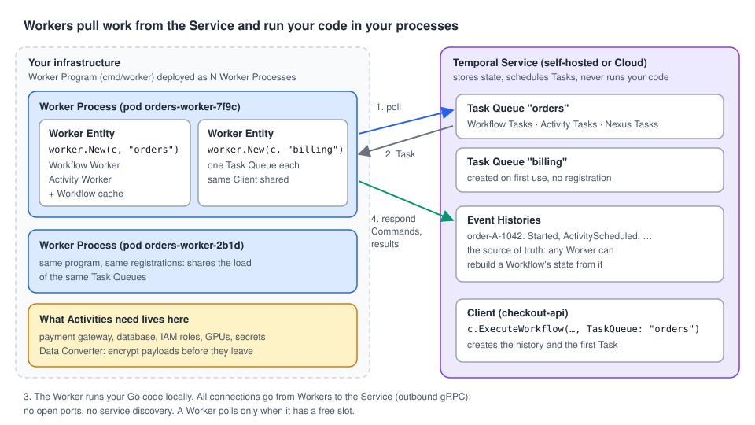

# 01 · What is a Worker?

> **Level:** foundations · **Read time:** ~12 min
> **Sources:** [Encyclopedia — Workers](https://docs.temporal.io/workers) · [Go SDK — Run a Worker](https://docs.temporal.io/develop/go/workers/run-worker-process)

---

## 1. The problem

You wrote `PlaceOrderWorkflow` and a few Activities. You start it with the Client and… nothing
happens. The Workflow shows as **Running** in the UI, but no Activity runs.

That's because the **Temporal Service never runs your code**. It stores Event Histories, keeps
timers and puts work on queues. Something has to take that work, run your Go functions, and report
back. That something is a **Worker**.

Workers solve three problems at once:

- **Where the code runs:** in your processes, on your machines, with your credentials and network
  access. Not on the Temporal Service.
- **How work is spread:** many Worker processes share the load of one queue. Add processes to scale
  out; remove them and the work waits.
- **How work survives crashes:** a Worker that dies mid-task loses nothing. The Service hands the
  task to another Worker, which rebuilds the state from the Event History.

---

## 2. Three things called "Worker"

In daily talk, "the Worker" can mean three different things. The Encyclopedia separates them:

| Term | What it is | In Go |
| --- | --- | --- |
| **Worker Program** | The static code: which Workflows and Activities to register, which Task Queue to poll, which options | Your `cmd/worker/main.go` |
| **Worker Process** | A running instance of that program. A fleet usually runs many | `go run ./cmd/worker` on a VM, a pod, a container |
| **Worker Entity** | One Worker inside a process, polling **one** Task Queue. It contains a Workflow Worker and/or an Activity Worker | The value returned by `worker.New(c, "orders", …)` |



A process can hold several Worker Entities (one per Task Queue, see [chapter 04](04-running-a-worker.md)).
A Worker Entity listens to **exactly one** Task Queue.

---

## 3. What a Worker Process does

A Worker Process runs a loop:

1. **Poll** a Task Queue on the Temporal Service (a long-poll gRPC call).
2. **Receive a Task**: "advance this Workflow", "run this Activity attempt" or "handle this Nexus request".
3. **Run your code** for that Task.
4. **Respond** to the Service with the result (Commands, an Activity result, an error).

Tasks are covered in [chapter 02](02-tasks.md), Task Queues in [chapter 03](03-task-queues.md).

Some consequences of this design:

| Fact | Why it matters |
| --- | --- |
| Workers **call out** to the Service. The Service never calls in | No open ports, no load balancer, no DNS or service discovery for Workers. A Worker behind a NAT works fine |
| A Worker polls only when it has **spare capacity** | It can't be overloaded by a spike. Extra work waits in the Task Queue |
| Workers are **stateless** from the Service's point of view | Any Worker of the fleet can continue any Workflow. You can deploy, restart or kill Workers at any time |
| The Service is **external** to your Workers | You develop the Worker Program **and** operate the Worker Processes. Temporal Cloud doesn't host them (except [Serverless Workers](12-serverless-workers.md)) |

### Stateless, but with a cache

Workers keep Workflow state in an in-memory cache to avoid rebuilding it on every step
([chapter 06](06-sticky-execution.md)). The cache is an optimization, not a requirement: a Workflow
that is waiting (on a timer, a Signal, a long Activity) can be evicted and rebuilt later on the same
or another Worker. So **one Worker can serve far more open Workflows than its cache size**, millions
in fact. The price is latency: a Workflow that was evicted must be replayed from its history before
it can move on.

### Your data is visible to the Service, unless you encrypt it

Arguments, results and Signal payloads are stored in the Event History. They travel over TLS but
are readable at rest by the Service. If that's not acceptable, configure a **Data Converter** (codec)
on both the Client and the Worker so payloads are encrypted before they leave your process. The
Service then only sees ciphertext.

### Activity Workers need your resources

The Activity code runs in the Worker Process, so that process needs what the Activities use:
network access to your payment gateway, database credentials, cloud IAM roles, a GPU… Plan Worker
deployments like any other service that holds those secrets. Different needs can mean different
Worker pools on different Task Queues ([chapter 07](07-task-routing.md)).

> The Temporal Service also runs **internal workers** for its own system Workflows. You never see
> or manage them.

---

## 4. Your first Worker

An `orders` service: one Workflow, two Activities, and a payment gateway behind an interface.

```go
// file: orders/orders.go
package orders

import (
	"context"
	"fmt"
	"time"

	"go.temporal.io/sdk/workflow"
)

// TaskQueue is shared by the Worker and every Client that starts order Workflows.
const TaskQueue = "orders"

type PlaceOrderInput struct {
	OrderID     string
	CustomerID  string
	AmountCents int64
}

type PlaceOrderResult struct {
	OrderID   string
	PaymentID string
}

// PaymentGateway is the external system. Production code wraps a real PSP SDK.
type PaymentGateway interface {
	Charge(ctx context.Context, customerID string, amountCents int64, idempotencyKey string) (paymentID string, err error)
}

// Activities holds the dependencies Activities need. The Worker registers all its exported methods.
type Activities struct {
	Payments PaymentGateway
}

func (a *Activities) ChargeCustomer(ctx context.Context, in PlaceOrderInput) (string, error) {
	return a.Payments.Charge(ctx, in.CustomerID, in.AmountCents, "order-"+in.OrderID)
}

func (a *Activities) SendConfirmation(ctx context.Context, orderID, paymentID string) error {
	fmt.Printf("order %s confirmed (payment %s)\n", orderID, paymentID)
	return nil
}

func PlaceOrderWorkflow(ctx workflow.Context, in PlaceOrderInput) (PlaceOrderResult, error) {
	ctx = workflow.WithActivityOptions(ctx, workflow.ActivityOptions{StartToCloseTimeout: 30 * time.Second})

	var a *Activities // nil pointer: only used to name the Activity methods
	var paymentID string
	if err := workflow.ExecuteActivity(ctx, a.ChargeCustomer, in).Get(ctx, &paymentID); err != nil {
		return PlaceOrderResult{}, err
	}
	if err := workflow.ExecuteActivity(ctx, a.SendConfirmation, in.OrderID, paymentID).Get(ctx, nil); err != nil {
		return PlaceOrderResult{}, err
	}
	return PlaceOrderResult{OrderID: in.OrderID, PaymentID: paymentID}, nil
}
```

```go
// file: orders/fakegateway.go
package orders

import (
	"context"
	"sync"
)

// FakeGateway is an in-memory PaymentGateway for local runs. It honors idempotency keys
// because Activities can be retried.
type FakeGateway struct {
	mu      sync.Mutex
	charges map[string]string
}

func NewFakeGateway() *FakeGateway { return &FakeGateway{charges: map[string]string{}} }

func (g *FakeGateway) Charge(_ context.Context, customerID string, _ int64, key string) (string, error) {
	g.mu.Lock()
	defer g.mu.Unlock()
	if id, ok := g.charges[key]; ok {
		return id, nil
	}
	id := "pay_" + customerID + "_" + key
	g.charges[key] = id
	return id, nil
}
```

The Worker Program: connect, create a Worker Entity for the `orders` Task Queue, register, run.

```go
// file: cmd/worker/main.go
package main

import (
	"log"

	"go.temporal.io/sdk/client"
	"go.temporal.io/sdk/worker"

	"github.com/acme/shop/orders"
)

func main() {
	c, err := client.Dial(client.Options{}) // localhost:7233, Namespace "default"
	if err != nil {
		log.Fatalln("unable to create Temporal client:", err)
	}
	defer c.Close()

	w := worker.New(c, orders.TaskQueue, worker.Options{})
	w.RegisterWorkflow(orders.PlaceOrderWorkflow)
	w.RegisterActivity(&orders.Activities{Payments: orders.NewFakeGateway()})

	// Blocks until SIGINT or SIGTERM, then stops the Worker.
	if err := w.Run(worker.InterruptCh()); err != nil {
		log.Fatalln("worker stopped with error:", err)
	}
}
```

A starter that uses the **same** Task Queue constant:

```go
// file: cmd/starter/main.go
package main

import (
	"context"
	"log"

	"go.temporal.io/sdk/client"

	"github.com/acme/shop/orders"
)

func main() {
	c, err := client.Dial(client.Options{})
	if err != nil {
		log.Fatalln("unable to create Temporal client:", err)
	}
	defer c.Close()

	in := orders.PlaceOrderInput{OrderID: "A-1042", CustomerID: "cus_829", AmountCents: 4999}
	run, err := c.ExecuteWorkflow(context.Background(), client.StartWorkflowOptions{
		ID:        "order-" + in.OrderID,
		TaskQueue: orders.TaskQueue,
	}, orders.PlaceOrderWorkflow, in)
	if err != nil {
		log.Fatalln("unable to start order:", err)
	}

	var res orders.PlaceOrderResult
	if err := run.Get(context.Background(), &res); err != nil {
		log.Fatalln("order failed:", err)
	}
	log.Printf("order %s paid with %s", res.OrderID, res.PaymentID)
}
```

Run it:

```bash
temporal server start-dev            # terminal 1, UI at http://localhost:8233
go run ./cmd/worker                  # terminal 2
go run ./cmd/starter                 # terminal 3
```

Try this: start the starter **before** the Worker. The Workflow is created and waits; the Workflow
Task sits in the `orders` Task Queue. Start the Worker and the order completes. Kill the Worker
during a run and start it again: the Workflow continues where it was.

---

## 5. Key takeaways

- The Temporal Service **orchestrates**; Workers **execute**. No Worker polling the right Task Queue, no progress.
- **Worker Program** = code, **Worker Process** = running instance, **Worker Entity** = one `worker.New(...)` polling one Task Queue.
- Workers connect **out** to the Service and pull work only when they have capacity: no open ports, natural back-pressure.
- Workers are stateless. Any Worker can continue any Workflow; the cache only saves time.
- Activity Workers need access to everything the Activities touch. Encrypt payloads with a Data Converter if the Service must not read them.
