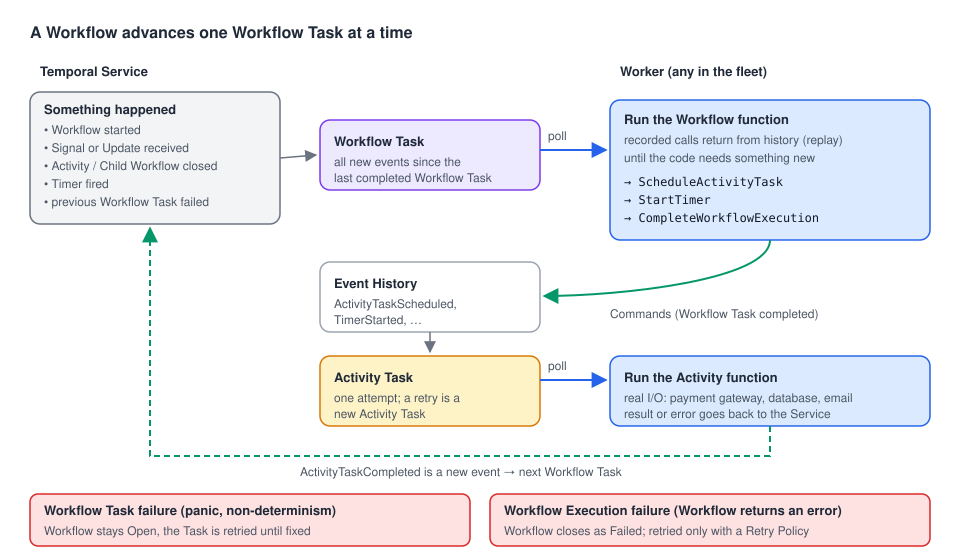

# 02 · Tasks: what a Worker actually does

> **Level:** foundations · **Read time:** ~15 min
> **Sources:** [Encyclopedia — Tasks](https://docs.temporal.io/tasks) · [Encyclopedia — Sticky Execution](https://docs.temporal.io/sticky-execution) · [`worker.Options.WorkflowPanicPolicy`](https://pkg.go.dev/go.temporal.io/sdk/internal#WorkerOptions)

---

## 1. The problem

[Chapter 01](01-what-is-a-worker.md) said a Worker "polls for Tasks". But what *is* a Task? Your
`PlaceOrderWorkflow` runs for minutes, days, sometimes months. No Worker holds it for that long.
The Workflow advances in **small steps**, and each step is a Task that any Worker can pick up.

Understanding Tasks explains most "why is my Workflow stuck?" questions, and the most important
distinction for debugging: a **Workflow Task failure** (your Worker can't process the step) is not a
**Workflow Execution failure** (your business logic decided it failed).

---

## 2. Three kinds of Tasks

A **Task** is a unit of work the Service puts on a Task Queue for a Worker.

| Task | What it does | Runs | Typical duration |
| --- | --- | --- | --- |
| **Workflow Task** | Advances a Workflow Execution by one step | Your Workflow function (deterministic) | Milliseconds |
| **Activity Task** | Runs **one attempt** of an Activity | Your Activity function | Milliseconds to hours |
| **Nexus Task** | Delivers one Nexus request (start or cancel an Operation) | Your Nexus Operation handler | Short. Long work is started asynchronously |



---

## 3. Workflow Tasks

### When is a Workflow Task scheduled?

Whenever something happens that may change what the Workflow does next:

- the Workflow Execution starts;
- a Signal or an Update arrives;
- an Activity completes (success or failure);
- a Timer fires;
- a Child Workflow completes;
- a previous Workflow Task failed and must be retried.

One Workflow Task bundles **all new events** since the last completed Workflow Task. Three Signals
arriving together are handled in one step.

### How a Worker processes it

1. The Worker receives the Workflow Task with the Event History.
2. It runs your Workflow function. Calls that already happened (an Activity that already completed,
   a Timer that already fired) **return their recorded result** from the history instead of running
   again. This is **replay**.
3. The code reaches something new: schedule an Activity, start a Timer, complete the Workflow.
4. The Worker sends these decisions as **Commands** and completes the Workflow Task.
5. The Service records them as new Events (`ActivityTaskScheduled`, `TimerStarted`, …) and creates
   the Activity Tasks or Timers.

That's why Workflow code must be **deterministic**: replaying the same history must produce the
same Commands. And that's why a Workflow Task is fast: no I/O, only your logic. The time an
Activity or a Timer takes is **not** spent in a Workflow Task.

> **Nuance: "replays from the beginning".** The Tasks page says the Worker replays the whole history
> on every Workflow Task. That's what happens when a Worker sees the Workflow **for the first time**
> (or after the Workflow was evicted from its cache). Most of the time, thanks to **Sticky Execution**,
> the Workflow Task goes back to the Worker that already has the Workflow's state in memory, and it only
> applies the **new** events. See [chapter 06](06-sticky-execution.md).

---

## 4. Activity Tasks

An Activity Task runs **one attempt** of an Activity. If the attempt fails or times out and the
Retry Policy allows it, the Service schedules another Activity Task. To the Workflow it all looks
like a single call that eventually returns: an "effectively once" experience, built on
at-least-once attempts. That's why Activities must be **idempotent** (the fake gateway in
[chapter 01](01-what-is-a-worker.md) uses an idempotency key).

| Event | Meaning |
| --- | --- |
| `ActivityTaskScheduled` | The Service put the Activity Task in the Task Queue |
| `ActivityTaskStarted` | A Worker picked it up (written when the Activity closes, with the last attempt) |
| `ActivityTaskCompleted` / `Failed` / `TimedOut` / `Canceled` / `Terminated` | The Activity closed |

A retried attempt can read the **heartbeat details** recorded by the previous attempt and resume
from its last checkpoint (see the [Activities guide](../../activities/docs/04-timeouts-retries-heartbeats.md)).

---

## 5. Nexus Tasks

A Nexus Task delivers one Nexus request to a Worker polling the Endpoint's target Task Queue.
The caller Workflow sees one Operation, but the Service may send several Nexus Tasks to start it,
so Operation handlers must be idempotent. Nexus Tasks (like Query Tasks) are **not persisted**:
they are handed to a Worker that is polling right now, or they fail and the caller retries
([chapter 03](03-task-queues.md)).

---

## 6. Workflow Task failure vs Workflow Execution failure

This table is worth memorizing:

| | **Workflow Task failure** | **Workflow Execution failure** |
| --- | --- | --- |
| What failed | The Worker couldn't process a step: a bug, a panic, non-determinism, a Task timeout | Your business logic decided the Workflow can't succeed |
| Workflow state | Stays **Open** (Running) | **Closes** as Failed |
| Retry | **Always**, automatically, by the Service | Only if the Workflow has a Retry Policy (new Run, new history) |
| Event History | Same history, with `WorkflowTaskFailed` events | Ends with `WorkflowExecutionFailed` |
| How to fix | Fix the code or the infrastructure, redeploy. The Workflow continues | Business decision, new start, compensation |
| Where you see it | Workflow Task failures in the history and Worker metrics/logs | A Failed Workflow in the UI |

### A Workflow Task failure: a bug

```go
// file: inventory/allocate.go
package inventory

import (
	"time"

	"go.temporal.io/sdk/temporal"
	"go.temporal.io/sdk/workflow"
)

const TaskQueue = "inventory"

type AllocateStockInput struct {
	OrderID string
	Lines   []OrderLine
}

type OrderLine struct {
	SKU      string
	Quantity int
}

// AllocateStockWorkflow has a bug: an order with no lines panics on Lines[0].
// The panic fails the Workflow Task, not the Workflow. The Workflow stays Running and
// the Service retries the Task until a fixed Worker is deployed.
func AllocateStockWorkflow(ctx workflow.Context, in AllocateStockInput) error {
	ctx = workflow.WithActivityOptions(ctx, workflow.ActivityOptions{StartToCloseTimeout: 10 * time.Second})

	warehouse := pickWarehouse(in.Lines[0].SKU) // index out of range when Lines is empty

	for _, line := range in.Lines {
		err := workflow.ExecuteActivity(ctx, "ReserveStock", warehouse, line).Get(ctx, nil)
		if err != nil {
			return err
		}
	}
	return nil
}

func pickWarehouse(sku string) string {
	if len(sku) > 0 && sku[0] == 'F' {
		return "warehouse-fresh"
	}
	return "warehouse-main"
}

// AllocateStockWorkflowFixed is the fixed version. An empty order is now a business
// error: the Workflow Execution fails, closes, and is not retried.
func AllocateStockWorkflowFixed(ctx workflow.Context, in AllocateStockInput) error {
	if len(in.Lines) == 0 {
		return temporal.NewNonRetryableApplicationError("order has no lines", "EmptyOrder", nil, in.OrderID)
	}
	ctx = workflow.WithActivityOptions(ctx, workflow.ActivityOptions{StartToCloseTimeout: 10 * time.Second})
	warehouse := pickWarehouse(in.Lines[0].SKU)
	for _, line := range in.Lines {
		if err := workflow.ExecuteActivity(ctx, "ReserveStock", warehouse, line).Get(ctx, nil); err != nil {
			return err
		}
	}
	return nil
}
```

With the buggy version, start an order with no lines and look at the history:
`WorkflowTaskScheduled → WorkflowTaskStarted → WorkflowTaskFailed` (cause
`WORKFLOW_WORKER_UNHANDLED_FAILURE`, with the panic and stack trace), then a new
`WorkflowTaskScheduled → WorkflowTaskStarted`. Later failed attempts aren't written again: the
history stays short, the attempt counter grows, and the Worker logs `Workflow panic` with the stack
trace on every attempt. The Workflow stays **Running** (checked on a dev server). In real life you deploy the fix under the **same** Workflow
Type name, and the next retry of the Workflow Task succeeds: the stuck Workflow continues by itself.
(The two functions here are side by side only for reading; register the fix under the original name
with `RegisterWorkflowWithOptions(..., workflow.RegisterOptions{Name: "AllocateStockWorkflow"})`.)

### A Workflow Execution failure: a business decision

With the fixed version, the same empty order returns a non-retryable `ApplicationError`. The
history ends with `WorkflowExecutionFailed`, the UI shows **Failed**, and the Client's `run.Get`
returns the error. No automatic retry happens unless you set a Workflow Retry Policy (and even then,
a non-retryable error stops it).

### Choosing how panics behave

By default a panic in Workflow code, **including detected non-determinism**, blocks the Workflow
(`worker.BlockWorkflow`): the Workflow Task fails and is retried, waiting for a fix. You can make
the Worker fail the Workflow Execution instead:

```go
// file: cmd/inventory-worker/main.go
package main

import (
	"log"

	"go.temporal.io/sdk/client"
	"go.temporal.io/sdk/worker"
	"go.temporal.io/sdk/workflow"

	"github.com/acme/shop/inventory"
)

func main() {
	c, err := client.Dial(client.Options{})
	if err != nil {
		log.Fatalln("unable to create Temporal client:", err)
	}
	defer c.Close()

	w := worker.New(c, inventory.TaskQueue, worker.Options{
		// Default is worker.BlockWorkflow. FailWorkflow turns panics and non-determinism
		// into Workflow Execution failures. Use it only if a failed Workflow is better for
		// you than a stuck one that a fix could unblock.
		WorkflowPanicPolicy: worker.FailWorkflow,
	})
	w.RegisterWorkflowWithOptions(inventory.AllocateStockWorkflowFixed, workflow.RegisterOptions{
		Name: "AllocateStockWorkflow",
	})

	if err := w.Run(worker.InterruptCh()); err != nil {
		log.Fatalln("worker stopped with error:", err)
	}
}
```

Keep the default unless you have a reason: a blocked Workflow can be repaired by a deploy, a failed
one can't.

---

## 7. Key takeaways

- A **Task** is one unit of work on a Task Queue: **Workflow Task** (one step of a Workflow), **Activity Task** (one attempt), **Nexus Task** (one request).
- A Workflow Task is scheduled on every event that can change the Workflow (start, Signal, Update, Activity/Timer/Child completion, retry). It runs your code, replaying recorded results, and returns **Commands**.
- With Sticky Execution, a cached Worker applies only new events. Full replay happens on a cache miss.
- **Workflow Task failure** = the Workflow stays Open and is retried until the code is fixed. **Workflow Execution failure** = the Workflow closes as Failed.
- Panics and non-determinism block the Workflow by default (`BlockWorkflow`). `WorkflowPanicPolicy: worker.FailWorkflow` fails it instead.
