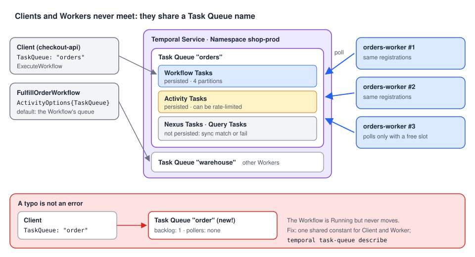

# 03 · Task Queues: where Workers find work

> **Level:** foundations · **Read time:** ~15 min
> **Sources:** [Encyclopedia — Task Queues](https://docs.temporal.io/task-queue) · [Task Queue naming](https://docs.temporal.io/task-queue/naming) · [Go SDK — Run a Worker](https://docs.temporal.io/develop/go/workers/run-worker-process#register-types)

---

## 1. The problem

A Client starts `PlaceOrderWorkflow`. Ten Worker processes are running. Which one gets the work,
and how does the Client even know they exist?

It doesn't. Clients and Workers never talk to each other. They meet at a **Task Queue**: the
Client (or a Workflow) says "this work goes to the `orders` queue", and Workers say "I take work
from the `orders` queue". The name is the whole contract. Get it wrong by one letter and nothing
fails: the work just waits forever.

---

## 2. What a Task Queue is

A Task Queue is a **lightweight, named queue on the Temporal Service** that Workers poll for Tasks.

- **No registration.** A Task Queue is created on demand, the first time a Workflow, Activity or
  Nexus Operation is sent to it, or a Worker polls it. There's no "create queue" step and no limit
  on how many you use.
- **One name, three queues.** A name like `orders` holds a Workflow Task Queue, an Activity Task
  Queue and a Nexus Task Queue. One Worker Entity (`worker.New(c, "orders", …)`) polls the ones it
  has handlers for.
- **Scoped to a Namespace.** `orders` in Namespace `shop-prod` and `orders` in `shop-staging` are
  unrelated.



---

## 3. Why polling is a good design

Workers fetch Tasks with a long-poll RPC. That gives you, for free:

| Benefit | What it means for you |
| --- | --- |
| **Flow control** | A Worker polls only when it has a free slot. A spike fills the queue, not your Worker's memory |
| **Load balancing** | Add Worker processes on the same queue and they share the work. No load balancer |
| **Task Routing** | Different queues for different Workers (GPU boxes, a region, a single host). See [chapter 07](07-task-routing.md) |
| **Server-side throttling** | Activity Task Queues can be rate-limited across all Workers (`TaskQueueActivitiesPerSecond`, [chapter 05](05-worker-options.md)) |
| **Durability** | Workflow and Activity Tasks are **persisted**. If every Worker is down, the Tasks wait until one comes back |
| **No discovery, no inbound ports** | Workers connect out to the Service. Nothing has to find them |

Two kinds of Tasks are **not** persisted: **Query** and **Nexus** Tasks. They are *sync matched*,
handed directly to a Worker that is polling right now. If none is, the call fails and the caller
must retry. (A caller Workflow retries Nexus Tasks automatically until the Operation's
Schedule-to-Close timeout.) So a Query against a Workflow whose Workers are all down fails, even
though the Workflow is fine.

---

## 4. The identical-registration rule

**Any Worker polling a Task Queue can receive any Task on it.** The queue doesn't route by type.
So every Worker on a Task Queue must register **the same Workflows, Activities and Nexus Services**.

When a Worker gets a Task for a type it doesn't know, the Task fails with a "not found" error:

| Task | Effect of "not found" |
| --- | --- |
| Workflow Task | **Retryable.** The Workflow Task fails and is retried. The Workflow stays Running |
| Activity Task | **Retryable.** The attempt fails and the Activity is retried per its Retry Policy, maybe on a Worker that knows it |
| Nexus Task | **Non-retryable.** The Operation fails; the caller Workflow must retry it explicitly |

On a dev server, the Go Worker reports them as `unable to find workflow type: UnknownWorkflow.
Supported types: [FulfillOrderWorkflow]` and `unable to find activityType=PickAndPack. Supported
types: [ReserveOrder]`. Both Workflows stayed Running, the Activity on attempt 4 and counting.
These messages are the first thing to look for when a Workflow "does nothing".

Two legitimate exceptions:

- **During a rollout with [Worker Versioning](11-worker-versioning.md)**, old and new Workers may
  temporarily register different sets: the Service routes each Workflow to a compatible version.
- **Dynamic Workflows and Activities** (`RegisterDynamicWorkflow`, `RegisterDynamicActivity`) act as a
  catch-all for types the Worker doesn't register by name.

In practice: build **one Worker Program per Task Queue** and deploy it as many times as you need.
Two different programs on one queue is a bug waiting for a deploy.

---

## 5. Where a Task Queue is set

The Task Queue name appears in five places. Here are the four you write in Go:

```go
// file: taskqueues/taskqueues.go
package taskqueues

// Task Queue names, shared by every Client, Workflow and Worker of the shop.
// A typo in a Task Queue name is not an error: it silently creates another queue.
const (
	Orders    = "orders"
	Warehouse = "warehouse"
	Shipping  = "shipping"
)
```

**1. Starting a Workflow** (required):

```go
// file: checkout/start.go
package checkout

import (
	"context"

	"go.temporal.io/sdk/client"

	"github.com/acme/shop/taskqueues"
)

type FulfillOrderInput struct {
	OrderID string
	Address string
}

func StartFulfillment(ctx context.Context, c client.Client, in FulfillOrderInput) (client.WorkflowRun, error) {
	return c.ExecuteWorkflow(ctx, client.StartWorkflowOptions{
		ID:        "fulfill-" + in.OrderID,
		TaskQueue: taskqueues.Orders, // the Workflow Tasks of this Workflow go here
	}, "FulfillOrderWorkflow", in)
}
```

**2. Creating a Worker** (required): see the Worker below.

**3. Scheduling an Activity** (optional, defaults to the Workflow's queue) and
**4. starting a Child Workflow** (optional, defaults to the parent's queue):

```go
// file: orders/fulfill.go
package orders

import (
	"time"

	"go.temporal.io/sdk/workflow"

	"github.com/acme/shop/checkout"
	"github.com/acme/shop/taskqueues"
)

type Parcel struct {
	OrderID    string
	WeightGram int
}

func FulfillOrderWorkflow(ctx workflow.Context, in checkout.FulfillOrderInput) (string, error) {
	// No TaskQueue: this Activity runs on the Workflow's own queue ("orders").
	local := workflow.WithActivityOptions(ctx, workflow.ActivityOptions{
		StartToCloseTimeout: 10 * time.Second,
	})
	if err := workflow.ExecuteActivity(local, "ReserveOrder", in.OrderID).Get(ctx, nil); err != nil {
		return "", err
	}

	// Picking and packing runs on Workers inside the warehouse network.
	warehouse := workflow.WithActivityOptions(ctx, workflow.ActivityOptions{
		TaskQueue:           taskqueues.Warehouse,
		StartToCloseTimeout: 30 * time.Minute,
	})
	var parcel Parcel
	if err := workflow.ExecuteActivity(warehouse, "PickAndPack", in.OrderID).Get(ctx, &parcel); err != nil {
		return "", err
	}

	// Shipping is owned by another team, with its own Workers and Task Queue.
	shipping := workflow.WithChildOptions(ctx, workflow.ChildWorkflowOptions{
		WorkflowID: "ship-" + in.OrderID,
		TaskQueue:  taskqueues.Shipping,
	})
	var trackingNumber string
	if err := workflow.ExecuteChildWorkflow(shipping, "ShipParcelWorkflow", parcel, in.Address).Get(ctx, &trackingNumber); err != nil {
		return "", err
	}
	return trackingNumber, nil
}
```

The Activities and the Child Workflow are called **by name** (`"PickAndPack"`, `"ShipParcelWorkflow"`):
they are registered by Workers in other programs, on other queues. The `orders` Worker only needs
`FulfillOrderWorkflow` and `ReserveOrder`.

**5. Creating a Nexus Endpoint**: an Endpoint routes Nexus requests to a target Task Queue in a
target Namespace. Callers only know the Endpoint name; the Task Queue is an operator setting
(`temporal operator nexus endpoint create --target-task-queue …`).

The `orders` Worker:

```go
// file: cmd/orders-worker/main.go
package main

import (
	"context"
	"log"

	"go.temporal.io/sdk/client"
	"go.temporal.io/sdk/worker"
	"go.temporal.io/sdk/workflow"

	"github.com/acme/shop/orders"
	"github.com/acme/shop/taskqueues"
)

func ReserveOrder(ctx context.Context, orderID string) error {
	log.Printf("order %s reserved", orderID)
	return nil
}

func main() {
	c, err := client.Dial(client.Options{})
	if err != nil {
		log.Fatalln("unable to create Temporal client:", err)
	}
	defer c.Close()

	w := worker.New(c, taskqueues.Orders, worker.Options{})
	w.RegisterWorkflowWithOptions(orders.FulfillOrderWorkflow, workflow.RegisterOptions{Name: "FulfillOrderWorkflow"})
	w.RegisterActivity(ReserveOrder)

	if err := w.Run(worker.InterruptCh()); err != nil {
		log.Fatalln("worker stopped with error:", err)
	}
}
```

---

## 6. Naming: one constant, everywhere

Because a Task Queue is created on first use, a name mismatch **is not an error**. Start a Workflow
on `order` while the Worker polls `orders`, and you get two queues: one with a Task and no Worker,
one with a Worker and no Task. The Workflow shows as Running, forever.

Defend against it:

- **Share a constant** (`taskqueues.Orders` above) between the code that starts the Workflow and
  the Worker. It's the Encyclopedia's main recommendation.
- When a constant can't be shared (the Client is another service, or another language), **document
  the name in the API contract** of the Workflow, next to its Type name and input.
- Name queues after **what they do or where they run** (`orders`, `warehouse`, `gpu-inference`), and
  keep environment out of the name: use a Namespace per environment instead.

To spot a mismatch, describe the queue the Workflow was sent to. A backlog and **no pollers** means
no Worker listens there:

```bash
$ temporal task-queue describe --task-queue order
Task Queue Statistics:
    BuildID    TaskQueueType  ApproximateBacklogCount  ApproximateBacklogAge  …
  UNVERSIONED  workflow                             1  1.078304s              …
  UNVERSIONED  activity                             0  0s                     …
Pollers:
  BuildID  TaskQueueType  Identity  LastAccessTime  RatePerSecond
```

On a healthy queue, the `Pollers` table lists each Worker's identity (`70052@ip-10-0-3-17@`) and
when it last polled. The UI shows the same on the Workflow's "Workers" tab.

---

## 7. Partitions and ordering

Under the hood, a Task Queue is split into **partitions** to scale: **4 by default**. Each Task goes
to a random partition and Workers poll all of them. Consequences:

- A single-partition queue is almost always FIFO, but limited to low and medium throughput.
- A multi-partition queue is **not** globally ordered. Once a backlog builds up, Tasks come from the
  backlog first, so new Tasks rarely get matched immediately.
- Don't rely on Task order. It says nothing about the order of **Events** inside one Workflow,
  which is fixed once written.

If you need some Tasks served first, use Task Queue **priority** or separate queues
([chapter 07](07-task-routing.md)), not ordering.

---

## 8. Key takeaways

- A Task Queue is a **named meeting point** on the Service. Created on first use, unlimited, per Namespace.
- Polling gives flow control, load balancing, routing and durability. Workflow and Activity Tasks are persisted; **Query and Nexus Tasks are not**.
- **Every Worker on a Task Queue registers the same types.** "Not found" is retryable for Workflow and Activity Tasks, not for Nexus.
- Set the queue when starting a Workflow and creating a Worker; optionally per Activity and Child Workflow; and on a Nexus Endpoint.
- A wrong name fails **silently**. Share a constant, and check `temporal task-queue describe` for pollers.
- Don't rely on Task ordering: queues have 4 partitions by default.
