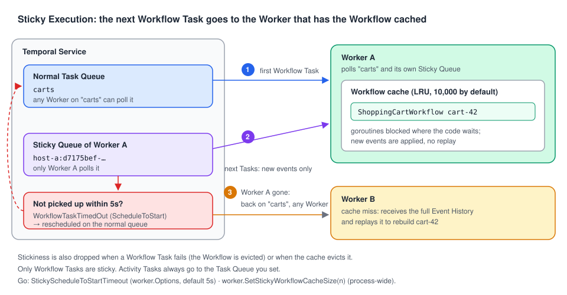

# 06 · Sticky Execution and the Workflow cache

> **Level:** daily use · **Read time:** ~12 min
> **Sources:** [Sticky Execution](https://docs.temporal.io/sticky-execution) · [Tasks — Workflow Task](https://docs.temporal.io/tasks#workflow-task) · [`worker.Options.StickyScheduleToStartTimeout`](https://pkg.go.dev/go.temporal.io/sdk/internal#WorkerOptions) · [`worker.SetStickyWorkflowCacheSize`](https://pkg.go.dev/go.temporal.io/sdk/worker#SetStickyWorkflowCacheSize)

---

## 1. The problem

[Chapter 02](02-tasks.md) explained that a Worker rebuilds a Workflow's state by **replaying** its
Event History. A shopping-cart Workflow that lives for two weeks and receives 400 "add item" Signals
would then replay 400 Signals to handle the 401st. Every Signal would cost more than the previous one.

Temporal avoids this with a cache and a routing trick: **Sticky Execution**. It is on by default, you
never have to enable it, but you should understand it to size Worker memory, read Event Histories,
and make sense of a 5-second pause after a Worker dies.

---

## 2. How it works



1. The first Workflow Task goes to the **normal** Task Queue you named (`carts`). Any Worker can take it.
2. The Worker that runs it keeps the Workflow **in memory** (its goroutines, blocked where the code
   waits) and starts polling a second, private queue: its **Sticky Queue**, with a generated name.
3. The Service puts the **next** Workflow Tasks for that Workflow on this Sticky Queue. The Worker
   receives only the **new** events, applies them to the cached state and continues. No replay.
4. If the Worker doesn't pick up a sticky Task within `StickyScheduleToStartTimeout` (**5s** by
   default), the Service gives up on stickiness for that Workflow: the Task times out and is
   rescheduled on the normal queue, where any Worker can take it and replay the full history.

You can see it in any Event History. Here is a real one (dev server, Go SDK v1.50.0): a cart Workflow
gets a Signal, the Worker stops, a second Signal arrives, a new Worker starts 7 seconds later:

```text
  2 WorkflowTaskScheduled  queue=carts                                     kind=Normal
  3 WorkflowTaskStarted
  4 WorkflowTaskCompleted
  5 WorkflowExecutionSignaled
  6 WorkflowTaskScheduled  queue=J9L636DG4L:d7175bef-2ae6-4a80-99c4-…      kind=Sticky   ← cached on that Worker
  7 WorkflowTaskStarted
  8 WorkflowTaskCompleted
  9 WorkflowExecutionSignaled                                                            ← Worker is gone now
 10 WorkflowTaskScheduled  queue=J9L636DG4L:d7175bef-2ae6-4a80-99c4-…      kind=Sticky
 11 WorkflowTaskTimedOut   timeout=ScheduleToStart                                       ← 5s later
 12 WorkflowTaskScheduled  queue=carts                                     kind=Normal   ← any Worker, full replay
```

The sticky queue name is `<hostname>:<uuid>`. Events 10–11 are the **sticky penalty** a Workflow pays
when its Worker disappears: up to `StickyScheduleToStartTimeout` of extra latency, once.

> **Correcting a simplification.** The Tasks page says that when a Worker picks up a Workflow Task
> *"it replays the entire Workflow Execution from the beginning"*. That is what happens on a
> **cache miss** (first Task on this Worker, after eviction, after a Worker restart, after a failed
> Task). With a cache hit through the Sticky Queue, the Worker only processes the new events. The
> Sticky Execution page describes this second path, and it is the common one.

---

## 3. What breaks stickiness

| Event | What happens |
| --- | --- |
| The Worker stops, crashes or is too busy to poll its Sticky Queue | The sticky Task times out after `StickyScheduleToStartTimeout`, then goes to the normal queue |
| A Workflow Task **fails** (panic, non-determinism…) | The Worker drops the Workflow from its cache (its state is unknown). The retry goes to the normal queue |
| The cache is full | The Worker evicts the least recently used Workflow. Its next Task replays |

None of this affects correctness: the Event History is the source of truth, the cache is only an
optimization. It affects **latency** and **CPU** (replays).

Sticky Execution only concerns **Workflow Tasks**. Activity Tasks have no history to cache, so they
always go to the Task Queue you set. To pin Activities to one Worker, use Task Routing
([chapter 07](07-task-routing.md)) or Sessions ([chapter 08](08-sessions.md)).

---

## 4. The Go knobs

| Setting | Where | Default | Notes |
| --- | --- | --- | --- |
| `StickyScheduleToStartTimeout` | `worker.Options` | 5s | Resolution is seconds. Lower = faster failover after a Worker dies, but more false failovers on a busy Worker |
| Workflow cache size | `worker.SetStickyWorkflowCacheSize(n)` | 10,000 | **Process-wide**, shared by every Worker in the process. Must be called **before any Worker starts** |
| `MaxConcurrentWorkflowTaskExecutionSize` / `MaxConcurrentWorkflowTaskPollers` | `worker.Options` | 1,000 / 2 | Can't be **1**: Workflow pollers alternate between the sticky and the normal queue, so a single one would only ever poll the sticky queue. `worker.New` panics |

A Worker can hold far **more** open Workflows than its cache size. The Workers page puts it this way:
*"a single Worker can handle millions of open Workflow Executions"*, at the cost of replays for those
that aren't cached. Size the cache to your **active** Workflows (those receiving events right now)
and your memory budget: each cached Workflow keeps its goroutines and local variables alive.

---

## 5. Example: a cart service Worker

```go
// file: carts/workflow.go
package carts

import (
	"go.temporal.io/sdk/workflow"
)

const TaskQueue = "carts"

type CartItem struct {
	SKU      string
	Quantity int
}

type CheckoutRequest struct {
	CartID string
	Items  []CartItem
}

// ShoppingCartWorkflow lives as long as the cart: it receives one Signal per change,
// so it benefits a lot from Sticky Execution (no replay per Signal).
func ShoppingCartWorkflow(ctx workflow.Context, cartID string) (CheckoutRequest, error) {
	cart := CheckoutRequest{CartID: cartID}
	addItem := workflow.GetSignalChannel(ctx, "add-item")
	checkout := workflow.GetSignalChannel(ctx, "checkout")

	done := false
	for !done {
		sel := workflow.NewSelector(ctx)
		sel.AddReceive(addItem, func(c workflow.ReceiveChannel, _ bool) {
			var item CartItem
			c.Receive(ctx, &item)
			cart.Items = append(cart.Items, item)
		})
		sel.AddReceive(checkout, func(c workflow.ReceiveChannel, _ bool) {
			c.Receive(ctx, nil)
			done = true
		})
		sel.Select(ctx)
	}
	return cart, nil
}
```

```go
// file: cmd/cart-worker/main.go
package main

import (
	"log"
	"time"

	"go.temporal.io/sdk/client"
	"go.temporal.io/sdk/worker"

	"github.com/acme/shop/carts"
)

func main() {
	// Process-wide, before any Worker starts. 2,000 active carts per replica is
	// what our memory budget allows.
	worker.SetStickyWorkflowCacheSize(2000)

	c, err := client.Dial(client.Options{})
	if err != nil {
		log.Fatalln("unable to create Temporal client", err)
	}
	defer c.Close()

	w := worker.New(c, carts.TaskQueue, worker.Options{
		// Fail over a little faster than the 5s default when a replica dies.
		StickyScheduleToStartTimeout: 3 * time.Second,
	})
	w.RegisterWorkflow(carts.ShoppingCartWorkflow)

	if err := w.Run(worker.InterruptCh()); err != nil {
		log.Fatalln("cart worker stopped", err)
	}
}
```

To check stickiness on a real Workflow, read where its Workflow Tasks were scheduled. A small
debugging tool:

```go
// file: cmd/sticky-report/main.go
package main

import (
	"context"
	"fmt"
	"log"
	"os"

	"go.temporal.io/sdk/client"
)

// Prints, for each Workflow Task of a Workflow, the queue it was scheduled on
// (Normal or Sticky) and any Workflow Task timeouts.
func main() {
	if len(os.Args) != 2 {
		log.Fatalln("usage: sticky-report <workflow-id>")
	}
	c, err := client.Dial(client.Options{})
	if err != nil {
		log.Fatalln("unable to create Temporal client", err)
	}
	defer c.Close()

	it := c.GetWorkflowHistory(context.Background(), os.Args[1], "", false, 0)
	for it.HasNext() {
		e, err := it.Next()
		if err != nil {
			log.Fatalln("read history", err)
		}
		if a := e.GetWorkflowTaskScheduledEventAttributes(); a != nil {
			fmt.Printf("%4d scheduled on %-8s %s\n", e.EventId, a.GetTaskQueue().GetKind(), a.GetTaskQueue().GetName())
		}
		if a := e.GetWorkflowTaskTimedOutEventAttributes(); a != nil {
			fmt.Printf("%4d timed out (%s)\n", e.EventId, a.GetTimeoutType())
		}
	}
}
```

The same information is in the Temporal UI (event details of `WorkflowTaskScheduled`) and in
`temporal workflow show --workflow-id <id> --output json`.

---

## 6. Key takeaways

- Sticky Execution routes a Workflow's next Workflow Tasks to the Worker that has it **cached**, through a private Sticky Queue. It's the default.
- A cache hit processes only the new events. Full replay happens on cache misses: new Worker, eviction, failed Task, restart.
- A dead Worker costs each of its cached Workflows one `StickyScheduleToStartTimeout` (**5s**) before the Task moves back to the normal queue.
- `worker.SetStickyWorkflowCacheSize` (default **10,000**) is process-wide and must be called before any Worker starts.
- Stickiness is for Workflow Tasks only. Activities are routed with Task Queues or Sessions.
