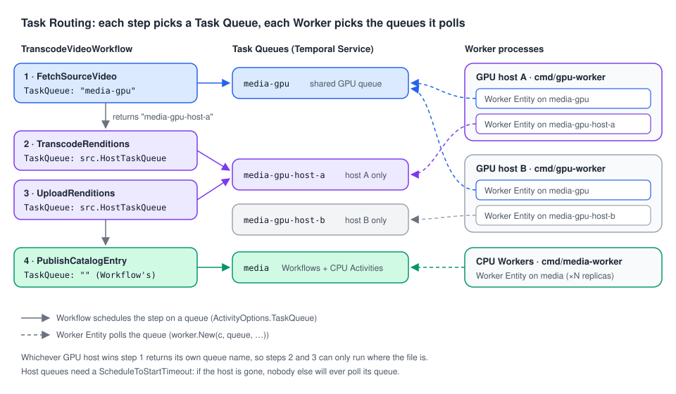

# 07 · Task Routing: sending work to the right Workers

> **Level:** advanced · **Read time:** ~18 min
> **Sources:** [Task Routing and Worker Sessions](https://docs.temporal.io/task-routing) · [Task Queues](https://docs.temporal.io/task-queue) · [Go file processing sample](https://github.com/temporalio/samples-go/tree/main/fileprocessing)

---

## 1. The problem

By default, every Activity of a Workflow runs on whichever Worker polls the Workflow's Task Queue
first ([chapter 03](03-task-queues.md)). That's what you want most of the time. But some work can't
run "anywhere":

- **Transcoding** needs a GPU. Your GPU boxes are expensive and few.
- **Card data** may only be processed inside the PCI-compliant network.
- The transcoder writes a 4 GB file to **local disk**: the upload step must run on the **same host**.
- An Activity loads a 2 GB ML model into memory once: later calls should hit **the same process**.
- Premium customers' jobs should overtake the free tier's backlog.

**Task Routing** is the answer to all of these: you choose the Task Queue of each Activity (or Child
Workflow), and you decide which Workers poll which queue. There is no other routing mechanism to learn.

---

## 2. The building block: one queue per kind of Worker



A Task Queue is just a name ([chapter 03](03-task-queues.md)): a Workflow can schedule each Activity
on any queue it wants with `ActivityOptions.TaskQueue`. The Activity inherits the Workflow's queue only
when you leave it empty.

| Pattern | Task Queues | Who polls |
| --- | --- | --- |
| **Specific environment** (GPU, PCI, a region, a data center) | one per environment: `media-gpu`, `payments-pci` | only Workers running in that environment |
| **Specific host** (files on local disk) | one per host: `media-gpu-<hostname>` | only the Worker on that host |
| **Specific process** (in-memory cache) | one per process: `ml-<hostname>-<pid>` | only that process |
| **Priority** | one per priority (`reports-high`, `reports-low`), or one queue with `Priority` | a Worker pool per queue, or one pool |
| **Versioning** | a new queue for a breaking change (`billing-v2`) | Workers with the new code |

All Workers on a given queue must register the **same** Activities (and Workflows) for that queue, or
Tasks fail with "not found" until a Worker that knows them picks them up.

---

## 3. Example: a video-transcoding pipeline

The `media` team transcodes uploaded videos:

1. **Fetch** the source video to local disk: needs a GPU box, any of them.
2. **Transcode** it to several renditions: same host as step 1 (the file is there).
3. **Upload** the renditions to object storage: same host again.
4. **Publish** the catalog entry: any regular (CPU) Worker.

Steps 2 and 3 use a **host-specific Task Queue**. The trick is that step 1 returns the name of that
queue: whichever GPU Worker downloads the file tells the Workflow where to send the rest.

### 3.1 Activities

```go
// file: media/activities.go
package media

import (
	"context"
	"fmt"
	"os"
	"path/filepath"

	"go.temporal.io/sdk/activity"
)

const (
	// CPUTaskQueue is polled by the regular media Workers (and runs the Workflows).
	CPUTaskQueue = "media"
	// GPUTaskQueue is polled by every GPU Worker.
	GPUTaskQueue = "media-gpu"
)

// HostTaskQueue is the queue only the GPU Worker on this host polls.
func HostTaskQueue(hostname string) string { return GPUTaskQueue + "-" + hostname }

type FetchSourceResult struct {
	LocalPath     string
	HostTaskQueue string // where the next steps must run
}

type Rendition struct {
	Name      string // "1080p", "720p", …
	LocalPath string
}

// ObjectStore and Transcoder are external systems (fakes in tests).
type ObjectStore interface {
	Download(ctx context.Context, key, localPath string) error
	Upload(ctx context.Context, localPath, key string) (url string, err error)
}

type Transcoder interface {
	Transcode(ctx context.Context, sourcePath, outDir, profile string) (string, error)
}

// GPUActivities run on GPU Workers. HostTaskQueue is set at Worker startup.
type GPUActivities struct {
	Store         ObjectStore
	Transcoder    Transcoder
	ScratchDir    string
	HostTaskQueue string
}

func (a *GPUActivities) FetchSourceVideo(ctx context.Context, videoID, sourceKey string) (FetchSourceResult, error) {
	path := filepath.Join(a.ScratchDir, videoID, "source.mp4")
	if err := os.MkdirAll(filepath.Dir(path), 0o755); err != nil {
		return FetchSourceResult{}, err
	}
	if err := a.Store.Download(ctx, sourceKey, path); err != nil {
		return FetchSourceResult{}, fmt.Errorf("download %s: %w", sourceKey, err)
	}
	return FetchSourceResult{LocalPath: path, HostTaskQueue: a.HostTaskQueue}, nil
}

func (a *GPUActivities) TranscodeRenditions(ctx context.Context, sourcePath string, profiles []string) ([]Rendition, error) {
	out := make([]Rendition, 0, len(profiles))
	for _, p := range profiles {
		path, err := a.Transcoder.Transcode(ctx, sourcePath, filepath.Dir(sourcePath), p)
		if err != nil {
			return nil, fmt.Errorf("transcode %s: %w", p, err)
		}
		out = append(out, Rendition{Name: p, LocalPath: path})
		activity.RecordHeartbeat(ctx, p)
	}
	return out, nil
}

func (a *GPUActivities) UploadRenditions(ctx context.Context, videoID string, renditions []Rendition) (map[string]string, error) {
	urls := make(map[string]string, len(renditions))
	for _, r := range renditions {
		url, err := a.Store.Upload(ctx, r.LocalPath, fmt.Sprintf("videos/%s/%s.mp4", videoID, r.Name))
		if err != nil {
			return nil, err
		}
		urls[r.Name] = url
	}
	// The local files are no longer needed.
	return urls, os.RemoveAll(filepath.Join(a.ScratchDir, videoID))
}

// Catalog is the video catalog service.
type Catalog interface {
	Publish(ctx context.Context, videoID string, renditionURLs map[string]string) error
}

// CatalogActivities run on the regular (CPU) Workers.
type CatalogActivities struct {
	Catalog Catalog
}

func (a *CatalogActivities) PublishCatalogEntry(ctx context.Context, videoID string, urls map[string]string) error {
	return a.Catalog.Publish(ctx, videoID, urls)
}
```

### 3.2 The Workflow

```go
// file: media/workflow.go
package media

import (
	"errors"
	"time"

	enumspb "go.temporal.io/api/enums/v1"
	"go.temporal.io/sdk/temporal"
	"go.temporal.io/sdk/workflow"
)

type TranscodeVideoInput struct {
	VideoID   string
	SourceKey string
	Profiles  []string
}

func TranscodeVideoWorkflow(ctx workflow.Context, in TranscodeVideoInput) (map[string]string, error) {
	var gpu *GPUActivities
	var catalog *CatalogActivities
	logger := workflow.GetLogger(ctx)

	var urls map[string]string
	var err error
	// If the GPU host dies between steps, its files are gone: start over on another host.
	for attempt := 1; attempt <= 3; attempt++ {
		urls, err = transcodeOnOneHost(ctx, gpu, in)
		if err == nil || !hostLost(err) {
			break
		}
		logger.Warn("GPU host lost, restarting on another host", "attempt", attempt, "error", err)
	}
	if err != nil {
		return nil, err
	}

	// Step 4 on the regular Workers: the Workflow's own Task Queue is used when TaskQueue is empty.
	cpuCtx := workflow.WithActivityOptions(ctx, workflow.ActivityOptions{StartToCloseTimeout: 30 * time.Second})
	err = workflow.ExecuteActivity(cpuCtx, catalog.PublishCatalogEntry, in.VideoID, urls).Get(ctx, nil)
	return urls, err
}

func transcodeOnOneHost(ctx workflow.Context, gpu *GPUActivities, in TranscodeVideoInput) (map[string]string, error) {
	// Step 1: any GPU Worker.
	fetchCtx := workflow.WithActivityOptions(ctx, workflow.ActivityOptions{
		TaskQueue:           GPUTaskQueue,
		StartToCloseTimeout: 10 * time.Minute,
	})
	var src FetchSourceResult
	if err := workflow.ExecuteActivity(fetchCtx, gpu.FetchSourceVideo, in.VideoID, in.SourceKey).Get(ctx, &src); err != nil {
		return nil, err
	}

	// Steps 2 and 3: only the Worker on the host that has the file.
	hostCtx := workflow.WithActivityOptions(ctx, workflow.ActivityOptions{
		TaskQueue: src.HostTaskQueue,
		// Nobody else polls this queue: if the host is gone, fail fast instead of waiting forever.
		ScheduleToStartTimeout: time.Minute,
		StartToCloseTimeout:    2 * time.Hour,
		HeartbeatTimeout:       2 * time.Minute,
	})
	var renditions []Rendition
	if err := workflow.ExecuteActivity(hostCtx, gpu.TranscodeRenditions, src.LocalPath, in.Profiles).Get(ctx, &renditions); err != nil {
		return nil, err
	}
	var urls map[string]string
	err := workflow.ExecuteActivity(hostCtx, gpu.UploadRenditions, in.VideoID, renditions).Get(ctx, &urls)
	return urls, err
}

// hostLost reports whether a host-pinned Activity was never picked up (the host is gone)
// or lost its heartbeat (the host died mid-way).
func hostLost(err error) bool {
	var timeoutErr *temporal.TimeoutError
	if !errors.As(err, &timeoutErr) {
		return false
	}
	return timeoutErr.TimeoutType() == enumspb.TIMEOUT_TYPE_SCHEDULE_TO_START ||
		timeoutErr.TimeoutType() == enumspb.TIMEOUT_TYPE_HEARTBEAT
}
```

> **Why `ScheduleToStartTimeout` matters here.** On a shared queue you almost never set it: another
> Worker will pick the Task up. On a host-specific queue **only one Worker** exists. Without a
> Schedule-To-Start timeout, a Task sent to a dead host's queue waits until its Schedule-To-Close or
> the Workflow's own timeout. A Schedule-To-Start timeout is not retried: the Activity fails at once
> with a `*temporal.TimeoutError`, and `hostLost` sends the whole sequence to another host. A host that
> dies **during** a step is detected by the `HeartbeatTimeout`.

### 3.3 The Workers: one process, two Worker Entities

Each GPU host runs **one process with two Worker Entities**: one on the shared `media-gpu` queue (to
win step 1) and one on its own `media-gpu-<hostname>` queue (for steps 2 and 3). Both register the same
Activities struct, so the Activity knows which host queue to return.

```go
// file: cmd/gpu-worker/main.go
package main

import (
	"context"
	"log"
	"os"
	"path/filepath"

	"go.temporal.io/sdk/client"
	"go.temporal.io/sdk/worker"

	"github.com/acme/shop/media"
)

// Fakes standing in for the object store client and the ffmpeg wrapper.
type localStore struct{}

func (localStore) Download(_ context.Context, _, localPath string) error {
	return os.WriteFile(localPath, []byte("video"), 0o644)
}
func (localStore) Upload(_ context.Context, _, key string) (string, error) {
	return "https://cdn.example/" + key, nil
}

type fakeTranscoder struct{}

func (fakeTranscoder) Transcode(_ context.Context, _, outDir, profile string) (string, error) {
	return filepath.Join(outDir, profile+".mp4"), nil
}

func main() {
	hostname, err := os.Hostname()
	if err != nil {
		log.Fatalln("hostname", err)
	}
	c, err := client.Dial(client.Options{})
	if err != nil {
		log.Fatalln("unable to create Temporal client", err)
	}
	defer c.Close()

	acts := &media.GPUActivities{
		Store:         localStore{},
		Transcoder:    fakeTranscoder{},
		ScratchDir:    filepath.Join(os.TempDir(), "transcode"),
		HostTaskQueue: media.HostTaskQueue(hostname),
	}

	// Shared GPU queue: any GPU host can fetch a source video.
	shared := worker.New(c, media.GPUTaskQueue, worker.Options{
		DisableWorkflowWorker:              true,
		MaxConcurrentActivityExecutionSize: 4, // limited by local disk and GPUs
	})
	shared.RegisterActivity(acts)

	// Host queue: only this process polls it.
	host := worker.New(c, acts.HostTaskQueue, worker.Options{DisableWorkflowWorker: true})
	host.RegisterActivity(acts)

	if err := host.Start(); err != nil {
		log.Fatalln("start host worker", err)
	}
	defer host.Stop()
	// Run the shared Worker last: a host that can't serve its own queue must not win new videos.
	if err := shared.Run(worker.InterruptCh()); err != nil {
		log.Fatalln("gpu worker stopped", err)
	}
}
```

```go
// file: cmd/media-worker/main.go
package main

import (
	"context"
	"log"

	"go.temporal.io/sdk/client"
	"go.temporal.io/sdk/worker"

	"github.com/acme/shop/media"
)

type fakeCatalog struct{}

func (fakeCatalog) Publish(context.Context, string, map[string]string) error { return nil }

// Regular (CPU) Worker: runs the Workflows and the catalog Activity.
func main() {
	c, err := client.Dial(client.Options{})
	if err != nil {
		log.Fatalln("unable to create Temporal client", err)
	}
	defer c.Close()

	w := worker.New(c, media.CPUTaskQueue, worker.Options{})
	w.RegisterWorkflow(media.TranscodeVideoWorkflow)
	w.RegisterActivity(&media.CatalogActivities{Catalog: fakeCatalog{}})

	if err := w.Run(worker.InterruptCh()); err != nil {
		log.Fatalln("media worker stopped", err)
	}
}
```

Checked on a dev server (Temporal CLI 1.9.1, Go SDK v1.50.0): both renditions are transcoded and
uploaded by the host that fetched the source. In a second run, the host that won step 1 never polled
its host queue: after the 1-minute Schedule-To-Start timeout the Workflow logged *"GPU host lost,
restarting on another host"* and completed on the other host.

The Workflow is started on `media` (`StartWorkflowOptions{TaskQueue: media.CPUTaskQueue}`). The GPU
Workers never run Workflow code (`DisableWorkflowWorker: true`), so they don't need the Workflow's
dependencies.

The Go SDK has a built-in version of steps 1–3: **Worker Sessions** ([chapter 08](08-sessions.md))
create the host-specific queue, detect a dead host and limit concurrent sessions for you. The manual
pattern above is still worth knowing: it works in every SDK, and you control every timeout.

---

## 4. Routing to one process

When the thing to reuse is **in memory** (a loaded ML model, a warmed cache), route to a **process**,
not a host: build the queue name from something unique to the process, for example
`fmt.Sprintf("fraud-model-%s-%d", hostname, os.Getpid())`, or a random ID generated at startup.
Everything else is the same as section 3. A restart creates a new queue, so Tasks routed to the old one
hit their Schedule-To-Start timeout: plan for it as in `hostLost` above.

---

## 5. Priorities

Two ways, from the Task Routing page:

**One Task Queue per priority**, each with its own Worker pool. Simple and isolated: a flood of
free-tier reports can't slow premium ones, because they don't share Workers. But you pay for idle
capacity in each pool.

```go
// file: reports/queues.go
package reports

const (
	PremiumTaskQueue  = "reports-premium"
	StandardTaskQueue = "reports-standard"
)

// ReportTaskQueue picks the queue (and so the Worker pool) for a customer tier.
func ReportTaskQueue(tier string) string {
	if tier == "premium" {
		return PremiumTaskQueue
	}
	return StandardTaskQueue
}
```

**One Task Queue with Task priorities.** `ActivityOptions.Priority` (also on `StartWorkflowOptions`
and `ChildWorkflowOptions`) takes a `temporal.Priority`. `PriorityKey` goes from 1 (highest) to 5 by
default, and unset means 3. When the queue has a backlog, lower keys are dispatched first. The same
struct carries `FairnessKey` / `FairnessWeight` to share throughput between tenants. See
[Task Queue Priority and Fairness](https://docs.temporal.io/develop/task-queue-priority-fairness) for
its availability on your Temporal Service.

```go
// file: reports/workflow.go
package reports

import (
	"time"

	"go.temporal.io/sdk/temporal"
	"go.temporal.io/sdk/workflow"
)

type MonthlyReportInput struct {
	CustomerID string
	Tier       string
	Month      string
}

func MonthlyStatementWorkflow(ctx workflow.Context, in MonthlyReportInput) (string, error) {
	priority := temporal.Priority{PriorityKey: 4, FairnessKey: in.CustomerID}
	if in.Tier == "premium" {
		priority.PriorityKey = 1
	}
	ctx = workflow.WithActivityOptions(ctx, workflow.ActivityOptions{
		TaskQueue:           StandardTaskQueue,
		StartToCloseTimeout: 10 * time.Minute,
		Priority:            priority,
	})
	var pdfURL string
	err := workflow.ExecuteActivity(ctx, "RenderStatementPDF", in.CustomerID, in.Month).Get(ctx, &pdfURL)
	return pdfURL, err
}
```

---

## 6. Versioning by Task Queue

The Task Routing page calls a new Task Queue *"the simplest way to version your code"*: when an
Activity changes incompatibly, register the new version on `billing-v2`, point new Workflows at it,
and keep `billing` Workers running until the old Workflows finish. It works, but you manage the
queues, the Worker fleets and the switch by hand. **Worker Versioning** does the same job without new
queue names ([chapter 11](11-worker-versioning.md)).

---

## 7. Key takeaways

- Task Routing = choosing a Task Queue per Activity (`ActivityOptions.TaskQueue`) and choosing which Workers poll which queue.
- Use **dedicated queues** for special environments (GPU, PCI). Run Activity-only Workers there with `DisableWorkflowWorker: true`.
- For host affinity, have the first Activity **return** a host-specific queue name, and run two Worker Entities per host process: shared + host.
- On a queue only one Worker polls, set a **`ScheduleToStartTimeout`** and handle the timeout by starting over elsewhere.
- Priorities: one queue per priority (isolation), or `temporal.Priority` on one queue (shared capacity).
- In Go, Worker Sessions ([chapter 08](08-sessions.md)) automate host affinity.
