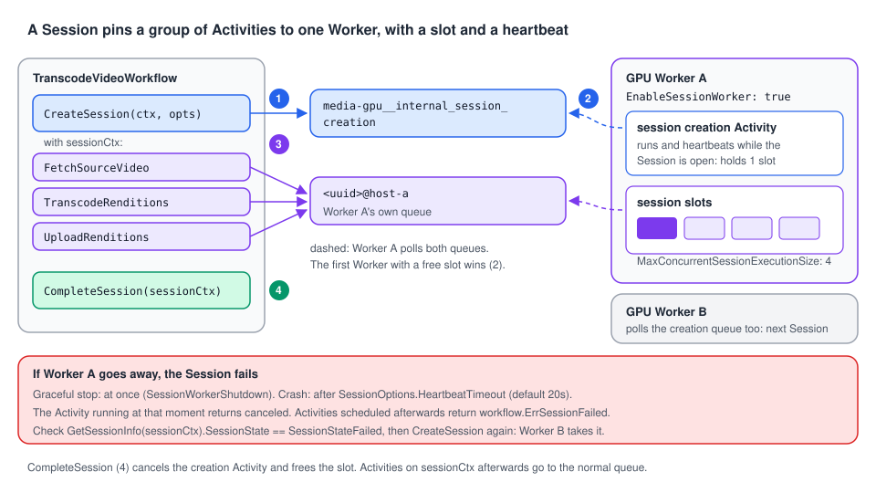

# 08 · Worker Sessions

> **Level:** advanced · **Read time:** ~15 min
> **Sources:** [Go SDK — Worker Sessions](https://docs.temporal.io/develop/go/workers/sessions) · [Task Routing and Worker Sessions](https://docs.temporal.io/task-routing#worker-session) · [`workflow.CreateSession`](https://pkg.go.dev/go.temporal.io/sdk/workflow#CreateSession)

---

## 1. The problem

[Chapter 07](07-task-routing.md) pinned the transcoding steps to one GPU host by hand: a host-specific
Task Queue, two Worker Entities per process, a Schedule-To-Start timeout to detect a dead host, a loop
to start over. It works, but it's a lot of plumbing, and two things are still missing:

- **A limit per host.** A host with 4 GPUs should accept at most 4 videos at a time, whatever the
  number of Activities each video schedules.
- **Fast failure detection.** If the host dies between two steps, you want to know in seconds, not
  when a timeout you guessed expires.

The Go SDK packages this pattern as **Worker Sessions**. A Session is a group of Activities that the
SDK guarantees run on the **same Worker**, without you naming any Task Queue. Sessions are **Go only**:
the other SDKs use the manual pattern of chapter 07.

---

## 2. How a Session works



1. The Worker opts in with `EnableSessionWorker: true`. Besides its normal pollers, it then polls two
   internal queues: `<task-queue>__internal_session_creation` and a queue unique to this Worker
   (`<uuid>@<hostname>`).
2. The Workflow calls `workflow.CreateSession`. The SDK schedules an internal **session creation
   Activity** on the creation queue. The first Worker with a free session slot takes it, and becomes
   the Session's Worker.
3. That creation Activity keeps running (and **heartbeating**) for the whole Session. It holds one of
   the Worker's `MaxConcurrentSessionExecutionSize` slots.
4. Every Activity scheduled with the returned **session context** goes to that Worker's unique queue.
5. `workflow.CompleteSession` cancels the creation Activity and runs a completion Activity: the slot is
   released.

If the Worker goes away, the Session **fails**: its context is canceled, the Activities running in it
are canceled, and new `ExecuteActivity` calls with the session context return
`workflow.ErrSessionFailed` without being scheduled. How fast depends on how the Worker goes away:

- **Graceful stop** (`Stop()`, `SIGTERM` through `worker.InterruptCh()`): the creation Activity fails at
  once with `SessionWorkerShutdown` (observed on a dev server).
- **Crash** or network loss: the creation Activity stops heartbeating, and the Session fails after its
  `HeartbeatTimeout` (20s by default).

---

## 3. The API

| Call | What it does |
| --- | --- |
| `worker.Options{EnableSessionWorker: true}` | This Worker accepts Sessions |
| `worker.Options{MaxConcurrentSessionExecutionSize: n}` | Max open Sessions on this Worker. Default **1,000** |
| `workflow.CreateSession(ctx, &workflow.SessionOptions{…})` | Creates a Session on a Worker polling the Task Queue set in the **ActivityOptions** of `ctx` (or the Workflow's queue) |
| `workflow.SessionOptions` | `CreationTimeout` (required): how long to wait for a Worker with a free slot. `ExecutionTimeout` (required): max Session lifetime. `HeartbeatTimeout` (optional, default 20s): how fast a dead Worker is detected |
| `workflow.CompleteSession(sessionCtx)` | Releases the slot and cancels the session context. Safe on a failed Session: call it with `defer` |
| `workflow.GetSessionInfo(sessionCtx)` | `SessionID`, `HostName`, `SessionState`. `nil` if the context has no Session |
| `workflow.ErrSessionFailed` | Returned by `ExecuteActivity(...).Get` for Activities scheduled **after** the Session failed |
| `info.GetRecreateToken()` + `workflow.RecreateSession(ctx, token, opts)` | Open a new Session **on the same Worker** in another run (after Continue-As-New) |

Rules worth remembering:

- If **no Worker** has a free slot, `CreateSession` keeps trying until `CreationTimeout`, then returns an error.
- Calling `CreateSession` with a context that already holds an **open** Session returns an error.
- An **Activity** failing doesn't fail the Session. You handle Activity errors as usual and decide whether to complete the Session.
- When the Session fails **during** an Activity, that Activity's `Get` returns a **canceled** error, not `ErrSessionFailed`. Check `workflow.GetSessionInfo(sessionCtx).SessionState == workflow.SessionStateFailed` to tell the two apart (see `sessionError` below).
- After `CompleteSession`, the context still works, but Activities go back to the normal Task Queue (any Worker).

---

## 4. Example: the transcoding pipeline with a Session

The same pipeline as [chapter 07](07-task-routing.md), section 3. Compare: no host queue name, no
second Worker Entity, no Schedule-To-Start timeout, and a per-host limit.

```go
// file: media/activities.go
package media

import (
	"context"
	"fmt"
	"os"
	"path/filepath"

	"go.temporal.io/sdk/activity"
)

const (
	CPUTaskQueue = "media"
	GPUTaskQueue = "media-gpu"
)

type Rendition struct {
	Name      string
	LocalPath string
}

type ObjectStore interface {
	Download(ctx context.Context, key, localPath string) error
	Upload(ctx context.Context, localPath, key string) (url string, err error)
}

type Transcoder interface {
	Transcode(ctx context.Context, sourcePath, outDir, profile string) (string, error)
}

// GPUActivities run on GPU Workers, inside a Session.
type GPUActivities struct {
	Store      ObjectStore
	Transcoder Transcoder
	ScratchDir string
}

func (a *GPUActivities) FetchSourceVideo(ctx context.Context, videoID, sourceKey string) (string, error) {
	path := filepath.Join(a.ScratchDir, videoID, "source.mp4")
	if err := os.MkdirAll(filepath.Dir(path), 0o755); err != nil {
		return "", err
	}
	if err := a.Store.Download(ctx, sourceKey, path); err != nil {
		return "", fmt.Errorf("download %s: %w", sourceKey, err)
	}
	return path, nil
}

func (a *GPUActivities) TranscodeRenditions(ctx context.Context, sourcePath string, profiles []string) ([]Rendition, error) {
	out := make([]Rendition, 0, len(profiles))
	for _, p := range profiles {
		path, err := a.Transcoder.Transcode(ctx, sourcePath, filepath.Dir(sourcePath), p)
		if err != nil {
			return nil, fmt.Errorf("transcode %s: %w", p, err)
		}
		out = append(out, Rendition{Name: p, LocalPath: path})
		activity.RecordHeartbeat(ctx, p)
	}
	return out, nil
}

func (a *GPUActivities) UploadRenditions(ctx context.Context, videoID string, renditions []Rendition) (map[string]string, error) {
	urls := make(map[string]string, len(renditions))
	for _, r := range renditions {
		url, err := a.Store.Upload(ctx, r.LocalPath, fmt.Sprintf("videos/%s/%s.mp4", videoID, r.Name))
		if err != nil {
			return nil, err
		}
		urls[r.Name] = url
	}
	return urls, os.RemoveAll(filepath.Join(a.ScratchDir, videoID))
}
```

```go
// file: media/workflow.go
package media

import (
	"errors"
	"time"

	"go.temporal.io/sdk/workflow"
)

type TranscodeVideoInput struct {
	VideoID   string
	SourceKey string
	Profiles  []string
}

func TranscodeVideoWorkflow(ctx workflow.Context, in TranscodeVideoInput) (map[string]string, error) {
	logger := workflow.GetLogger(ctx)
	var urls map[string]string
	var err error
	for attempt := 1; attempt <= 3; attempt++ {
		urls, err = transcodeInSession(ctx, in)
		if !errors.Is(err, workflow.ErrSessionFailed) {
			break
		}
		// The GPU Worker died: its local files are gone. Start over on another Worker.
		logger.Warn("GPU session failed, retrying on another Worker", "attempt", attempt)
	}
	if err != nil {
		return nil, err
	}

	cpuCtx := workflow.WithActivityOptions(ctx, workflow.ActivityOptions{StartToCloseTimeout: 30 * time.Second})
	err = workflow.ExecuteActivity(cpuCtx, "PublishCatalogEntry", in.VideoID, urls).Get(ctx, nil)
	return urls, err
}

func transcodeInSession(ctx workflow.Context, in TranscodeVideoInput) (map[string]string, error) {
	// The Session is created on a Worker polling the Task Queue of these ActivityOptions.
	ctx = workflow.WithActivityOptions(ctx, workflow.ActivityOptions{
		TaskQueue:           GPUTaskQueue,
		StartToCloseTimeout: 2 * time.Hour,
		HeartbeatTimeout:    2 * time.Minute,
	})
	sessionCtx, err := workflow.CreateSession(ctx, &workflow.SessionOptions{
		CreationTimeout:  30 * time.Minute, // wait up to 30 min for a free GPU slot
		ExecutionTimeout: 3 * time.Hour,    // the whole video, all steps
		HeartbeatTimeout: 30 * time.Second, // detect a dead GPU Worker within ~30s
	})
	if err != nil {
		return nil, err
	}
	defer workflow.CompleteSession(sessionCtx)

	info := workflow.GetSessionInfo(sessionCtx)
	workflow.GetLogger(ctx).Info("transcoding session open", "sessionID", info.SessionID, "host", info.HostName)

	var a *GPUActivities
	var sourcePath string
	if err := workflow.ExecuteActivity(sessionCtx, a.FetchSourceVideo, in.VideoID, in.SourceKey).Get(sessionCtx, &sourcePath); err != nil {
		return nil, sessionError(sessionCtx, err)
	}
	var renditions []Rendition
	if err := workflow.ExecuteActivity(sessionCtx, a.TranscodeRenditions, sourcePath, in.Profiles).Get(sessionCtx, &renditions); err != nil {
		return nil, sessionError(sessionCtx, err)
	}
	var urls map[string]string
	err = workflow.ExecuteActivity(sessionCtx, a.UploadRenditions, in.VideoID, renditions).Get(sessionCtx, &urls)
	return urls, sessionError(sessionCtx, err)
}

// sessionError turns any Activity error caused by the Session's Worker going away into
// ErrSessionFailed. An Activity that was running at that moment returns a *canceled*
// error, not ErrSessionFailed: only the calls made after the failure get ErrSessionFailed.
func sessionError(sessionCtx workflow.Context, err error) error {
	if err != nil && workflow.GetSessionInfo(sessionCtx).SessionState == workflow.SessionStateFailed {
		return workflow.ErrSessionFailed
	}
	return err
}
```

The GPU Worker: one Worker Entity, Sessions enabled, at most 4 videos at a time on this host.

```go
// file: cmd/gpu-worker/main.go
package main

import (
	"context"
	"log"
	"os"
	"path/filepath"

	"go.temporal.io/sdk/client"
	"go.temporal.io/sdk/worker"

	"github.com/acme/shop/media"
)

type localStore struct{}

func (localStore) Download(_ context.Context, _, localPath string) error {
	return os.WriteFile(localPath, []byte("video"), 0o644)
}
func (localStore) Upload(_ context.Context, _, key string) (string, error) {
	return "https://cdn.example/" + key, nil
}

type fakeTranscoder struct{}

func (fakeTranscoder) Transcode(_ context.Context, _, outDir, profile string) (string, error) {
	return filepath.Join(outDir, profile+".mp4"), nil
}

func main() {
	c, err := client.Dial(client.Options{})
	if err != nil {
		log.Fatalln("unable to create Temporal client", err)
	}
	defer c.Close()

	w := worker.New(c, media.GPUTaskQueue, worker.Options{
		DisableWorkflowWorker:             true,
		EnableSessionWorker:               true,
		MaxConcurrentSessionExecutionSize: 4, // one video per GPU
	})
	w.RegisterActivity(&media.GPUActivities{
		Store:      localStore{},
		Transcoder: fakeTranscoder{},
		ScratchDir: filepath.Join(os.TempDir(), "transcode"),
	})

	if err := w.Run(worker.InterruptCh()); err != nil {
		log.Fatalln("gpu worker stopped", err)
	}
}
```

The `media` Worker that runs the Workflow and `PublishCatalogEntry` is the same as in chapter 07.

**Checked on a dev server** (Temporal CLI 1.9.1, Go SDK v1.50.0) with two GPU Workers: all three
Activities of a video ran on the Worker that opened the Session. When that Worker was stopped during
`TranscodeRenditions`, the Activity returned `canceled` and the Session state was `Failed`:
`sessionError` turned it into `ErrSessionFailed`, and the loop opened a new Session on the other Worker
and completed. Without `sessionError`, the Workflow failed with the `canceled` error. The Go page's
sample has the same gap: it returns the Activity error as is.

---

## 5. Long Sessions and Continue-As-New

A Workflow that transcodes a whole 500-episode back-catalog on one host would grow a huge Event
History. Split it with Continue-As-New, and use a **recreate token** so the next run gets a Session on
the **same Worker** (whose disk still has the cached intro/outro assets):

```go
// file: media/backcatalog.go
package media

import (
	"time"

	"go.temporal.io/sdk/workflow"
)

type BackCatalogInput struct {
	SeriesID      string
	EpisodeKeys   []string
	Profiles      []string
	RecreateToken []byte // set by the previous run
}

const episodesPerRun = 50

func TranscodeBackCatalogWorkflow(ctx workflow.Context, in BackCatalogInput) error {
	ctx = workflow.WithActivityOptions(ctx, workflow.ActivityOptions{
		TaskQueue:           GPUTaskQueue,
		StartToCloseTimeout: 2 * time.Hour,
		HeartbeatTimeout:    2 * time.Minute,
	})
	opts := &workflow.SessionOptions{CreationTimeout: time.Hour, ExecutionTimeout: 24 * time.Hour}

	var sessionCtx workflow.Context
	var err error
	if in.RecreateToken != nil {
		sessionCtx, err = workflow.RecreateSession(ctx, in.RecreateToken, opts)
	} else {
		sessionCtx, err = workflow.CreateSession(ctx, opts)
	}
	if err != nil {
		return err
	}

	var a *GPUActivities
	n := min(episodesPerRun, len(in.EpisodeKeys))
	for _, key := range in.EpisodeKeys[:n] {
		var src string
		if err := workflow.ExecuteActivity(sessionCtx, a.FetchSourceVideo, in.SeriesID, key).Get(sessionCtx, &src); err != nil {
			workflow.CompleteSession(sessionCtx)
			return err
		}
		if err := workflow.ExecuteActivity(sessionCtx, a.TranscodeRenditions, src, in.Profiles).Get(sessionCtx, nil); err != nil {
			workflow.CompleteSession(sessionCtx)
			return err
		}
	}

	token := workflow.GetSessionInfo(sessionCtx).GetRecreateToken()
	workflow.CompleteSession(sessionCtx)
	if n == len(in.EpisodeKeys) {
		return nil
	}
	return workflow.NewContinueAsNewError(ctx, TranscodeBackCatalogWorkflow, BackCatalogInput{
		SeriesID:      in.SeriesID,
		EpisodeKeys:   in.EpisodeKeys[n:],
		Profiles:      in.Profiles,
		RecreateToken: token,
	})
}
```

Checked on a dev server with two session-enabled GPU Workers: 120 episodes, three runs chained by
Continue-As-New, and all 120 downloads ran on the same Worker.

`RecreateSession` returns errors in the same cases as `CreateSession` (no free slot before
`CreationTimeout`), and also when the token can't be decoded.

---

## 6. Limits and caveats

| Topic | What to know |
| --- | --- |
| Scope of the limit | `MaxConcurrentSessionExecutionSize` is counted **per Worker** that has `EnableSessionWorker` (each gets its own internal ID). The docs' FAQ says "per Worker Process", which is the same thing if you run one session-enabled Worker per process, as advised |
| Default limit | The Go page says the default is *"a very large value"*. In SDK v1.50.0 it is **1,000** (`defaultMaxConcurrentSessionExecutionSize`) |
| Worker restarts | A restarted process is a **new** Worker: open Sessions on the old one fail. The docs list automatic re-establishment as future work |
| One resource type | All Sessions consume the same kind of slot. You can't say "this Session needs a GPU, that one only disk" (also listed as future work) |
| Worker Versioning | The SDK panics on `EnableSessionWorker` + the **deprecated** `UseBuildIDForVersioning` (`cannot set both EnableSessionWorker and UseBuildIDForVersioning`, see [sdk-go#1227](https://github.com/temporalio/sdk-go/issues/1227)). With the current `DeploymentOptions.UseVersioning`, `worker.New` accepts it and the SDK unversions the Worker's internal session queue, but no doc page covers Sessions with Worker Versioning ([chapter 11](11-worker-versioning.md)). Test it before relying on it |

---

## 7. Key takeaways

- A Session pins a group of Activities to **one Worker**, without naming Task Queues. Go only.
- Enable it on the Worker (`EnableSessionWorker`), cap it with `MaxConcurrentSessionExecutionSize` (default **1,000**, per session-enabled Worker).
- `CreateSession` uses the Task Queue of the context's ActivityOptions. Always `defer workflow.CompleteSession(sessionCtx)`.
- A Worker that stops fails its Sessions at once. A crashed one is detected after the Session's `HeartbeatTimeout` (default 20s).
- The Activity running at that moment returns **canceled**, later ones `ErrSessionFailed`: check `SessionState == SessionStateFailed`, then start over with a new Session.
- `GetRecreateToken` + `RecreateSession` carry a Session's Worker across Continue-As-New.
