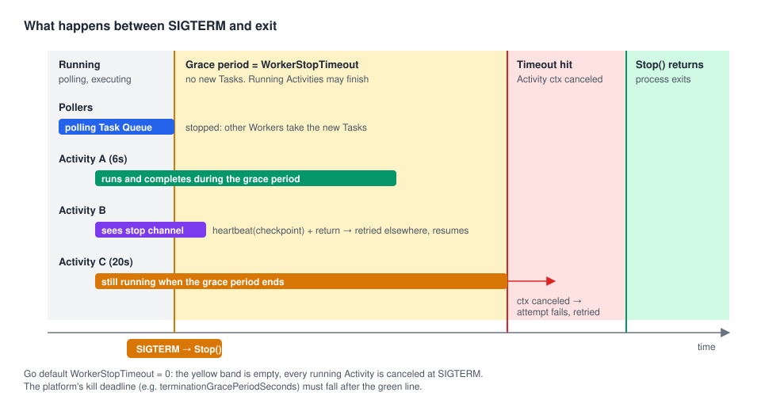

# 10 · Graceful shutdown: deploying without losing work

> **Level:** production · **Read time:** ~15 min
> **Sources:** [Encyclopedia — Worker Shutdown Behavior](https://docs.temporal.io/encyclopedia/workers/worker-shutdown) · [Go SDK — Run a Worker: Shut down a Worker](https://docs.temporal.io/develop/go/workers/run-worker-process) · [`worker.Options`](https://pkg.go.dev/go.temporal.io/sdk/internal#WorkerOptions)

---

## 1. The problem

Workers restart all the time: every deploy, every autoscaling event, every node drain. Each time, some
Activities are running: a 40-second carrier API call, a 3-minute CSV export. What happens to them?

Temporal never **loses** them: an Activity that doesn't report back is retried by the Service after its
timeout. But "retried after its timeout" can mean minutes of delay, duplicated side effects and noisy
alerts on every deploy. **Graceful shutdown** lets a Worker finish (or cleanly hand back) its current
work before it exits.

---

## 2. The shutdown sequence



When `Stop()` is called (directly, or by `Run` when the process gets `SIGINT`/`SIGTERM`):

1. The Worker **stops polling**: it takes no new Tasks from its Task Queues.
2. The **Worker stop channel** closes. Activities can see it with `activity.GetWorkerStopChannel(ctx)`.
3. In-flight **Activities** keep running for up to `WorkerStopTimeout`.
4. When the timeout hits (or immediately, if it is 0), the **Activity contexts are canceled**. Each
   canceled attempt is reported as failed and **retried** by the Service according to its Retry Policy.
5. In-flight **Workflow Tasks** are completed. They are short (milliseconds) unless Workflow code
   blocks incorrectly or runs Local Activities (see §5).
6. `Stop()` returns.

Workflows are never affected by a Worker stopping: their state lives in the Event History, and the next
Workflow Task goes to any other Worker ([chapter 06](06-sticky-execution.md)).

---

## 3. `WorkerStopTimeout` defaults to **0**

The Go page says that on `SIGINT`/`SIGTERM` the Worker "waits for in-flight Tasks to finish, up to the
`WorkerStopTimeout`". It doesn't say that the default is **0s**, which means **no wait at all**.

Observed on a dev server (Go SDK v1.50.0, Temporal Server 1.32.0). An Activity that sleeps for a given
duration, `Stop()` called 2 seconds after it starts:

| `WorkerStopTimeout` | Activity duration | `Stop()` returned after | What happened to the Activity |
| --- | --- | --- | --- |
| `0` (default) | 6s | **0s** | Context **canceled immediately**. Attempt 1 failed with `context canceled`, attempt 2 scheduled |
| `10s` | 6s | ~4s | **Completed** normally. Stop waited only as long as needed |
| `5s` | 20s | 5s | Ran 5 more seconds, then context canceled. Attempt 2 scheduled |

So with the defaults, **every deploy cancels every running Activity**. Always set `WorkerStopTimeout`
in production, to a bit more than your typical Activity duration.

The Encyclopedia notes a Go-specific detail: if an Activity **ignores** cancellation after the timeout,
Go's `Stop()` still returns, and the Activity goroutine keeps running and holding its slot until the
process exits. (Core-based SDKs wait for it instead.) Honor `ctx.Done()` in long Activities.

---

## 4. Write Activities that shut down well

A long export reads the stop channel. When the Worker is stopping, it records its progress in a
heartbeat and returns a retryable error at once, instead of waiting to be canceled. The next attempt,
on another Worker, resumes from the checkpoint.

```go
// file: reporting/export.go
package reporting

import (
	"context"
	"fmt"

	"go.temporal.io/sdk/activity"
	"go.temporal.io/sdk/temporal"
)

type ExportShipmentsInput struct {
	Day         string
	ShipmentIDs []string
}

// Warehouse is the external system we export to.
type Warehouse interface {
	PushShipment(ctx context.Context, day, shipmentID string) error
}

type Activities struct {
	Warehouse Warehouse
}

// ExportShipments pushes each shipment once, checkpointing progress with heartbeats.
func (a *Activities) ExportShipments(ctx context.Context, in ExportShipmentsInput) (int, error) {
	next := 0
	if activity.HasHeartbeatDetails(ctx) {
		var done int
		if err := activity.GetHeartbeatDetails(ctx, &done); err == nil {
			next = done // resume where the previous attempt stopped
		}
	}

	stopping := activity.GetWorkerStopChannel(ctx)
	for i := next; i < len(in.ShipmentIDs); i++ {
		select {
		case <-stopping:
			// Hand the rest back now. The heartbeat carries the checkpoint to the retry.
			activity.RecordHeartbeat(ctx, i)
			return i, temporal.NewApplicationError("worker shutting down, will resume", "WorkerShutdown")
		case <-ctx.Done():
			return i, ctx.Err()
		default:
		}
		if err := a.Warehouse.PushShipment(ctx, in.Day, in.ShipmentIDs[i]); err != nil {
			return i, fmt.Errorf("push shipment %s: %w", in.ShipmentIDs[i], err)
		}
		activity.RecordHeartbeat(ctx, i+1)
	}
	return len(in.ShipmentIDs), nil
}
```

```go
// file: reporting/warehouse.go
package reporting

import "context"

// warehouseClient stands in for the real warehouse API client.
type warehouseClient struct{}

func (warehouseClient) PushShipment(ctx context.Context, day, shipmentID string) error { return nil }

func NewWarehouseClient() Warehouse { return warehouseClient{} }
```

```go
// file: reporting/workflow.go
package reporting

import (
	"time"

	"go.temporal.io/sdk/temporal"
	"go.temporal.io/sdk/workflow"
)

const TaskQueue = "reporting"

func DailyShipmentExportWorkflow(ctx workflow.Context, in ExportShipmentsInput) (int, error) {
	ctx = workflow.WithActivityOptions(ctx, workflow.ActivityOptions{
		StartToCloseTimeout: 30 * time.Minute,
		// A dead Worker is detected in 30s instead of 30min.
		HeartbeatTimeout: 30 * time.Second,
		RetryPolicy:      &temporal.RetryPolicy{InitialInterval: time.Second},
	})
	var a *Activities
	var exported int
	err := workflow.ExecuteActivity(ctx, a.ExportShipments, in).Get(ctx, &exported)
	return exported, err
}
```

Checked on a dev server with 8 shipments taking 1s each and `WorkerStopTimeout: 45s`: Worker A pushed
shipments 1 to 4, `Stop()` returned 0.5s later (the time to finish shipment 4), and Worker B's attempt
resumed at shipment 5. No shipment was pushed twice and the Workflow completed with 8.

Three habits make this work:

- **Honor `ctx.Done()`** in every loop and blocking call (pass `ctx` to your HTTP and DB clients).
- **Heartbeat a checkpoint** so a retry continues instead of restarting.
- **Set a `HeartbeatTimeout`**, so if the process is killed hard (OOM, `SIGKILL`) the Service notices in
  seconds, not after the full `StartToCloseTimeout`.

---

## 5. Local Activities and Workflow Tasks

Local Activities run **inside** a Workflow Task, so shutdown treats them differently
([Encyclopedia](https://docs.temporal.io/encyclopedia/workers/worker-shutdown)):

| Phase | Local Activities |
| --- | --- |
| During the graceful period | The current one, and the next ones of the same Workflow Task, may run and complete |
| When the period is over | The running attempt gets a cancel signal. No new Local Activity is started or retried |
| After that | The Worker still waits for the current Workflow Task to finish. A hung Local Activity can block shutdown until the Workflow Task times out |

Keep Local Activities short (seconds) and make them honor `ctx.Done()`. Anything long belongs in a normal
Activity.

---

## 6. Wiring shutdown into your process

### 6.1 A dedicated Worker process

`Run(worker.InterruptCh())` is enough: it starts the Worker, blocks until `SIGINT` or `SIGTERM`
(the SDK's `InterruptCh` listens to both), then calls `Stop()`.

```go
// file: cmd/reporting-worker/main.go
package main

import (
	"log"
	"time"

	"github.com/acme/shop/reporting"
	"go.temporal.io/sdk/client"
	"go.temporal.io/sdk/worker"
)

func main() {
	c, err := client.Dial(client.Options{})
	if err != nil {
		log.Fatalln("unable to create Temporal client:", err)
	}
	defer c.Close()

	w := worker.New(c, reporting.TaskQueue, worker.Options{
		// Longer than a typical export batch, shorter than the platform's kill deadline.
		WorkerStopTimeout: 45 * time.Second,
	})
	w.RegisterWorkflow(reporting.DailyShipmentExportWorkflow)
	w.RegisterActivity(&reporting.Activities{Warehouse: reporting.NewWarehouseClient()})

	if err := w.Run(worker.InterruptCh()); err != nil {
		log.Fatalln("worker stopped with error:", err)
	}
	log.Println("worker stopped cleanly")
}
```

### 6.2 A Worker inside an HTTP service

When the Worker shares the process with an API, use `Start()` and `Stop()` and drive both from one
signal context:

```go
// file: cmd/shop-api/main.go
package main

import (
	"context"
	"errors"
	"log"
	"net/http"
	"os/signal"
	"syscall"
	"time"

	"github.com/acme/shop/reporting"
	"go.temporal.io/sdk/client"
	"go.temporal.io/sdk/worker"
)

func main() {
	ctx, stop := signal.NotifyContext(context.Background(), syscall.SIGINT, syscall.SIGTERM)
	defer stop()

	c, err := client.Dial(client.Options{})
	if err != nil {
		log.Fatalln("unable to create Temporal client:", err)
	}
	defer c.Close() // runs last: after the Worker and the HTTP server are stopped

	w := worker.New(c, reporting.TaskQueue, worker.Options{WorkerStopTimeout: 45 * time.Second})
	w.RegisterWorkflow(reporting.DailyShipmentExportWorkflow)
	w.RegisterActivity(&reporting.Activities{Warehouse: reporting.NewWarehouseClient()})
	if err := w.Start(); err != nil {
		log.Fatalln("unable to start worker:", err)
	}

	srv := &http.Server{Addr: ":8080", Handler: http.NewServeMux()}
	go func() {
		if err := srv.ListenAndServe(); err != nil && !errors.Is(err, http.ErrServerClosed) {
			log.Println("http server:", err)
			stop()
		}
	}()

	<-ctx.Done()
	log.Println("shutting down")

	shutdownCtx, cancel := context.WithTimeout(context.Background(), 10*time.Second)
	defer cancel()
	_ = srv.Shutdown(shutdownCtx) // stop accepting HTTP requests
	w.Stop()                      // blocks up to WorkerStopTimeout
}
```

### 6.3 Give the platform enough time

The platform kills the process some time after `SIGTERM`. That deadline must be **longer** than
`WorkerStopTimeout`, plus the time the rest of your shutdown takes:

```yaml
# Kubernetes Deployment (excerpt)
spec:
  template:
    spec:
      terminationGracePeriodSeconds: 60   # > WorkerStopTimeout (45s) + HTTP shutdown
      containers:
        - name: reporting-worker
          image: registry.acme.dev/shop/reporting-worker:2026.10.25
```

| Platform | Setting to align with `WorkerStopTimeout` |
| --- | --- |
| Kubernetes | `terminationGracePeriodSeconds` (default 30s) |
| AWS ECS | `stopTimeout` (default 30s) |
| systemd | `TimeoutStopSec` |
| Docker | `docker stop -t` (default 10s) |
| AWS Lambda (Serverless) | handled by `lambdaworker`'s `ShutdownDeadlineBuffer` ([chapter 12](12-serverless-workers.md)) |

---

## 7. Key takeaways

- Stopping a Worker stops polling, closes the stop channel, lets Activities run for up to
  `WorkerStopTimeout`, then cancels them. Canceled attempts are **retried**, never lost.
- In Go, **`WorkerStopTimeout` defaults to 0**: without it, every deploy cancels every running Activity.
- Long Activities should **honor `ctx.Done()`**, watch `activity.GetWorkerStopChannel`, and **heartbeat
  a checkpoint** with a `HeartbeatTimeout`.
- Keep Local Activities short: a hung one can hold up shutdown.
- Make the platform's kill deadline **longer** than `WorkerStopTimeout`. Next: [Worker Versioning](11-worker-versioning.md),
  for deploys that change Workflow code.
