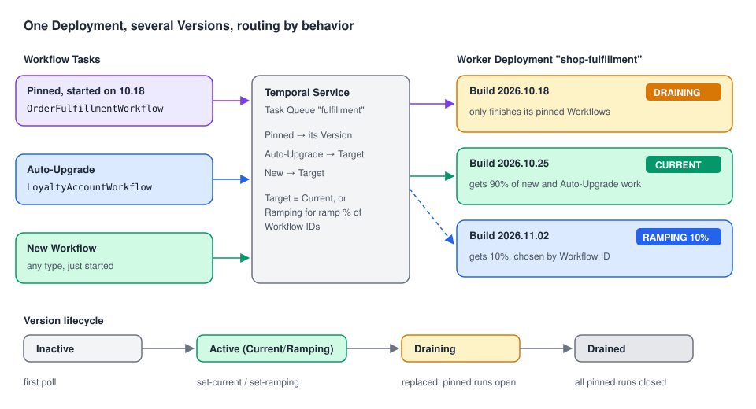

# 11 · Worker Versioning: shipping new Workflow code safely

> **Level:** production · **Read time:** ~20 min
> **Sources:** [Encyclopedia — Worker Versioning](https://docs.temporal.io/worker-versioning) · [Go SDK — Run a versioned Worker](https://docs.temporal.io/develop/go/workers/run-worker-process#run-a-versioned-worker) · [Task Routing — Versioning](https://docs.temporal.io/task-routing)

---

## 1. The problem

`OrderFulfillmentWorkflow` has 3,000 open executions. Some will stay open for weeks, waiting for a
return window to close. You need to change it: add a fraud check before shipping.

If you just deploy the new code, every Worker replays the old histories with the new code. The first
Workflow that reaches the new `ExecuteActivity` call fails its Workflow Tasks with a **non-determinism**
error ([chapter 02](02-tasks.md)). The classic fixes are patching (`workflow.GetVersion`) or a new Task
Queue per version ([chapter 07](07-task-routing.md)). Both work, both are manual.

**Worker Versioning** moves the problem to deployment time: each Worker says which **build** it is, and
the Service routes each Workflow to a build that can run it. Old Workflows can stay on the old build
until they finish; new ones go to the new build.

---

## 2. The vocabulary



| Term | Meaning |
| --- | --- |
| **Worker Deployment** | A logical service grouping similar Workers, named after it (e.g. `shop-fulfillment`). |
| **Worker Deployment Version** | One iteration of it: **deployment name + Build ID** (e.g. `shop-fulfillment` / `2026.10.25-a1b2c3`). All its Workers run the same code build. A Worker reports its Version when it polls. |
| **Current Version** | Where new Workflows (and Auto-Upgrade ones) go. If none is set, they go to **unversioned** Workers. |
| **Ramping Version** | Receives a percentage `[0, 100]` of new and Auto-Upgrade Workflows. The rest go to Current. |
| **Target Version** | The Version a Workflow will move to next: Current or Ramping. Chosen deterministically from the **Workflow ID**, so a Workflow doesn't flip-flop. |

Every Workflow type declares a **Versioning Behavior**:

| Behavior | Guarantee | You must… | Good for |
| --- | --- | --- | --- |
| **Pinned** | Runs **its whole life** on the Version it started on | Keep that Version's Workers running until its Workflows drain | Short and medium Workflows: no patching ever |
| **Auto-Upgrade** | Moves to the Target Version on its next Workflow Task | Keep the code **replay-safe** with patching (`workflow.GetVersion`) | Long-running Workflows (entity Workflows, subscriptions) |

A pinned Workflow can still be moved by an operator with `temporal workflow update-options`
(a Versioning Override).

### Version statuses

| Status | Meaning |
| --- | --- |
| **Inactive** | A Worker with this Version has polled, but it was never Current or Ramping |
| **Active** | It is Current or Ramping: it receives new Workflows |
| **Draining** | No longer Current/Ramping, but pinned Workflows are still open on it. Keep its Workers running |
| **Drained** | All its pinned Workflows are closed. You can shut its Workers down (unless you still need Queries on closed Workflows within the Retention Period) |

The drainage status is refreshed periodically, so "Draining with 0 open Workflows" can show for a short time.

---

## 3. A versioned Worker in Go

```go
// file: fulfillment/workflow.go
package fulfillment

import (
	"context"
	"time"

	"go.temporal.io/sdk/workflow"
)

const TaskQueue = "fulfillment"

type FulfillOrderInput struct {
	OrderID string
	SKU     string
}

type Activities struct{}

func (a *Activities) ReserveStock(ctx context.Context, in FulfillOrderInput) error { return nil }
func (a *Activities) CheckFraud(ctx context.Context, in FulfillOrderInput) error   { return nil }
func (a *Activities) ShipParcel(ctx context.Context, in FulfillOrderInput) error   { return nil }

// OrderFulfillmentWorkflow is short-lived: Pinned, so new code never replays old histories.
func OrderFulfillmentWorkflow(ctx workflow.Context, in FulfillOrderInput) error {
	ctx = workflow.WithActivityOptions(ctx, workflow.ActivityOptions{StartToCloseTimeout: time.Minute})
	var a *Activities
	if err := workflow.ExecuteActivity(ctx, a.ReserveStock, in).Get(ctx, nil); err != nil {
		return err
	}
	// New in build 2026.10.25: no GetVersion patch needed, old runs stay on the old build.
	if err := workflow.ExecuteActivity(ctx, a.CheckFraud, in).Get(ctx, nil); err != nil {
		return err
	}
	return workflow.ExecuteActivity(ctx, a.ShipParcel, in).Get(ctx, nil)
}

// LoyaltyAccountWorkflow lives for years: Auto-Upgrade, so changes are patched.
func LoyaltyAccountWorkflow(ctx workflow.Context, customerID string, points int) (int, error) {
	earned := workflow.GetSignalChannel(ctx, "points-earned")
	for !workflow.GetInfo(ctx).GetContinueAsNewSuggested() {
		var n int
		earned.Receive(ctx, &n)
		// Patch: since build 2026.10.25, points are doubled. Runs that already passed
		// this point on the old build replay with DefaultVersion and keep the old rule.
		if v := workflow.GetVersion(ctx, "double-points", workflow.DefaultVersion, 1); v == 1 {
			n *= 2
		}
		points += n
	}
	return points, workflow.NewContinueAsNewError(ctx, LoyaltyAccountWorkflow, customerID, points)
}
```

```go
// file: cmd/fulfillment-worker/main.go
package main

import (
	"log"
	"os"
	"time"

	"github.com/acme/shop/fulfillment"
	"go.temporal.io/sdk/client"
	"go.temporal.io/sdk/worker"
	"go.temporal.io/sdk/workflow"
)

func main() {
	c, err := client.Dial(client.Options{})
	if err != nil {
		log.Fatalln("unable to create Temporal client:", err)
	}
	defer c.Close()

	w := worker.New(c, fulfillment.TaskQueue, worker.Options{
		WorkerStopTimeout: 30 * time.Second,
		DeploymentOptions: worker.DeploymentOptions{
			UseVersioning: true,
			Version: worker.WorkerDeploymentVersion{
				DeploymentName: "shop-fulfillment",
				BuildID:        os.Getenv("BUILD_ID"), // e.g. set by CI to the image tag
			},
			// Used by every Workflow registered without its own behavior.
			DefaultVersioningBehavior: workflow.VersioningBehaviorPinned,
		},
	})

	w.RegisterWorkflow(fulfillment.OrderFulfillmentWorkflow) // Pinned (the default above)
	w.RegisterWorkflowWithOptions(fulfillment.LoyaltyAccountWorkflow, workflow.RegisterOptions{
		VersioningBehavior: workflow.VersioningBehaviorAutoUpgrade,
	})
	w.RegisterActivity(&fulfillment.Activities{})

	if err := w.Run(worker.InterruptCh()); err != nil {
		log.Fatalln("worker stopped:", err)
	}
}
```

### Configuration mistakes the SDK catches

Checked with Go SDK v1.50.0:

| Configuration | Result |
| --- | --- |
| `DefaultVersioningBehavior` set, `UseVersioning: false` | `worker.New` **panics**: `cannot set both DeploymentOptions.DefaultVersioningBehavior if DeploymentOptions.UseBuildIDForVersioning is false` |
| `UseVersioning: true` + `Version` set, no default, `RegisterWorkflow` without a behavior | `RegisterWorkflow` **panics**: `workflow type does not have a versioning behavior` |
| `UseVersioning: true` **without** a `Version`, no behavior | **No panic.** The Go page says such a registration "fails at registration time" without this condition: the check only runs when `Version` is set |

The deprecated `BuildID` / `UseBuildIDForVersioning` options belong to an older versioning API. Use
`DeploymentOptions` only.

---

## 4. Rolling out a new Version

Deploy the new build **next to** the old one (both sets of Workers polling the same Task Queue), then
tell the Service where new work goes.

### 4.1 With the CLI

```bash
# 1. Deploy Workers with BUILD_ID=2026.10.25-a1b2c3. They poll, the Version appears (Inactive).
temporal worker deployment describe-version \
  --deployment-name shop-fulfillment --build-id 2026.10.25-a1b2c3

# 2. Optional: send 10% of new Workflows to it first.
temporal worker deployment set-ramping-version \
  --deployment-name shop-fulfillment --build-id 2026.10.25-a1b2c3 --percentage 10 --yes

# 3. Make it Current. The previous Version starts Draining.
temporal worker deployment set-current-version \
  --deployment-name shop-fulfillment --build-id 2026.10.25-a1b2c3 --yes

# 4. Watch the old Version until it is Drained, then scale its Workers to zero.
temporal worker deployment describe-version \
  --deployment-name shop-fulfillment --build-id 2026.10.18-9f8e7d
```

`set-ramping-version` and `set-current-version` refuse the change if the new Version's Workers don't poll
all the Task Queues the Deployment expects (override with `--ignore-missing-task-queues`), and
`set-current-version` also refuses a Version with no pollers (`--allow-no-pollers`). That protects you
from routing Workflows to a build that is missing a queue. Both commands ask for confirmation: `--yes`
skips it in CI.

### 4.2 From Go (a deploy pipeline step)

The same operations are on `client.WorkerDeploymentClient()` (marked **experimental** in v1.50.0):

```go
// file: cmd/promote-build/main.go
package main

import (
	"context"
	"flag"
	"log"

	"go.temporal.io/sdk/client"
)

func main() {
	buildID := flag.String("build-id", "", "Build ID to promote")
	ramp := flag.Float64("ramp", 0, "ramp percentage; 0 makes the build Current")
	flag.Parse()

	c, err := client.Dial(client.Options{})
	if err != nil {
		log.Fatalln("unable to create Temporal client:", err)
	}
	defer c.Close()

	ctx := context.Background()
	deployment := c.WorkerDeploymentClient().GetHandle("shop-fulfillment")

	if *ramp > 0 {
		_, err = deployment.SetRampingVersion(ctx, client.WorkerDeploymentSetRampingVersionOptions{
			BuildID:    *buildID,
			Percentage: float32(*ramp),
		})
	} else {
		_, err = deployment.SetCurrentVersion(ctx, client.WorkerDeploymentSetCurrentVersionOptions{
			BuildID: *buildID,
		})
	}
	if err != nil {
		log.Fatalln("promote build:", err)
	}
	log.Printf("build %s promoted (ramp=%.0f%%)", *buildID, *ramp)
}
```

### 4.3 What it looks like (checked on a dev server)

Two builds `v1` and `v2` of one Deployment on one Task Queue, Temporal Server 1.32.0:

| Step | Result |
| --- | --- |
| v1 Workers start, `set-current-version v1` | — |
| Start `order-A` (Pinned) and `order-B` (Auto-Upgrade); both wait for a Signal | Both on v1 |
| v2 Workers start, `set-current-version v2` | v1 shows `DrainageStatus: draining` |
| Start `order-C` (Pinned) | Starts on v2 |
| Signal all three; each runs an Activity that returns its build | `order-A` → **v1**, `order-B` → **v2**, `order-C` → **v2** |

The Pinned Workflow finished on the build it started on. The Auto-Upgrade one moved to v2 at its next
Workflow Task.

---

## 5. Activities, children and Continue-As-New

**Activities** normally start on their Workflow's Version: the pinned Version for a Pinned Workflow,
the Target Version for an Auto-Upgrade one. The exception is **Independent Activities**: Activities sent
to a Task Queue that isn't part of the Workflow's Version (another Deployment, or an unversioned queue).
They run on that queue's own Current or Ramping Version.

New runs and versions (Encyclopedia rules, summarized):

| New run created by… | From a **Pinned** run | From an **Auto-Upgrade** run |
| --- | --- | --- |
| Child Workflow | Inherits the parent's Version **if** the child's Task Queue is in it (first Workflow Task there). A Pinned child stays. An Auto-Upgrade child becomes Auto-Upgrade after that first task | No inheritance: starts on the Current Version |
| Continue-As-New | Inherits the pinned Version (if the Task Queue is in it) | No inheritance |
| Retry | Inherits only if the run itself inherited a pinned Version (child or Continue-As-New of a pinned run) and its Task Queue is in it | No inheritance |
| Cron | Never inherits | Never inherits |

A **pinned Versioning Override** (`update-options`) is inherited the same way, and takes precedence.

---

## 6. Worker Versioning vs other tools

| Tool | When |
| --- | --- |
| **Pinned + Worker Versioning** | Default choice for Workflows that finish in hours or days. No patching. |
| **Auto-Upgrade + `workflow.GetVersion`** | Workflows that live for months, or must pick up fixes. |
| **New Task Queue per version** ([chapter 07](07-task-routing.md)) | Simplest, but you change every caller's Task Queue. |
| **Serverless Workers** ([chapter 12](12-serverless-workers.md)) | Require Worker Versioning: each Version maps to an immutable function or image. |

Worker Sessions ([chapter 08](08-sessions.md)) predate Worker Versioning. The SDK source says they are
"not currently compatible" with the older Build ID versioning (it panics if both are set), and the new
`DeploymentOptions` path doesn't check. Don't combine sessions and versioning without testing it.

---

## 7. Key takeaways

- A **Worker Deployment Version** = deployment name + **Build ID**. Workers report it when they poll.
- **Pinned** Workflows finish on the Version they started on: no patching, but keep old Workers until
  the Version is **Drained**. **Auto-Upgrade** Workflows move forward and need replay-safe code.
- Turn it on with `worker.DeploymentOptions{UseVersioning, Version, DefaultVersioningBehavior}` or per
  Workflow with `workflow.RegisterOptions{VersioningBehavior}`.
- Roll out with `set-ramping-version` then `set-current-version` (CLI or `WorkerDeploymentClient`).
- Next: [Serverless Workers](12-serverless-workers.md), which build on Worker Versioning.
